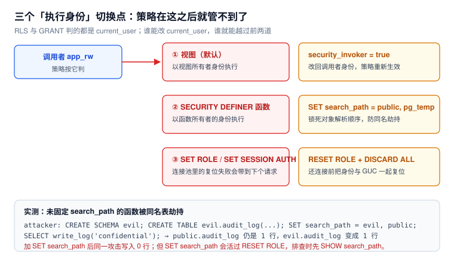

# 越权路径：视图、函数与 search_path

上一页讲了策略怎么写；这一页讲**策略是怎么被绕过去的**。绕过不需要漏洞，只需要一个「换掉执行身份」的入口——而这样的入口在 PostgreSQL 里有三个，且都很常见。



本页判据族 `ESCP-A` ~ `ESCP-H`，共 8 条。定义表在第七节。

## 一、为什么会有「换身份」这回事

`GRANT` 与 RLS 判的都是 `current_user`。而下面三样东西会把 `current_user` 换掉：

| 入口 | 换成谁 | 默认行为 | 开关 |
| --- | --- | --- | --- |
| 视图 | 视图的**所有者** | 默认以所有者执行 | `WITH (security_invoker = true)` |
| `SECURITY DEFINER` 函数 | 函数的**所有者** | 显式声明才生效 | 加 `SET search_path`，并限制 `EXECUTE` |
| `SET ROLE` / 连接池复用 | 另一个角色 | 显式语句或残留 | `RESET ROLE` + `DISCARD ALL` |

这不是设计缺陷：以所有者身份执行，正是「让用户通过函数访问他不该直接访问的表」这一模式的基础。问题在于**默认值站在宽松那一侧**。

## 二、完整复现：一次 `search_path` 劫持

### 场景

`postgres` 建了一张审计表和一支写入函数，函数是 `SECURITY DEFINER`（普通角色没有审计表的写权限），但**没有固定 `search_path`**：

```sql
create table audit_log(msg text, at timestamptz default now());

create function write_log(m text) returns void
  security definer language plpgsql as $$
begin
  insert into audit_log(msg) values (m);   -- 未限定 schema
end $$;

grant execute on function write_log(text) to dev1;
revoke all on audit_log from dev1;
```

### 攻击

```sql
-- 以 dev1 身份（拥有「在自己的 schema 里建对象」的权限）
create schema evil;
create table evil.audit_log(msg text, at timestamptz default now());
set search_path = evil, public;

select write_log('confidential: 员工薪资表已导出');
```

### 结果（本机实测）

| 表 | 行数 | 内容 |
| --- | --- | --- |
| `public.audit_log` | **1**（此前已有 1 行，本次**没有新增**） | — |
| `evil.audit_log` | **1** | `confidential: 员工薪资表已导出` |

函数以 `postgres` 身份执行了 `insert into audit_log`，但**名字是按调用者的 `search_path` 解析的**，于是写进了攻击者的表。审计系统看到的是「一切正常」——真正的审计表一行没多。

### 修复

```sql
create or replace function write_log(m text) returns void
  security definer
  set search_path = public, pg_temp      -- 关键这一行
  language plpgsql as $$
begin
  insert into audit_log(msg) values (m);
end $$;
```

再跑同一段攻击：`public.audit_log` 增加，`evil.audit_log` **不再增加**。

::: danger 两个容易忽略的配套动作
1. **`EXECUTE` 默认对 `PUBLIC` 开放**：本机实测，新建函数的 `proacl` 为空（即默认），`has_function_privilege('app_rw', 'pub_test()', 'EXECUTE')` 返回 **t**。也就是说**任何能连库的账号都能调你的安全定义函数**，除非你显式 `REVOKE EXECUTE ... FROM PUBLIC`。
2. **`SET search_path` 会活过 `RESET ROLE`**：攻击结束后 `RESET ROLE`，会话的 `search_path` 仍是 `evil, public`，后续未限定名的查询继续命中攻击者的表。排查时先 `SHOW search_path`，收尾用 `DISCARD ALL`。
:::

## 三、临时表也能劫持：同一会话内的静默替换

即使 `search_path` 是默认的 `"$user", public`，临时表仍然排在**关系名解析的最前面**：

```sql
-- 以 app_rw 身份
create temp table audit_log(msg text);
select count(*) from audit_log;   -- 0（解析到了临时表）
```

本机实测：真实表有 3 行，同一个会话里建了同名临时表后，未限定名的 `select` 返回 **0 行**。这条不会影响别的会话，但足以让「同一次请求里先建临时表再写审计」的逻辑静默写丢数据。

对策只有一条：**审计与关键写入一律写全限定名**（`public.audit_log`），不要依赖 `search_path`。

## 四、视图绕过：默认以所有者执行

已在 [行级安全](../RowLevelSecurity/index.md) 给过数字，这里只补「为什么」：

```sql
create view v_docs2 as select * from docs2;   -- 由 owner_app 创建
grant select on v_docs2 to app_rw;
```

`app_rw` 查 `docs2` 得到 1 行（策略生效），查 `v_docs2` 得到 **2 行**（视图以 `owner_app` 身份执行，所有者不受策略约束）。

两条修复路径：

| 做法 | 语句 | 适用 |
| --- | --- | --- |
| 让表对所有者也生效 | `alter table docs2 force row level security` | 表的所有者不是超级用户时有效 |
| 让视图回到调用者身份 | `create view ... with (security_invoker = true)` | 视图较多、想逐个控制时 |

::: warning `FORCE` 对超级用户无效
如果表的所有者是 `postgres`（超级用户），`FORCE` 也拦不住——超级用户永远绕过 RLS。所以**业务表的所有者不要是超级用户**，这条比任何策略写法都重要。
:::

## 五、几条「一个授权换一个服务器」的路

| 能力 | 需要的角色 / 权限 | 本机实测报错 |
| --- | --- | --- |
| 读服务器任意文件 | `pg_read_server_files` 或超级用户 | `ERROR: permission denied for function pg_read_file` |
| 在服务器上执行命令 | `pg_execute_server_program` | `Only roles with privileges of the "pg_execute_server_program" role may COPY to or from an external program.` |
| 在大对象里藏可执行内容 | `lo_import` + 相应权限 | 与文件读取同族 |
| 建 schema / 建库 | 数据库级 `CREATE` | `ERROR: permission denied for database postgres` |

第三行那种报错最容易误判：开发者以为是「schema 权限没给」，实际是**数据库级**权限没给。排查时按报错里的对象类型找，不要按语义猜。

## 六、三条自检查询：把绕过入口列出来

```sql
-- ① 所有安全定义函数，以及它们是否固定了 search_path
select n.nspname, p.proname, p.prosecdef, p.proconfig
from pg_proc p join pg_namespace n on n.oid = p.pronamespace
where p.prosecdef
order by (p.proconfig is null) desc, 1, 2;

-- ② 所有视图，以及是否 security_invoker
select schemaname, viewname, viewowner,
       coalesce((regexp_match(definition, 'security_invoker=(true|false)'))[1], '(default: owner)') as invoker
from pg_views where schemaname = 'public';

-- ③ 带 BYPASSRLS 的角色（应当极少）
select rolname from pg_roles where rolbypassrls and rolname !~ '^pg_';
```

第一条查询把「没固定 `search_path` 的安全定义函数」排在最前面（`proconfig is null` 降序），这就是待修清单。

## 七、本页判据

| 编号 | 判据 | 看什么现象 | 不满足时改哪里 |
| --- | --- | --- | --- |
| `ESCP-A` | 所有 `SECURITY DEFINER` 函数都固定了 `search_path` | `pg_proc.proconfig` 非空 | 补 `SET search_path = public, pg_temp` |
| `ESCP-B` | 安全定义函数的 `EXECUTE` 不对 `PUBLIC` 开放 | `proacl` 里没有 `=X/`（PUBLIC 项） | `REVOKE EXECUTE ... FROM PUBLIC` 后按需授予 |
| `ESCP-C` | 视图要么 `security_invoker`，要么表已 `FORCE` | 第四节两种修复至少落一种 | 重建视图或加 `FORCE` |
| `ESCP-D` | 关键写入用全限定名 | 函数体内 `public.xxx` 可见 | 改写函数体；不依赖 `search_path` |
| `ESCP-E` | 业务表所有者不是超级用户 | `pg_class.relowner` 指向专用所有者角色 | `ALTER TABLE ... OWNER TO` |
| `ESCP-F` | 运行账号无文件 / 程序执行能力 | `pg_read_file`、`COPY PROGRAM` 均被拒 | `REVOKE`；排查历史授权 |
| `ESCP-G` | 带 `BYPASSRLS` 的角色有清单与审计 | 查询③可数得出来 | 收回；确需保留的单独审计 |
| `ESCP-H` | 归还连接前 `DISCARD ALL` | 池化场景有对应代码 | 补复位；`RESET ROLE` 不够 |

## 参考资料

- PostgreSQL 18 Documentation：*Writing SECURITY DEFINER Functions Safely*（官方明确要求固定 `search_path`）、*CREATE FUNCTION*
- PostgreSQL 18 Documentation：*CREATE VIEW*（`security_invoker`）、*Row Security Policies*（所有者与超级用户绕过）
- PostgreSQL 18 Documentation：*COPY*（`PROGRAM`）、*Predefined Roles*（`pg_read_server_files`、`pg_execute_server_program`）
- PostgreSQL 18 Documentation：*Schemas*（`pg_temp` 在关系名解析中的位置）
- 本仓库：[行级安全](../RowLevelSecurity/index.md)、[最小权限](../LeastPrivilege/index.md)、[四层结构与五个必失点](../Overview/index.md)
