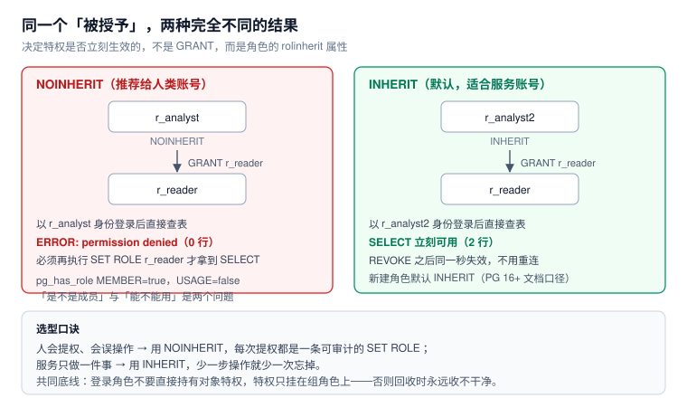

# 角色、继承与 SET ROLE

「我把权限授予他了，为什么还是 `permission denied`？」——这是权限问题里最常见的疑问，答案几乎总是同一个：**授予（membership）与生效（usage）是两件事**，而决定它们之间那一步的，是角色的 `rolinherit` 属性与成员资格上的 `SET` 选项。

本页把这三者的组合讲透，并给出一张「哪种组合适合哪种账号」的选型表。



本页判据族 `ROL-A` ~ `ROL-H`，共 8 条。定义表在第六节。

## 一、先把三种角色分开

很多人把「角色」当成一个东西，实际上至少要分三类，它们的属性要求完全不同：

| 类型 | 典型命名 | 关键属性 | 作用 |
| --- | --- | --- | --- |
| 登录角色 | `svc_order`、`u_zhangsan` | `LOGIN`、`NOSUPERUSER`、`NOBYPASSRLS` | 能被连接使用；**不直接持有对象特权** |
| 组角色（职责角色） | `r_order_read`、`r_order_write` | `NOLOGIN` | 承载对象特权；被授予给登录角色 |
| 对象所有者 | `app_owner`、`migrator` | 通常是 `NOLOGIN` 或专用迁移账号 | 拥有表 / 函数；**决定默认权限与视图执行身份** |

::: tip 为什么要这么分
因为回收的粒度不同：人走了收登录角色，职责变了改组角色，表换了主人改所有者。三者混成一个，回收时就得靠 `REVOKE` 一条条试，永远收不干净。
:::

检查现状：

```sql
select rolname, rolcanlogin, rolinherit, rolsuper, rolbypassrls, rolcreatedb, rolcreaterole
from pg_roles
where rolname !~ '^pg_'
order by rolcanlogin desc, rolname;
```

本机实验环境里跑出来是这样（节选）：

```text
 rolname   | rolcanlogin | rolinherit | rolsuper | rolbypassrls
-----------+-------------+------------+----------+--------------
 app_rw    | t           | t          | f        | f
 owner_app | t           | t          | f        | f
 postgres  | t           | t          | t        | t
 r_reader  | f           | f          | f        | f
 r_writer  | f           | f          | f        | f
```

## 二、`rolinherit`：授予之后，要不要再切一次

```sql
create role r_reader noinherit;
create role r_analyst noinherit;
grant select on t_doc to r_reader;
grant r_reader to r_analyst;
```

以 `r_analyst` 的身份执行：

| 步骤 | 结果 |
| --- | --- |
| `select has_table_privilege('r_analyst','t_doc','SELECT')` | **f** |
| `set role r_analyst; select count(*) from t_doc` | `ERROR: permission denied for table t_doc` |
| `set role r_reader; select count(*) from t_doc` | **2** |

换成 `INHERIT` 的角色（`r_analyst2`）：`has_table_privilege = t`，`set role r_analyst2` 之后直接查出 **2 行**。

::: danger `SET ROLE` 不是「继承的替代品」
`SET ROLE r_analyst` 只是把 `current_user` 换成 `r_analyst`，**不会**顺带把 `r_analyst` 被授予的组角色特权带进来（当它是 `NOINHERIT` 时）。想用 `r_reader` 的特权，必须显式 `SET ROLE r_reader`——这就是「切两层」。
:::

## 三、PG 16 起：三个开关可以分开拨

`pg_auth_members` 里有三个布尔列，对应 `GRANT ... WITH` 的三个选项：

| 列 | 对应语法 | 含义 |
| --- | --- | --- |
| `inherit_option` | `WITH INHERIT TRUE/FALSE` | 这个成员资格的特权是否**自动可用** |
| `set_option` | `WITH SET TRUE/FALSE` | 能不能 `SET ROLE` 到这个角色 |
| `admin_option` | `WITH ADMIN TRUE/FALSE` | 能不能把这个角色再授予别人 |

本机实测的两行（`select member, grp, inherit_option, set_option, admin_option from pg_auth_members ...`）：

```text
  member   |   grp    | inherit_option | set_option | admin_option
-----------+----------+----------------+------------+--------------
 r_analyst | r_reader | t              | f          | f
 r_analyst | r_writer | f              | t          | f
```

四种组合的实际效果（用真实登录角色 `member1` 验证）：

| `inherit` | `set` | 直接查表 | `SET ROLE` 到该角色 | 适用场景 |
| --- | --- | --- | --- | --- |
| `true` | `true` | 可用 | 可以 | 服务账号（默认，最省事） |
| `false` | `true` | 拒绝 | **可以**（提权要显式一步） | 人类账号的日常形态 |
| `false` | `false` | 拒绝 | `ERROR: permission denied to set role "r_reader"` | 只作「成员关系登记」，等审批后再开 `set` |
| `true` | `false` | 可用 | 不可以 | 极少用：给了特权但不允许切换身份 |

第三行那句报错是实测原文——它说明 `set_option = false` 时，连「切过去」这一步都被挡住，不只是「切过去也没用」。

::: warning 超级用户不受这条约束
用 `postgres` 测 `SET ROLE` 永远成功，因为超级用户能切到任何角色。**验证成员选项必须用非超级用户登录**，否则测出来的全是假阳性。
:::

## 四、`pg_has_role` 的两个问法

```sql
select pg_has_role('r_analyst','r_reader','MEMBER');  -- true
select pg_has_role('r_analyst','r_reader','USAGE');   -- false
```

- `MEMBER` 问的是「**是不是成员**」——`GRANT` 过就是 true，与 `inherit` 无关；
- `USAGE` 问的是「**此刻能不能用**」——`NOINHERIT` 且没 `SET ROLE` 时是 false。

写权限检查脚本时：

```sql
-- 错：只查成员关系就断言「有权限」
select pg_has_role('app_rw','r_order_write','MEMBER');   -- true，但可能根本用不上

-- 对：查「此刻能不能用」+ 具体对象特权
select pg_has_role('app_rw','r_order_write','USAGE')
       and has_table_privilege('app_rw','orders','INSERT') as can_insert;
```

## 五、`SET ROLE` 的边界与回收时效

### 三种切换语句

| 语句 | 需要什么 | 切换的是什么 | 典型用途 |
| --- | --- | --- | --- |
| `SET ROLE x` | `set_option` 或超级用户 | `current_user` | 提权做一件事，做完 `RESET ROLE` |
| `SET SESSION AUTHORIZATION x` | 超级用户（或对目标有 `SET` 权限） | `session_user` **与** `current_user` | 极少用；会改掉审计里的「谁」 |
| `RESET ROLE` | 无 | 回到 `session_user` | 连接归还池之前必须做 |

::: danger `RESET ROLE` 不会复位 `search_path`
实测踩过：攻击者 `SET search_path = evil, public` 之后，即使 `RESET ROLE`，后续未限定名的 `select ... from audit_log` 仍然解析到 `evil.audit_log`。排查时先 `SHOW search_path`，归还连接前用 `DISCARD ALL`。
:::

### 回收是「立即」的

```sql
revoke r_reader from r_analyst2;
select has_table_privilege('r_analyst2','t_doc','SELECT');  -- f
```

不需要重连、不需要等会话过期：权限判定发生在**每次执行**时，读的是系统表当前状态。这一点很重要——它意味着「紧急收权」可以立刻生效，不必去杀会话。反过来，**已经缓存的执行计划**也可能因为权限变化而重新规划，所以收权后重跑一次即可确认。

## 六、角色该怎么设计

一套够用又不至于爆炸的结构：

```sql
-- 组角色：按「域 + 动作」两级，动作只有 read / write / admin
create role r_order_read  nologin;
create role r_order_write nologin;
create role r_pay_read    nologin;

-- 写角色继承读角色（写的人必然能读，避免双份授权）
grant r_order_read to r_order_write;

-- 登录角色：服务账号 INHERIT，人类账号 NOINHERIT
create role svc_order login inherit  password '...';
create role u_zhangsan login noinherit password '...';

grant r_order_write to svc_order;
grant r_order_read  to u_zhangsan;

-- 对象特权只授给组角色，永不直接授给登录角色
grant select, insert, update on orders to r_order_write;
```

四条纪律：

1. **登录角色不直接持有对象特权**——否则回收组角色时，那条直接授权还在。
2. **写角色继承读角色**，不要在每张表上 `GRANT SELECT` 给两个角色。
3. **人类账号用 `NOINHERIT`**：每次提权都是一条可审计的 `SET ROLE`，误操作面小。
4. **禁止共享登录角色**：`svc_*` 一个服务一个，`u_*` 一人一个。共享账号会让审计里的「谁」退化成「某个服务」。

## 七、本页判据

| 编号 | 判据 | 看什么现象 | 不满足时改哪里 |
| --- | --- | --- | --- |
| `ROL-A` | 登录角色与组角色分离命名 | `r_*` 全为 `NOLOGIN`，`u_*` / `svc_*` 全为 `LOGIN` | 按命名规范重命名（`ALTER ROLE ... RENAME`） |
| `ROL-B` | 登录角色不直接持有表特权 | 展开 `relacl` 后 grantee 只有 `r_*` | `REVOKE` 直接授权，改授组角色 |
| `ROL-C` | 人类账号 `NOINHERIT` | `pg_roles.rolinherit = f` | `ALTER ROLE u_xxx NOINHERIT` |
| `ROL-D` | 服务账号 `INHERIT` 且不共享 | 一服务一账号，`rolinherit = t` | 拆账号；共享账号无法归因 |
| `ROL-E` | 成员选项被显式设定 | `pg_auth_members` 的 `inherit_option` / `set_option` 有明确取值 | 用 `GRANT ... WITH INHERIT/SET` 明确表达 |
| `ROL-F` | 权限检查用 `USAGE` 而非 `MEMBER` | 检查脚本里出现 `pg_has_role(...,'USAGE')` | 改写检查逻辑 |
| `ROL-G` | 收权后能给出「已失效」的证据 | `has_table_privilege` 从 t 变 f | 补一条收权后的验证查询 |
| `ROL-H` | 归还连接前复位身份 | 池化场景有 `RESET ROLE` + `DISCARD ALL` | 见 [连接池](../ConnectionPool/index.md) 的复位契约 |

## 参考资料

- PostgreSQL 18 Documentation：*CREATE ROLE*（`INHERIT` / `NOINHERIT`、`LOGIN`）、*GRANT*（角色成员资格与 `WITH INHERIT` / `SET` / `ADMIN`）、*SET ROLE*、*SET SESSION AUTHORIZATION*
- PostgreSQL 16 Release Notes：角色成员资格的三个独立选项
- PostgreSQL 系统视图：`pg_roles`、`pg_auth_members`、`pg_has_role()`、`has_table_privilege()`
- 本仓库：[四层结构与五个必失点](../Overview/index.md)、[最小权限](../LeastPrivilege/index.md)、[权限生命周期](../Lifecycle/index.md)
