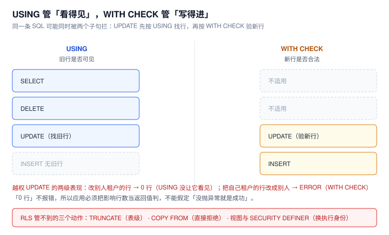

# 行级安全：策略的写法与边界

行级安全（Row-Level Security，RLS）是数据库层唯一能表达「同一个账号，只能看到一部分行」的机制。它的语法很短，短到让人以为配完就完事；但它的**边界**很长：`ENABLE` 与 `FORCE` 差一个词，视图与函数就能绕过去；策略里写 `current_setting` 还是写子查询，执行计划能差 70 倍。



本页判据族 `RLS-A` ~ `RLS-H`，共 8 条。定义表在第八节。

## 一、最小可用示例

```sql
create table orders(
  id        int primary key,
  tenant_id text not null,
  amount    numeric(12,2)
);

alter table orders enable row level security;

create policy p_tenant on orders
  using      (tenant_id = current_setting('app.tenant_id', true))
  with check (tenant_id = current_setting('app.tenant_id', true));
```

使用方在每次事务里设置上下文：

```sql
begin;
select set_config('app.tenant_id', 'acme', true);   -- true = 仅本事务
select * from orders;                                -- 只有 acme 的行
commit;
```

本机实测（3 行数据：acme 2 行、globex 1 行）：

| 场景 | 返回 | 说明 |
| --- | --- | --- |
| 未设上下文 | **0 行** | `current_setting(..., true)` 返回 `null`，比较为 `null`，策略不通过 |
| 上下文 `acme` | **2 行** | 正常 |
| 上下文设成空串 | **0 行** | 空串不等于任何 `tenant_id`，仍然安全 |

::: danger 空串不是 `null`，别用 `is null` 判「有没有设」
本机实测：`SET LOCAL app.tenant_id = 'acme'` 在事务结束后，`current_setting('app.tenant_id', true)` 返回的是**空串**而非 `null`（因为参数已经被「设置过」，回滚只是回到上一个值，即「已定义但为空」）。

所以这段常见写法是错的：

```sql
-- 错：复位之后这里是空串，不是 null，判不出来
using (tenant_id = coalesce(current_setting('app.tenant_id', true), '__none__'))
```

正确的做法是把空串也当成「没有上下文」：

```sql
using (tenant_id = nullif(current_setting('app.tenant_id', true), ''))
```

「空串」在策略里是安全的（匹配不到任何行），但**在应用逻辑里是危险的**：`if (tenant == null) throw` 拦不住空串，代码会带着空租户一路往下跑。
:::

## 二、`USING` 与 `WITH CHECK` 不是一回事

| 子句 | 管什么 | 作用于哪些命令 |
| --- | --- | --- |
| `USING` | **旧行**可不可见 | `SELECT`、`UPDATE`、`DELETE` |
| `WITH CHECK` | **新行**合不合法 | `INSERT`、`UPDATE` |

同一个 `UPDATE` 会被两道闸门依次检查：先用 `USING` 找到「你能改哪些行」，再用 `WITH CHECK` 验「改完的行还合不合法」。本机实测两种越权的表现完全不同：

```sql
-- 以 app_rw 身份、上下文 acme
update orders set amount = 1 where id = 3;          -- globex 的行
-- UPDATE 0（不报错，就是没改到）

update orders set tenant_id = 'globex' where id = 1; -- 自己的行改成别人
-- ERROR:  new row violates row-level security policy for table "orders"
```

::: danger 「0 行」是最容易被忽略的失败
第一条不抛异常，只是影响 0 行。应用如果写成「没抛异常就是成功」，就会把「越权被静默拒绝」当成「更新成功」，返回 200 给用户。

**必须把影响行数当返回值判**：`UPDATE ... ` 返回 0 时，要么是「本来就不存在」，要么是「不可见」——两者对用户是两个完全不同的结论。
:::

## 三、`ENABLE` 与 `FORCE`：差一个词，差一个租户

默认行为下，**表的所有者不受策略约束**（策略是给「别人」定的）。加上 `FORCE` 之后，所有者也要遵守。

本机实测（表所有者 `owner_app`，查询者 `app_rw`，数据是 acme 1 行 + globex 1 行）：

| 配置 | `app_rw` 直查表 | `app_rw` 查默认视图 |
| --- | --- | --- |
| 只 `ENABLE` | 1 行 | **2 行**（视图以所有者身份执行，所有者绕过策略） |
| `ENABLE` + `FORCE` | 1 行 | 1 行 |
| `ENABLE` + 视图 `security_invoker = true` | 1 行 | 1 行 |

两个绕过通道都要堵：

```sql
alter table orders force row level security;               -- 堵所有者
create view v_orders with (security_invoker = true) as     -- 堵视图
  select * from orders;
```

::: warning 超级用户与 `BYPASSRLS` 永远不受约束
`FORCE` 只对「普通所有者」有效。超级用户，以及带 `BYPASSRLS` 属性的角色，永远看到全部行：

```sql
create role svc_etl login password 'etl' bypassrls;
grant select on big to svc_etl;
set role svc_etl;
select count(*) from big;   -- 500000（策略形同虚设）
```

所以**带 `BYPASSRLS` 的角色必须单独审计**：它的每一次查询都应该进日志，且不允许出现在业务应用里。
:::

## 四、策略的组合：permissive 是「或」，restrictive 是「与」

默认每条策略都是 `PERMISSIVE`，多条之间取**并集**；`AS RESTRICTIVE` 的策略之间取**交集**，并与并集结果再取交集。

本机实测（4 行：acme/u1、acme/u2、globex/u1、globex/u2）：

```sql
create policy p_tenant on p3 for select using (tenant_id = current_setting('app.tenant_id', true));
create policy p_owner  on p3 for select using (owner     = current_setting('app.uid', true));
-- 上下文 acme + u1：可见 {1,2,3}
```

再加一条限制性策略：

```sql
create policy p_only_globex on p3 as restrictive for select using (tenant_id = 'globex');
-- 上下文 acme + u1：可见 {3}
```

`{1,2,3}` 与 `{3}` 的差别就是「或」与「与」。**用错方向会造成两种事故**：把该限制的写成 permissive → 策略越加越宽；把该放宽的写成 restrictive → 永远只有 0 行。

一条排查用查询：

```sql
select schemaname, tablename, policyname, permissive, roles, cmd, qual, with_check
from pg_policies
where schemaname = 'public'
order by tablename, policyname;
```

## 五、性能：策略写在 `WHERE` 里还是写成子查询，差 70 倍

策略的谓词会被内联进执行计划。写成「与列直接比较」时，它能下推到索引；写成子查询时，它可能退化成全表扫描。

本机实测（`big` 表 50 万行、50 个租户、`tenant_id` 上有索引，查询「本租户计数」）：

| 策略写法 | 查询是否带租户条件 | 计划 | 耗时 |
| --- | --- | --- | --- |
| `tenant_id = current_setting('app.tenant_id', true)` | 不带 | `Bitmap Index Scan`（`Index Cond` 就是策略谓词） | **8.35 ms** |
| 同上 | 带 `where tenant_id='t7'` | `Bitmap Index Scan` + `One-Time Filter` | 6.21 ms |
| `exists (select 1 from membership ...)` | 不带 | **`Seq Scan` + `Rows Removed by Filter: 490000`** | **1,323.59 ms** |
| 同上 | 带 `where tenant_id='t7'` | `Bitmap Index Scan` + `Filter` | 18.08 ms |

三个结论：

1. **`current_setting(..., true)` 是可以下推的**——第二参为 `true` 时它是稳定表达式，规划器能当索引用。这一点与「RLS 一定慢」的传言相反。
2. **子查询型策略把选择率的责任交给了查询本身**：不带租户条件时退化成全表扫描，50 万行里丢掉 49 万行，耗时 **73 倍**。
3. 子查询型策略里引用的表（这里是 `membership`）**必须给调用者 `SELECT` 权限**，否则会报 `permission denied for table membership`——报错指向的是策略里的表，不是被查的表，很容易查错方向。

::: tip 结论不是「别用子查询策略」
成员表驱动的策略（一个用户属于多个租户）是真实需求。正确的做法是：**策略保留子查询，但所有业务查询强制带租户条件**，并把「查询必须带 `tenant_id`」写进代码评审清单。
:::

## 六、RLS 管不到的三个动作

| 动作 | 行为 | 应对 |
| --- | --- | --- |
| `TRUNCATE` | **不受策略约束**，清空全表 | 不授予 `TRUNCATE`（唯一办法） |
| `COPY ... FROM` | **直接拒绝**：`COPY FROM not supported with row-level security` | 改 `INSERT ... SELECT`，或先灌临时表再过一遍 |
| 视图 / `SECURITY DEFINER` 函数 | 换执行身份，绕过策略 | `security_invoker` / `FORCE` / 固定 `search_path` |

前两条是「策略管不了」，第三条是「策略被绕开」。三者合起来，就是「开了 RLS ≠ 隔离完成」的全部原因。

## 七、多租户的标准写法

把上下文注入放进**事务的第一条语句**，并保证连接池复位：

```sql
begin;
-- ① 注入上下文（true = 事务级，提交/回滚即失效）
select set_config('app.tenant_id', $1, true);
select set_config('app.user_id',   $2, true);

-- ② 业务语句
select id, amount from orders where tenant_id = $1;

commit;
```

三条纪律：

1. **必须 `true`**：`false` 会把上下文留在会话上，池复用时就串租户了。
2. **必须在事务里**：autocommit 下 `set_config(..., true)` 会在语句结束时被丢弃，下一条语句读到空值——本机实测确认，且**不报错**。
3. **归还前 `DISCARD ALL`**：`RESET ROLE` 不会清 `search_path`，两者要一起做。

## 八、本页判据

| 编号 | 判据 | 看什么现象 | 不满足时改哪里 |
| --- | --- | --- | --- |
| `RLS-A` | 每张含租户列的表都开了 RLS | `pg_class.relrowsecurity = true` | `ALTER TABLE ... ENABLE ROW LEVEL SECURITY` |
| `RLS-B` | 同一批表都加了 `FORCE` | `relforcerowsecurity = true` | `ALTER TABLE ... FORCE ROW LEVEL SECURITY` |
| `RLS-C` | `SELECT` / `INSERT` / `UPDATE` 各有对应策略 | `pg_policies` 里 `cmd` 覆盖三类 | 补策略；只写 `USING` 会漏掉 `INSERT` |
| `RLS-D` | 上下文取值用 `nullif(...,'')` | 策略表达式里没有裸 `current_setting` | 改写表达式 |
| `RLS-E` | 应用按影响行数判成败 | `UPDATE` 返回 0 时有明确分支 | 改代码；不要只看异常 |
| `RLS-F` | 策略谓词可下推（或查询强制带租户条件） | `EXPLAIN` 无 `Seq Scan` | 简化谓词或强制查询条件 |
| `RLS-G` | 视图全部 `security_invoker` 或表已 `FORCE` | `pg_views` 里 `security_invoker` 为 on | 重建视图或加 `FORCE` |
| `RLS-H` | 应用账号无 `TRUNCATE` | `has_table_privilege(...,'TRUNCATE') = false` | `REVOKE TRUNCATE` |

## 与「多租户 SaaS 架构」的分工（第 195 天补充）

| 那边（专题）回答 | 本页回答 |
| --- | --- |
| 同一套策略在「租户」这个维度上的**工程用法**：上下文取值、缓存键、异步链路 | 策略本身的语法、`USING` 与 `WITH CHECK` 的边界、`FORCE` 的必要性 |
| 大租户（占 40% 数据）的点查 4.723 ms 对小租户 0.049 ms（96 倍） | 策略对**同规模数据**的执行计划影响（本页实测 0.049 对 0.054 ms） |
| 三档隔离各自的成本与迁移路径 | 行级策略这一档在库层怎么落地 |

**本页独有的一个坑**：策略里包函数会让条件**下推不进 `Index Cond`**。本页示例里的写法 `tenant_id = current_setting(...)` 之所以能走索引，是因为它是内联表达式；一旦包成 `tenant_id = current_tenant()` 且函数没标 `STABLE`，计划里就只剩 `Filter`，扫描量从 471 行变成 50 万行。判断方法只有一条：看 `EXPLAIN` 的 `Index Cond` 里有没有那段表达式。

专题详见 [多租户 SaaS 架构](../../../Backend/MultiTenantSaaS/index.md) 的 [租户上下文](../../../Backend/MultiTenantSaaS/TenantContext/index.md)。


## 参考资料

- PostgreSQL 18 Documentation：*Row Security Policies*（`USING` / `WITH CHECK`、`PERMISSIVE` / `RESTRICTIVE`、所有者与 `FORCE`、`BYPASSRLS`）
- PostgreSQL 18 Documentation：*CREATE POLICY*、*ALTER TABLE ... ENABLE ROW LEVEL SECURITY*、*CREATE VIEW*（`security_invoker`）
- PostgreSQL 18 Documentation：*COPY*（`COPY FROM` 与 RLS 的限制）
- 本仓库：[四层结构与五个必失点](../Overview/index.md)、[越权路径](../PrivilegeEscalation/index.md)、[连接池的会话复位](../../ConnectionPool/TransactionBoundary/index.md)
- 本仓库项目侧：[TeamBoard 连接池串租户复现](../../../../project/Complete/TeamBoard/PoolTenantLeak/index.md)（同一机制的故障复现）
