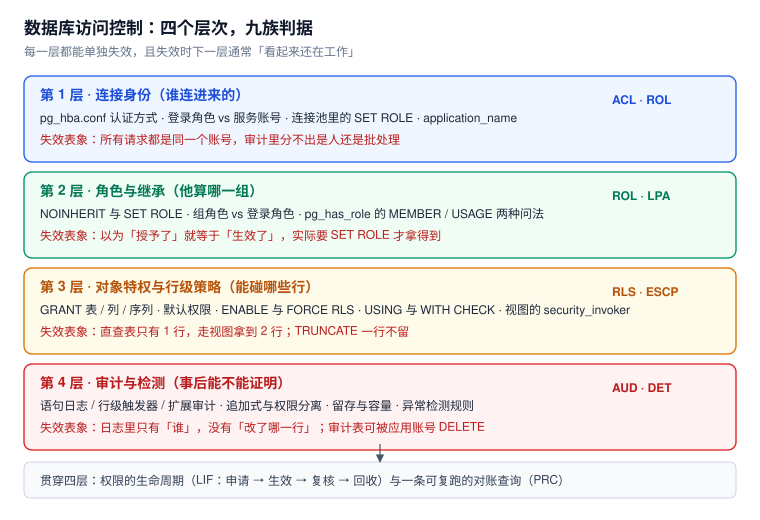

# 数据库访问控制与审计

「数据库权限」听起来是一件配置工作：建几个角色、`GRANT` 几下、上线。但真实的失效都不在配置那一刻，而在**配置与执行之间的缝里**：同一个账号，直查表只能看到自己租户的 1 行，走一个视图就拿到 2 行；`RLS` 明明开了，一句 `TRUNCATE` 把全部租户的数据清空；审计看起来开着，出事时才发现日志只记到「谁发了这条 SQL」，没记「改了哪一行」。

本专题讲的是这四层（连接身份 → 角色继承 → 对象特权与行策略 → 审计与检测）各自的判定规则、**在哪儿会静默失效**，以及怎么用一条可复跑的查询把它们对平。

::: tip 一句话理解
数据库权限不是「能不能进这个门」，而是**「以什么身份、对哪些行、能做什么，以及这事有没有留下证据」**——四件事里任何一件缺席，另外三件都会给你一个「看起来正常」的假象。
:::

::: info 本专题与相邻专题的分工
本专题只回答「**数据库这一层**怎么判权、怎么留证」。十处最容易混淆的邻居，边界一次写死：

| 相邻专题 | 那边回答什么 | 本专题回答什么 |
| --- | --- | --- |
| [PostgreSQL](../Relational/PostgreSQL/index.md) | 安装、参数、日常运维与 SQL 用法（`CREATE POLICY` 只有一句示例） | 策略的判定顺序、`FORCE` 的边界、策略对执行计划的真实影响 |
| [应用层授权](../../Backend/Auth/Authorization/index.md) | 应用里的 RBAC / ABAC、接口级鉴权、Token 声明 | 即使应用层判错，**库层还能不能兜住** |
| [安全加固与审计检测](../../Ops/SecurityHardening/AuditDetection/index.md) | 主机与网络层审计、日志集中、入侵检测告警 | 库内语句日志与行级审计表怎么写、怎么防篡改、成本多少 |
| [密钥与凭据治理](../../Ops/SecurityHardening/SecretGovernance/index.md) | 密码、Token、证书的存放与轮换 | 角色密码与 `pg_hba` 认证方式在库侧怎么落 |
| [连接治理](../Middleware/ConnectionGovernance/index.md) | 连接数预算、连接风暴的值班处置 | 池化之后**连接身份与会话上下文**怎么复位 |
| [连接池与连接生命周期](../ConnectionPool/index.md) | 借还路径、池的数学、泄漏定位 | 池里的 `SET ROLE` / `SET LOCAL` 残留会造成什么越权 |
| [在线 Schema 演进](../SchemaEvolution/index.md) | 改表的重写边界、锁队列、回填 | 新增表 / 新增列时，权限与默认权限怎么跟着走 |
| [数据治理](../DataGovernance/index.md) | 数据分级、元数据、血缘、质量 | 分级结果怎么翻译成**可执行的授权** |
| [TeamBoard 多租户](../../../project/Complete/TeamBoard/MultiTenancy/index.md) | 项目侧的租户隔离落地（含 RLS 一段） | 机制层的为什么：策略、身份、绕过路径 |
| [TeamBoard 跨租户矩阵](../../../project/Complete/TeamBoard/CrossTenantMatrix/index.md) | 项目侧的越权用例矩阵 | 每条用例背后的库层判定规则 |
:::

## 目录

- [四层结构与五个必失点](Overview/index.md)
- [角色、继承与 SET ROLE](RoleModel/index.md)
- [最小权限：从 GRANT 到默认权限](LeastPrivilege/index.md)
- [行级安全：策略的写法与边界](RowLevelSecurity/index.md)
- [越权路径：视图、函数与 search_path](PrivilegeEscalation/index.md)
- [审计：三种位置与各自的成本](AuditTrail/index.md)
- [权限生命周期：申请、复核与回收](Lifecycle/index.md)
- [异常访问检测与处置](Detection/index.md)
- [实战：一套可验收的权限基线](Practice/index.md)
- [常见问题与分诊](FAQ/index.md)

## 专题地图

## 判据纪律

沿用全库写法：**每页 8 条，编号形如 `ACL-A`**，逐页前缀唯一，可被 `utils/audit` 下的判据类巡检机械核对。每条判据都要能回答三件事：**看什么现象、判成什么、不满足时改哪里**。

| 页 | 判据族 | 条数 | 这一族管什么 |
| --- | --- | --- | --- |
| 四层结构与必失点 | `ACL-A` ~ `ACL-H` | 8 | 四层判定顺序、五个必失点、归属判断 |
| 角色与继承 | `ROL-A` ~ `ROL-H` | 8 | INHERIT / NOINHERIT、`SET ROLE`、`pg_has_role` 两种问法、回收时效 |
| 最小权限 | `LPA-A` ~ `LPA-H` | 8 | schema USAGE、列级授权、默认权限、迁移账号、只读路径 |
| 行级安全 | `RLS-A` ~ `RLS-H` | 8 | `USING` / `WITH CHECK`、`FORCE`、上下文取值、策略组合、性能 |
| 越权路径 | `ESCP-A` ~ `ESCP-H` | 8 | 视图、安全定义函数、`search_path`、危险预定义角色、`TRUNCATE` |
| 审计 | `AUD-A` ~ `AUD-H` | 8 | 三种位置、字段口径、追加式、权限分离、容量与留存 |
| 生命周期 | `LIF-A` ~ `LIF-H` | 8 | 申请留痕、期限、复核对账、孤儿账号、回收 |
| 异常检测 | `DET-A` ~ `DET-H` | 8 | 信号源、四类规则、阈值、处置顺序、误报治理 |
| 实战 | `PRC-A` ~ `PRC-H` | 8 | 角色清单、策略全集、验收序列、故意失败 |
| 常见问题 | `ACQ-A` ~ `ACQ-H` | 8 | 症状分诊、自查清单、常见错误建议 |

合计 **10 族 80 条**。

## 事实与版本速览（2026-10 核对）

| 项 | 现状 | 对本专题的影响 |
| --- | --- | --- |
| PostgreSQL | 18.x（本机实测 **18.6**） | 本文所有 SQL 与读数都在 18.6 上跑过 |
| `public` schema 的 `CREATE` | 自 **PostgreSQL 15** 起不再默认授予 `PUBLIC` | 新建角色在 `public` 建表会直接 `permission denied for schema public`——老教程里的「默认可建表」已失效 |
| 视图的 `security_invoker` | 自 **PostgreSQL 15** 起可用 | 默认视图以**所有者**身份执行；需要 `WITH (security_invoker = true)` 才回到调用者身份 |
| 角色成员资格选项 | 自 **PostgreSQL 16** 起可写 `GRANT ... WITH INHERIT TRUE/FALSE, SET TRUE/FALSE` | 「是不是成员」与「能不能立刻用」终于能在一条语句里分开表达 |
| `MAINTAIN` 权限 | 自 **PostgreSQL 17** 起引入（覆盖 `VACUUM` / `ANALYZE` / `REINDEX` 等） | 想给运维开「维护但不可读」，不必再给 `pg_maintain` 这种全库级角色 |
| 预定义角色 | `pg_read_all_data` / `pg_write_all_data` / `pg_maintain` 均存在（本机核实 3/3） | 它们是**全库级**的，别拿来做租户隔离；只在「整库只读副本」这类场景用 |
| `pgaudit` 扩展 | **不在**本机 `postgres:18` 镜像的 `pg_available_extensions` 里 | 「开个扩展就有审计」不成立，先确认装得上，再谈类目 |
| `log_statement` 体积 | 本机 csvlog 实测 **约 218 字节/条** | 1000 语句/秒 ≈ **18.8 GB/天**，全量开是有容量代价的 |

::: warning 关于「实测」的诚实标注
本专题的数字分两类，正文逐处标注：

- **本机可复跑**：PostgreSQL **18.6** 容器（`docker run postgres:18`），macOS x64 + Docker Desktop。所有 `psql` 命令都写在页面里，**脚本本身不入库**。用途是比较不同写法的量级差，不是生产绝对值。
- **文档口径**：版本特性、默认行为以 PostgreSQL 官方文档为准，逐条标了引入版本；凡属推算（容量、留存）一律写「算例」。

三处必须说清的局限：① 本机读数是单机空载，**并发下的策略开销**会随计划形态变化，不要直接当 SLA；② 行级审计的开销只测了 `INSERT`（20,000 行），`UPDATE` / `DELETE` 的放大倍数不同；③ 本专题以 PostgreSQL 为主，MySQL 的 `DEFINER` / `SQL SECURITY` 与 Oracle 的 VPD 只在对照处出现，**未做 MySQL 侧实测**。
:::

## 三条底线

1. **应用账号不得持有 DDL 与 `TRUNCATE`**：`TRUNCATE` 是表级动作，`RLS` 管不到它；本机实测应用账号一句 `TRUNCATE docs2` 就把两个租户的数据一起清空，而这个账号的策略明明配好了。
2. **行级策略必须 `FORCE`，否则等于只防了「非所有者」**：表所有者默认绕过策略，视图与安全定义函数又都以所有者身份执行——两件事叠起来，「开了 RLS」和「真隔离」之间差了整整一个租户。
3. **审计与业务权限必须分离**：审计表只能 `INSERT` + `SELECT`，且执行写审计的角色不能是应用角色；否则攻击者拿到应用账号的第一件事就是删证据。

## 参考资料

- PostgreSQL 18 Documentation：*Client Authentication*（`pg_hba.conf`）、*Roles and Privileges*（`CREATE ROLE`、`GRANT`、预定义角色）、*Row Security Policies*（`USING` / `WITH CHECK` / `FORCE`）、*CREATE VIEW*（`security_invoker`）、*CREATE FUNCTION*（`SECURITY DEFINER` 与 `search_path`）
- PostgreSQL Release Notes：15（`public` schema 权限、`security_invoker`）、16（`GRANT ... WITH INHERIT`）、17（`MAINTAIN`）、18（本机基线）
- PostgreSQL Wiki：*Row Level Security*、*Security* 分类下的 *Revoking CREATE on public*
- pgaudit 官方仓库 README：审计类目（`READ` / `WRITE` / `DDL` / `ROLE` / `FUNCTION`）与 `pgaudit.log_catalog` 的行为
- 本仓库相邻专题：[PostgreSQL](../Relational/PostgreSQL/index.md)、[连接池与连接生命周期](../ConnectionPool/index.md)、[在线 Schema 演进](../SchemaEvolution/index.md)、[安全加固与审计检测](../../Ops/SecurityHardening/AuditDetection/index.md)
