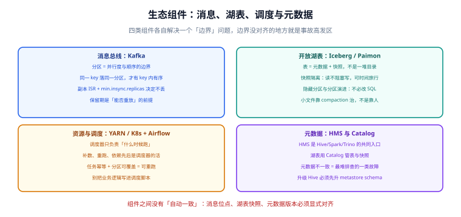

# 生态组件：消息、湖表与调度

计算引擎只负责「算」。链路上还有三类组件在承担各自的边界职责：**消息总线**负责搬运与缓冲，**开放湖表**负责把存储变成有语义的表，**调度与元数据**负责让这一切按顺序发生、并说清楚每份数据是什么。

这一页讲这三类组件的边界与配置判据——它们的配置错误通常**不报错**，而是以「数据看着对但口径不对」的形式出现。



## 消息总线：Kafka 作为数据链路的主动脉

当 Kafka 的角色从「业务异步解耦」变成「数据总线」时，关注点会变：不再只看消息是否投递成功，而是看**能不能重放、能不能扩展并行度、顺序有没有保证**。

### 三个必须先定死的参数

| 参数 | 决定什么 | 定错的后果 |
| --- | --- | --- |
| **分区数（partitions）** | 消费并行度的上限 | 分区太少 → 加消费者也没用；分区太多 → 元数据与文件句柄压力 |
| **分区键（key）** | 顺序保证的范围 | 用随机键 → 同一实体的变更可能乱序 |
| **保留期（retention）** | 能回溯多远 | 保留期比「发现数据问题的平均时间」短 → 想重算时数据没了 |

::: tip 一条实用判据
**分区数按「峰值吞吐 ÷ 单消费者吞吐」估，再 ×1.5 留余量**。分区数只能增加（且会增加不能减少），所以宁可略微保守。
**保留期按「最慢的那个下游的重跑周期」定**：如果下游每周才跑一次全量校准，保留 1 天就等于放弃了重放能力。
:::

### 顺序：只保证「同分区内有序」

这是最容易出错的一条语义。Kafka **只保证同一分区内的消息有序**，跨分区无任何顺序保证。因此：

```properties
# 生产者侧：key 决定分区，同一 key 必落同一分区
# 关键配置（以 kafka 官方客户端为例）
acks=all                          # 等所有 ISR 确认，配合 min.insync.replicas 才不丢
enable.idempotence=true           # 生产者幂等：重试不会产生重复
max.in.flight.requests.per.connection=5   # 开幂等后允许 5，重试仍保序
compression.type=zstd             # 压缩省带宽与磁盘
```

```properties
# 主题侧（broker 配置或建主题时指定）
# 副本数 3 + 最小同步副本 2：容忍 1 个 broker 故障且不丢已确认消息
replication.factor=3
min.insync.replicas=2
```

::: danger 注意
`acks=all` 单独使用**并不保证不丢**。真正的条件是 `acks=all` **且** `min.insync.replicas >= 2`：如果 ISR 只剩 1 个副本（其他副本掉线），`acks=all` 也只等这 1 个副本确认，此时该副本故障就丢数据。两个参数必须成对配置。
:::

### 位点（offset）与重放

| 消费起点 | 语义 | 适用 |
| --- | --- | --- |
| `earliest` | 从最早可见位点开始 | 首次全量初始化（注意会重放全部历史） |
| `latest` | 从最新位点开始 | 只关心新数据 |
| 指定位点 / 时间戳 | 从某一点开始 | **补数**：重新消费某段时间的数据 |

重放的能力取决于两件事：**保留期还没过期**，以及**下游写入是幂等的**。后者往往是瓶颈——重放时如果没有幂等键，就会产生重复。

## 开放湖表：Iceberg / Paimon

湖表解决的问题是：**让对象存储上的文件具备表的语义**（事务、快照、Schema 演进、分区演进），从而让批与流读写同一份数据。

### 核心：表不是目录，表是元数据 + 快照

| 概念 | 含义 | 带来的能力 |
| --- | --- | --- |
| 元数据（metadata） | 表结构、分区规范、快照列表 | Schema 演进、分区演进 |
| 快照（snapshot） | 某一时刻「数据文件清单」的不可变列表 | 快照隔离、时间旅行、增量读 |
| Manifest | 快照内部的文件清单（分层组织） | 让「列清单」比「列目录」快得多 |
| Catalog | 表 → 当前元数据文件的映射 | 多引擎共用同一份表定义 |

### 与「Hive 表 + HDFS 目录」的本质区别

| 维度 | Hive 表（目录即数据） | 湖表（快照即状态） |
| --- | --- | --- |
| 写完什么时候可见 | 文件落盘即可见（可能读到一半的数据） | 提交后才可见（原子性） |
| 并发写 | 靠分区隔离，冲突即覆盖 | 乐观并发 + 冲突检测 |
| 改分区方式 | 必须重写历史数据 | 分区演进，历史数据不动 |
| 读一致性 | 无（读到哪个文件算哪个） | 快照隔离 |
| 小文件 | 需要人工或定时合并 | 支持 compaction（自动或定时） |

```sql
-- Spark SQL 中创建 Iceberg 表（隐藏分区：查询无需知道分区列）
CREATE TABLE IF NOT EXISTS lake.dwd_orders (
    order_id   STRING,
    shop_id    STRING,
    amount     DECIMAL(18,2),
    event_time TIMESTAMP
)
USING iceberg
PARTITIONED BY (days(event_time))       -- 隐藏分区：写入自动按天切
TBLPROPERTIES (
    'format-version' = '2',
    'write.target-file-size-bytes' = '134217728',
    'write.distribution-mode' = 'hash'
);
```

```sql
-- 快照与时间旅行：把「昨天 10 点的时候这张表长什么样」变成一个可执行查询
SELECT * FROM lake.dwd_orders.snapshots ORDER BY committed_at DESC LIMIT 5;
SELECT COUNT(*) FROM lake.dwd_orders VERSION AS OF 1234567890123456789;
SELECT COUNT(*) FROM lake.dwd_orders TIMESTAMP AS OF '2026-10-11 10:00:00';
```

::: warning 说明
**湖表不自动解决小文件问题**。流式写入（每次检查点提交一次）会持续产生小文件，必须配套 compaction：

- 定时任务做全量 compaction（批处理时段执行，成本可控）；
- 或开启自动 compaction（`Paimon` 与 `Iceberg` 1.4+ 都支持），代价是占用一些写资源。

判据是「**单个数据文件平均大小 ≥ 目标大小的一半**」。低于这个值就说明文件名副其实地碎了。
:::

## 调度与元数据：让链路自己跑起来

### 调度器管什么、不管什么

| 调度器负责 | 调度器不负责 |
| --- | --- |
| 什么时候跑（时间/依赖触发） | 数据怎么算（那是 SQL 与引擎的事） |
| 依赖顺序（A 完成后跑 B） | 数据质量判定（虽然可以在 DAG 里加校验任务） |
| 失败重试与告警 | 资源分配（YARN/K8s 负责） |
| 补数与回填 | 业务口径定义 |

**一条硬纪律：调度脚本里只放「调用」，不放业务逻辑。** 业务逻辑写在 SQL 或引擎代码里，调度器只负责按顺序触发。否则会出现「同一段口径在调度脚本和 SQL 里各有一份」——这正是口径分叉的源头。

```python
# Airflow DAG 骨架：只描述顺序与依赖，逻辑在各任务自己内部
from datetime import datetime, timedelta
from airflow import DAG
from airflow.providers.apache.spark.operators.spark_sql import SparkSqlOperator

default_args = {"owner": "data", "retries": 2, "retry_delay": timedelta(minutes=5)}

with DAG(
    dag_id="dwd_orders_daily",
    schedule="0 2 * * *",                  # 每天 02:00 跑（源库低峰期）
    start_date=datetime(2026, 10, 1),
    catchup=False,                          # 不自动补历史，补数走手动回填
    default_args=default_args,
    max_active_runs=1,                      # 同一天只允许一个实例，避免并发写同一分区
) as dag:
    ods = SparkSqlOperator(task_id="ods_orders", sql="/sql/ods_orders.sql")
    dwd = SparkSqlOperator(task_id="dwd_orders", sql="/sql/dwd_orders.sql")
    check = SparkSqlOperator(task_id="check_rowcount", sql="/sql/check_rowcount.sql")

    ods >> dwd >> check                     # 顺序：抽取 → 加工 → 校验
```

### 可重跑的三个前提

补数与重跑是调度的日常动作，能做到的前提只有三条：

1. **任务幂等**：同一个分区跑两遍，结果一样（用「按分区覆盖写」而不是「追加写」）。
2. **分区可定位**：每个任务都能接受一个日期参数，并且只处理那一天的数据。
3. **依赖可重放**：A 重跑后，依赖 A 的 B 也要能跟着重跑（调度器的 `catchup` 或手动 backfill）。

::: danger 注意
**「追加写 + 补数」= 数据翻倍。** 这是补数事故里最常见的一类：任务设计成 `INSERT INTO`，重跑一次数据就多一份，而且往往**不报错**——因为表结构没问题，只是数字变大了。修法只有一条：写入必须按分区（或按主键）**覆盖/upsert**，并在校验任务里比对条数。
:::

### 元数据：HMS 与 Catalog 的边界

| 组件 | 管什么 | 谁在读它 |
| --- | --- | --- |
| Hive Metastore（HMS） | Hive 表结构与分区 | Hive、Spark、Trino、Impala |
| 湖表 Catalog（含 REST Catalog） | 湖表的表 → 当前元数据文件 | Spark、Flink、Trino、各引擎 |
| 数据目录（Data Catalog） | 表负责人、字段含义、血缘 | 人 |

**三者最容易出问题的地方是「HMS 与湖表 Catalog 各说各话」**：同一张业务表，在 HMS 里是外部表指向 HDFS 目录，在湖表 Catalog 里是另一套快照。此时两个引擎查出来的结果可能不同，且都不报错。

**处置原则**：一张表只允许有一个权威定义源。迁移期用「双写 + 对账」，而不是「两边都保留、谁查谁用」。

## 可执行验证

```shell
# 1) Kafka：看主题的分区、副本与最小同步副本配置
kafka-topics.sh --bootstrap-server kafka:9092 --describe --topic dwd.orders
# 期望：PartitionCount 与规划一致；ReplicationFactor=3；min.insync.replicas 在配置中为 2

# 2) Kafka：看消费者组的积压（lag）是否为 0 或稳定
kafka-consumer-groups.sh --bootstrap-server kafka:9092 --describe --group order-metrics
# 期望：LAG 列不持续增长；持续增长说明消费能力不足

# 3) 湖表：看快照与文件数量（判断小文件问题）
#    在 Spark SQL 中执行：
#    SELECT COUNT(*) AS files, AVG(file_size_in_bytes)/1024/1024 AS avg_mb
#    FROM lake.dwd_orders.files;

# 4) 湖表：确认写入是幂等的（同一批次跑两遍条数不变）
#    在 Spark SQL 中执行：
#    SELECT COUNT(*) FROM lake.dwd_orders WHERE dt = '2026-10-11';
#    重跑该批次后再次执行同一语句，两次结果必须一致
```

## 常见问题与判读

| 现象 | 常见原因 | 处置 |
| --- | --- | --- |
| 消费积压持续增长 | 消费者并行度 < 分区数，或单条处理慢 | 加消费者实例（上限为分区数）；或优化下游写入 |
| 同一实体的数据顺序错乱 | 分区键选择不当（用了随机键） | 改为业务主键做 key，保证同实体同分区 |
| 湖表查询越来越慢 | 小文件累积 | 配置定时 compaction，设目标文件大小 |
| 调度任务跑了但数据没变 | 任务没有接收日期参数，一直在写同一天 | 任务必须参数化分区，且参数由调度器注入 |
| 补数之后数字变大 | 追加写 + 重跑 | 改为分区覆盖或 upsert，并加条数校验 |

## 参考资料

- Apache Kafka 官方文档：<https://kafka.apache.org/documentation/>
- Apache Iceberg 官方文档：<https://iceberg.apache.org/docs/latest/>
- Apache Paimon 官方文档：<https://paimon.apache.org/docs/master/>
- Apache Airflow 官方文档：<https://airflow.apache.org/docs/>
- 相关专题：[消息队列](/docs/Backend/MessageQueue/index.md)、[Flink：有状态流处理](../Flink/index.md)、[数据同步与 CDC](/docs/DB/CDC/index.md)
