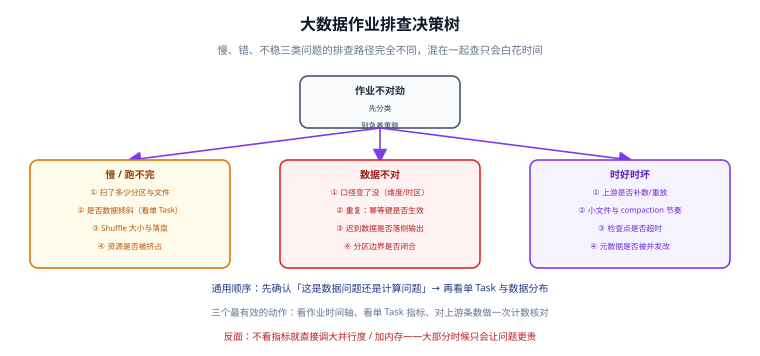

# 常见问题与最佳实践

这一页是排查入口与经验沉淀：**先按现象分类，再按分类找原因**。大数据链路的故障有个共同特征——**大多数不报错**，只表现为「数字不对」「跑得慢」「时好时坏」，所以判读方法比组件知识更重要。



## 分诊表：先回答「这是哪一类问题」

| 现象 | 第一类怀疑对象 | 第一个动作 | 不要做的事 |
| --- | --- | --- | --- |
| 作业很慢 / 跑不完 | 数据量与分布 | 看扫描的分区数与单 Task 记录数 | 先别调并行度、别加内存 |
| 结果不对 | 口径与去重 | 比对一个已知答案的小时间窗 | 别先怀疑引擎 |
| 时好时坏 | 上游重放 / 并发写 | 查上游当天有无补数或重放 | 别只看本次运行的日志 |
| 报错但重跑就好 | 资源与超时 | 看失败任务所在节点与时间点 | 别把「重跑能过」当结论 |
| 越跑越慢（长期） | 状态膨胀 / 小文件 | 看状态大小与文件平均大小趋势 | 别只优化当前这一轮 |

## 高频十二问

### Q1：批处理和流处理的分界线到底在哪？

按**输入的边界性**分，不按延迟分：输入是有限数据集 → 批；输入是无界数据集 → 流。延迟只是结果属性。判据见[概述](../Overview/index.md#四条主线)。

### Q2：为什么我的 Hive 查询扫了全表？

三种典型原因，按出现频率排序：

1. **过滤条件没有作用在分区列上**（例如用 `substr(dt,1,7)='2026-10'` 而不是 `dt BETWEEN ...`）；
2. **分区列类型不匹配**（`dt` 是 string，条件里比较的是 date，导致无法裁剪）；
3. **函数包裹了分区列**（`to_date(dt) = ...`）。

```sql
-- 用 EXPLAIN 确认分区裁剪是否生效（看 TableScan 的 partition 列表）
EXPLAIN EXTENDED SELECT COUNT(*) FROM dwd_orders WHERE dt = '2026-10-11';
```

### Q3：数据倾斜一定要加盐吗？

不一定，按代价排序试：**过滤后单独处理** → **广播小表** → **加盐打散**。加盐是最后手段，因为它要求两轮聚合，且如果忘记第二轮，结果就是错的。判据是「单 Task 记录数 / 中位数」是否 > 10。

### Q4：Spark 4 升级后一堆作业报错，是不是该关掉 ANSI？

不要。ANSI 模式把「静默返回 null」变成抛异常，**它暴露的是原本就存在的数据问题**（整数溢出、除零、非法类型转换）。正确做法是逐个定位：能修数据就修数据，确实要兼容旧行为就用 `try_cast` 而不是全局关 ANSI。

### Q5：Flink 从 1.x 升到 2.x，最难的是什么？

**状态不兼容**。官方明确 1.x 与 2.x 状态不保证兼容，再加上 `flink-conf.yaml` → `config.yaml`、`SourceFunction`/`SinkFunction` 移除、Per-job 模式移除。升级前必须做一次「旧版本写 savepoint → 新版本恢复」的演练，并确认所有连接器都有 2.x 版本。

### Q6：Kafka 为什么还会丢消息？不是配了 `acks=all` 吗？

`acks=all` 单独不够，必须配合 `min.insync.replicas >= 2`。当 ISR 只剩一个副本时，`acks=all` 也只等这一个副本，它挂了就丢。另外要开生产者幂等（`enable.idempotence=true`）避免重试导致重复。

### Q7：湖表比 Hive 表好在哪？不是都能查吗？

关键差别在**写入的原子性与并发**：Hive 表写文件即可见，读者可能读到一半的数据；湖表提交后才可见，且支持快照隔离。此外湖表支持分区演进与时间旅行，改分区方式不用重写历史数据。

### Q8：流作业跑几个月就崩，是什么原因？

按概率排序：**状态无 TTL**（去重/关联状态无限累积）→ **检查点持续变慢直至超时** → **下游写入变慢引发背压** → **小文件导致读取端变慢**。这三者常常连锁发生。修复顺序是先给所有状态加 TTL，再看检查点大小趋势。

### Q9：怎么证明「流侧的数据是对的」？

唯一可信的方法：**让批侧对同一时间窗重算一遍，比较结果**。两侧必须用同一时区、同一时间边界（左闭右开）、同一去重口径。差额必须能被解释，不能写「基本一致」。

### Q10：补数之后数字变大了，怎么修？

说明写入是追加而不是覆盖/upsert。修法：任务必须**幂等**——按分区覆盖或按业务主键 upsert，并在校验任务里比对条数。已经翻倍的数据要按分区删掉重写，而不是手动改数字。

### Q11：小文件问题怎么判断，怎么治？

**判断**：`单文件平均大小 < 目标值的 50%`，或「文件数 / 分区数」异常大。
**治**：定时 compaction（湖表用 `rewrite_data_files`）、写入端控制文件大小（`write.target-file-size-bytes`）、避免按分钟分区。

### Q12：单机能验证这条链路吗？

能，但要分清「能验证什么」：单机容器可以验证**语法、配置解析、SQL 正确性、作业能否起来**；**不能**验证真实的吞吐、故障恢复、跨节点网络行为。把两类结论分开写，不要用单机结果宣称生产可用。

## 上线自查十项

| # | 检查项 | 判据 |
| --- | --- | --- |
| 1 | 口径表已写死 | 指标定义、时间字段、时区、去重键四项齐全 |
| 2 | 源端 binlog 配置正确 | `ROW` + `FULL` + 保留期 ≥ 重跑周期 |
| 3 | 全量与增量衔接可解释 | 快照条数与源库差额可解释 |
| 4 | 主题分区与保留期按规划 | 分区数、副本数、`min.insync.replicas` 全部显式设置 |
| 5 | 所有流状态都有 TTL | 代码里每一处 `StateDescriptor` 都设了 TTL |
| 6 | 每个 Sink 的语义已确认 | 能事务则事务；不能事务则**幂等键已下沉** |
| 7 | 迟到数据有归宿 | 侧输出（或明确接受丢弃）已落地 |
| 8 | 对账任务已上线 | 每天自动比对批流两侧，差异告警可达 |
| 9 | 小文件有治理机制 | compaction 已调度，文件平均大小有指标 |
| 10 | 元数据有唯一权威源 | 同一张表不在两套 Catalog 里各说各话 |

## 最佳实践十二条

1. **先定口径，再选引擎。** 口径没定就开始写作业，后面必然返工。
2. **每一跳都要能核对。** 没有条数核对方式的链路，等于没有链路。
3. **幂等比一致性参数更重要。** 能用主键覆盖解决的问题，不要指望调检查点参数。
4. **所有状态都要有 TTL。** 包括去重、关联、缓存——没有例外。
5. **时间边界统一左闭右开。** 两侧口径一致的前提。
6. **分区到天，不要到分钟。** 需要更细粒度就用聚合表或多级分区。
7. **小文件靠机制治理，不靠人工。** 定时 compaction 比「发现慢了再合并」可靠。
8. **任务必须参数化，且只放调用不放逻辑。** 逻辑写在 SQL 或引擎代码里。
9. **升级前先演练恢复，再演练启动。** 能恢复才有资格升级。
10. **旧版本内容保留并标注状态。** 存量项目仍在跑旧版本，它们需要的是旧版本的答案。
11. **判据要写位置。** 报错只报「有问题」的巡检与文档，等于把定位成本转嫁给读者。
12. **不把期望值写成实测值。** 没跑过的就写「未跑 + 原因」，跑过就填真实输出。

## 与「数据湖与湖仓一体」专题的分工

| 症状 | 看哪里 |
| --- | --- |
| 作业 OOM、shuffle 落盘、数据倾斜、序列化报错 | **本页**（引擎层分诊） |
| 行数不对、删了还能查到、越查越慢、两个引擎版本不一致 | [湖仓专题 · 常见问题](../../Lakehouse/FAQ/index.md)（表语义层分诊） |

一句话：**引擎层的错误会报错，表语义层的错误不报错**。所以分诊的第一问不是「报了什么错」，而是「有没有报错」——没有报错但数据不对，直接去湖仓专题的分诊表。

::: danger 本页特有的坑：把「重跑一次好了」当成结论
引擎层的问题重跑常常真的好了（资源竞争、偶发 OOM）；表语义层的问题重跑只会**让错的数据多一份**。同一个「重跑好了」的动作，在两类问题上的后果相反——先判断属于哪一类，再决定要不要重跑。
:::

## 参考资料

- Spark 调优指南：<https://spark.apache.org/docs/latest/sql-performance-tuning.html>
- Flink 配置与状态后端：<https://nightlies.apache.org/flink/flink-docs-stable/docs/deployment/config/>
- Hive 语言手册（分区与分桶）：<https://cwiki.apache.org/confluence/display/Hive/LanguageManual+DDL>
- Iceberg 表维护：<https://iceberg.apache.org/docs/latest/maintenance/>
- 相关专题：[选型与架构决策](../Selection/index.md)、[实战：从 binlog 到实时看板](../Practice/index.md)、[数仓建模 · 常见问题](/docs/DB/DataWarehouse/FAQ/index.md)
