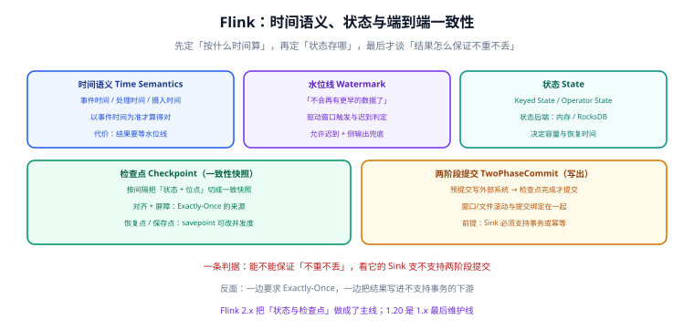

# Flink：有状态流处理

批处理的世界里，数据是有限的，重跑一次就能修正结果。流处理的世界里，数据是**无界的**，作业会跑上几个月，期间会重启、会扩容、会迟到——所以「怎么保证结果正确」必须被设计出来，而不能靠重跑兜底。

Flink 就是围绕这件事设计的：**时间语义**决定了「按什么时间算」，**状态**决定了「记住什么」，**检查点与两阶段提交**决定了「重启之后结果还对不对」。

## 适用版本与状态

| 版本线 | 状态 | 关键差异 |
| --- | --- | --- |
| **2.3.0**（2026-06-25） | 当前主线 | 生态组件已基本完成 2.x 适配 |
| 2.2.1（2026-05-15） | 维护中 | — |
| 2.1.3（2026-06-14） | 维护中 | 2.1 线补丁版 |
| 2.0.2（2026-05-11） | 仅存量项目使用 | 2.0 首个大版本，含全部破坏性变更 |
| **1.20.5**（2026-06-03） | **1.x 最后维护线，仅存量项目使用** | 若一时无法升级，1.20 是唯一还收补丁的 1.x |

::: danger 注意
**Flink 2.0 是一次真正的大版本断裂，1.x 与 2.x 之间「状态不保证兼容」**。官方 2.0 发布说明列出的破坏性变更至少要记住这些：
1. **API 移除**：`DataSet` API、Scala DataStream/DataSet API、`SourceFunction` / `SinkFunction` / Sink V1、`TableSource` / `TableSink`、`TableSchema` / `TableColumn` / `Types`（分别迁到 Source/Sink V2、`DynamicTableSource` / `DynamicTableSink`、`Schema` / `Column` / `DataTypes`）；
2. **配置文件换格式**：`flink-conf.yaml` 不再支持，改用标准 YAML 的 `config.yaml`（官方提供迁移工具）；
3. **部署模式**：Per-job 模式被移除，改用 Application 模式；
4. **时间 API**：`org.apache.flink.api.common.time.Time` 与窗口的 `Time` 改为 `java.time.Duration`；
5. **状态不兼容**：1.x 用 Kryo 或带集合字段的 POJO 作为状态时，**从 1.x 升级到 2.x 的 savepoint 可能无法恢复**——这是升级前必须做演练的第一件事；
6. **JDK**：Java 8 不再支持。
:::

## 时间语义：先决定「按什么时间算」



| 时间概念 | 含义 | 什么时候用 |
| --- | --- | --- |
| **事件时间（Event Time）** | 数据**产生**的时间（写在数据里） | 只要结果要可复算，就必须用它 |
| **处理时间（Processing Time）** | 数据**被处理**的时间（机器时钟） | 只关心「现在」，且允许结果不可复算 |
| **摄入时间（Ingestion Time）** | 数据**进入 Flink** 的时间 | 中间态，实践中很少用 |

::: tip 一句话判据
问一句：**「同一批数据今天跑和明天跑，结果要不要一样？」**
要一样 → 用事件时间（并接受结果需要等水位线）；可以不一样 → 用处理时间（并接受无法复算）。
:::

### 水位线（Watermark）

水位线是「**从这个时间点之前，不会再有更早的数据了**」这个承诺。它有两个作用：驱动窗口触发、判定迟到数据。

```java
import org.apache.flink.api.common.eventtime.WatermarkStrategy;
import java.time.Duration;

WatermarkStrategy<OrderEvent> strategy =
    WatermarkStrategy.<OrderEvent>forBoundedOutOfOrderness(Duration.ofSeconds(5))
        .withTimestampAssigner((event, ts) -> event.getEventTime())
        // 数据源空闲时也推进水位线，避免下游窗口永远不触发
        .withIdleness(Duration.ofMinutes(1));
```

**两条硬规则**：

1. **代价是延迟**：容忍 5 秒乱序，就意味着结果最多晚 5 秒出现。乱序容忍度越大，结果越准、延迟越高。
2. **多源并行时取最小值**：上游有 10 个并行分区，水位线取所有分区的最小值——**任何一个分区没数据，整个作业的水位线就停住**。这就是 `withIdleness` 存在的原因。

### 迟到数据的三种处置

| 处置 | 语义 | 适用 |
| --- | --- | --- |
| 丢弃 | 窗口已触发，迟到数据不再计入 | 允许少量误差，且能承受 |
| 侧输出（side output） | 把迟到数据写到旁路流，单独处理 | **推荐默认做法**：既不丢，也不影响主链路 |
| 允许迟到（allowedLateness） | 窗口保持一段时间，迟到数据触发更新 | 结果要下发（update 模式）时可用，但会长期占用状态 |

```java
OutputTag<OrderEvent> lateTag = new OutputTag<OrderEvent>("late-orders") {};

SingleOutputStreamOperator<ShopGmv> main = events
    .keyBy(OrderEvent::getShopId)
    .window(TumblingEventTimeWindows.of(Duration.ofMinutes(2)))
    .allowedLateness(Duration.ofSeconds(30))
    .sideOutputLateData(lateTag)
    .aggregate(new GmvAggregator());

// 旁路流单独落库/告警，保证「迟到数据可见」而不是静默消失
main.getSideOutput(lateTag).addSink(new LateOrderSink());
```

::: danger 注意
`allowedLateness` 不是「越大越好」：窗口每保留一天，状态就多占一天的内存/磁盘，重新消费时还要把历史窗口重建一次。**正确姿势是侧输出兜底 + 有限的 allowedLateness**，而不是把 allowedLateness 设成几小时来「保证不丢」。
:::

## 状态：算「过去一段时间」的前提

### 两种状态

| 状态类型 | 作用范围 | 典型用法 |
| --- | --- | --- |
| **Keyed State** | 按 key 隔离 | 每个用户的累计消费、每个订单的当前状态 |
| **Operator State** | 算子实例级 | 记录消费位点、维护连接池里的可分片列表 |

Keyed State 的容量随着 **key 的数量**增长。所以「key 的基数」是流作业最重要的容量参数——和[监控系统里标签基数爆炸](/docs/Backend/DistributedCache/index.md)是同一类问题。

### 状态后端

| 后端 | 状态存放 | 容量上限 | 适用 |
| --- | --- | --- | --- |
| HashMapStateBackend | JVM 堆内 | 受堆大小限制 | 状态小（GB 级以内）、追求低延迟 |
| EmbeddedRocksDBStateBackend | 本地磁盘（LSM 结构） | 可到 TB 级 | 状态大、key 多 |

```yaml
# config.yaml（Flink 2.x 的标准 YAML 配置）
state:
  backend: rocksdb
  backend.rocksdb:
    # 状态放本地磁盘，注意容器要挂持久卷，否则重启即丢本地状态
    localdir: /opt/flink/state/rocksdb
checkpointing:
  interval: 60s
  timeout: 10min
  min-pause: 30s
  # 非对齐检查点：牺牲一点恢复语义换更稳的检查点耗时，适合背压严重的作业
  unaligned: true
```

::: warning 说明
**RocksDB 状态后端 + 容器部署**有一个必须处理的细节：`localdir` 要挂持久卷。若挂在容器临时层，Pod 重建时本地状态全丢，恢复只能回到最近一次检查点——这时「检查点间隔 + 恢复时间」直接决定故障恢复时长。
:::

## 一致性：端到端「不重不丢」怎么来

### 检查点：一致快照

Flink 的检查点做的是：**在某一时刻，把所有算子的状态与输入位点，做成一份一致的快照**。作业重启时从最近的成功检查点恢复，从位点继续消费。

两条常用路径：

- **对齐检查点（Aligned）**：算子在屏障到达时先阻塞输入，等所有上游屏障到齐再快照。语义简单，但背压大时检查点会很慢甚至超时。
- **非对齐检查点（Unaligned）**：把「屏障到达时还没处理的数据」一起存进快照，不阻塞输入。检查点更快，但快照更大。

### 两阶段提交：写出外部系统

**只有「读」和「算」的一致还不够**，结果怎么保证不重不丢？答案是两阶段提交：

```text
① 预提交：把数据写到外部系统（或写到临时位置），此时对外不可见
② 检查点：等检查点完成（Barrier 到达所有算子并快照成功）
③ 提交：收到检查点完成通知后，把预提交的数据对外可见
④ 失败回滚：若在中途失败，丢弃预提交的数据，从上一个检查点重放
```

**这条链路的成立前提是 Sink 支持事务或幂等**：

| 下游 | 能否做到端到端 Exactly-Once | 前提 |
| --- | --- | --- |
| Kafka | 能 | 事务型 producer + 读端 `read_committed` |
| 文件系统 / 湖表 | 能 | 文件只在上游提交后才 rename 到可见位置 |
| 支持事务的数据库 | 能 | 事务与检查点对齐 |
| 普通数据库（无事务/无唯一键） | **不能** | 只能做到 At-Least-Once，必须靠**幂等写入**（主键覆盖）补 |

::: danger 注意
「一边要求 Exactly-Once，一边把结果写进不支持事务、也没有唯一键的下游」是流处理里最常见的自相矛盾。此时无论 Flink 配置多正确，重启后都会出现重复数据。**正确做法是把幂等键下沉到下游**（写入时用业务主键做 upsert），而不是在上游反复调检查点参数。
:::

## 背压与并行度

| 概念 | 含义 | 观测方式 |
| --- | --- | --- |
| 并行度（parallelism） | 每个算子起多少个并行实例 | `parallelism.default` 或算子级设置 |
| 槽（slot） | 资源的最小单位，一个 slot 可跑一条算子链 | TaskManager 的 `taskmanager.numberOfTaskSlots` |
| 背压（backpressure） | 下游处理不过来，反压到上游 | Flink UI 的 Backpressure 面板；`busy` 与 `idle` 时间比 |

**背压不是故障，而是信号**：它说明整条链路里最慢的那一段在哪里。判读顺序是「**先看背压出现在哪个算子，再看那个算子为什么慢**」——常见原因是下游写库慢（如单条 insert）、状态过大（RocksDB 读写放大）、或数据倾斜。

```shell
# 一个最小可跑的本土作业（Flink SQL，读取 socket 里的 JSON 并窗口聚合）
# 1) 起一个本地会话集群
./bin/start-cluster.sh

# 2) 在另一个终端造数据源
nc -lk 9999

# 3) 提交 SQL 作业（这里用 SQL 客户端交互执行）
./bin/sql-client.sh
```

```sql
-- 在 sql-client 中执行：建表 → 窗口聚合 → 打印结果
CREATE TABLE orders (
    order_id    STRING,
    shop_id     STRING,
    amount      DOUBLE,
    event_time  TIMESTAMP(3),
    WATERMARK FOR event_time AS event_time - INTERVAL '5' SECOND
) WITH (
    'connector' = 'kafka',
    'topic' = 'dwd.orders',
    'properties.bootstrap.servers' = 'kafka:9092',
    'properties.group.id' = 'order-metrics',
    'scan.startup.mode' = 'latest-offset',
    'format' = 'json'
);

CREATE TABLE shop_gmv (
    window_start TIMESTAMP(3),
    window_end   TIMESTAMP(3),
    shop_id      STRING,
    gmv          DOUBLE,
    cnt          BIGINT
) WITH (
    'connector' = 'print'
);

INSERT INTO shop_gmv
SELECT window_start, window_end, shop_id, SUM(amount) AS gmv, COUNT(*) AS cnt
FROM TABLE(TUMBLE(TABLE orders, DESCRIPTOR(event_time), INTERVAL '2' MINUTES))
GROUP BY window_start, window_end, shop_id;
```

**期望结果**：TaskManager 日志中每两分钟打印一批窗口结果；`window_start` 与 `window_end` 相差 2 分钟，且同一窗口的 `cnt` 等于该时间段内的订单条数。

## 常见问题与判读

| 现象 | 常见原因 | 处置 |
| --- | --- | --- |
| 窗口一直不触发 | 某个上游分区空闲，水位线不推进 | 配置 `withIdleness`，或为无数据源发心跳 |
| 检查点持续超时 | 状态过大 / 背压严重 / 下游 Sink 慢 | 看检查点大小与耗时趋势；开非对齐检查点；治背压 |
| 重启后结果重复 | 下游不支持事务且未做幂等写入 | 用业务主键 upsert；或改为事务型 Sink |
| 作业频繁重启 | 重启策略过激 + 单点数据异常（如脏数据解析失败） | 先用侧输出隔离脏数据，再调重启策略 |
| 升级到 2.x 后 savepoint 恢复失败 | 状态序列化不兼容（Kryo / 集合字段 POJO） | 升级前用**双跑对比**验证：新旧版本对同一段数据结果一致 |

## 参考资料

- Flink 官方文档：<https://nightlies.apache.org/flink/flink-docs-stable/>
- Flink 2.0 破坏性变更说明：<https://flink.apache.org/2024/10/23/preview-release-of-apache-flink-2.0>
- Flink 下载与版本列表：<https://flink.apache.org/downloads/>
- 相关专题：[数据同步与 CDC](/docs/DB/CDC/index.md)、[消息队列](/docs/Backend/MessageQueue/index.md)、[Spark：批与微批引擎](../Spark/index.md)、[实战：从 binlog 到实时看板](../Practice/index.md)
