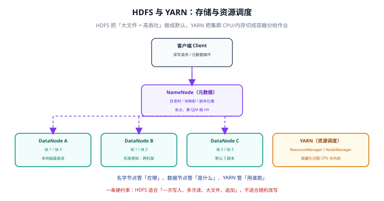

# Hadoop：HDFS 与 YARN

Hadoop 是这条技术路线里最早成体系的一套：**HDFS 负责存、YARN 负责分配资源、MapReduce 负责算**。三者里前两个至今仍是很多集群的地基，而 MapReduce 作为计算引擎已经基本被 Spark 取代。

这一页只讲今天仍然要用的部分：**HDFS 的数据模型与 YARN 的资源模型**，以及它们的硬约束。

## 适用版本与状态

| 版本线 | 状态 | 说明 |
| --- | --- | --- |
| **3.5.0**（2026-04-01） | 当前主线 | 3.5 首个稳定版，含 485 项修复与改进 |
| 3.4.3（2026-02-24） | 维护中 | 3.4 线最新补丁，升级前的一站 |
| 3.3.x 及更早 | 仅存量项目使用 | 仍能跑，但不再有新特性；不建议新建 |
| 2.x | 已停止维护 | 部分老集群仍在使用，新项目不要选 |

## HDFS：为「大文件 + 高吞吐」设计的文件系统



### 核心数据模型

HDFS 把文件切成**固定大小的块（block）**，默认 128 MB，每个块存 **3 个副本**，分布在不同机器上。这个设计带来四条必须记住的性质：

1. **元数据与数据分离**：NameNode 只存「文件 → 块 → 副本位置」的映射，块数据在 DataNode 本地磁盘上。所以 NameNode 的内存占用取决于**文件与块的数量**，而不是数据总量。
2. **副本是容错手段，不是备份手段**：三个副本在同一集群内，集群整体故障时一起丢失。
3. **一次写入、多次读取、只允许追加**：HDFS 不支持在文件中间随机改写。这是它最简单的部分，也是它最容易被误用的部分。
4. **高吞吐优先于低延迟**：一次读取要跨网络、跨磁盘，单次访问延迟远高于本地磁盘。

::: danger 注意
把 HDFS 当数据库用是最常见的误用，会直接踩三个坑：
1. **小文件问题**：每个文件、每个块都要占 NameNode 内存（约 150 字节/对象）。上传 1000 万个 1 KB 的小文件，占用的是 **1000 万个对象** 的元数据，而不是 10 GB 数据。正确做法是**先合并再入湖**（顺序写大文件），或在湖表层用 compaction 归并。
2. **随机更新**：想「改一行」只能重写整个块。需要随机读写的场景应该用 HBase、Kudu 或在线库，而不是 HDFS。
3. **直接用 HDFS 路径当表名**：`/warehouse/orders/dt=2026-10-01/` 这种目录结构**本身不是表**——没有元数据就无法保证「谁在读、读的哪一版、分区是什么类型」。表语义必须由 Hive Metastore 或湖表 Catalog 提供。
:::

### 高可用（HA）

NameNode 是单点，HDFS 的高可用靠**两个 NameNode + 共享编辑日志**实现：

- **Active / Standby**：同一时刻只有一个 Active 响应请求，Standby 持续同步编辑日志；
- **共享存储（QJM，Quorum Journal Manager）**：编辑日志写到 3 个 JournalNode，**多数派写成功才算成功**（3 个节点容忍 1 个故障）；
- **故障切换**：主备切换依赖 ZooKeeper 或内置的切换控制器，切换期间会有短暂不可用。

```shell
# 查看 NameNode 状态与安全模式（HA 集群需指定服务名）
hdfs haadmin -getServiceState nn1
hdfs dfsadmin -safemode get

# 查看块与副本的健康状况（关注 Under-replicated / Missing blocks）
hdfs fsck /warehouse/orders -files -blocks -locations | tail -5

# 查看文件与块的数量级（判断有没有小文件问题）
hdfs dfs -count -q -v /warehouse/orders
```

**判读**：`hdfs fsck` 输出里 `Under-replicated blocks` 长期非 0，说明有 DataNode 掉队或磁盘写满；`Missing blocks` 非 0 说明副本已经不够，必须立刻处理（此时读该块会失败或走慢路径）。

::: tip 提示
`hdfs dfs -count` 的最后四列分别是「目录数 / 文件数 / 总字节 / 路径」。**文件数远大于目录数 × 单目录合理文件数**（例如 1000 个分区却有 200 万文件）就是典型的小文件信号，需要合并或压缩。
:::

## YARN：把集群切成容器分给作业

YARN 解决的是「多个作业共享一个集群」的问题。它的模型只有两个概念：

| 角色 | 职责 | 关键点 |
| --- | --- | --- |
| ResourceManager（RM） | 全局资源仲裁 | 决策「给谁多少」，是集群单点（靠 HA 解决） |
| NodeManager（NM） | 单机资源上报与容器启停 | 上报本机可用 CPU/内存，按 RM 指令启动容器 |
| ApplicationMaster（AM） | 单个作业的「项目经理」 | 向 RM 申请资源、向 NM 请求容器、管理 Task 生命周期 |
| Container | 资源与进程的绑定单位 | 一次分配固定内存 + CPU 核数，进程在其中运行 |

一次作业的完整过程：

```text
客户端提交 → RM 分配第一个容器启动 AM → AM 向 RM 注册并申请资源
→ RM 把容器分配信息交给 AM → AM 通知对应 NM 启动容器 → Task 在容器中执行
→ AM 汇报进度与状态 → 全部完成 → AM 注销 → RM 回收资源
```

### 最常用的两个配置

```properties
# yarn-site.xml 中的关键项（示例：单节点配额）
yarn.nodemanager.resource.memory-mb=32768        # 该 NM 可分配的总内存（MB）
yarn.nodemanager.resource.cpu-vcores=16          # 该 NM 可分配的总核数
yarn.scheduler.maximum-allocation-mb=16384       # 单个容器上限，决定「大作业能不能跑」
yarn.scheduler.minimum-allocation-mb=1024        # 分配粒度，太小会导致容器数爆炸
yarn.resourcemanager.scheduler.class=org.apache.hadoop.yarn.server.resourcemanager.scheduler.capacity.CapacityScheduler
```

::: danger 注意
`yarn.nodemanager.resource.memory-mb` 必须**小于**机器物理内存，要给操作系统与 NM/DataNode 自身留出空间。设成等于物理内存的常见后果是节点被 OOM Killer 杀进程，表现为「作业莫名其妙失败、NM 掉线」，而 YARN 上只看到容器退出码非 0。
:::

### 队列与资源隔离

生产集群几乎一定要配多队列：

- **Capacity Scheduler**：每个队列有保证容量与最大容量，适合「多团队共享、按比例保障」；
- **Fair Scheduler**：按权重动态分配，适合「小作业要快速拿到资源」。

判据只有一条：**如果一个团队的作业能把整个集群占满并让其他团队排队数小时，那就必须配队列。**

```shell
# 查看队列使用情况（Capacity Scheduler）
yarn queue -status default | head -20

# 查看应用列表与状态
yarn application -list -appStates RUNNING,ACCEPTED

# 查看某个应用的资源与诊断信息
yarn application -status application_1712345678901_0001
```

## Hadoop 的边界：它不管什么

| Hadoop 不管的事 | 应该用什么 |
| --- | --- |
| 随机读写（按主键点查、频繁更新） | HBase / Kudu / 在线库 / OLAP 库 |
| 交互式亚秒查询 | Trino / ClickHouse / Doris |
| 流处理与低延迟 | Flink / Spark Structured Streaming |
| 表语义与事务 | Hive Metastore + 表格式（Iceberg / Hudi / Paimon） |
| 作业调度与依赖编排 | Airflow / DolphinScheduler（YARN 只管资源） |

::: tip 一句话总结
**HDFS 是「可靠的大仓库」，YARN 是「集群的物业」**。仓库不负责分拣，物业不负责搬货——把这两件事按它们的边界用，Hadoop 就很好用；越界使用，问题都会出在「以为是数据库却是文件系统」上。
:::

## 常见故障与判读

| 现象 | 常见原因 | 排查入口 |
| --- | --- | --- |
| 写入卡在最后 1 个块 | 副本管道中某个 DataNode 慢/满 | `hdfs dfsadmin -report` 看各节点剩余空间 |
| 读文件报 `Could not obtain block` | 所有副本所在节点同时不可用 | `hdfs fsck <path> -files -blocks` |
| 集群进入安全模式 | NameNode 启动时块汇报未达标 | `hdfs dfsadmin -safemode get`，等汇报完成或手动退出 |
| 作业一直 `ACCEPTED` | 队列资源不足或单容器上限太小 | `yarn application -status <appId>` 看诊断信息 |
| NameNode 堆持续增长 | 小文件过多 | `hdfs dfs -count` 统计文件数，做合并 |

## 参考资料

- Hadoop 官方发布页：<https://hadoop.apache.org/release>
- HDFS 架构文档：<https://hadoop.apache.org/docs/stable/hadoop-project-dist/hadoop-hdfs/HdfsDesign.html>
- YARN 架构文档：<https://hadoop.apache.org/docs/stable/hadoop-yarn/hadoop-yarn-site/YARN.html>
- 相关专题：[Hive：数仓 SQL 层](../Hive/index.md)、[Spark：批与微批引擎](../Spark/index.md)、[生态组件：消息、湖表与调度](../Ecosystem/index.md)
