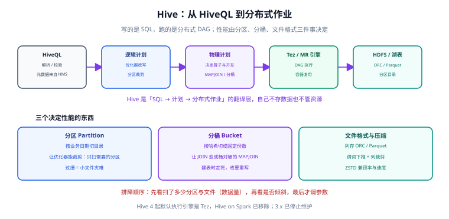

# Hive：数仓 SQL 层

Hive 是「用 SQL 描述分布式作业」的那一层。它**自己不存数据**（数据在 HDFS 或对象存储上），也**自己不管资源**（资源由 Tez/YARN 或 MR 申请），它做的事只有一件：把一段 HiveQL 翻译成一个能在集群上跑的分布式 DAG。

理解这一点，就能理解 Hive 的一切行为：为什么它慢（作业启动有固定开销）、为什么分区这么重要（优化器靠它裁剪数据）、为什么升级 Hive 要先升元数据。

## 适用版本与状态

| 版本线 | 状态 | 关键约束 |
| --- | --- | --- |
| **4.2.1**（2026-08-24） | 当前主线 | 需 **JDK 21**；修复 metastore 直连 SQL 分区路径等三个安全问题 |
| 4.2.0（2025-11-23） | 维护中 | Iceberg 删除向量、自动 compaction、REST Catalog |
| 4.1.0（2025-07-31） | 维护中 | JDK 17；HMS 可作为独立组件部署（二进制 + Docker 镜像） |
| 4.0.1（2024-10-02） | 仅存量项目使用 | JDK 8；官方已建议把负载迁到 Tez |
| 3.x | **已停止维护**（2024-10-08 EOL） | 最后一个版本 3.1.3；**Hive on Spark 在 4.0 被移除** |

::: warning 说明
从 Hive 4.0 起 `hive.execution.engine` **只接受 `mr` 或 `tez`**，`spark` 已被移除（HIVE-26134）；4.1 起默认引擎是 Tez，MapReduce 被标记为 deprecated。升级前**必须先确认没有作业把引擎设成 spark**。
:::

## 从 HiveQL 到分布式作业



### 一次查询的六个阶段

| 阶段 | 做什么 | 出问题时的表现 |
| --- | --- | --- |
| 解析与校验 | 语法解析、表/列是否存在（查 HMS） | 报 `SemanticException`，通常是元数据对不上 |
| 逻辑计划生成 | 转成算子树（Scan/Filter/Join/Aggregate） | 极少出错，错误一般来自 UDF |
| 逻辑优化 | 谓词下推、分区裁剪、常量折叠 | 优化没生效 → 扫了全表（见下文判读） |
| 物理计划生成 | 决定用哪种 Join、并发度、是否走 MapJoin | 选错 Join 策略 → 大规模 Shuffle |
| 执行 | 交给 Tez/MR 跑 DAG | 卡在某个 Stage、数据倾斜 |
| 结果写回 | 写到 HDFS / 湖表 | 小文件、分区没闭合 |

::: tip 为什么 Hive 的「分钟级」不全是数据量的问题
Tez/MR 作业有**固定启动开销**（申请容器、初始化 JVM），一个只需 3 秒的查询也可能花 30 秒。所以 Hive 不适合「高频小查询」；需要交互式查询时应交给 Trino、ClickHouse 这类没有重型启动开销的引擎。
:::

### 表与数据组织

```sql
-- 分区 + 分桶 + 列存格式，是 Hive 表设计的三件套
CREATE TABLE IF NOT EXISTS dwd_orders (
    order_id     STRING,
    user_id      BIGINT,
    amount       DECIMAL(18, 2),
    created_at   TIMESTAMP
)
COMMENT '订单明细（DWD）'
PARTITIONED BY (dt STRING COMMENT '业务日期，格式 yyyy-MM-dd')
CLUSTERED BY (user_id) INTO 64 BUCKETS
STORED AS ORC
TBLPROPERTIES (
    'orc.compress' = 'ZSTD',
    'orc.bloom.filter.columns' = 'order_id'
);
```

三项各自解决一个问题：

| 设计 | 解决什么 | 代价 |
| --- | --- | --- |
| **分区（PARTITIONED BY）** | 让优化器能只扫需要的目录（分区裁剪） | 分区过细 → 海量小文件；分区列不应是唯一值列 |
| **分桶（CLUSTERED BY）** | 让 JOIN 变成桶对桶（Bucket MapJoin），让取样更快 | 桶数建表时定死，改要重写数据 |
| **列存 + 压缩（ORC/Parquet + ZSTD）** | 只读用到的列，压缩后又少读 IO | 写入成本略增；格式选错会影响引擎兼容性 |

::: danger 注意
分区列选错的三种典型形式，都会在数据量增长后集中爆发：
1. **按小时甚至按分钟分区**：一天产生 1440 个分区 × 数百天 = 数十万目录，NameNode 与 HMS 双重压力。正确做法是**分区到天**，小时内用聚合表。
2. **用高基数列做分区**（如 `user_id`、`order_id`）：分区数等于去重值数，等同于把表切碎。
3. **分区值与数据内容不一致**（写入时写错 `dt`）：`dt` 是**字符串**，Hive 不会校验它与数据里的时间是否一致。正确做法是在写入时由调度器注入，并在下游加一条「分区值 ↔ 数据时间范围」的校验。
:::

### 三个必须会用的判据

```sql
-- 判据 1：这次查询到底扫了多少数据？（分区裁剪是否生效）
EXPLAIN EXTENDED
SELECT dt, COUNT(*) FROM dwd_orders WHERE dt BETWEEN '2026-10-01' AND '2026-10-07' GROUP BY dt;
-- 在输出里找 TableScan 的 "partition" 与 "Statistics"，确认只包含目标分区、文件数符合预期

-- 判据 2：Shuffle 有多大？（决定要不要调 Join 策略）
EXPLAIN
SELECT /*+ MAPJOIN(d) */ f.order_id, d.name
FROM dwd_orders f JOIN dim_shop d ON f.shop_id = d.shop_id;

-- 判据 3：是否发生数据倾斜？（看单个 reducer 的耗时）
-- 在 Tez UI / YARN 应用页面里看各 Task 的「耗时」与「输入记录数」，
-- 若最大 Task 的记录数超过中位数 10 倍以上，即确认倾斜
```

## Hive 4 的破坏性变化与升级

升级 Hive 不是「换 jar 包」，而是一次**平台级搬迁**。顺序不能反：

```shell
# 0) 备份元数据库（必须，回滚唯一依靠）
mysqldump -h <hms-db> -u hive -p hive_metastore > hms_backup_$(date +%Y%m%d).sql

# 1) 先看当前 schema 版本
schematool -dbType mysql -info

# 2) 预演升级（只打印将执行的脚本，不改库）
schematool -dbType mysql -upgradeSchema -dryRun

# 3) 真正升级
schematool -dbType mysql -upgradeSchema

# 4) 校验：客户端连一次并查一张分区表
beeline -u "jdbc:hive2://<hiveserver2>:10000/default" -e "SHOW PARTITIONS dwd_orders LIMIT 5;"
```

升级前必须逐项确认的清单：

| 检查项 | 为什么 | 判据 |
| --- | --- | --- |
| JDK 版本 | 4.0 需 JDK 8、4.1 需 JDK 17、4.2 需 JDK 21 | `java -version` 在 HiveServer2、HMS、嵌入 Hive 库的客户端上都要满足 |
| 执行引擎 | `hive.execution.engine=spark` 在 4.0 已移除 | 全量搜索配置与作业脚本，确认没有残留 |
| Tez 版本 | 4.2.x 与 Tez 0.10.5 搭配 | 版本不匹配会出现编译期或运行期异常 |
| 元数据 schema | 4.x 自带从 3.1.0 起的升级链 | 先 `-info` 确认起点在升级链覆盖范围内 |
| 其他客户端 | Spark / Trino / Impala 都读 HMS | 升级后**每个客户端都要单独回归**，它们各自的兼容范围不同 |
| 回滚方案 | 元数据升级不可逆（除恢复备份） | 有可恢复的备份 + 有回滚时间窗 |

::: danger 注意
**不要只测 HiveServer2 就认为升级成功。** HMS 是多个引擎的公共入口：Spark、Trino、Presto、Impala 都读它。升级后如果只验证了 Hive 自己的查询，很可能在几天后从「Spark 读某张表报列类型错」这类现象才发现问题——那时已经很难判断是新写入的数据问题还是元数据问题。
:::

## 生产实践：让 Hive 表可维护

1. **命名与分层统一**：`ods_` / `dwd_` / `dws_` / `ads_` 前缀 + 主题域 + 粒度后缀（详见[数仓建模](/docs/DB/DataWarehouse/Layering/index.md)）。
2. **小文件治理是常态工作**：按天分区的小表可以先判据再决定是否合并。
3. **统计信息要主动收集**：CBO（成本优化器）依赖统计信息，缺失时会退回默认估计值，导致 Join 策略选错。

```sql
-- 收集表与列的统计信息（CBO 的前提）
ANALYZE TABLE dwd_orders PARTITION (dt = '2026-10-01') COMPUTE STATISTICS;
ANALYZE TABLE dwd_orders PARTITION (dt = '2026-10-01') COMPUTE STATISTICS FOR COLUMNS order_id, user_id, amount;

-- 小文件合并（ORC 表专用，按分区执行）
ALTER TABLE dwd_orders PARTITION (dt = '2026-10-01') CONCATENATE;
```

```shell
# 查看分区下文件数与平均大小（判断小文件问题的入口）
hdfs dfs -count /warehouse/dwd_orders/dt=2026-10-01
```

## 常见问题与判读

| 现象 | 常见原因 | 处置 |
| --- | --- | --- |
| 查询很慢但数据量不大 | 没走分区裁剪，扫了全表 | `EXPLAIN` 看 TableScan 的 partition 列表 |
| 某个 Reduce 长时间不动 | 数据倾斜或聚合 key 集中 | 看 Tez UI 单 Task 记录数；开启倾斜优化或先打散 |
| 报 `Metastore contains multiple versions` | 直接改了 hive-site.xml 但没升 schema | 用 `schematool` 走正式升级流程 |
| 动态分区写入报分区数超限 | `hive.exec.max.dynamic.partitions` 默认值偏小 | 评估真实分区数后再调，别一味放大 |
| 中文列注释乱码 | 元数据库字符集与 Hive 配置不一致 | 检查 JDBC URL 的 `characterEncoding` 与库表字符集 |

## 与「数据湖与湖仓一体」专题的分工

| 问题 | 看哪里 |
| --- | --- |
| Hive 的分区目录、元数据库、`MSCK REPAIR`、Hive SQL 语法 | **本页** |
| 为什么「目录即表」在并发写与回滚上不成立、替代方案是什么 | [湖仓专题 · 表格式](../../Lakehouse/TableFormat/index.md) |
| 从 Hive 表迁到湖表的落地步骤与验收 | [湖仓专题 · 实战](../../Lakehouse/Practice/index.md) |

一句话：**Hive 表用路径推断成员，湖仓表用元数据声明成员**。前者的一整类运维动作（`MSCK REPAIR`、手工建分区目录、`INSERT OVERWRITE` 前先删目录）在后者里根本不存在，不是因为更聪明，而是因为成员清单不再靠目录猜。

::: danger 本页特有的坑：手工建的 dt= 目录，湖表读者看不见
在 Hive 里 `hdfs dfs -mkdir dt=2026-10-20` 再 `MSCK REPAIR` 就能让数据可见；在湖表里**手工造目录等于没造**——manifest 里没有这些文件，读者查不到，而且它们会被孤儿清理当成垃圾删掉。迁表时最容易被这套肌肉记忆坑到：ETL 脚本里那句 `mkdir` 必须删掉，改成正常的写入作业。
:::

## 参考资料

- Hive 官方文档：<https://hive.apache.org/docs/>
- Hive 语言手册（DDL/DML）：<https://cwiki.apache.org/confluence/display/Hive/LanguageManual>
- Hive 4 release notes 与升级说明：<https://hive.apache.org/downloads.html>
- 相关专题：[Hadoop：HDFS 与 YARN](../Hadoop/index.md)、[数仓建模](/docs/DB/DataWarehouse/index.md)、[Spark：批与微批引擎](../Spark/index.md)
