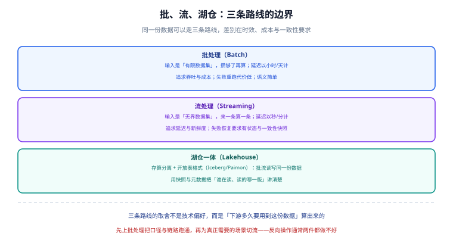

# 概述：大数据栈的四层与四条主线

「大数据」这个词被用得太多，以至于掩盖了它真正要解决的问题：**当数据量或时效要求超出单机数据库的处理能力时，如何用一组分工明确的组件把这条路走通。**

这一页先回答三个问题：**什么时候真的需要它、它由哪几层组成、走上这条路的第一步应该是什么。**

## 什么时候该上大数据栈

先给判据，再谈组件。下面五条里**满足任意一条**，才进入「考虑集群」的讨论范围：

| 判据 | 具体表现 | 反例（不该上） |
| --- | --- | --- |
| 单机存不下 | 单表 > 数亿行且还在增长，归档后仍放不下 | 表很大但 90% 是历史数据，归档即可 |
| 单机算不动 | 一次全量聚合超过业务可等待时间（如 > 30 分钟）且无法靠索引解决 | 加索引、改 SQL、加从库就能解决 |
| 需要跨源整合 | 数据分散在多个库/多种存储，需要统一口径 | 只有一两个来源，靠定时任务同步即可 |
| 时效要求高且量级大 | 要求分钟级可见，且变更量级超过在线库能承受的同步频率 | 要求 T+1 可见，用夜间批处理 |
| 需要留存明细 | 业务库只保留近期数据，但分析要全历史 | 分析只用到汇总结果，业务库即可 |

::: danger 注意
三个最常见的误判，都会把项目带入「集群很大、问题还在」的状态：
1. **把「数据量」当成唯一判据**——真正决定架构的是**时效**与**查询形态**，不是 GB 数。
2. **因为「怕以后不够用」而提前上集群**——集群的运维成本从第 1 天就开始付，而收益在第 N 天才出现。
3. **把「实时」当成目标而不是手段**——先问「下游拿到实时数据之后会做什么动作」，答不出来就不需要实时。
:::

## 四条主线



### 批处理路线

输入是**有限数据集**：数据攒够了再算，延迟以小时或天计。

典型链路：`业务库 → 定时抽取 → HDFS 或对象存储 → Hive/Spark → 结果表 → 报表`。

它的优点不是「简单」，而是**失败重跑的代价低**：重跑一个分区，语义是「用同一天的源数据重算同一天的结果」，天然幂等。所以批处理链路更适合承担**口径定义**的职责——线上报表的数字通常以批侧为准。

### 流处理路线

输入是**无界数据集**：数据一条一条来，处理一条输出一条，延迟以秒或分钟计。

典型链路：`binlog → Kafka → Flink → 湖表或 OLAP → 看板`。

流处理的难点不在「快」，而在**状态**：要算「过去 5 分钟的订单数」，就必须记住过去 5 分钟的数；要保证「不重不丢」，就必须能把这份记忆做一致性快照。这两件事分别对应 Flink 的状态后端与检查点机制，是本专题的重点章节。

### 湖仓一体路线

把「湖」（低成本对象存储 + 开放表格式）与「仓」（SQL 语义 + 事务 + 元数据）合成一条路线：**批流读写同一份数据**。

关键变化在于：表不再是一堆目录，而是**元数据 + 快照**。带来三个直接结果：

- **快照隔离**：读不阻塞写，读到的是一致的一版；
- **时间旅行**：能查「昨天 10 点那一版数据」；
- **分区演进**：改分区方式不必重写历史数据。

### 选型第一判据

四条主线怎么选，收敛成一个问题：

> **下游多久要用到这份数据？**

- T+1 或更慢 → 批处理栈（成本最低、最容易维护）；
- 分钟级 → 流处理栈 + 湖表；
- 秒级且要按主键更新 → 再加一层实时 OLAP。

这个判断必须**先于**任何组件选型。顺序反了的典型后果是：先选了流处理框架，再回头给每个需求都硬套一个流作业，最后维护不动。

## 组件分层的四层

| 层 | 职责 | 代表组件 | 边界（这一层不做什么） |
| --- | --- | --- | --- |
| 驱动层 | 什么时候跑、按什么顺序跑 | 调度器（Airflow / DolphinScheduler）、数据总线（Kafka） | 不写业务逻辑、不做数据加工 |
| 计算层 | 把数据算成结果 | Spark、Flink、Hive（Tez）、Trino | 不负责长期存储、不管资源以外的调度 |
| 存储层 | 长期保存数据 | HDFS、对象存储、湖表（Iceberg/Paimon）、HBase | 不做业务计算、不保证查询性能 |
| 描述层 | 说明数据是什么 | Hive Metastore、Iceberg REST Catalog、数据目录 | 不存业务数据本身，但**故障时影响面最大** |

::: tip 一个经验规律
四层里**最难排查的是描述层**：存储坏了会有告警，计算慢了会有指标，而元数据不一致往往表现为「同一个 SQL 今天能跑明天报错」或「两个引擎查同一张表结果不同」，既不报错也不掉线。
:::

## 从单机走向集群的三步

不要一次搭完整套。按下面顺序推进，每一步都有独立收益，也都能停下来：

```shell
# 第一步：把「算」从在线库里挪走（不改架构，只改位置）
# 目标：在线库只服务线上事务，重查询走只读副本或离线副本
# 验证：在线库的 QPS 峰值下降，慢查询不再出现在在线库的 slow log 里

# 第二步：引入批处理与统一存储（此时还没有「实时」）
# 目标：T+1 报表由离线链路产出，口径从在线库的口径中解耦
# 验证：同一指标离线产出值与在线库直接统计值一致（差额为 0）

# 第三步：为真正需要实时的场景引入流处理
# 目标：只把「下游会立刻动作」的场景切到流，其余仍留在批
# 验证：流侧结果与批侧对同一时间窗重算的结果一致
```

::: warning 说明
第二步的验证（离线与在线对账）**不能跳过**。跳过它的项目，通常会在第三步才第一次发现「离线口径和线上口径从来就不一样」，而那时链路已经很长，定位成本高一个数量级。
:::

## 本地上手：不装集群也能验证的一条链路

不必一开始就搭 Hadoop 集群。用容器在单机跑一个最小批处理链路，就能把「存储 → 计算 → 结果」这条主线走通：

```yaml
# compose.yaml（放在自己的工程目录里，本仓库不提交该文件）
services:
  spark:
    image: apache/spark:4.2.0-scala2.13-java17-python3-ubuntu
    command: >
      /opt/spark/bin/spark-sql
      --conf spark.sql.warehouse.dir=/tmp/warehouse
    volumes:
      - ./data:/opt/spark/data
    stdin_open: true
    tty: true
```

```shell
# 1) 起容器（先用交互模式，方便直接敲 SQL）
docker compose up -d

# 2) 造一份小数据
docker compose exec spark bash -lc 'printf "o1,2026-10-01,100.00\no2,2026-10-01,200.00\no3,2026-10-02,50.00\n" > /opt/spark/data/orders.csv'

# 3) 建表并做一次分组聚合
docker compose exec spark /opt/spark/bin/spark-sql -e 'CREATE TABLE IF NOT EXISTS orders (id STRING, dt STRING, amt DOUBLE) USING CSV OPTIONS (path "/opt/spark/data/orders.csv", header false); SELECT dt, COUNT(*) AS cnt, SUM(amt) AS total FROM orders GROUP BY dt ORDER BY dt;'
```

**期望输出**（两行，按日期分组）：

```text
2026-10-01	2	300.0
2026-10-02	1	50.0
```

```shell
# 4) 收尾
docker compose down
```

::: tip 提示
这条链路刻意**没有**用 HDFS 和 Hive——Spark 可以只读本地文件。它的作用是让「SQL → 分布式执行计划 → 结果」这条链路先跑通，**不要**把它当成生产形态。生产形态的存储与元数据在后面的章节讲。
:::

## 术语对齐（避免沟通歧义）

| 术语 | 本文口径 | 常见混淆 |
| --- | --- | --- |
| 批 / 流 | 按**输入的边界性**区分（有限 vs 无界），不按延迟区分 | 误当成「慢 / 快」 |
| 实时 | 端到端可观测延迟，包含采集、计算、落库、查询四段 | 只算计算那一段 |
| 一致性 | 指**结果的正确性语义**（不重、不丢、有序），不是指可用性 | 与 CAP 中的一致性混用 |
| 幂等 | 同一批数据跑两遍结果相同（靠主键覆盖或去重键实现） | 误以为「重跑就会重复」是必然的 |
| 湖 / 仓 | 湖指开放格式的对象存储；仓指带事务与元数据的表语义 | 把「用了 Hive 就是仓」 |
| 元数据 | 表结构、分区、快照、统计信息 | 误以为只有「表名」 |

## 三条最贵的原则

1. **口径先定，组件后选。** 指标定义与时间边界（用什么时区、按什么时间分组）必须先写死，否则换任何引擎都会得到两个数。
2. **每一跳都要可核对。** 链路里每一跳都应该有一条「源端条数 vs 本跳条数」的核对方式；没有核对方式的链路，等于没有链路。
3. **旧版本行为要留存。** 升级不是覆盖：旧版本的行为与判据留在原页，标注维护状态，供存量项目查阅。

## 参考资料

- Apache Hadoop 官方站点：<https://hadoop.apache.org/>
- Apache Spark 官方文档：<https://spark.apache.org/docs/latest/>
- Apache Flink 官方文档：<https://nightlies.apache.org/flink/flink-docs-stable/>
- Apache Iceberg 官方文档：<https://iceberg.apache.org/docs/latest/>
- 相关专题：[数仓建模](/docs/DB/DataWarehouse/index.md)、[数据同步与 CDC](/docs/DB/CDC/index.md)、[消息队列](/docs/Backend/MessageQueue/index.md)
