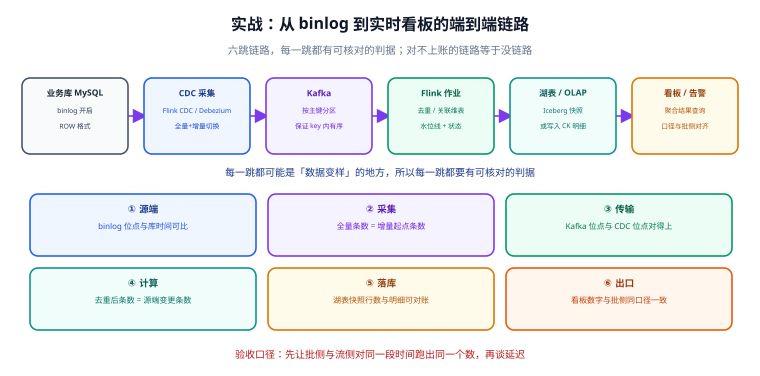

# 实战：从 binlog 到实时看板

前面各页讲的是组件本身。这一页把它们串起来：**从 MySQL 的 binlog 出发，经过 CDC、消息总线、流计算、湖表，最终产出与批处理口径一致的实时看板**。

选这条链路是因为它同时覆盖了本专题的全部关键判断点：全量与增量的衔接、分区与顺序、状态与一致性、幂等与对账、以及「怎么证明结果是对的」。



## 目标与边界

**目标**：订单数据从产生到出现在看板上，端到端延迟 ≤ 60 秒；同一时间窗内，流侧结果与批侧重算结果**完全一致**。

**明确不做的四件事**（写进文档以控制范围）：

| 不做 | 原因 | 替代 |
| --- | --- | --- |
| 不做毫秒级 | 业务动作是「小时级调整投放」，秒级已是富余 | 若真需要，再上实时 OLAP |
| 不做全量数据实时同步 | 历史数据用批处理初始化即可 | 全量用 `SELECT` 一次导入，之后只跑增量 |
| 不引入 K8s | 30 天周期内单机 Compose 足够 | 第 4 周若需弹性再迁移 |
| 不做数据质量平台 | 本链路只做**条数级**对账 | 字段级质量规则交给既有[数据质量专题](/docs/DB/DataWarehouse/Quality/index.md) |

## 第 0 跳：先定口径（最容易被跳过的一步）

在写任何代码之前，把口径写死。**这一份表是全链路唯一的口径来源**：

| 指标 | 定义 | 时间字段 | 时区 | 去重键 |
| --- | --- | --- | --- | --- |
| 订单数 | 已支付订单的**去重**订单数 | `paid_at`（支付时间） | Asia/Shanghai | `order_id` |
| GMV | 已支付订单金额之和 | `paid_at` | Asia/Shanghai | `order_id` |
| 店铺数 | 有支付订单的店铺去重数 | `paid_at` | Asia/Shanghai | `shop_id` |

::: danger 注意
口径表里最容易出错的三处，必须在动手前确认：
1. **用哪个时间字段**：用 `created_at`（下单）还是 `paid_at`（支付），两个口径算出来的「今日订单数」可以差一半。
2. **时区**：源库是 UTC、看板期望东八区，若在某一跳做了转换而另一跳没做，会出现「今天的数对上了、跨天的时候错位」。
3. **去重键**：CDC 会重放，重放即重复。**没有去重键就没有正确的指标**。
:::

## 第 1 跳：源端 MySQL

```ini
# my.cnf（服务端，需重启生效）
[mysqld]
server-id                = 1
log_bin                  = mysql-bin
binlog_format            = ROW          # 必须 ROW：只有行格式才能还原出「改了哪一行」
binlog_row_image         = FULL         # 记录完整前后镜像，否则拿不到旧值
binlog_expire_logs_seconds = 604800     # 保留 7 天，决定「改错了能回溯多久」
```

```sql
-- 给 CDC 用的最小权限账号（不要用 root）
CREATE USER 'cdc'@'%' IDENTIFIED BY '<强密码>';
GRANT SELECT, RELOAD, SHOW DATABASES, REPLICATION SLAVE, REPLICATION CLIENT ON *.* TO 'cdc'@'%';
FLUSH PRIVILEGES;
```

**本跳判据**：

```shell
# 确认 binlog 开启、格式为 ROW，并记录当前位点（增量起点）
mysql -ucdc -p -e "SHOW VARIABLES LIKE 'binlog_format'; SHOW MASTER STATUS;"
```

**期望**：`binlog_format` = `ROW`；`SHOW MASTER STATUS` 返回当前 `File` 与 `Position`（这两个值就是增量起点，采集任务启动时要用）。

## 第 2 跳：CDC 采集（全量 + 增量衔接）

CDC 的难点**不在增量**，而在「全量做完的那一刻，增量从哪里开始」，中间的缝隙会丢数据。

```yaml
# Flink CDC 的作业配置（提交给 Flink 集群执行）
# 关键点：全量与增量在同一个作业里完成，由框架保证切换点一致（无需手算位点）
source:
  type: mysql
  hostname: mysql
  port: 3306
  username: cdc
  tables: biz.orders
  scan:
    startup:
      mode: initial            # 先做全量快照，再自动接增量，衔接由框架保证
    increment:
      snapshot:
        chunk:
          size: 8096           # 全量阶段的分片大小：太小 → 连接多；太大 → 单批慢
```

**为什么不用「手动算位点」**：手动方案需要「先锁定位点 → 做全量 → 从位点开增量」，全量期间库仍在写入，很容易把位点算错。框架化的 `initial` 模式把这段一致性交给引擎处理。

**本跳判据**（全量条数 = 增量起点条数）：

```sql
-- 在源库执行：拿到某一时刻的行数
SELECT COUNT(*) AS src_cnt FROM biz.orders;

-- 在湖表执行：确认全量快照的条数一致（允许快照期间的新增差异，差额要能解释）
SELECT COUNT(*) AS lake_cnt FROM lake.ods_orders;
```

**判读**：两个数应当接近；若差值为负（湖表少于源库），说明全量阶段有数据未捕获，需要检查快照分片配置与源库长事务（长事务会阻塞快照的一致性读）。

## 第 3 跳：Kafka 作为数据总线

```shell
# 建主题：3 分区（峰值吞吐估算 ÷ 单消费者能力 × 1.5），副本 3
kafka-topics.sh --bootstrap-server kafka:9092 --create \
  --topic ods.orders \
  --partitions 3 \
  --replication-factor 3 \
  --config min.insync.replicas=2 \
  --config retention.ms=604800000        # 保留 7 天，与 binlog 保留期对齐

# 验证
kafka-topics.sh --bootstrap-server kafka:9092 --describe --topic ods.orders
```

::: tip 分区键的判据
**用 `order_id` 做 key 还是 `shop_id`？**
取决于「谁需要有序」：如果下游按订单聚合，用 `order_id`；如果下游按店铺聚合且要求店铺内顺序，用 `shop_id`。
**不要用随机键**——随机键会打散同一实体的变更，让「按主键去重」这件事变复杂。
:::

## 第 4 跳：Flink 作业（去重 → 维表关联 → 窗口聚合）

这一跳是整个链路的**正确性中心**：去重、状态、水位线、两阶段提交都在这里。

```java
// 作业骨架：Kafka → 去重 → 维表关联 → 窗口聚合 → 湖表（两阶段提交）
StreamExecutionEnvironment env = StreamExecutionEnvironment.getExecutionEnvironment();

// ① 检查点：一致性快照，60 秒一次；这是 Exactly-Once 的基础
env.enableCheckpointing(60_000);
env.getCheckpointConfig().setCheckpointingMode(CheckpointingMode.EXACTLY_ONCE);
env.getCheckpointConfig().setMinPauseBetweenCheckpoints(30_000);
env.getCheckpointConfig().setCheckpointTimeout(600_000);

// ② 源：Kafka，带水位线（事件时间，容忍 5 秒乱序）
KafkaSource<OrderEvent> source = KafkaSource.<OrderEvent>builder()
    .setBootstrapServers("kafka:9092")
    .setTopics("ods.orders")
    .setGroupId("order-metrics")
    .setStartingOffsets(OffsetsInitializer.committedOffsets(OffsetResetStrategy.LATEST))
    .setValueOnlyDeserializer(new OrderEventDeserializer())
    .build();

DataStream<OrderEvent> events = env.fromSource(
    source,
    WatermarkStrategy.<OrderEvent>forBoundedOutOfOrderness(Duration.ofSeconds(5))
        .withTimestampAssigner((e, ts) -> e.getPaidAt())
        .withIdleness(Duration.ofMinutes(1)),
    "kafka-orders");

// ③ 去重：CDC 重放会产生重复，按 order_id 做 keyed 去重（状态保留 1 天）
DataStream<OrderEvent> deduped = events
    .keyBy(OrderEvent::getOrderId)
    .process(new DeduplicateFunction(Duration.ofDays(1)));

// ④ 维表关联：店铺维度用广播状态（维度表小、变更少）
DataStream<OrderEvent> enriched = deduped
    .keyBy(OrderEvent::getShopId)
    .connect(shopDimBroadcastStream)          // 店铺维度变更流
    .process(new ShopEnrichFunction());

// ⑤ 窗口聚合：2 分钟滚动窗口，按店铺
SingleOutputStreamOperator<ShopGmv> gmv = enriched
    .keyBy(OrderEvent::getShopId)
    .window(TumblingEventTimeWindows.of(Duration.ofMinutes(2)))
    .allowedLateness(Duration.ofSeconds(30))
    .sideOutputLateData(lateTag)               // 迟到数据走旁路，不丢也不污染主链路
    .aggregate(new GmvAggregator());

// ⑥ Sink：写湖表，靠两阶段提交做到端到端 Exactly-Once
gmv.sinkTo(IcebergSink.forTable("lake.dws_shop_gmv").build());
```

```java
// 去重算子的核心：用状态记住见过的 order_id，重复的直接丢弃
public class DeduplicateFunction extends KeyedProcessFunction<String, OrderEvent, OrderEvent> {
    private transient ValueState<Boolean> seen;

    @Override
    public void open(Configuration params) {
        // 注意：Flink 2.x 起 TTL 用 java.time.Duration（1.x 的 org.apache.flink.api.common.time.Time 已移除）
        ValueStateDescriptor<Boolean> desc = new ValueStateDescriptor<>("seen", Types.BOOLEAN);
        desc.enableTimeToLive(StateTtlConfig.newBuilder(Duration.ofDays(1)).build());   // 状态必须设 TTL
        seen = getRuntimeContext().getState(desc);
    }

    @Override
    public void processElement(OrderEvent e, Context ctx, Collector<OrderEvent> out) throws Exception {
        if (seen.value() == null) {            // 第一次见到
            seen.update(true);
            out.collect(e);
        }
        // 重复的直接丢弃：这就是「幂等」在流侧的落点
    }
}
```

::: danger 注意
**去重状态不设 TTL 是流作业最经典的泄漏源。** `order_id` 几乎不重复，但状态会永久累积——运行几个月后状态膨胀到几十 GB，检查点超时、恢复时间从分钟级变成小时级。修法：所有去重/关联状态都要 `enableTimeToLive`，TTL 取「业务上重复可能出现的最大时间窗 × 2」。
:::

## 第 5 跳：落库（湖表 + OLAP 明细）

| 下游 | 存什么 | 写入方式 | 一致性 |
| --- | --- | --- | --- |
| **湖表 `dws_shop_gmv`** | 窗口聚合结果（店铺 × 2 分钟） | Flink Iceberg Sink（两阶段提交） | Exactly-Once |
| **湖表 `ods_orders`** | 去重后的订单明细 | Flink Iceberg Sink（两阶段提交） | Exactly-Once |
| **OLAP（如 ClickHouse）** | 明细 + 聚合（看板直查） | 幂等写入（按主键 upsert / 分区替换） | At-Least-Once + 幂等 |

::: warning 说明
**OLAP 侧通常做不到事务型两阶段提交**，所以必须靠幂等：写入时以「日期分区 + 订单主键」为主键做替换，而不是追加。**这是全链路唯一需要「用幂等补一致性」的地方**，也是压测与对账时最容易出问题的地方。
:::

```sql
-- 湖表侧的 Compaction：流式写入会持续产生小文件，定时合并
-- 在 Spark SQL 中执行（每天低峰期调度）
CALL lake.system.rewrite_data_files(
  table => 'lake.dwd_orders',
  options => map('target-file-size-bytes', '134217728', 'min-input-files', '5')
);
CALL lake.system.rewrite_manifests('lake.dwd_orders');   -- 顺带合并元数据
```

## 第 6 跳：看板与出口

看板只做两件事：**查询**与**展示**。不要在看板层再做一次业务计算——那会让「看板口径」和「数仓口径」变成两套。

```sql
-- 看板接口背后的一条查询（近 24 小时各店铺 GMV，按小时聚合）
-- 注意：聚合粒度比湖表粗（湖表是 2 分钟窗口），这里做上卷
SELECT
    toStartOfHour(window_start) AS hour,
    shop_id,
    sum(gmv)   AS gmv,
    sum(cnt)   AS order_cnt
FROM lake.dws_shop_gmv
WHERE window_start >= now() - INTERVAL 24 HOUR
GROUP BY hour, shop_id
ORDER BY hour DESC, gmv DESC;
```

## 批流对账：证明结果是对的

这是整个实战里**最值钱的一步**。做法是：**让批侧对同一时间窗重算一遍，比较结果**。

```sql
-- 流侧：取某一天的流结果
SELECT shop_id, SUM(gmv) AS gmv, SUM(cnt) AS cnt
FROM lake.dws_shop_gmv
WHERE window_start >= '2026-10-10 00:00:00' AND window_start < '2026-10-11 00:00:00'
GROUP BY shop_id;

-- 批侧：从明细按同一口径重算
SELECT shop_id, SUM(amount) AS gmv, COUNT(DISTINCT order_id) AS cnt
FROM lake.ods_orders
WHERE paid_at >= '2026-10-10 00:00:00' AND paid_at < '2026-10-11 00:00:00'
  AND status = 'PAID'
GROUP BY shop_id;
```

**对账纪律**：

| 项 | 要求 |
| --- | --- |
| 时间窗 | 两侧必须**左闭右开**，且用同一个时区 |
| 去重口径 | 两侧都用 `COUNT(DISTINCT order_id)` |
| 差额判读 | 差额必须能解释（如「窗口边界处迟到 30 秒内的订单」），不能只写「基本一致」 |
| 频率 | 每天跑一次；差异连续两天出现即视为缺陷 |

## P1~P10 验收断言

| 编号 | 断言 | 验证方式 | 期望 |
| --- | --- | --- | --- |
| P1 | 源端 binlog 为 ROW 且保留期 ≥ 7 天 | `SHOW VARIABLES` / `SHOW MASTER STATUS` | 格式 ROW，保留期满足 |
| P2 | 全量快照与源库条数可解释 | 两侧 `COUNT(*)` | 差额能被快照期间的写入解释 |
| P3 | 主题分区、副本、最小同步副本符合规划 | `kafka-topics.sh --describe` | 分区 = 3，副本 = 3，`min.insync.replicas` = 2 |
| P4 | 消费无持续积压 | `kafka-consumer-groups.sh --describe` | LAG 不持续增长 |
| P5 | 去重生效：重放同一批数据不产生重复 | 重放后比对 `COUNT(*)` | 两次结果一致 |
| P6 | 迟到数据可见 | 人为造一条迟到数据 | 出现在侧输出目标中 |
| P7 | 端到端延迟 ≤ 60 秒 | 源端写入带时间戳的记录，看板轮询 | 出现时间差 ≤ 60s |
| P8 | 流侧与批侧对账一致 | 对同一时间窗重算 | 差额可解释（正常为 0） |
| P9 | 作业重启后结果不重 | 触发一次重启，观察聚合值 | 重启前后总值不变 |
| P10 | 小文件受控 | 查湖表文件数与平均大小 | 平均大小 ≥ 目标值的 50% |

::: tip 关于实测列
上表是**判据清单**，不是实测记录。在你的环境里跑完后，逐条把实测结果填进去；**不要直接把「期望」抄进「实测」列**——那样等于没有验证。本机没有容器运行时的项目，应当如实标注未执行与原因。
:::

## 收尾：这条链路最容易出问题的三处

1. **全量与增量的衔接点**（第 2 跳）：手算位点必错，用框架的 `initial` 模式。
2. **去重状态无 TTL**（第 4 跳）：不设 TTL，作业能跑但会在几个月后崩。
3. **OLAP 侧的写入不是幂等**（第 5 跳）：看似只是重复几条，实际会让所有对账都白做。

## 参考资料

- Flink CDC 文档：<https://nightlies.apache.org/flink/flink-cdc-docs-stable/>
- Kafka 主题与生产者配置：<https://kafka.apache.org/documentation/#producerconfigs>
- Iceberg 维护操作（compaction）：<https://iceberg.apache.org/docs/latest/maintenance/>
- 相关专题：[数据同步与 CDC](/docs/DB/CDC/index.md)、[Flink：有状态流处理](../Flink/index.md)、[生态组件：消息、湖表与调度](../Ecosystem/index.md)、[数仓建模](/docs/DB/DataWarehouse/index.md)
