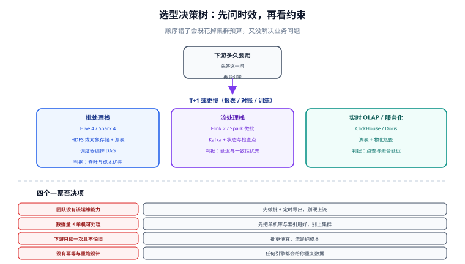

# 选型与架构决策

选型的难点不在「哪个组件更好」，而在**先回答对问题**。这一页给出一套可以照着走的判断顺序：先定时效，再定约束，最后定版本与升级路径。



## 第一步：先问时效

| 下游要用到数据的时间 | 推荐栈 | 典型场景 | 成本量级 |
| --- | --- | --- | --- |
| T+1 或更慢 | 批处理：抽取 → 对象存储/HDFS → Hive/Spark → 结果表 | 报表、对账、模型训练样本 | 最低（离线时段跑，资源可复用） |
| 分钟级（5~30 分钟） | 流处理微批：CDC → Kafka → Spark 微批 / Flink → 湖表 | 运营看板、库存预警 | 中（需要常驻作业） |
| 秒级（1~30 秒） | 流处理 + 实时 OLAP：Flink → OLAP/湖表物化视图 | 实时大屏、风控、监控 | 高（常驻 + 额外存储） |
| 毫秒级（点查） | 在线库 / 分布式 KV / 实时 OLAP 点查 | 用户端查询、订单状态 | 与 OLAP 相当，但要求高可用 |

::: tip 一条纪律
**「实时」是一个需要被证明的需求，不是一个默认选项。** 在需求文档里写清「下游拿到实时数据后会做什么动作」——如果答案是「其实第二天看也一样」，那它就不需要实时。用批处理省下来的资源，通常远大于「支持实时」带来的业务价值。
:::

## 第二步：四个一票否决项

任一条成立，就不要按理想方案推进：

| 一票否决项 | 为什么 | 替代方案 |
| --- | --- | --- |
| **团队没有流处理运维能力** | 流作业是常驻进程，需要处理背压、状态膨胀、检查点超时、版本升级——出问题的概率远高于批作业 | 先做批 + 定时导出，把口径跑通；需要时效时用「高频微批」过渡 |
| **数据量单机可处理** | 集群的固定成本（机器、运维、监控）从第一天开始付 | 用好索引、分区、物化视图；单机 OLAP 通常能撑到亿级 |
| **下游只读一次且不怕旧** | 流处理把成本换成了延迟，而这里延迟没有价值 | 批处理 + 更长保留期 |
| **没有幂等与重跑设计** | 任何引擎都会在失败时重放数据，重放即重复 | 先定幂等键与写入语义，再谈引擎 |

## 第三步：引擎对照

### 批处理引擎

| 引擎 | 优势 | 代价 | 什么时候选它 |
| --- | --- | --- | --- |
| Hive（Tez） | SQL 生态成熟、与 HMS 深度绑定、存量资产多 | 启动开销大、交互式查询体验差 | 已有 Hive 数仓、以 T+1 报表为主 |
| Spark | 一套 API 覆盖 SQL/流/ML、生态最广、迭代计算快 | 需要理解 Stage 与 Shuffle 才能调优 | 主流选择：批 + 微批都能覆盖 |
| Trino / Presto | 交互式查询快、跨源联邦查询强 | 不擅长超大规模 ETL、对元数据依赖高 | 即席查询、BI 直连 |
| ClickHouse | 单表聚合极致快、列存压缩高 | 不擅长多表复杂 JOIN、更新弱 | 明细查询与实时看板 |

### 流处理引擎

| 维度 | Flink | Spark Structured Streaming |
| --- | --- | --- |
| 执行模型 | 原生流（一条一条处理） | 微批（按间隔切批） |
| 延迟下限 | 毫秒~秒级 | 秒级~十秒级（受批次间隔约束） |
| 状态管理 | 完备（Keyed/Operator State、RocksDB、savepoint 可改并发） | 相对受限 |
| 时间语义 | 事件时间 + 水位线 + 侧输出，能力最全 | 事件时间 + 水位线，能力足够但选项少 |
| 批流代码复用 | Table API 层可复用，DataStream 需另写 | **与批处理共用同一套 API**，复用度最高 |
| 升级成本 | 1.x → 2.x 有破坏性变更（见下） | 3.x → 4.x 主要是 ANSI 模式与 Scala 版本 |

**选择判据**：需要「亚秒级延迟」或「复杂状态（如 CEP、大 key 状态）」→ Flink；团队已用 Spark 且延迟要求 ≥ 5 秒、希望批流一套代码 → Structured Streaming。

### 存储形态

| 形态 | 优点 | 代价 | 适用 |
| --- | --- | --- | --- |
| Hive 表 + HDFS/对象存储 | 简单、生态广 | 无事务、并发写弱、小文件多 | 纯批、不要求并发写 |
| 湖表（Iceberg/Paimon） | 快照隔离、时间旅行、分区演进、批流共用 | 需要维护 compaction 与 Catalog | 批流一体、多引擎共用 |
| 实时 OLAP | 查询延迟低、并发高 | 成本高、历史深度有限 | 看板、点查 |
| 时序库 | 写入吞吐与压缩最优 | 只适合指标型数据 | 监控指标（见[时序数据库](/docs/DB/TimeSeries/index.md)） |

## 大版本组织与升级路径

这一节回答两个问题：**文档里旧版本内容怎么组织**、**线上旧版本怎么升级**。

### 一、版本目录的拆分判据

仓库约定「涉及大版本时按版本目录组织（如 `Spring5/`、`Spring6/`），旧版本保留并标注状态，不覆盖旧内容」。但**拆目录本身有成本**：拆完之后每个版本都要单独维护，且两版共用 80% 的内容会变成两份。

所以拆目录的判据写死为三条，**满足任意一条才拆**：

| 判据 | 说明 | 反例 |
| --- | --- | --- |
| 包名/命名空间级变化 | 依赖无法共存，代码要改写 | `javax.*` → `jakarta.*`（Spring 5→6） |
| API 大面积移除或重命名 | 老代码在新版**编译不过** | Vue 2 Options API → Vue 3 Composition API |
| 两版并存期很长（≥ 3 年）且都在生产 | 两版都要有独立教程 | MySQL 5.7 与 8.0 并存期 |

反之，**差异集中在「默认值变了 / 少数配置项变了 / 少数语义变了」时，不拆目录**——在页面内按版本分节，并显式标注哪一版适用即可。本专题的四组大版本（Hadoop、Hive、Spark、Flink）当前都属于第二类，因此**统一在组件页内按版本分节**，不为每个大版本建目录。

::: tip 为什么这条判据要写出来
没有判据时，两种做法都会有人反对：有人觉得「必须拆，否则两版混在一起看不懂」，有人觉得「不该拆，重复内容难维护」。把判据写死之后，争论变成一次检查：「它满足三条中的哪一条？」——答不出来的就不拆。
:::

### 二、各组件的版本状态与升级要点

| 组件 | 当前主线 | 存量线 | 存量线状态 | 升级的最大障碍 |
| --- | --- | --- | --- | --- |
| Hadoop | 3.5.0 | 3.4.3 / 3.3.x / 2.x | 3.4 维护中；2.x 停止维护 | NameNode 元数据格式（不可逆，必须先全量备份） |
| Hive | 4.2.1（JDK 21） | 4.1.x（JDK 17）/ 4.0.1（JDK 8） | 3.x 已于 2024-10-08 EOL | 执行引擎（`spark` 已移除）+ metastore schema |
| Spark | 4.2.0 | 3.5.9（LTS） | LTS 只收安全修复 | Scala 2.12 移除 + ANSI 模式默认开启 |
| Flink | 2.3.0 | 1.20.5 | 1.x 最后维护线 | 1.x 与 2.x **状态不保证兼容** |

### 三、三条升级纪律

**纪律 1：先验证「能不能恢复」，再验证「能不能跑」。**

升级的第一件事不是启动新版本，而是确认**旧版本的 savepoint / 备份可用**。Flink 升级尤其如此：官方明确 1.x 与 2.x 状态不保证兼容，所以升级前必须做一次「旧版本写 savepoint → 新版本恢复」的演练。

```shell
# Flink：升级前必做的一次跨版本恢复演练
# 1) 在 1.20 上触发 savepoint（作业不停）
flink savepoint <jobId> /data/savepoints --type canonical

# 2) 在 2.x 上用该 savepoint 启动一个新版本作业（不接生产流量）
flink run -d --fromSavepoint /data/savepoints/savepoint-xxxx \
  -c com.example.OrderMetricsJob order-metrics.jar

# 3) 双跑对比：新旧版本对同一段 Kafka 数据算出的结果必须一致
#    不一致 → 说明状态或算子语义变了，不能切流
```

```shell
# Hive：升级前备份元数据并预演 schema 升级
mysqldump -h <hms> -u hive -p hive_metastore > hms_backup.sql
schematool -dbType mysql -info
schematool -dbType mysql -upgradeSchema -dryRun      # 预演，不改库
```

**纪律 2：升级顺序按「平台 → 组件 → 作业」。**

```text
① 平台层：JDK、Hadoop、Tez/调度器        （Flink 2.x 要求 JDK 11+；Hive 4.2 要求 JDK 21）
② 组件层：Hive/HMS、Spark、Flink、连接器  （连接器常滞后于引擎，先确认版本矩阵）
③ 作业层：逐个作业改配置、重新编译、双跑  （按业务重要性排序，不一次性全切）
```

**纪律 3：旧版本行为必须留在文档里，且标注状态。**

升级之后不要删掉旧版本的说明：**存量项目仍在跑旧版本**，他们需要的是「旧版本怎么做」，而不是「新版怎么做」。本专题的处理方式是——旧版本内容保留在原页，按版本分节，并在表格里标注 `仅存量项目使用` / `已停止维护`，同时在页首给出该组件的版本状态表。

::: danger 注意
升级中最容易被忽略的一类问题：**连接器版本与引擎版本不匹配**。Flink 2.0 移除了 `SourceFunction` / `SinkFunction` / Sink V1，**依赖这些 API 的旧连接器在 2.x 上根本无法运行**；Spark 4 移除 Scala 2.12，自编译的 UDF jar 需要重编。所以升级清单里必须包含一项：「本项目用到的每个连接器/插件，在新版本下有没有对应版本？」
:::

## 第四步：成本量级估算

| 项 | 估算方式 | 容易被忽略的部分 |
| --- | --- | --- |
| 存储 | 明细数据量 × 副本/版本数 × 保留天数 × 压缩比倒数 | **副本与快照**：3 副本 + 30 天快照 = 原始数据的 3 倍以上 |
| 计算 | 峰值并行度 × 单核价格 × 作业时长 | **常驻作业**：流作业 24 小时计费，批作业只跑几小时 |
| 运维 | 人力 × 时间 | **组件数量**：每多一个独立组件，就多一套监控、备份、升级 |
| 风险 | 故障恢复时间 × 业务损失 | **恢复演练**：没演练过的恢复方案等于没有 |

::: tip 一个常被低估的成本
**「元数据与 Catalog 的运维」通常被忽略**：HMS 的数据库、湖表 Catalog 的高可用、连接器版本矩阵——这些不产生业务价值，但它们坏了会**同时影响多个引擎**，是投入产出比最需要提前算清楚的一块。
:::

## 决策记录模板（建议写进项目文档）

```text
## 决策：<决策点名称>
- 背景：<要解决的问题，含数据量与时效数字>
- 候选方案：<A / B / C，各自一句话>
- 选择：<方案 X>
- 理由：<为什么 X 匹配当前的时效、规模、团队能力>
- 放弃的代价：<选 X 之后放弃了什么，是否可逆>
- 判据：<用什么指标验证这个决定是对的，什么时候复查>
- 版本：<涉及组件的版本号与状态（主线/存量/EOL）>
```

## 与数据治理专题的分工

选型解决的是「**用什么跑**」，治理解决的是「**同一份数据存在多处时，谁是权威**」。大数据生态里这个边界最容易被越界：湖里一份、仓里一份、业务库里还有一份，三份都「跑得对」，但**没有任何一处写着哪一份算数**。

- 选型关注：引擎、存储格式、调度、成本、迁移路径（本页）。
- 治理关注：**跨系统的资产归属与口径归属**——同一指标在两个系统里各有一份实现时，谁是权威、差异怎么登记。见 [概述：数据治理的四条边界](../../DataGovernance/Overview/index.md)与 [数据标准与主数据](../../DataGovernance/StandardsMasterData/index.md)。

一条可用的判据：**当一个指标在湖与仓里各有一份实现时，两份实现必须能回答「谁是权威、差异是多少」**；答不出来，说明治理这一档还没做，此时的选型再先进也只是把不一致复制到了第二套系统里。

## 与「数据湖与湖仓一体」专题的分工

| 问题 | 看哪里 |
| --- | --- |
| 组件级选型：Hive / Spark / Flink / ClickHouse / ES 之间的取舍 | **本页** |
| 表格式级选型：Iceberg / Delta / Hudi / Paimon 的判别条件 | [湖仓专题 · 表格式](../../Lakehouse/TableFormat/index.md) |
| 存储与查询两层怎么分工（湖仓 vs 服务层） | [湖仓专题 · 引擎接入](../../Lakehouse/QueryEngine/index.md) |

一句话：**本页选「算」，湖仓专题选「存」**。两者的选型不能互相替代：选了 Spark 不代表表格式只能是某个；选了 Iceberg 也不代表查询引擎只能用 Trino。

::: danger 本页特有的坑：把「支持 Iceberg」当成「能读写 Iceberg」
「支持」有三种强度，选型表里必须写清是哪一种：**只能读 v2**、**能读能写 v2**、**支持 v3**。最常见的翻车是「A 引擎写、B 引擎读」上线后才发现 B 只认 v2，而 A 已经把表升到 v3——v3 表对 v2-only 读者是**不可见**，不是「降级读」。对齐方法见湖仓专题的 `LHT-C`。
:::

## 参考资料

- Apache Spark 下载与版本页：<https://spark.apache.org/downloads.html>
- Apache Flink 下载与版本页：<https://flink.apache.org/downloads/>
- Apache Flink 2.0 破坏性变更：<https://flink.apache.org/2024/10/23/preview-release-of-apache-flink-2.0>
- Hive 版本与生命周期：<https://hive.apache.org/downloads.html>
- Hadoop 发布归档：<https://hadoop.apache.org/release>
- 相关专题：[概述：大数据栈的四层与四条主线](../Overview/index.md)、[常见问题与最佳实践](../FAQ/index.md)
