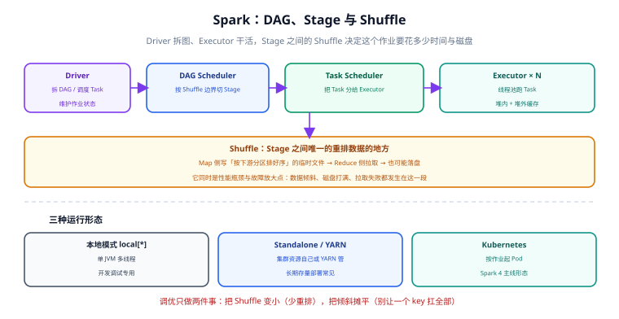

# Spark：批与微批引擎

Spark 解决的是「同一个引擎既能跑批、也能跑微批」的问题。它在 Hadoop 的存储之上加了一层**内存计算 + 有向无环图调度**，把 MapReduce 时代「每个阶段都落盘」的代价压了下来，同时把 SQL、流、机器学习放进同一套 API。

这一页的重点是**执行模型**与**性能决定项**：搞懂 Stage 与 Shuffle，调优就有了方向。

## 适用版本与状态

| 版本线 | 状态 | 关键差异 |
| --- | --- | --- |
| **4.2.0**（2026-07-14） | 当前主线 | Spark Connect 为首选接入形态；预编译 Scala 2.13 |
| 4.1.3（2026-07-15） | 维护中 | 4.1 线最新补丁 |
| 4.0.4（2026-07-15） | 仅存量项目使用 | 4.0 线补丁版；ANSI 模式为默认行为 |
| **3.5.9**（2026-07-16） | **LTS，仅存量项目使用** | 仍在收安全修复，但不再有新特性 |
| 3.4 及更早 / 2.x | 已停止维护 | 新项目不要选 |

::: warning 说明
**Spark 4 与 Spark 3 的差异集中在三处**，升级前必须逐条确认（详见[选型与架构决策](../Selection/index.md)）：
1. **Scala 2.12 支持已移除**，Spark 4 只提供 Scala 2.13 预编译包；自编译的 UDF jar 需要重新编译；
2. **ANSI 模式成为默认**：整数溢出、除零、类型转换失败等从「静默返回 null」变成**抛异常**——这是升级后最常见的报错来源；
3. **Spark Connect 成为推荐接入方式**：客户端与集群解耦，但自定义扩展点（如自定义数据源）在 Connect 下行为受限。
:::

## 执行模型：Driver 拆图，Executor 干活



### 五个角色与三层切分

| 概念 | 含义 | 与性能的关系 |
| --- | --- | --- |
| **RDD / DataFrame** | 不可变的数据集抽象与血缘（lineage） | 血缘是容错基础，也是重算的来源 |
| **Job** | 由一次「触发动作」（如 `count`、`write`）产生 | 惰性求值：没有动作就不会执行 |
| **DAG** | 由转换（transformation）连成的有向无环图 | 图越简单，优化空间越大 |
| **Stage** | 按 **Shuffle 边界**切分出的执行段 | Stage 数 ≈ 需要的 Shuffle 轮次 |
| **Task** | Stage 内按分区切出的最小执行单元 | Task 数决定并行度与调度开销 |

一个关键推论：**Stage 的数量不是由代码行数决定的，而是由 Shuffle 次数决定的**。减少 Shuffle 就是减少 Stage，也就是减少落盘与网络传输。

::: tip 惰性求值带来的一个实用判据
如果你写完一个转换就发现「作业立刻开始跑了」，那说明中间有触发动作；反之，一个纯转换的 DataFrame 链条不会占用任何集群资源。调试时在关键位置加 `explain()` 看计划，比盲目跑作业便宜得多。
:::

### Shuffle：唯一的重排点

Shuffle 发生在 Stage 之间：上游按下游需要的分区方式，把数据**重分布**。它的代价包括：

- **Map 侧**：写临时文件（可能落盘）、排序；
- **Reduce 侧**：拉取远程数据、合并、可能再次落盘；
- **放大效应**：某个 key 的数据远多于其他 key 时，单个 Task 会成为长尾。

```python
# 观察 Shuffle 规模：换 join 方式前先量一次
from pyspark.sql import SparkSession, functions as F

spark = SparkSession.builder.appName("shuffle-probe").getOrCreate()

orders = spark.read.parquet("hdfs:///warehouse/dwd_orders")
users = spark.read.parquet("hdfs:///warehouse/dim_user")

# 默认 sort-merge join：会发生完整 Shuffle
joined = orders.join(users, on="user_id", how="inner")
joined.explain("cost")          # 看计划的估计行数与分区数
joined.count()                  # 触发执行

# 小表广播：把 dim_user 全量发到每个 Executor，消除大表侧的 Shuffle
small = spark.read.parquet("hdfs:///warehouse/dim_user_small")
joined2 = orders.join(F.broadcast(small), on="user_id", how="inner")
joined2.explain("cost")
```

**判读口径**：在 Spark UI 的 SQL 页面里看每个节点的 `Shuffle Write / Shuffle Read` 字节数。若某次 JOIN 的 Shuffle Write 与你预期的结果集大小差一个数量级，通常说明**过滤条件没有下推**（例如过滤写在了 JOIN 之后）。

## 数据倾斜：识别与四类解法

倾斜的判据很机械：**同一个 Stage 内，最大 Task 的处理记录数超过中位数 10 倍以上**。

| 成因 | 表现 | 解法 | 代价 |
| --- | --- | --- | --- |
| 某个 key 天然巨大（如 `shop_id=0` 表示「平台自营」） | 单个 Task 长时间不动 | **过滤后单独处理**，再 union 回主结果 | 代码分叉，需保证口径一致 |
| 大表 JOIN 大表且 key 分布不均 | 少数 Reduce 扛住大部分数据 | **加盐打散**（key 拼随机前缀，两轮聚合） | 需要第二轮再聚合 |
| JOIN 的小表其实不小（几十 MB~几 GB） | 大表侧 Shuffle 无意义 | **广播小表**（`F.broadcast`，阈值可调） | 广播过大 → Executor 内存压力 |
| 空值/无效 key 集中 | null 落到同一分区 | **先过滤 null** 或把 null 单独处理 | 需确认业务上确实可丢弃 |

```python
# 加盐打散：两轮聚合的标准写法（适用于「大 key 参与 GROUP BY」）
salt = 16
salted = orders.withColumn("salt", (F.rand() * salt).cast("int"))
partial = (salted.groupBy("shop_id", "salt").agg(F.sum("amount").alias("partial_amount")))
result = partial.groupBy("shop_id").agg(F.sum("partial_amount").alias("amount"))
```

::: danger 注意
三个在倾斜治理上反复出现的错误：
1. **只调大并行度**：`spark.sql.shuffle.partitions` 从 200 调到 2000 并不会让那个超大 key 变小，只会让 1999 个 Task 更快地空转。
2. **无脑广播**：`spark.sql.autoBroadcastJoinThreshold` 设得过大，或对小表判断错误，会让 Executor 频繁 GC 甚至 OOM。
3. **加盐后忘记第二轮聚合**：得到的是每个「key + 盐值」的部分结果，**条数会变多**，直接落库就是错的。
:::

## 缓存与广播

| 手段 | 适用场景 | 不用它的后果 |
| --- | --- | --- |
| `cache()` / `persist()` | 同一个中间结果被**多次使用**（迭代算法、多路分支输出） | 每次动作都从头重算整条血缘链 |
| 广播变量 | 小表或小字典参与 JOIN/查找 | 每个 Task 各读一份，网络与内存都浪费 |
| 检查点（checkpoint） | 血缘过长导致重算代价过高 | 失败重算整条链 |

::: tip 一条纪律
缓存**不是越多越好**：它占用 Executor 内存，与 Shuffle 和算子抢空间。判据是「这个 DataFrame 会不会被触发两次以上动作」——不会就不该缓存，缓存了只会挤掉别人。
:::

## Structured Streaming：微批形态的流处理

Spark 的流处理基于**微批（micro-batch）**：按固定间隔（或按可用数据）把流切成小批，用与批处理相同的引擎执行。

```python
# 从 Kafka 读数 → 按窗口聚合 → 写入下游（两分钟一个窗口，容忍 1 分钟迟到）
from pyspark.sql import SparkSession, functions as F

spark = SparkSession.builder.appName("order-metrics").getOrCreate()

raw = (spark.readStream.format("kafka")
       .option("kafka.bootstrap.servers", "kafka:9092")
       .option("subscribe", "dwd.orders")
       .option("startingOffsets", "latest")
       .load())

events = (raw.selectExpr("CAST(value AS STRING) AS json")
          .select(F.from_json("json", "order_id STRING, shop_id STRING, amount DOUBLE, event_time TIMESTAMP").alias("e"))
          .select("e.*")
          .withWatermark("event_time", "1 minute"))

agg = (events.groupBy(F.window("event_time", "2 minutes"), "shop_id")
       .agg(F.sum("amount").alias("gmv"), F.count("*").alias("cnt")))

query = (agg.writeStream
         .outputMode("update")
         .format("iceberg")                 # 写入湖表；换 console 可先在本地看结果
         .option("checkpointLocation", "hdfs:///checkpoints/order-metrics")
         .trigger(processingTime="30 seconds")
         .start())
query.awaitTermination()
```

::: warning 说明
微批与原生流的取舍：
- **微批的优点**：与批处理共用引擎与 API，批流两套代码可以大量复用；延迟通常可达秒级到十秒级。
- **微批的代价**：延迟下限受批次间隔约束；状态管理相对 Flink 更受限；**同一份业务逻辑在「批回算」与「流增量」之间仍需保证口径一致**（通常靠复用同一个聚合 SQL 实现）。
:::

## 调优清单（按收益排序）

| 顺序 | 动作 | 判据 |
| --- | --- | --- |
| 1 | 减少 Shuffle：能用广播就用广播，能在 JOIN 前过滤就不要在 JOIN 后 | SQL 页面的 Shuffle Write/Read 字节数下降 |
| 2 | 治倾斜：单 Task 记录数 / 中位数 < 3 | 各 Task 耗时分布更均匀 |
| 3 | 选对文件格式与分区：列存 + 分区裁剪 | TableScan 的「读入字节」远小于表总量 |
| 4 | 控制并行度：`shuffle.partitions` 与「Shuffle 数据量 / 128MB」相当 | Task 数不出现「一片几百毫秒的小任务」 |
| 5 | 缓存真正被复用的中间结果 | 重复动作的耗时明显下降 |
| 6 | 调内存与 GC：优先用**堆外/统一内存**，观察 GC 时间占比 | GC 时间占比 < 10% |

```shell
# 提交一个作业时最常用的几个参数（示例，按实际资源调整）
spark-submit \
  --master yarn --deploy-mode cluster \
  --num-executors 20 --executor-cores 4 --executor-memory 8g \
  --conf spark.sql.shuffle.partitions=400 \
  --conf spark.sql.adaptive.enabled=true \
  --conf spark.sql.adaptive.skewJoin.enabled=true \
  --conf spark.dynamicAllocation.enabled=true \
  job.py
```

## 常见问题与判读

| 现象 | 常见原因 | 处置 |
| --- | --- | --- |
| 作业一直卡在某个 Stage 不动 | 数据倾斜或 Shuffle 落盘打满磁盘 | Spark UI 看单 Task 记录数与各 Executor 磁盘 |
| 升级 Spark 4 后大量作业报错 | ANSI 模式默认开启，溢出/除零/转换失败变成异常 | 逐个定位，修数据或用 `try_cast`；不要全局关掉 ANSI |
| OOM in `collect()` / `toPandas()` | 把大数据集拉回 Driver | 改为写文件或分页拉取 |
| 任务数量上千但每个都很快 | 并行度过高（分区数远大于数据量） | 降低 `shuffle.partitions` |
| UDF 拖慢整个作业 | Python UDF 逐行跨进程调用 | 优先用内置函数；必须用 UDF 时考虑 Pandas UDF（向量化） |

## 与「数据湖与湖仓一体」专题的分工

| 问题 | 看哪里 |
| --- | --- |
| 算子、shuffle、执行计划、内存与并行度调优 | **本页** |
| 写表的提交语义（`INSERT OVERWRITE` 在湖表上到底做了什么）、幂等重跑 | [湖仓专题 · 提交协议](../../Lakehouse/WritePath/index.md) |
| 小文件为什么越写越多、`distribution-mode` 与目标文件大小 | [湖仓专题 · 小文件治理](../../Lakehouse/SmallFiles/index.md) |
| 读侧只扫了该扫的文件吗（裁剪四层） | [湖仓专题 · 引擎接入](../../Lakehouse/QueryEngine/index.md) |

一句话：**Spark 是写湖的主力引擎，但它不负责表语义**。同一个 `INSERT OVERWRITE`，在裸 Parquet 上是「先删后写」（中途失败留下半个分区），在湖表上是一个快照切换。

::: danger 本页特有的坑：`repartition(1)` 治小文件，治出新问题
为了少写文件而 `coalesce(1)` / `repartition(1)`，会把并行度压到 1——单 task 写 100 GB，任何一个 executor 抖动都要重跑整批。正确做法是**按目标文件大小算出分区数**（`总字节 / 128 MB`）再用 `repartition(n, 分区列)`，或者在表属性里让引擎自己分配（`write.distribution-mode=hash`）。判据见湖仓专题的 `LHC-D`。
:::

## 参考资料

- Spark 官方文档：<https://spark.apache.org/docs/latest/>
- Spark 性能调优指南：<https://spark.apache.org/docs/latest/sql-performance-tuning.html>
- Spark Structured Streaming 编程指南：<https://spark.apache.org/docs/latest/structured-streaming-programming-guide.html>
- 相关专题：[Hive：数仓 SQL 层](../Hive/index.md)、[Flink：有状态流处理](../Flink/index.md)、[选型与架构决策](../Selection/index.md)
