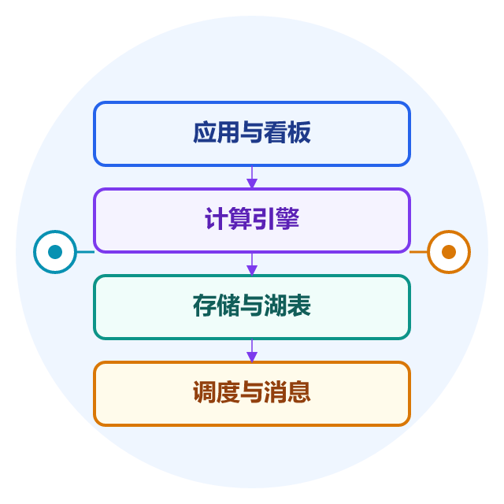
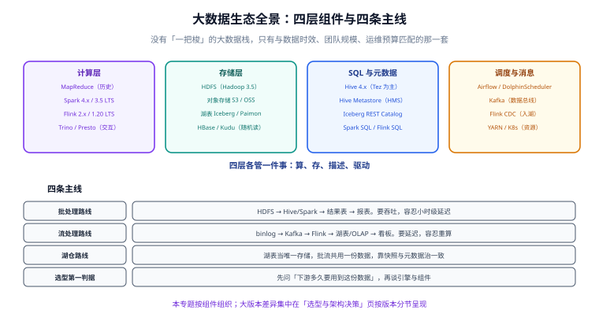

# 大数据生态

**大数据生态**不是某一个软件，而是一组分工明确的组件：有人负责把数据从业务库里搬出来，有人负责存，有人负责算，有人负责描述「这份数据是什么」，还有人负责在正确的时间把它们串起来。

它要回答的问题只有一个：**当单机数据库处理不了的数据量与时效要求出现时，该用哪几件工具、按什么顺序装、各自的边界在哪里。**

::: tip 一句话理解
大数据栈里没有「更先进的组件」，只有**与数据时效、团队规模、运维预算匹配的组件**。选错的代价不是跑不起来，而是跑起来了却没人能维护。
:::

## 与相邻专题的分工

本专题讲**组件本身怎么搭、怎么选、怎么连**；原理与方法论由库内既有专题承担。下表写死边界，避免重复阅读：

| 相邻专题 | 它讲什么 | 本专题讲什么 | 判据（什么时候该看哪边） |
| --- | --- | --- | --- |
| [数仓建模](/docs/DB/DataWarehouse/index.md) | 分析侧建模方法论：分层、维度建模、SCD、粒度 | 承载这些模型**用什么组件**：存哪、算什么、怎么调度 | 「表该怎么设计」→ 数仓建模；「这些表跑在哪」→ 本专题 |
| [ClickHouse](/docs/DB/ClickHouse/index.md) | 列存引擎原理、MergeTree、物化视图 | 它在整条链路里处在哪一跳、和湖表怎么分工 | 「单表查询怎么快」→ ClickHouse；「为什么要有这一跳」→ 本专题 |
| [数据同步与 CDC](/docs/DB/CDC/index.md) | binlog 原理、Debezium/Canal/Flink CDC 用法 | 采集出来的数据**往哪落、按什么语义落** | 「怎么把变更抓出来」→ CDC；「抓出来之后怎么组织」→ 本专题 |
| [时序数据库](/docs/DB/TimeSeries/index.md) | 指标型数据模型、采样与压缩 | 为什么监控链路一般不放大数据栈 | 数据是**指标**→ 时序库；数据是**业务事实**→ 本专题 |
| [数据库中间件](/docs/DB/Middleware/index.md) | 分库分表、读写分离、连接治理 | 在线库的内部扩展手段，与离线栈是两件事 | 「把在线库扛住」→ 中间件；「把在线库的数据用起来」→ 本专题 |
| [消息队列](/docs/Backend/MessageQueue/index.md) | Kafka/RabbitMQ 的消息语义、可靠投递、幂等 | 作为**数据总线**时怎么分区、怎么重放 | 「消息怎么不丢」→ 消息队列；「消息怎么支撑数据链路」→ 本专题 |
| [Kubernetes](/docs/Ops/Kubernetes/index.md) | 容器编排、调度、存储 | 大数据组件跑在 K8s 上的形态与取舍 | 「怎么部署」→ K8s；「为什么要这么部署」→ 本专题 |

## 专题地图

四层各管一件事——**算、存、描述、驱动**。任何一层缺失，链路都会在某处断裂：只有存储没有计算，数据是一堆文件；只有计算没有元数据，没人知道这份数据是什么；只有链路没有调度，链路不会自己跑。

## 章节导航

1. [概述：大数据栈的四层与四条主线](./Overview/index.md)：批 / 流 / 湖仓三条路线的边界、组件分层、从单机走向集群的三步、什么时候**不该**上大数据栈
2. [Hadoop：HDFS 与 YARN](./Hadoop/index.md)：HDFS 的块、副本、机架感知与 HA，YARN 的资源模型与容器，以及「适合一次写入多次读」的硬约束
3. [Hive：数仓 SQL 层](./Hive/index.md)：HiveQL 到执行引擎的翻译过程、分区/分桶/文件格式三个性能决定项、Hive 4 的破坏性变化与 metastore 升级
4. [Spark：批与微批引擎](./Spark/index.md)：RDD/DAG/Stage/Task 的执行模型、Shuffle 为什么是瓶颈、数据倾斜的识别与四类解法、Spark 4 与 3.5 LTS 的差异
5. [Flink：有状态流处理](./Flink/index.md)：时间语义与水位线、状态与状态后端、检查点与两阶段提交、Flink 2.x 与 1.20 LTS 的分界
6. [生态组件：消息、湖表与调度](./Ecosystem/index.md)：Kafka 作为数据总线的分区设计、Iceberg/Paimon 的快照语义、调度器与元数据目录的职责边界
7. [选型与架构决策](./Selection/index.md)：时效决策树、四个一票否决项、**大版本组织与升级路径**（Spark 3/4、Flink 1/2、Hive 3/4 的状态标注）
8. [实战：从 binlog 到实时看板](./Practice/index.md)：六跳链路的完整配置与判据、批流对账口径、可执行的验收清单
9. [常见问题与最佳实践](./FAQ/index.md)：慢/错/不稳三类问题的分诊表、高频十二问、上线自查十项

## 版本状态速览（2026-10）

| 组件 | 当前主线 | 仍在维护 | 已停止维护 | 页面口径 |
| --- | --- | --- | --- | --- |
| Hadoop | **3.5.0**（2026-04-01） | 3.4.3（2026-02-24） | 2.x、3.3.x | HDFS/YARN 判据对 3.3+ 通用 |
| Hive | **4.2.1**（2026-08-24） | 4.2.x / 4.1.x | 1.x / 2.x / 3.x（2024-10-08 EOL） | 4.x 默认 Tez，Hive on Spark 已移除 |
| Spark | **4.2.0**（2026-07-14） | 4.1.3 / 4.0.4 / **3.5.9**（LTS） | 2.x、3.4 及更早 | Spark 4 预编译 Scala 2.13，2.12 已弃用 |
| Flink | **2.3.0**（2026-06-25） | 2.2.1 / 2.1.3 / 1.20.5（1.x 末线） | 1.19 及更早 | 1.x 与 2.x 的 API 有破坏性变化 |
| Iceberg | **1.12.0** | 1.11.0 | 0.14 及更早 | 支持 Spark 4.0/4.1、Flink 2.2/2.3 |

::: warning 说明
上表按 Apache 官方发布页与下载页核对（2026-10 口径）。**大版本差异一律在既有页面内按版本分节呈现，不为每个大版本新建目录**——原因与拆目录的判据写在[选型与架构决策](./Selection/index.md)的「大版本组织与升级路径」一节。
:::

## 大版本组织说明

本专题按**组件**组织，这是生态类主题的正确切法：读者的问题是「这套链路怎么搭」，而不是「Spark 3 怎么写」。

按仓库约定「涉及大版本时按版本目录组织、旧版本保留并标注状态」，本专题的处理方式是：

1. **不删除、不覆盖**：旧版本（Spark 3.5 LTS、Flink 1.20 LTS、Hive 3）的行为差异全部保留在对应组件页内，按版本分节，页内显式标注「仅存量项目使用 / 已停止维护」。
2. **不建版本目录**：只有当两版之间的**工程做法差异大到必须分开写教程**时才拆目录（例如 Spring 5 与 Spring 6 的 `javax` → `jakarta`）。当前四组大版本的差异都集中在有限的几个配置项与默认值上，拆目录会产生大量重复内容，与「不做重复章节」的约定冲突；拆目录的**判据**写死在选型页。
3. **升级路径集中呈现**：跨大版本的升级顺序、前置检查、回滚点在选型页统一给出，避免散落在各页造成口径分叉。

## 建议阅读顺序

- **第一次接触**：概述 → Hadoop → Hive → Spark → 实战（先建立「批处理链路」的完整印象）。
- **要上实时链路**：概述 → Flink → 生态组件 → 实战（把「流怎么保证不重不丢」放在最前面读）。
- **要做选型汇报**：概述 → 选型与架构决策 → 常见问题（先答时效，再答约束，最后答风险）。
- **已经踩坑**：常见问题与最佳实践（分诊表直接定位）→ 对应组件页。

## 参考资料

- Hadoop 官方发布页：<https://hadoop.apache.org/release>
- Hive 官方文档：<https://hive.apache.org/docs/>
- Spark 官方下载与版本页：<https://spark.apache.org/downloads.html>
- Flink 官方下载页：<https://flink.apache.org/downloads/>
- Iceberg 多引擎支持矩阵：<https://iceberg.apache.org/multi-engine-support/>
- endoflife.date（各组件生命周期）：<https://endoflife.date/>
