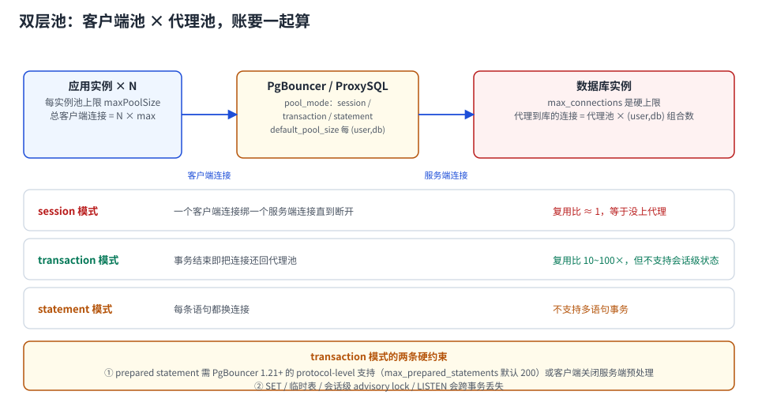

# 双层池与代理：两层上限怎么一起算

单层池有一个绕不过去的矛盾：**实例数 × 池上限**。10 个实例、每个 20 条，就是 200 条连接；而 `max_connections` 是 100。这时候有三个选择：

1. 把池上限压到 5（应用侧的并发能力被绑死在最少的实例上）；
2. 把 `max_connections` 调到 500（每条连接 1.4 MiB 私有内存 + 一个后端进程，CPU 与内存都要付账）；
3. **在中间加一层连接复用**——客户端还是 200 条连接，代理到库只有 20 条。

第三个选择就是双层池。它解决了连接数，但引入了三个新问题：**模式选择、会话状态、两层的账**。



本页判据族 `CPD-A` ~ `CPD-H`，共 8 条。定义表在第 1 节起「本页判据」。

## 一、三种模式的能力边界

PgBouncer 的三种 `pool_mode`，本质区别是「服务端连接什么时候还给代理池」：

| 模式 | 归还时机 | 复用比 | 会话级特性 |
| --- | --- | --- | --- |
| `session` | 客户端断开 | ≈ 1（等于没上代理） | 全部支持 |
| `transaction` | 事务结束 | **10~100×** | 有明确的不支持清单（见下表） |
| `statement` | 每条语句 | 最高 | **不允许多语句事务** |

`session` 模式唯一的用处是「不改代码先接进来」——它的复用比是 1，只节省了建连（约 2~4 ms/次），没有解决连接数问题。**真正省连接的是 `transaction`**。

`transaction` 模式的支持矩阵（PgBouncer 官方 Features，1.26.x）：

| 特性 | `session` | `transaction` |
| --- | --- | --- |
| 启动参数（`application_name` 等） | 支持 | 支持（按追踪参数） |
| `SET` / `RESET` | 支持 | **仅追踪参数生效** |
| `LISTEN` | 支持 | **不支持** |
| `NOTIFY` | 支持 | 支持（`NOTIFY` 本身无状态） |
| `WITH HOLD` 游标 | 支持 | **不支持** |
| `PREPARE` / `DEALLOCATE`（SQL 级） | 支持 | **不支持**（`DEALLOCATE ALL`、`DISCARD ALL` 例外） |
| 会话级 advisory lock | 支持 | **不支持** |
| 协议级预编译 | 支持 | **支持**（需 `max_prepared_statements > 0`） |

::: danger 引用「PG 会话特性」最多的四个地方
① 临时表（`ON COMMIT PRESERVE ROWS`）；② 会话级 advisory lock（分布式锁的常见实现）；③ `LISTEN/NOTIFY`（很多「实时推送」的土办法）；④ SQL 级 `PREPARE`（老 ORM 的写法）。

这四样在 `transaction` 模式下**全部失效**，而且失效方式各不相同：临时表是「下一次查不到」，advisory lock 是「锁没了但业务不知道」。上代理之前必须逐个排查，**不能靠压测发现**——压测用的连接恰好一直落在同一个服务端连接上，问题不会暴露。
:::

## 二、两层的账：把四个数写在一张纸上

```text
第 1 层（客户端 → 代理）
  clients_total = 实例数 × 每个实例的 maxPoolSize
  pgbouncer 的 max_client_conn 必须 ≥ clients_total      # 否则客户端连代理就被拒

第 2 层（代理 → 数据库）
  server_total  = default_pool_size × (user, db) 组合数
  server_total ≤ max_connections × 0.8                   # 与单层池的预算同一条线
```

**算例**：10 个实例 × 池上限 20 = **200 个客户端连接**；代理侧 `default_pool_size=20`、只有 `(app, orders)` 一个组合 → 到库 **20 条**。

```text
复用比 = 200 / 20 = 10×
```

这个 10× 就是代理带来的全部收益。三个必须一起写的参数：

| 参数 | 含义 | 算例取值 |
| --- | --- | --- |
| `max_client_conn` | 代理允许的客户端连接总数 | ≥ 200（留 20%，取 250） |
| `default_pool_size` | 每个 `(user, db)` 对库的连接数 | 20 |
| `pool_mode` | 复用粒度 | `transaction` |

::: warning `default_pool_size` 是「每个 (user, db)」，不是总数
这是最常见的算错点。若有 5 个库、2 个账号，`default_pool_size=20` 意味着最多 **5 × 2 × 20 = 200** 条到库的连接——直接超过 `max_connections`。

算账时必须用 `组合数 × default_pool_size`，不能只看一个数字。
:::

## 三、预编译语句：从「死结」变成「上限问题」

老经验说「PgBouncer 的 transaction 模式不能用 prepared statement」，这在 1.21 之前基本成立，现在不成立了：

- **协议级预编译**（JDBC 的 `prepareThreshold` 触发的 `Parse/Bind/Execute`）由代理改写与缓存，需 `max_prepared_statements > 0`（**默认 200**；设 0 关闭协议级支持）；
- **SQL 级 `PREPARE`**（应用自己写 `PREPARE p1 AS ...`）在 transaction 模式下**仍然不支持**。

两种写法的判别方法：搜代码里有没有字面量 `PREPARE` / `DEALLOCATE`。有，就要么改成协议级（驱动参数），要么把该路径的池换成直连。

::: tip 200 这个上限意味着什么
`max_prepared_statements=200` 是**每个客户端连接**的缓存条数上限。一个服务如果对每个租户的动态表名做预编译（`select ... from t_<tenant>`），200 很快被撑满；超出的部分会退化成「每次重新 Parse」，延迟上升但不会报错——属于**静默劣化**，要专门看 `pgbouncer` 的 `SHOW STATS` 里 `avg_parse` 一类指标。
:::

## 四、1.26 的两个变化值得单独记

| 变化 | 影响 |
| --- | --- |
| **默认追踪 `search_path` 与 `default_transaction_read_only`** | 应用里 `SET search_path` 在 transaction 模式下能跨语句保留了；此前必须靠 `track_extra_parameters` 手工加 |
| 新增 `pool_idle_timeout`、`query_wait_timeout` 可按 user/db 设 | 可以给「报表账号」单独设更短的等待超时，不让它把连接池占满 |
| **移除在线重启 `-R`** | 升级方式改为 `so_reuseport` 多进程滚动；运维脚本里如果还有 `pgbouncer -R`，会直接失败 |

`track_extra_parameters` 与 `ignore_startup_parameters` 的优先级也在 1.26.1 调整过：`ignore_startup_parameters = search_path` 可以恢复 1.25 的「不追踪」行为。**升级前先确认你的应用有没有依赖 `search_path` 的跨语句保留。**

## 五、MySQL 侧：ProxySQL 的对应关系

| 维度 | PgBouncer | ProxySQL |
| --- | --- | --- |
| 复用粒度 | `pool_mode`（session/transaction/statement） | 默认按「事务」复用；`multiplexing` 开关 |
| 到库连接上限 | `default_pool_size` | `mysql-servers` 的 `max_connections` |
| 路由 | 单实例（多 host 靠 DNS/LB） | **内置读写分离与查询规则** |
| 会话状态 | 追踪参数表 | `session track` 变量列表 |

差异的要点：ProxySQL 自带路由与读写分离，PgBouncer 不做路由（官方 FAQ 明确：不做负载均衡、不做故障切换检测，靠 DNS 或外部 TCP LB）。所以「加代理」这个动作在两种库上的**职责范围不同**，PgBouncer 场景下还要额外准备一个故障切换方案。

## 六、验证：五条读数

```sql
-- PgBouncer 管理库（psql -p 6432 -U pgbouncer pgbouncer）
SHOW POOLS;    -- cl_active / cl_waiting / sv_active / sv_idle / sv_used
SHOW STATS;    -- total_xact_count / avg_xact_time / avg_query_time
SHOW CONFIG;   -- pool_mode、max_client_conn、default_pool_size
```

| 读数 | 正常 | 异常 |
| --- | --- | --- |
| `cl_waiting` | 0 或极短 | 长期 > 0 → 代理侧 `default_pool_size` 太小 |
| `sv_active` / `default_pool_size` | < 0.8 | 接近 1 → 到库连接已成瓶颈 |
| `cl_active` | ≈ 实例数 × 池上限 | 远大于 → 有非池客户端（脚本、监控） |
| 库侧 `client backend` 数 | ≈ `default_pool_size × 组合数` | 远大于 → 算错了组合数 |
| 应用侧 P99 | 与直连同量级 | 明显变高 → 模式选错或预编译退化 |

```shell
# 两层的账，一条命令核对（库侧视角）
docker exec pglab psql -U postgres -tAc \
  "select usename, count(*) from pg_stat_activity where backend_type='client backend' group by 1;"
# 期望：每个 usename 的连接数 ≈ default_pool_size（而不是 200）
```

## 七、本页判据

| 编号 | 判据 | 看什么现象 | 不满足时改哪里 |
| --- | --- | --- | --- |
| `CPD-A` | `pool_mode` 与业务特性匹配 | 有「是否用临时表/advisory lock/LISTEN」的排查结论 | 用 `session` 或改代码 |
| `CPD-B` | 两层的账都算了 | 有 `clients_total` 与 `server_total` 两个数 | 补算；只算一层必翻车 |
| `CPD-C` | `server_total` 用「组合数 × pool_size」 | 算式里出现组合数 | 改成乘法；单看一个数会超预算 |
| `CPD-D` | `max_client_conn ≥ clients_total × 1.2` | 配置里有这个余量 | 调大；否则客户端连代理就被拒 |
| `CPD-E` | 预编译路径已确认 | 代码里无 SQL 级 `PREPARE`，或该路径走直连 | 改协议级/改直连 |
| `CPD-F` | 升级前查过 `-R` 与参数追踪变更 | 运维脚本里没有 `pgbouncer -R` | 改滚动方式；确认 `search_path` 依赖 |
| `CPD-G` | `cl_waiting` 有监控 | 有代理侧指标 | 接 `SHOW POOLS`；这是代理层唯一有效的饱和信号 |
| `CPD-H` | 代理层有独立的故障切换方案 | 文档里写明 DNS/LB 切换方式 | PgBouncer 不做切换，必须外部解决 |

## 参考资料

- PgBouncer 官方：*Features*（三种 pooling 模式的 SQL 能力矩阵）、*1.26.0 release notes*（2026-09-23：追踪 `search_path`、`pool_idle_timeout`、移除 `-R`）、*1.26.1 release notes*（2026-10-14）
- PgBouncer 官方 FAQ：不做负载均衡、不做故障切换检测
- PgBouncer 配置文档：`pool_mode`、`default_pool_size`、`max_client_conn`、`max_prepared_statements`（默认 200）
- ProxySQL 官方文档：`mysql-servers` 的 `max_connections`、`session track`
- 本仓库：[连接治理](../../Middleware/ConnectionGovernance/index.md)（多路复用那一节）、[代理模式](../../Middleware/ProxyMode/index.md)（中间件形态）、[池大小](../Sizing/index.md)（库侧预算）
