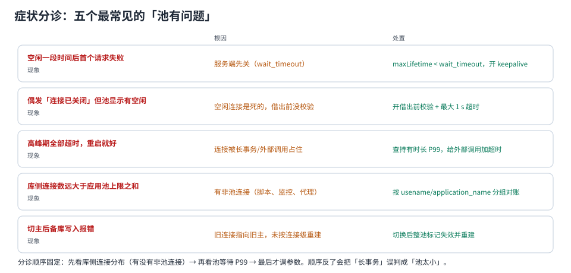

# 常见问题与分诊

本页是「现象 → 根因 → 处置」的速查表，每个问题都指向本专题里讲机制的那一页。分诊顺序固定：**先看库侧连接分布（有没有旁路/空闲事务）→ 再看池的等待 P99 → 最后才动参数**。顺序反了，就会把「长事务」误判成「池太小」。



本页判据族 `CPQ-A` ~ `CPQ-H`，共 8 条。定义表在第 11 节「本页判据」。

## 一、空闲一段时间后，第一个请求失败

**现象**：夜间或低峰后，第一个请求报 `08S01` / `Communications link failure` / `57P01`，之后恢复正常。

**根因**：池里的连接已经被**服务端或中间设备**单方面关掉（`wait_timeout`、LB 空闲超时、NAT 表项过期），客户端不知道，借出来直接用。

**处置**：

```properties
# ① 让池先于服务端回收：maxLifetime < 服务端/设备超时 − 120 s
dataSource.setMaxLifetime(1_800_000);          # 30 min
# ② 借出前校验，成本 0.205 ms（建连的 1/10）
dataSource.setValidationTimeout(1_000);
# ③ 空闲探活（HikariCP 6.2.1 起默认 2 min）
dataSource.setKeepaliveTime(120_000);
```

详见 [连接生命周期](../Lifetime/index.md)（五个阀门的优先级约束）。

## 二、池显示有空闲连接，请求却报「连接已关闭」

**根因**：`active=0 / idle=20` 只说明**池认为**连接可用。半开连接在池的账上是「空闲」，在网络上已经死了。而 `Connection.isClosed()` 只查客户端状态，照样返回 `false`。

**处置**：开 `isValid` 校验（不是 `isClosed`），并把连接级异常（`08`/`57P0x`）接到「丢弃 + 重建」路径上。

详见 [池的内部](../PoolInternals/index.md)（校验三问）与 [故障与自愈](../FailureRecovery/index.md)（错误分类）。

## 三、高峰期全部超时，重启就好

**现象**：`Connection is not available, request timed out after 30000ms (total=20, active=20, idle=0, waiting=7)`，重启后恢复，几天后复发。

**根因**：三类，按概率排序——**慢下游/长事务占住连接**（多数）、**事务未提交**、**代码漏 `close()`**（少数）。

**处置顺序**（不要先重启）：

```text
① 取证：jstack（找卡在 getConnection 的线程）+ pg_stat_activity 快照
② 止血：摘流量 / 临时加实例（不是无脑加池上限）
③ 修复：按堆栈改代码；leakDetectionThreshold 设 5~10 s 再观察一周
```

详见 [泄漏定位](../LeakDetection/index.md)（先取证后止血的四步）。

## 四、库侧连接数远大于「实例数 × 池上限」

**根因**：**旁路连接**。常见来源：DBA 客户端、监控采集器、定时脚本、代理池、另一个没纳入统计的服务。

**处置**：

```sql
select coalesce(application_name,'(unset)') app, usename, state, count(*)
from pg_stat_activity where backend_type='client backend'
group by 1,2,3 order by 4 desc;
```

若大量 `(unset)`：连接串里没设 `application_name`，先补上再谈归因。

详见 [观测与告警](../Observability/index.md)（两个来源的口径陷阱）。

## 五、调大池之后更慢了

**根因**：过了吞吐膝点。本机实测（PostgreSQL 18.6）：并发 16 → 32，吞吐 **−3.2%**、延迟 **+106%**；32 → 64，吞吐 **−15.2%**、延迟 **+371%**。

```text
c=8   2,692 TPS / 2.972 ms
c=16  4,007 TPS / 3.993 ms   ← 膝点
c=32  3,881 TPS / 8.245 ms
c=64  3,400 TPS / 18.825 ms
```

**处置**：在自己的机器上跑出膝点曲线，取膝点对应的并发；不要拿别人的数字。详见 [池大小](../Sizing/index.md)。

## 六、切主之后写入报「只读事务」

**根因**：池里的连接还指着旧主（已降为只读），或指向旧地址。`25006 read_only_sql_transaction` **不是**连接级错误码，靠错误分类识别不出来。

**处置**：切换完成后**主动整池失效并重建**，不要等报错。验证方法：

```sql
select pg_is_in_recovery();   -- f = 主库；切换后所有连接都应为 f
```

详见 [故障与自愈](../FailureRecovery/index.md)（主备切换按连接级判定）。

## 七、加了 PgBouncer 之后报「prepared statement 不存在」

**根因**：`transaction` 模式下，SQL 级 `PREPARE` 不被支持（服务端连接在事务结束后就换人了）。JDBC 驱动若用了 SQL 级预编译，或者 `max_prepared_statements=0` 关掉了协议级支持，就会报这个错。

**处置**：① 确认 `pool_mode`；② 把 `max_prepared_statements` 设为非 0（默认 200）；③ 应用侧改用**协议级**预编译（驱动参数），或让该路径直连。

详见 [双层池与代理](../DoubleLayer/index.md)（能力矩阵与 1.26 的变化）。

## 八、事务里刚写的数据，立刻查不到

**根因**：读写分离的读走了从库，或者事务中间切了数据源。**连接在事务开始时就被绑定**，之后改路由键不生效。

**处置**：事务内一律走主库；写后 N 秒内的读走主库（会话粘性）；报表走独立池并声明延迟容忍度。

详见 [多数据源与多租户](../MultiDatasource/index.md)（读写分离三件事）。

## 九、启动就报「Failed to initialize pool」

**根因**：池在启动时试图建满连接（`initializationFailTimeout` 语义），而库不可达/认证失败/预算超了。

**处置**：

| 场景 | 应对 |
| --- | --- |
| 库还没起（编排顺序问题） | 启动依赖加健康检查（`depends_on: condition: service_healthy`） |
| 认证失败 | 先手工 `psql` 验证账号与库名 |
| 53000 类槽位问题 | 启动并发太高：多实例同时建满池 → 加启动抖峰 |

详见 [池的内部](../PoolInternals/index.md)（预热与最小空闲）与 [故障与自愈](../FailureRecovery/index.md)（建连退避）。

## 十、上线前自查清单（打印出来贴墙上）

| 项 | 判据 | 本专题对应页 |
| --- | --- | --- |
| 预算 | `实例数 × 池上限 + 代理 + 离线 + 运维 ≤ 0.8 × max_connections` | [池大小](../Sizing/index.md) |
| 膝点 | 有本机 4 点曲线，池大小取膝点 | [池大小](../Sizing/index.md) |
| 时间常数 | `keepalive < maxLifetime < 服务端/设备超时 − 120 s` | [生命周期](../Lifetime/index.md) |
| 校验 | `validationTimeout ≤ 1 s`，且不用 `isClosed` 顶替 | [池的内部](../PoolInternals/index.md) |
| 复位 | 优先 `SET LOCAL`；有「设置 → 归还 → 再借」实验记录 | [事务边界](../TransactionBoundary/index.md) |
| 泄漏 | `leakDetectionThreshold(5~10 s) < connectionTimeout(30 s)` | [泄漏定位](../LeakDetection/index.md) |
| 代理 | 两层账都算；`max_client_conn ≥ clients × 1.2` | [双层池](../DoubleLayer/index.md) |
| 观测 | 四个指标 + `idle_in_tx` 告警 + 体检 SQL | [观测与告警](../Observability/index.md) |
| 演练 | 杀掉全连接后自动恢复，错误窗口 < 30 s | [故障与自愈](../FailureRecovery/index.md) |

## 十一、本页判据

| 编号 | 判据 | 看什么现象 | 不满足时改哪里 |
| --- | --- | --- | --- |
| `CPQ-A` | 分诊顺序固定 | 先库侧分布 → 再池等待 → 最后参数 | 写进值班手册 |
| `CPQ-B` | 「重启就好」被当作症状而非结论 | 重启前有取证快照 | 补取证；否则每周复发 |
| `CPQ-C` | 报错信息被逐字读 | `53300` 不当成「调大 max_connections」的理由 | 按预算重算 |
| `CPQ-D` | 调参前有基线读数 | 有 P99 与膝点记录 | 补跑压测 |
| `CPQ-E` | 代理相关报错先查模式 | 先确认 `pool_mode` 与 `max_prepared_statements` | 按能力矩阵改配置 |
| `CPQ-F` | 读写分离有「写后读」策略 | 有会话粘性或主库读 | 补策略 |
| `CPQ-G` | 上线清单逐项打勾 | 九项都有结论 | 补勾；缺一项就别上 |
| `CPQ-H` | 每个问题都能指到机制页 | 本页每条都有链接 | 补链接；速查表不能自成一派 |

## 参考资料

- HikariCP README：`leakDetectionThreshold`、`validationTimeout`、`initializationFailTimeout`、`maxLifetime`
- PgBouncer 官方 FAQ 与 *Features*：`transaction` 模式的能力矩阵、`max_prepared_statements`
- PostgreSQL 18 Documentation：*Error Codes*（`53300`、`57P01`、`25006`）、*`pg_is_in_recovery()`*
- MySQL 8.4 Reference Manual：`wait_timeout`、`Communications link failure` 的成因
- 本仓库：[连接治理](../../Middleware/ConnectionGovernance/index.md)（值班手册版）、[池的内部](../PoolInternals/index.md)、[池大小](../Sizing/index.md)、[生命周期](../Lifetime/index.md)、[事务边界](../TransactionBoundary/index.md)、[泄漏定位](../LeakDetection/index.md)、[双层池](../DoubleLayer/index.md)、[多数据源](../MultiDatasource/index.md)、[故障与自愈](../FailureRecovery/index.md)、[观测](../Observability/index.md)
