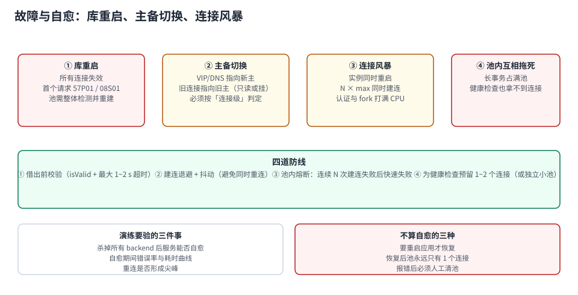

# 故障与自愈：库重启、主备切换、连接风暴

池在平稳期的表现不代表它在故障期的表现。四类故障会让池从「透明的中间层」变成「故障放大器」：

1. **库重启**：所有连接同时失效，第一批请求全部报 `57P01`；
2. **主备切换**：VIP/DNS 指向新主，旧连接还指着旧主（可能只读、可能挂掉）；
3. **连接风暴**：多实例同时重建池，库侧 fork/认证被打满，表现为「重启后更慢」；
4. **池内互拖**：长事务占满池，连健康检查都拿不到连接。



本页判据族 `CPR-A` ~ `CPR-H`，共 8 条。定义表在第 1 节起「本页判据」。

## 一、建连成本随并发上升：风暴为什么更慢

| 场景 | 平均建连时间 | 相对单连接 |
| --- | --- | --- |
| 1 个并发（`pgbench -C -c 1`） | **2.124 ms** | 1× |
| 8 并发（`-C -c 8`） | **5.526 ms** | 2.6× |
| 64 并发（`-C -c 64`） | **8.134 ms** | **3.8×** |

```shell
# 复现（PostgreSQL 18.6 容器内）
docker exec pglab pgbench -C -c 1  -j 1 -t 200 -U postgres bench | grep "connection time"
docker exec pglab pgbench -C -c 8  -j 8 -T 8   -U postgres bench | grep "connection time"
docker exec pglab pgbench -C -c 64 -j 8 -T 8   -U postgres bench | grep "connection time"
```

::: tip 这就是「重启之后反而更慢」的机制
20 个实例、每个池 20 条，库重启后同时重建 = **400 次建连**挤在同一秒。单次建连从 2.1 ms 涨到 8.1 ms（并发效应），整体就是 400 × 8.1 ms ≈ **3.2 秒的建连排队**。而这段时间里应用的健康检查也在抢连接，于是「服务起不来」被误判成「应用有 bug」。

对策不是把池调小，是**给建连加退避与抖动**：让 400 次建连摊到 5~10 秒里。
:::

## 二、失效判定：连接级错误不能当业务错误重试

```text
57P01  admin_shutdown          服务端被终止（重启、pg_terminate_backend）
57P02  crash_shutdown          服务端崩溃
57P03  cannot_connect_now      启动中，暂不可连
08006  connection_failure      连接级失败
08001  sqlclient_unable_to_establish_sqlconnection
53300  too_many_connections    槽位耗尽
```

判据很简单：**SQLSTATE 前两位是 `08`，或错误码是 `57P0x`**，说明「连接没了」，不是「SQL 错了」。

| 错误类型 | 正确反应 | 错误反应 |
| --- | --- | --- |
| 连接级（`08xxx`/`57P0x`） | 丢弃这条连接、从池移除、重建后重试**一次** | 在同一条连接上重试 → 必失败 |
| 槽位耗尽（`53300`） | 快速失败 + 告警（预算问题，不是抖动） | 无限重试 → 把库压得更死 |
| 业务错误（`23505` 唯一冲突等） | 按业务语义处理 | 当成连接错误重试 → 重复写入 |

本机实测的 `57P01` 现场（杀掉空闲连接后继续用）：

```text
FATAL:  terminating connection due to administrator command
server closed the connection unexpectedly
```

注意它出现在**下一条语句**上——如果这条语句是业务 SQL，用户看到的是 500，而池的指标显示「有 20 条空闲连接」。这就是 [生命周期](../Lifetime/index.md) 里强调「借出前校验」的原因。

## 三、四道防线

### 防线 ①：借出前校验

```properties
dataSource.setValidationTimeout(1000);   # 校验最多等 1 s
```

成本 0.205 ms（一次往返），能拦掉绝大多数「借到死连接」的情况。这是**唯一**能在业务 SQL 之前发现连接已死的机制。

### 防线 ②：建连退避 + 抖动

```text
第 n 次失败后等待 = min(cap, base × 2^n) × random(0.5, 1.0)
base = 100 ms，cap = 5 s
```

抖动（jitter）是关键。没有抖动，20 个实例会在**同一个毫秒**重试，形成新的风暴；加了抖动，重试被摊开，库侧看到的是平滑的建连曲线。

### 防线 ③：池内熔断

连续 N 次建连失败（例如 10 次）后，池应**快速失败**一段时间（例如 5 秒），而不是让每个请求都去试一次建连。否则「库不可用」会变成「应用线程全部卡在建连上」——比库挂掉更糟，因为应用也没法处理别的请求。

### 防线 ④：给健康检查留一条路

池满时，`/health` 端点如果也要借连接，就会一起超时，于是**编排系统认为应用不健康并把它杀掉**——池满升级成滚动重启。

三种解法，按代价排序：

| 做法 | 代价 | 适用 |
| --- | --- | --- |
| 健康检查用独立小池（1 条连接） | 多一个池 | 通用 |
| 健康检查只做「池内是否有活跃连接」的轻量判断 | 不碰库，无法发现库挂了 | 只关心进程存活 |
| 健康检查带短超时（500 ms）+ 降级为 degraded | 需要编排支持 | K8s 就绪探针 |

::: danger 不要用「池内有空闲连接」当健康信号
池里有空闲连接 ≠ 库可用：连接可能是死的（半开）。真正有效的健康检查是**借一条 + 执行一条最轻的查询 + 带 500 ms 超时**，且必须在独立小池里做，否则池满时它自己先失败。
:::

## 四、主备切换：池要按「连接级」判定失效

切主完成后，旧连接有两个可能：指向旧主（现在是只读或已停），或已被断开。两种情况的表现不同：

| 情况 | 表现 | 池的动作 |
| --- | --- | --- |
| 旧主被关 | `08S01` / `57P01` | 移除连接，按新地址建连 |
| 旧主降为只读 | 写请求报 `25006 read_only_sql_transaction` | **不能靠错误码识别连接失效**，要按「切换事件」主动整池失效 |

所以切换剧本里必须有一条：**收到切换完成的通知后，主动把整个池标记为失效并重建**，不要等错误发生。这一条比任何重试策略都可靠。

```shell
# 验证「池是否真的连到新主」：查服务端角色
docker exec pglab psql -U postgres -tAc "select pg_is_in_recovery();"
# f = 主库；t = 备库。切换后应全部为 f
```

## 五、演练：验收标准是「不改配置能自愈」

一次合格的演练，脚本固定为三步：

```shell
# ① 杀掉所有客户端连接（模拟库重启）
docker exec pglab psql -U postgres -tAc \
  "select count(pg_terminate_backend(pid)) from pg_stat_activity
   where backend_type='client backend' and pid <> pg_backend_pid();"

# ② 观察 60 秒：错误率曲线、P99、每分钟新建连接数
docker exec pglab psql -U postgres -d bench -tAc \
  "select date_trunc('minute', backend_start) m, count(*) from pg_stat_activity
   where backend_type='client backend' group by 1 order by 1 desc limit 5;"

# ③ 断言：服务无需人工干预恢复；错误率在 N 秒内回到 0；池的连接数恢复到上限
```

| 验收项 | 通过 | 不通过 |
| --- | --- | --- |
| 恢复方式 | 自动 | 需要重启应用 |
| 错误持续时间 | < 30 s（含建连退避） | 一直错，直到重启 |
| 恢复后的连接数 | 回到 `maximumPoolSize` | 只有 1~2 条（池没补满） |
| 建连曲线 | 平滑（有抖动） | 一个尖峰（无退避） |

::: warning 「自愈」不等于「没报错」
杀掉所有连接，第一批请求**必然**有错误——池不知道自己手里的连接已经死了，直到真正用一次。可接受的自愈定义是：**错误集中在一次窗口内（例如 5 秒），之后自动恢复，无需人工介入**。

要求「零错误」只能靠借出前校验把窗口压到最小（单条连接级别），不可能消除。
:::

## 六、本页判据

| 编号 | 判据 | 看什么现象 | 不满足时改哪里 |
| --- | --- | --- | --- |
| `CPR-A` | 连接级错误有独立分类 | 代码里按 SQLSTATE 前缀 `08` / `57P0x` 分流 | 补分类；别混进业务重试 |
| `CPR-B` | 连接级错误后丢弃连接 | 池移除该连接，不在原连接上重试 | 改重试策略 |
| `CPR-C` | 建连有退避 + 抖动 | 重连时间有随机分布 | 补抖动，否则形成新风暴 |
| `CPR-D` | 连续建连失败会熔断 | 有「快速失败窗口」 | 补熔断，避免线程全卡在建连 |
| `CPR-E` | 健康检查不抢主池 | 独立小池或短超时 | 改探针实现 |
| `CPR-F` | 切换后整池主动失效 | 剧本里有「收到切换通知 → 重建池」 | 补这一步；只读错误码识别不出来 |
| `CPR-G` | 演练脚本固定且可复跑 | 有 `pg_terminate_backend` 三步脚本 | 写成固定剧本 |
| `CPR-H` | 自愈有量化验收 | 「错误窗口 < 30 s、连接数回满」 | 补验收标准；「能起来」不算 |

## 参考资料

- PostgreSQL 18 Documentation：*Appendix A. PostgreSQL Error Codes*（`08` 类连接异常、`57P01`/`57P02`/`57P03`、`53300`）
- PostgreSQL 18 Documentation：*Connections and Authentication*（`superuser_reserved_connections` 的用途）
- HikariCP README：`validationTimeout`、`connectionTimeout`、`initializationFailTimeout`
- PgBouncer 官方 FAQ：不做故障切换检测（切换要靠 DNS 或外部 LB）
- 本仓库：[生命周期](../Lifetime/index.md)（半开连接）、[泄漏定位](../LeakDetection/index.md)（先取证后重启）、[连接治理](../../Middleware/ConnectionGovernance/index.md)（打满时的处置顺序）
