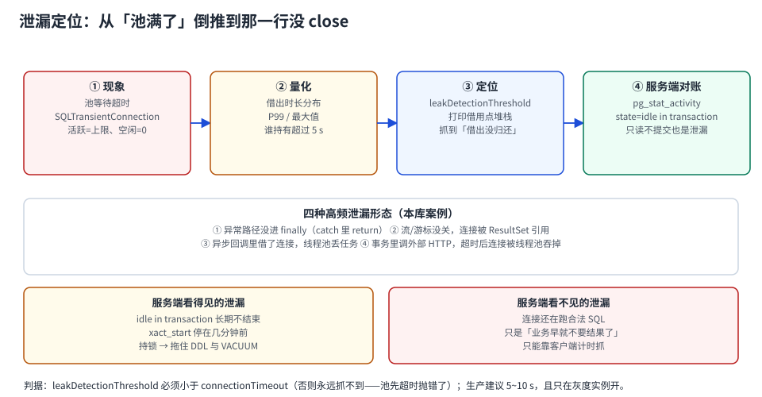

# 泄漏定位：从「池满了」倒推到那一行没 close

「连接池泄漏」这个词容易让人想到内存泄漏，其实两者机制完全不同：连接泄漏是**一条连接被借出后，没有任何人负责还**。池里可用连接数只减不增，直到 `getConnection()` 全部超时。

它有三个特殊之处，决定了排查方法：

1. **一开始完全无症状**——池有 20 条，一天漏 2 条，十天以后才出事；
2. **出事时表现为「池满了」，但库侧可能完全正常**（连接还在跑合法 SQL）；
3. **重启能立刻恢复**——正因为如此，绝大多数团队会「重启了事」，于是它每周复发一次。

本页给的是「从现象倒推到代码行」的固定路径，以及每步该看哪个读数。



本页判据族 `CPK-A` ~ `CPK-H`，共 8 条。定义表在第 1 节起「本页判据」。

## 一、四步定位法

### 第 ① 步：确认是「借不到」而不是「连不上」

```text
HikariPool-1 - Connection is not available, request timed out after 30000ms
  (total=20, active=20, idle=0, waiting=7)
```

这一行已经把结论写清了：`active=20`（全部借出）、`idle=0`（没有空闲）、`waiting=7`（7 个线程在排队）。**池是满的，不是库连不上**。

如果换成 `Connection refused` / `08S01`，那是网络或服务端问题，走 [故障与自愈](../FailureRecovery/index.md)，不是本页。

### 第 ② 步：量化「谁持有得久」

「池满了」不区分两种人：**合法的长事务**与**真正忘了还的泄漏**。区分靠的是持有时长分布：

| 指标 | 含义 | 判据 |
| --- | --- | --- |
| `active` | 当前借出数 | 长期贴着 `maximumPoolSize` = 满 |
| 借出时长 P50 | 一半连接的持有时长 | 正常应 ≈ SQL 耗时 |
| 借出时长 P99 | 长尾 | 远大于 P50 → 有一批「异常长」的持有 |
| 持有时长 > 阈值 的条数 | 候选泄漏 | 有稳定数量（不是偶发） |

关键判据：**泄漏的持有时长会一直增长**（因为它永远不会被还），而长事务的持有时长有上限（总有个头）。看两次采样，持有时长是否在**单调增长**，这是最快的区分方法。

### 第 ③ 步：打开泄漏检测，抓借用点堆栈

```properties
# HikariCP：借出超过 10 秒未归还就打印借用点堆栈（0 = 关闭，最小 2000ms）
dataSource.setLeakDetectionThreshold(10_000);
```

日志长这样，关键是最后那串堆栈——它指向**借出的那一行**：

```text
Connection leak detection triggered for org.postgresql.jdbc.PgConnection@6f1fba17
  on thread http-nio-8080-exec-3, stack trace follows
  java.lang.Exception: Apparent connection leak detected
    at com.acme.order.OrderRepository.findByNo(OrderRepository.java:88)
    at com.acme.order.OrderService.detail(OrderService.java:41)
    ...
```

::: danger `leakDetectionThreshold` 必须小于 `connectionTimeout`
默认 `leakDetectionThreshold=0`（关闭），`connectionTimeout=30 s`。如果把它设成 **60 s**，那么池在 30 s 时就先抛「借不到连接」了，检测永远不会触发——**你会以为「开了检测但没抓到泄漏」，其实是阈值设反了**。

正确关系：`leakDetectionThreshold`（5~10 s）< `connectionTimeout`（30 s）。
:::

### 第 ④ 步：服务端对账，看「库侧还认不认这条连接」

客户端指标只告诉你「借出没还」，服务端能告诉你**这条连接在干什么**：

```sql
-- ① idle in transaction：最危险的一类（占连接 + 占锁）
select pid, usename, application_name, state,
       round(extract(epoch from (now() - xact_start))::numeric,1) as xact_age_s,
       left(query, 60) as last_query
from pg_stat_activity
where state = 'idle in transaction'
order by xact_age_s desc;

-- ② 按应用名聚合，看谁的数量对不上预算
select coalesce(application_name,'(unset)') app, state, count(*)
from pg_stat_activity where backend_type='client backend'
group by 1,2 order by 3 desc;
```

本机实测（PostgreSQL 18.6）：一个 `idle in transaction` 的空闲事务持有行锁 12 秒，另一个会话更新同一行**等了 8,866 ms**。所以「泄漏」不只是吃池——**它还会持锁，把别人的请求一起拖住**。

## 二、四种高频泄漏形态（都能在代码里搜出来）

| 形态 | 代码特征 | 怎么搜 |
| --- | --- | --- |
| **异常路径没进 finally** | `conn = ds.getConnection();` 后面没有 try-with-resources | 搜 `getConnection()`，逐个看是否有 `try (` 包裹 |
| **流/游标没关** | 只 `close` 了 `Connection`，`ResultSet`/`Statement` 未关 | 实际不会漏连接（连接关了流也关），但会漏游标与内存 → 归为「资源泄漏」 |
| **异步回调里借了连接** | `CompletableFuture.supplyAsync(() -> repo.find(...))` 且线程池丢任务/超时取消 | 搜线程池 `submit`/`execute` 与库调用同处出现 |
| **线程被中断后没还** | `Thread.interrupted` / 超时中断后跳过了 `finally` | 搜 `InterruptedException` 附近的资源释放 |

还有一类**最容易被误判成泄漏**的：**合法的超长持有**。比如事务里调了一个 25 秒的下游接口——连接没漏，只是被占着。这种情况的正确处置是**加外部调用超时**，不是去查 `close()`。

::: tip 一个反直觉的经验
「泄漏」这个词在事故复盘里经常被误用。真正的原因分布大致是：**长事务/慢下游占住（多数）> 事务未提交（不少）> 代码漏 close（少数）**。

所以排查顺序应该是：先看 `idle in transaction`（状态问题）→ 再看最长持有时长对应的 SQL（慢）→ 最后才是搜 `getConnection()`（真泄漏）。
:::

## 三、处置顺序：先取证，再止血

池满时最诱人的动作是「重启」。重启会**销毁全部证据**，于是下一次还要从头查。正确的顺序：

```text
① 取证（30 秒内完成）
   - 池状态快照：active / idle / waiting（一条日志或一个 metrics 查询）
   - 线程栈：jstack > /tmp/stack-$(date +%s).txt（找卡在 getConnection 的线程）
   - 库侧快照：pg_stat_activity 按 state 聚合 + idle in transaction 明细
   - 连接级：谁持有最久（客户端指标或 APM 的 connection span）

② 止血（取证之后）
   - 立即：把流量摘掉一部分（降级/限流），让池有余量
   - 短期：临时调大池上限（注意库侧预算！见「池大小」）
   - 兜底：滚动重启（一次一个实例，避免连接风暴）

③ 修复（当天）
   - 按堆栈定位到代码行，补 try-with-resources / 加超时
   - 把 leakDetectionThreshold 留在灰度实例上，观察一周
```

::: danger 临时调大池上限之前，先算预算
池满了就调大，是把自己从一个坑挪到另一个坑：`实例数 × 新上限` 一旦超过 `max_connections × 0.8`，下一次发布就是全站 53300（本机实测：17 条普通连接占满后，第 18 条直接 `FATAL: remaining connection slots are reserved...`）。

临时扩容的正确做法是**先加实例/走代理**，而不是无脑加池上限。
:::

## 四、检测本身有成本，别一直开着

泄漏检测在每次借出时记录调用栈（`Thread.getStackTrace` 级别的开销）。高频借还的服务上，这个开销会体现在 CPU 与 GC 上。

| 环境 | 建议 |
| --- | --- |
| 开发/测试 | 常开，阈值 2,000 ms（最小值），尽早暴露 |
| 灰度实例 | 开，阈值 5,000~10,000 ms |
| 生产全量 | 平时关闭，排障时按实例开；或常开但阈值设到「业务 P99 持有时长的 3 倍」 |

阈值怎么定：**取业务持有时长 P99 的 3 倍**。低于 P99 会把正常长查询打成「疑似泄漏」，日志被噪声淹没之后，真泄漏就没人看了。

## 五、验证：五条断言

```java
// ① 静态扫描：每个 getConnection() 都在 try-with-resources 里
//    期望输出：0 行
//    grep -rn "getConnection()" src/main | grep -v "try ("

// ② 单元测试：异常路径也必须归还（用 HikariCP 的 active 计数断言）
assertThat(pool.getActiveConnections()).isZero();

// ③ 混沌：随机让 1% 的请求抛异常，跑 10 分钟后断言 active == 0

// ④ 长稳：8 小时压测，池的 idle 数应有锯齿但不单调下降
//    单调下降 = 泄漏在累积

// ⑤ 阈值自检：故意泄漏一条连接，10 秒内必须出现 leak detection 日志
```

| 读数 | 正常 | 异常 |
| --- | --- | --- |
| 静态扫描结果 | 0 行 | > 0 → 逐个确认 |
| 异常注入后 `active` | 回落到 0 | > 0 → 异常路径漏还 |
| 长稳 idle 曲线 | 有锯齿 | 单调下降 → 泄漏累积 |
| 故意泄漏后的日志 | 10 s 内出现堆栈 | 没出现 → 阈值 > `connectionTimeout` |

## 六、本页判据

| 编号 | 判据 | 看什么现象 | 不满足时改哪里 |
| --- | --- | --- | --- |
| `CPK-A` | 报错能区分「借不到」与「连不上」 | 日志里有 `active/idle/waiting` 三个数 | 打开池的详细日志 |
| `CPK-B` | `leakDetectionThreshold < connectionTimeout` | 两个值可对照 | 改成 5~10 s |
| `CPK-C` | 阈值 > 业务 P99 持有时长 | 阈值有取值依据 | 按 P99×3 设，避免噪声 |
| `CPK-D` | 有「持有时长分布」而非只有平均值 | P50/P99/max 三个读数 | 接池指标；平均值看不出泄漏 |
| `CPK-E` | 处置顺序是「先取证后重启」 | 有快照/线程栈/库侧快照 | 改成固定剧本，写进值班手册 |
| `CPK-F` | `idle in transaction` 纳入巡检 | 有对应告警或日报 | 加巡检（这是最危险的一类） |
| `CPK-G` | 临时扩容前算过库侧预算 | 有算式与结论 | 先加实例/代理，别直接加池上限 |
| `CPK-H` | 泄漏检测有「故意泄漏」自测 | 能在测试里复现日志 | 补自测；否则不知道检测到底生不生效 |

## 参考资料

- HikariCP README：`leakDetectionThreshold`（默认 0，最小 2000 ms）、`connectionTimeout`（30,000 ms）
- HikariCP 常见问题：*Connection is not available, request timed out*（`total/active/idle/waiting` 四个数的含义）
- PostgreSQL 18 Documentation：*Monitoring Database Activity*（`pg_stat_activity` 的 `state` 与 `xact_start`）、*`idle_in_transaction_session_timeout`*
- 本仓库：[生命周期](../Lifetime/index.md)（半开连接与五个阀门）、[池大小](../Sizing/index.md)（库侧预算算式）、[连接治理](../../Middleware/ConnectionGovernance/index.md)（打满时的值班处置）
