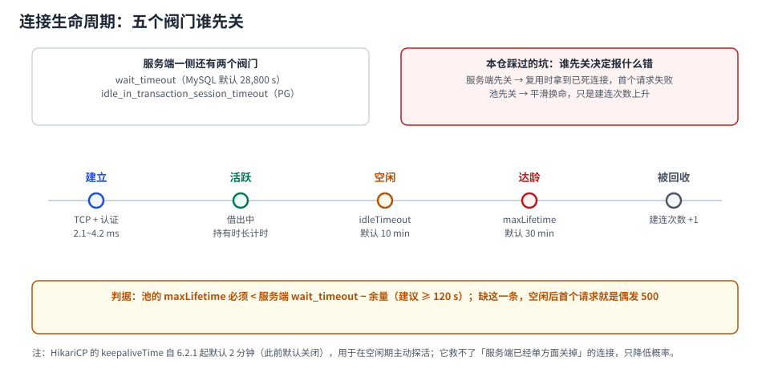

# 连接生命周期：五个阀门谁先关

一条池里的连接会被**五个不同的东西**判死：池的 `maxLifetime`、池的 `idleTimeout`、池的 `keepaliveTime`（探活，不杀）、服务端的 `wait_timeout` / `idle_in_transaction_session_timeout`、以及中间网络设备（LB、NAT、防火墙）的空闲超时。

问题在于：**它们不说同一句话，也不在同一个时刻关**。谁先关，决定了你看到的是一声平滑的换命，还是一次「空闲之后第一个请求 500」。



本页判据族 `CPL-A` ~ `CPL-H`，共 8 条。定义表在第 1 节起「本页判据」。

## 一、五个阀门与它们的默认值

| 阀门 | 归属 | 默认值 | 语义 | 最小可设 |
| --- | --- | --- | --- | --- |
| `maxLifetime` | HikariCP | **1,800,000 ms（30 min）** | 连接在池中的最大存活时长；使用中的不回收，归还后才移除 | 30,000 ms |
| `idleTimeout` | HikariCP | **600,000 ms（10 min）** | 空闲多久后被回收；**仅当 `minimumIdle < maximumPoolSize` 时生效** | 10,000 ms |
| `keepaliveTime` | HikariCP | **120,000 ms（2 min）** | 空闲连接的探活频率；**6.2.1 起才有这个默认值**，此前默认关闭 | 30,000 ms |
| `wait_timeout` | MySQL | **28,800 s（8 h）** | 服务端关闭空闲会话 | — |
| `idle_in_transaction_session_timeout` | PostgreSQL | **0（关闭）** | 服务端杀掉「事务开着但不干活」的会话 | — |
| TCP keepalive | OS / 内核 | Linux `tcp_keepalives_idle` 默认 **7,200 s** | 内核级探活，只处理「对端消失」 | — |
| 网络设备空闲超时 | LB / NAT / 防火墙 | 常见 **300~900 s**（例如 AWS NLB 的 TCP 空闲超时默认 350 s） | 静默丢弃空闲连接，**两端都收不到 FIN** | — |

::: danger 四条优先级约束（写成断言）
1. `keepaliveTime < maxLifetime` —— 否则探活还没跑，连接已经到龄；
2. `maxLifetime < 服务端/设备的空闲超时 − 120 s` —— 否则服务端先关，池还以为是活的；
3. `connectionTimeout > validationTimeout` —— 否则校验还没结束，借出已经超时；
4. `leakDetectionThreshold < connectionTimeout` —— 否则池先抛「借不到」，泄漏检测永远抓不到（见 [泄漏定位](../LeakDetection/index.md)）。
:::

## 二、半开连接：为什么 `isClosed()` 说没事，SQL 说连不上

「半开」指一端已经关了、另一端不知道。三种典型来源：

1. **服务端单方面终止**（重启、`pg_terminate_backend`、`wait_timeout` 到期）；
2. **中间设备静默丢连接**（NAT 表项过期、LB 空闲超时）——**两端都收不到 FIN**，最阴的一种；
3. **网络分区**，恢复后旧 socket 已经无效。

本机实测第 1 种。开一个 psql 会话，让它空闲，从另一个会话把它杀掉：

```shell
# 会话 A：打印自己的 pid，然后空闲 6 秒
docker exec -e PGAPPNAME=psql-probe pglab psql -U postgres -d bench -f /tmp/probe.sql

# 会话 B：杀掉它
docker exec pglab psql -U postgres -tAc \
  "select pg_terminate_backend(pid) from pg_stat_activity where application_name='psql-probe'"
```

会话 A 的下一条语句：

```text
psql:/tmp/probe.sql:3: FATAL:  terminating connection due to administrator command
psql:/tmp/probe.sql:3: server closed the connection unexpectedly
psql:/tmp/probe.sql:3: error: connection to server was lost
```

对应 SQLSTATE **`57P01`**（admin shutdown）。注意报错出现在**下一条语句**上——如果这条语句是你的业务 SQL，用户看到的就是「偶发 500」，而池的指标显示「一切正常，有 20 条空闲连接」。

::: tip 三个判据把半开挡在业务之外
① **借出前校验**（`isValid` + 1 s 超时，成本 0.205 ms，见 [池的内部](../PoolInternals/index.md)）；
② **`maxLifetime` 短于服务端与设备的超时**；
③ **拦截「连接级」异常并整池标记失效**——`08S01` / `57P01` 说明这条连接已死，不是 SQL 写错了，不该重试同一条连接。
:::

## 三、换命成本：一次 `maxLifetime` 就是一次全池重建

`maxLifetime` 到期时，连接**不是立刻被杀**，而是从池里移除、下一批请求触发新建。问题是池里连接的创建时间往往**高度集中**（同一时刻启动、同一时刻预热），于是会出现「每 30 分钟一次建连小高峰」。

本机的建连价目表（PostgreSQL 18.6）：

| 操作 | 成本 | 备注 |
| --- | --- | --- |
| 新建一条连接 | **2.124 ms**（单客户端）/ **4.201 ms**（8 并发） | 并发建连更贵 |
| 一次往返校验 | 0.205 ms | 建连的 1/10~1/20 |

20 条连接的池整池换命：`20 × 4.201 ms ≈ 84 ms` 的额外建连时间，如果集中在 1 秒内，就是一次肉眼可见的延迟尖刺。

缓解手段两条，都很朴素：

```properties
# ① 给 maxLifetime 加抖动（HikariCP 自身对 maxLifetime 做了 ± 的随机化，
#    但如果自己实现连接工厂，必须自己做）
# ② 不要在业务高峰做全池预热/重建；滚动发布时按实例错峰
```

::: warning `maxLifetime=0` 是「永不过期」，不是「最优」
HikariCP 允许 0（无限生命周期），很多人为了「少建连」就这么设。代价是：连接会一直活到服务端或设备把它关掉，于是**半开连接成为常态**，而池里没有任何机制把它们换掉。除非有代理层兜底，否则不要用 0。
:::

## 四、`idleTimeout` 什么时候真的生效

一个高频误解：`idleTimeout=600000` 就意味着「空闲 10 分钟就回收」。看官方语义——**仅当 `minimumIdle < maximumPoolSize` 时生效**；池已经缩到 `minimumIdle` 之后，空闲连接不再被回收。

所以：

| 配置 | `idleTimeout` 的实际效果 |
| --- | --- |
| `minimumIdle = maximumPoolSize`（默认，固定大小池） | **完全不生效**，空闲连接一条都不会回收 |
| `minimumIdle = 5`、`maximumPoolSize = 20` | 从 20 缩到 5 的过程中生效，缩到 5 后停止 |
| 想「夜间释放所有连接」 | 只能靠 `minimumIdle = 0` + `idleTimeout`，且要接受次日冷启动的建连延迟 |

## 五、`keepaliveTime`：探活不是保命

`keepaliveTime`（默认 2 分钟，6.2.1 起）对**空闲连接**定期发探活，目的是让中间设备的表项不过期、让服务端不把它当空闲会话。

它救不了两件事：

1. **服务端已经单方面关掉的连接**——探活只能「发现」它死了（发现即移除），不能阻止；
2. **事务里空闲的连接**——`keepaliveTime` 只对池中**空闲**（未被借出）的连接生效，借出后就不管了。事务里挂着的连接要靠 `idle_in_transaction_session_timeout`（PG，默认关闭）或应用侧超时。

::: danger PostgreSQL 的 `idle_in_transaction_session_timeout` 默认是 0
也就是说，**一条 `BEGIN` 之后再也不动的连接，服务端永远不会管**。它会一直占着连接、占着锁，直到应用层把它还回来。本机实测：一个空闲事务持有一行锁 12 秒，另一个会话更新同一行**等了 8,866 ms**。

建议在生产显式设置（例如 60 s），并把「事务里不许做外部 IO」写成代码规范——这是**唯一**能自动兜住「借出后忘了还」的服务端阀门。
:::

## 六、验证：四条能复现的检查

```shell
# ① 时间常数的相互关系（配置静态检查，进 CI）
#   期望：keepalive < maxLifetime < 服务端/设备超时 − 120s；validation < connectionTimeout
grep -E "maxLifetime|idleTimeout|keepaliveTime|connectionTimeout|validationTimeout" application.yml

# ② 半开连接：杀掉空闲连接后，业务是否报错（应被校验拦掉）
docker exec pglab psql -U postgres -tAc \
  "select pg_terminate_backend(pid) from pg_stat_activity where application_name='your-app'"

# ③ 空闲后首请求：让服务空闲超过每个阀门，然后打一个请求
#    期望：不出现 57P01 / 08S01；若出现 → maxLifetime 太长或没开校验

# ④ 换命是否形成尖峰：看每分钟新建连接数
docker exec pglab psql -U postgres -d bench -tAc \
  "select date_trunc('minute', backend_start) m, count(*) from pg_stat_activity
   where backend_type='client backend' group by 1 order by 1 desc limit 10;"
```

| 读数 | 正常 | 异常 |
| --- | --- | --- |
| 每分钟新建连接数 | 平稳，接近 0 | 每 30 分钟一个尖峰 = `maxLifetime` 到期集中换命 |
| 杀掉空闲连接后 | 业务无感（校验拦掉） | 用户看到 500 = 没开校验或没换连接 |
| 空闲期连接数 | 稳定在 `minimumIdle` | 一直等于 `maximumPoolSize` = 固定大小池（这是正常的，不是问题） |
| 服务端 `state` | 有 `idle`，无 `idle in transaction` | 出现 `idle in transaction` = 有事务没提交（见下页） |

## 七、本页判据

| 编号 | 判据 | 看什么现象 | 不满足时改哪里 |
| --- | --- | --- | --- |
| `CPL-A` | `keepaliveTime < maxLifetime` | 两个值可对照 | 调小 keepalive 或调大 maxLifetime |
| `CPL-B` | `maxLifetime < 服务端/设备超时 − 120 s` | 配置里有服务端超时与设备超时的记录 | 补记录；`maxLifetime` 改成 30 min 以内 |
| `CPL-C` | 不用 `maxLifetime=0` | 配置里不是 0 | 改成 1,800,000 ms 或更短 |
| `CPL-D` | 借出前校验拦住半开 | 杀连接后业务无感 | 开 `isValid`，超时 ≤ 1 s |
| `CPL-E` | 连接级异常会触发整池失效 | 日志里 `57P01`/`08S01` 走的是「重建」而不是「重试同连接」 | 补异常分类；别把连接级错误当业务错误重试 |
| `CPL-F` | PG 设了 `idle_in_transaction_session_timeout` | `show idle_in_transaction_session_timeout` ≠ 0 | 设 60 s；这是唯一兜住「忘了还」的服务端阀门 |
| `CPL-G` | 换命不形成尖峰 | 每分钟新建连接数平稳 | 错峰发布 / 加抖动 |
| `CPL-H` | 空闲后首请求被验证过 | 有「空闲 > 阀门时长再打请求」的记录 | 补验；这是唯一能提前发现半开的动作 |

## 参考资料

- HikariCP README：`maxLifetime`（30 min）、`idleTimeout`（10 min，仅当 `minimumIdle < maximumPoolSize` 生效）、`keepaliveTime`（120,000 ms）、`validationTimeout`（5,000 ms）
- HikariCP CHANGES：6.2.1 起 `keepaliveTime` 默认 2 分钟
- PostgreSQL 18 Documentation：*Client Connection Defaults*（`idle_in_transaction_session_timeout` 默认 0）、*Runtime Configuration*（`tcp_keepalives_idle`）
- MySQL 8.4 Reference Manual：*Server System Variables*（`wait_timeout` 默认 28,800 s）
- 本仓库：[池的内部](../PoolInternals/index.md)（校验成本 0.205 ms）、[泄漏定位](../LeakDetection/index.md)（检测阈值与 `connectionTimeout` 的关系）
