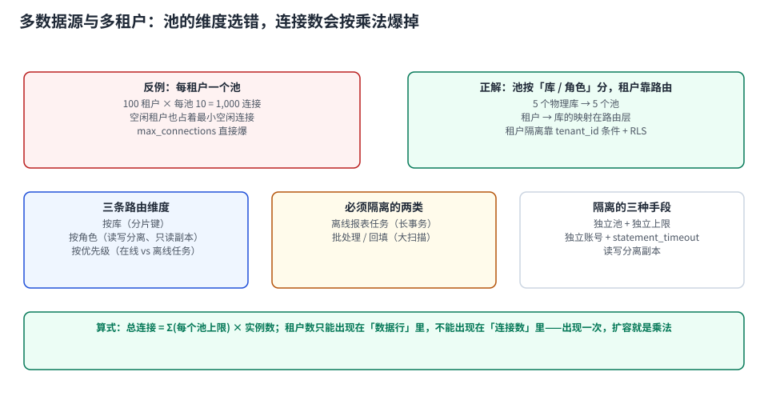

# 多数据源与多租户：池的维度选错就是乘法

一个池只服务一个 `(url, user)` 组合，这是连接池的天然单位。当系统里有多个库、多个账号、多个租户时，第一个设计决策就是：**池按什么维度划分**。

选错维度的代价是乘法，不是加法：**100 个租户 × 每租户 10 条连接 = 1,000 条连接**，而库的预算是 80。



本页判据族 `CPM-A` ~ `CPM-H`，共 8 条。定义表在第 1 节起「本页判据」。

## 一、三种划分维度与它们的成本

| 维度 | 池的数量 | 适用 | 代价 |
| --- | --- | --- | --- |
| **按库/分片** | 分片数 | 分库分表、多机房 | 池数量可控，跨库事务要另设计 |
| **按角色** | 主库 1 + 从库 N | 读写分离、只读副本 | 写后读一致性要处理 |
| **按优先级** | 在线 2~3 个 | 在线 / 报表 / 回填 / 迁移 | 隔离彻底，但要独立账号与预算 |
| **按租户** | 租户数 | 每租户独立库（silo 模型） | **连接数爆炸**，只在租户数很少时可行 |

前三种的池数量是**常数级**，第四种是**线性于业务规模**——这就是「租户数只能出现在数据行里，不能出现在连接数里」的含义。

::: danger 每租户一池的三种死法
1. **连接数爆炸**：100 租户 × 10 = 1,000 条，`max_connections=100` 直接不够；
2. **空闲也占着**：`minimumIdle` 让每个池都保底几条连接，90 个闲置租户白占 900 条；
3. **建池风暴**：租户首次访问时懒建池，一波营销活动带来 300 个租户同时首访 → 3,000 条连接同时建，库侧 fork 打满。

例外确实存在：租户数 ≤ 20 且每户数据量极大（独立库/独立实例）的 silo 架构，每租户一池是合理的——**前提是租户数有硬上限，且写进了容量规划**。
:::

## 二、正解：池按「库 + 角色」分，租户靠路由

```text
租户 t1, t2, t3  ──┐
                   ├─→ 池 A（orders 主库，20 条）──→ 库 orders_primary
租户 t4, t5, t6  ──┘

只读查询 ───────────→ 池 B（orders 从库，30 条）──→ 库 orders_replica
报表/回填 ──────────→ 池 C（orders 主库，5 条，独立账号）──→ statement_timeout=60s
```

三层隔离，一共 **3 个池**。租户隔离靠两件事保证：

1. **数据层**：`tenant_id` 等值条件（每张表都有，且进了索引前缀）；
2. **会话层**：`SET LOCAL app.tenant_id = ?` + RLS 策略（事务级，提交即恢复）。

第 2 条是「连接复用」与「租户隔离」能同时成立的关键——用 `SET LOCAL` 而不是 `SET`，这样连接还回池时不会带着上一个租户的身份。这条已在本仓有完整实测（[TeamBoard 连接池串租户](../../../../project/Complete/TeamBoard/PoolTenantLeak/index.md)）：会话级 `SET` 会被下一个请求继承，而 `SET LOCAL` 提交后恢复的是**外层会话值**，不是空。

## 三、读写分离：两个池，不是一套池

读写分离最常见的错误是「一个池连主，一个池连从，然后靠注解切换」。它能工作，但有三个必须显式处理的点：

| 问题 | 现象 | 处理 |
| --- | --- | --- |
| **写后读** | 刚下单，详情页查不到 | 写后 N 秒内的读走主库（会话粘性）或按 GTID/LSN 等待 |
| **事务内切换** | `@Transactional` 里读走了从库，读到旧数据 | **事务内一律走主库**；路由键在事务开始时已绑定，中间切换无效 |
| **从库延迟** | 报表读到滞后数据 | 报表走独立池 + 显式容忍度声明 |

第三条的技术根因值得单独说：**连接在事务开始时就被绑定**，之后改路由键不会换连接。所以「在事务中间切数据源」是不生效的——这一点在 `AbstractRoutingDataSource` 这类实现上表现最明显：`determineCurrentLookupKey()` 只在**获取连接时**被调用一次。

::: warning 池大小要按「角色」分别算
主库池 20 + 从库池 30 = 50 条连接，**每一层都要进库侧预算**。常见错误是只算了主库池，忘了从库池也是库侧连接（只是连到另一台）。

若从库是同一实例上的只读副本（少见但存在），则两者共享同一个 `max_connections`。
:::

## 四、离线任务必须独立池（不只是独立上限）

报表、回填、数据迁移这三类任务有两个特征：**单条 SQL 很慢**、**一次要扫很多行**。它们与在线请求共用池时，会以两种方式伤害在线：

1. **占连接**：一条 60 秒的报表占一条连接 60 秒；
2. **占 IO 与锁**：大范围扫描把缓存打掉，把从库延迟拉高。

所以隔离要做到三层：

```sql
-- ① 独立账号（便于在库侧按 usename 归因）
create role rpt_reader login password '***';
grant select on all tables in schema public to rpt_reader;

-- ② 账号级资源约束（PostgreSQL）
alter role rpt_reader set statement_timeout = '60s';
alter role rpt_reader set idle_in_transaction_session_timeout = '30s';

-- ③ 独立池 + 独立上限（应用侧）
--    rptDataSource: maximumPoolSize=5, connectionTimeout=3000
```

三层的效果：报表最坏情况只吃掉 5 条连接、60 秒后自杀，并且永远不会把在线池占满。**只做第 ③ 层是不够的**——池隔离了，但一条 10 分钟的查询仍会把从库延迟拉高。

## 五、连接数的完整算式（写进容量表）

```text
总连接 = Σ(每个池的上限) × 实例数
       ≤ max_connections × 0.8 − 代理池 − 运维会话
```

**算例**（`max_connections=100`，可用 80，10 个实例）：

| 池 | 单实例上限 | × 10 实例 | 说明 |
| --- | --- | --- | --- |
| 主库写池 | 4 | 40 | 在线写 |
| 从库读池 | 2 | 20 | 在线读 |
| 报表池 | 1 | 10 | 独立账号 + 60 s 超时 |
| **合计** | 7 | **70** | ≤ 80 ✅ |

若有人把主库池从 4 调到 8：`8×10 + 20 + 10 = 110 > 80` → 直接超标。**这个乘法是发布前必须过的一道闸。**

内存侧顺带算一下：1,000 条连接 × 1.4 MiB 私有内存 ≈ **1.4 GB**（`pg_backend_memory_contexts` 口径），再加共享缓冲。用 RSS 口径（14.8 MiB/连接）会算出 14 GB，那是重复计入共享映射的假数字。

## 六、验证：四条读数

```sql
-- ① 按账号/应用看连接分布（多租户下最有用的一条）
select coalesce(application_name,'(unset)') app, usename, count(*) as conns
from pg_stat_activity where backend_type='client backend'
group by 1,2 order by 3 desc;

-- ② 池的数量是否与「库数 × 角色数」一致（不是租户数）
--    应用侧：/actuator/metrics 里 hikaricp 的 pool 名称列表
--    期望：数量 = 库数 × 角色数，且与租户数无关

-- ③ 是否有租户身份泄漏（跨事务残留）
select count(*) from pg_stat_activity
where state = 'idle' and current_setting('app.tenant_id', true) is not null;
-- 期望：0（空闲连接上不应残留租户身份）
```

| 读数 | 正常 | 异常 |
| --- | --- | --- |
| 池的数量 | 常数（库数 × 角色数） | 随租户数增长 → 维度选错 |
| 每账号连接数 | ≈ 该池上限 × 实例数 | 超出 → 有旁路连接 |
| 总连接 / `max_connections` | < 60% | > 80% → 下次发布撞墙 |
| 空闲连接上的租户变量 | 空 | 非空 → 用了 `SET` 而不是 `SET LOCAL` |

## 七、本页判据

| 编号 | 判据 | 看什么现象 | 不满足时改哪里 |
| --- | --- | --- | --- |
| `CPM-A` | 池的数量是常数级 | 池数 = 库数 × 角色数 | 改成按库/角色分，租户走路由 |
| `CPM-B` | 租户身份用 `SET LOCAL` | 代码里是 `SET LOCAL app.tenant_id` | 改成 `SET LOCAL`（事务级自动恢复） |
| `CPM-C` | 空闲连接上无租户残留 | 巡检 SQL 返回 0 | 改复位策略；见「事务边界」 |
| `CPM-D` | 读写池分开且都进预算 | 预算表里主从两行都有 | 补从库池那一行 |
| `CPM-E` | 事务内不改路由 | 路由只在取连接时决定 | 事务内一律走主库 |
| `CPM-F` | 离线任务三层隔离 | 独立账号 + 账号级超时 + 独立池 | 补账号级约束（只隔离池不够） |
| `CPM-G` | 连接数算式写进容量表 | 有 `Σ池上限 × 实例数 ≤ 0.8 × max` | 补算；这是发布闸门 |
| `CPM-H` | 内存按私有口径算 | 容量表不是用 RSS × 连接数 | 改用 1.4 MiB 私有口径 |

## 参考资料

- HikariCP README：`maximumPoolSize` 语义（含空闲与使用中的总数）
- PostgreSQL 18 Documentation：*Row Security Policies*（RLS 与 `current_setting` 的配合）、*SET LOCAL*、*ALTER ROLE ... SET*（账号级默认参数）
- Spring Framework 参考文档：`AbstractRoutingDataSource#determineCurrentLookupKey`（**取连接时**调用一次）
- 本仓库：[TeamBoard 连接池串租户](../../../../project/Complete/TeamBoard/PoolTenantLeak/index.md)（`SET` 与 `SET LOCAL` 的实测差异）、[TeamBoard 多租户](../../../../project/Complete/TeamBoard/MultiTenancy/index.md)（租户隔离三档）、[双层池](../DoubleLayer/index.md)（代理层的账）
