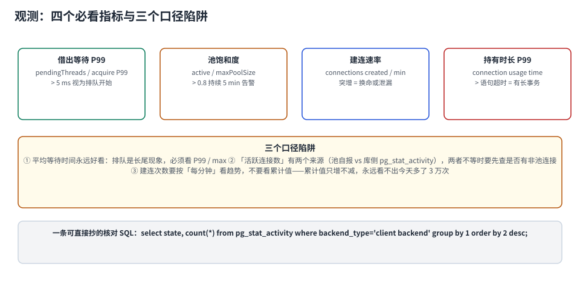

# 观测与告警：四个必看指标与三个口径陷阱

连接池是最容易被「监控到但看不懂」的组件：指标有一堆，出事时没人说得清哪个数是病。本页把指标收敛到**四个**，每个都给出阈值来源，并列出三个会让人得出相反结论的口径陷阱。



本页判据族 `CPV-A` ~ `CPV-H`，共 8 条。定义表在第 1 节起「本页判据」。

## 一、四个指标，每个都有阈值来源

| 指标 | 取哪里 | 阈值怎么来 | 超了说明什么 |
| --- | --- | --- | --- |
| **借出等待 P99** | 池侧 `acquire` 计时（HikariCP: `hikaricp_connections_acquire_seconds`） | 与一次往返查询对齐：本机 0.205 ms；> 5 ms 即开始排队 | 池不够或有长占用 |
| **池饱和度** | `active / maximumPoolSize` | 与库侧预算联动：库侧 > 80% 就要动手 | 接近 1 时下一次尖峰必超时 |
| **建连速率** | 每分钟 `backend_start` 数（或池的 `connections.created`） | 平稳基线 ±3σ | 突增 = 换命、被踢、泄漏 |
| **持有时长 P99** | 池侧 `usage` 计时 | 与语句超时对齐（如 60 s） | 远大于语句耗时 = 有等待/外部 IO |

::: tip 阈值不要拍脑袋，四条都能推
1. 借出等待：一次往返 0.205 ms，排队超过它的 20 倍（≈ 5 ms）就该看；
2. 饱和度：库侧预算的 80% 是硬线（见 [池大小](../Sizing/index.md)）；
3. 建连速率：`实例数 × 池上限 / maxLifetime` 是理论换命速率；
   例：10 × 20 / 1800 s ≈ **6.7 次/分钟**，明显超过就是在异常换命；
4. 持有时长：应 ≤ 语句超时（否则语句超时形同虚设）。
:::

## 二、三个口径陷阱

### 陷阱 ①：平均等待时间永远好看

排队是**长尾现象**：100 个请求里 99 个不等，1 个等了 3 秒，平均等待只有 30 ms——看起来「完全正常」，但那 1 个请求的用户已经超时了。

```text
正确：acquire_p99 > 5 ms → 告警
错误：acquire_avg > 5 ms → 永远不告警
```

### 陷阱 ②：「活跃连接数」有两个来源，不一定相等

| 来源 | 数的是什么 | 什么时候会偏 |
| --- | --- | --- |
| 池自报 `active` | 池认为已借出的连接数 | 借出但连接已死（仍算 active） |
| 库侧 `pg_stat_activity` | 服务端真实存在的会话 | 含非池连接（脚本、监控、代理） |

两者不等时不要急着「修指标」，先解释差异：

```sql
-- 库侧按应用名/账号聚合，找出「不是池」的那部分
select coalesce(application_name,'(unset)') app, usename, state, count(*)
from pg_stat_activity where backend_type='client backend'
group by 1,2,3 order by 4 desc;
```

若某个 `usename` 的连接数远超「实例数 × 池上限」，几乎一定是**旁路连接**：DBA 客户端、监控采集器、定时脚本、代理池。

### 陷阱 ③：建连次数要看「每分钟」，不要看累计

累计值只增不减，永远看不出「今天多了 3 万次」。必须是**速率**，且要能按实例下钻——单实例突增是泄漏，全体突增是换命或库侧踢连接。

## 三、一条 SQL 看清库侧现状

```sql
-- 连接池体检（PostgreSQL；MySQL 用 performance_schema.threads 或 SHOW PROCESSLIST）
select
  count(*) filter (where backend_type = 'client backend')                       as client_conns,
  count(*) filter (where state = 'active')                                      as active,
  count(*) filter (where state = 'idle')                                        as idle,
  count(*) filter (where state = 'idle in transaction')                          as idle_in_tx,
  round(max(extract(epoch from (now() - xact_start)))
        filter (where xact_start is not null)::numeric, 1)                       as max_xact_age_s,
  round(count(*) filter (where backend_type='client backend')::numeric
        / current_setting('max_connections')::int * 100, 1)                     as pct_of_max
from pg_stat_activity;
```

读数解读：

| 字段 | 健康值 | 异常含义 |
| --- | --- | --- |
| `client_conns` | 逼近但不等于「实例数 × 池上限」 | 远大于 → 旁路连接 |
| `active` | 随流量波动 | 长期 = 上限 → 池被打满 |
| `idle` | 有，且随负载变化 | 恒为 0 → 池不够或 `idleTimeout` 太短 |
| `idle_in_tx` | **0** | > 0 → 有事务没提交（最危险） |
| `max_xact_age_s` | < 语句超时 | 远大于 → 长事务 |
| `pct_of_max` | < 60% | > 80% → 预算吃完 |

::: danger `idle_in_tx > 0` 是唯一「必须立刻处理」的读数
其他指标是「趋势」，这一项是「状态」。本机实测：一个空闲事务持有行锁 12 秒，另一个会话更新同一行等了 **8,866 ms**。它同时污染三件事：占连接、占锁、挡住 `VACUUM`。

告警建议：`idle in transaction` 持续 > 60 秒即 P1。
:::

## 四、与 APM 对账：三个数必须闭合

池的指标是「点」，APM 的链路是「线」。两者闭合不了，说明有一段没被观测到：

```text
① APM 里的 SQL span 数 / 秒  ≈ 池的「借出次数 / 秒」
② APM 的 P99 请求耗时 ≥ 池的持有时长 P99
③ 池的等待 P99 ≈ APM 里「getConnection」span 的 P99（若埋了点）
```

若 ① 明显小于池的借出次数：有借出后没用（空借），常见于「先拿连接再判断要不要查」的代码。
若 ② 违反（APM P99 小于持有时长 P99）：链路埋点漏了某段（比如异步分支）。

## 五、仪表盘：一屏四格就够

| 格子 | 内容 | 看什么 |
| --- | --- | --- |
| 左上 | 饱和度曲线（`active/max`）+ 库侧 `pct_of_max` 双线 | 两条线是否一起涨（一起涨 = 真饱和） |
| 右上 | 借出等待 P99 / max | 长尾是否起来 |
| 左下 | 每分钟新建连接数（按实例分线） | 单线突增 = 该实例泄漏 |
| 右下 | `state` 分布堆叠（active/idle/idle in tx） | `idle in tx` 是否出现 |

::: tip 为什么饱和要看两条线
池的 `active/max` 涨、库侧 `pct_of_max` 不涨 → 池被自己的长事务占满，库还很空，**加池上限有效**。
两条一起涨 → 库侧到顶了，加池上限只会让 53300 来得更快，**该加代理或加副本**。

一个指标看不出这个区别，两条线一起看才分得清。
:::

## 六、验证：四条断言

```shell
# ① 指标确实在暴露（HikariCP + actuator）
curl -s localhost:8080/actuator/metrics/hikaricp.connections.pending | jq '.measurements[0].value'
curl -s localhost:8080/actuator/metrics/hikaricp.connections.acquire | jq '.measurements'

# ② 告警规则可被触发（用压测把池打满）
docker exec pglab pgbench -c 64 -j 8 -T 60 -U postgres bench

# ③ 库侧体检 SQL 能跑通且字段有值
docker exec pglab psql -U postgres -d bench -c "<上面的体检 SQL>"

# ④ 与 APM 对账：抽 1 分钟窗口，比较「借出次数」与「SQL span 数」
```

| 断言 | 通过标准 |
| --- | --- |
| 指标存在 | `acquire` / `pending` / `usage` 三类都有 |
| 告警可触发 | 压测期间收到「饱和度 > 0.8」告警 |
| 体检 SQL 可用 | 六个字段都有非空值 |
| 对账闭合 | ① 的偏差 < 10% |

## 七、本页判据

| 编号 | 判据 | 看什么现象 | 不满足时改哪里 |
| --- | --- | --- | --- |
| `CPV-A` | 看 P99 不看平均 | 告警规则里是 P99/max | 改规则；平均永远好看 |
| `CPV-B` | 四个指标齐全 | acquire/usage/saturation/created 都有 | 补指标 |
| `CPV-C` | 建连速率是「每分钟」 | 面板上是速率而非累计 | 改 PromQL/统计口径 |
| `CPV-D` | 饱和看双线 | 池侧与库侧同屏 | 加库侧 `pct_of_max` |
| `CPV-E` | `idle_in_tx` 有 P1 告警 | 阈值 60 s | 加告警；这是状态不是趋势 |
| `CPV-F` | 与 APM 对账过 | 有「借出次数 vs SQL span」的记录 | 补对账 |
| `CPV-G` | 指标带实例标签 | 能按实例下钻 | 补标签；否则定位不到单实例 |
| `CPV-H` | 体检 SQL 固化 | 一条 SQL 出六个字段 | 抄本页那条，放进值班手册 |

## 参考资料

- HikariCP 指标：`hikaricp.connections.active/idle/pending/acquire/usage/created`（Micrometer 命名）
- Micrometer 文档：*HikariCP Metrics*（指标名与标签）
- PostgreSQL 18 Documentation：*Monitoring Database Activity*（`pg_stat_activity` 全字段）、*The Statistics Collector*
- MySQL 8.4 Reference Manual：*performance_schema.threads*、*SHOW PROCESSLIST*
- 本仓库：[连接治理](../../Middleware/ConnectionGovernance/index.md)（连接来源聚合 SQL）、[池大小](../Sizing/index.md)（预算 80% 的来源）、[泄漏定位](../LeakDetection/index.md)（`idle in transaction` 的实测杀伤力）
