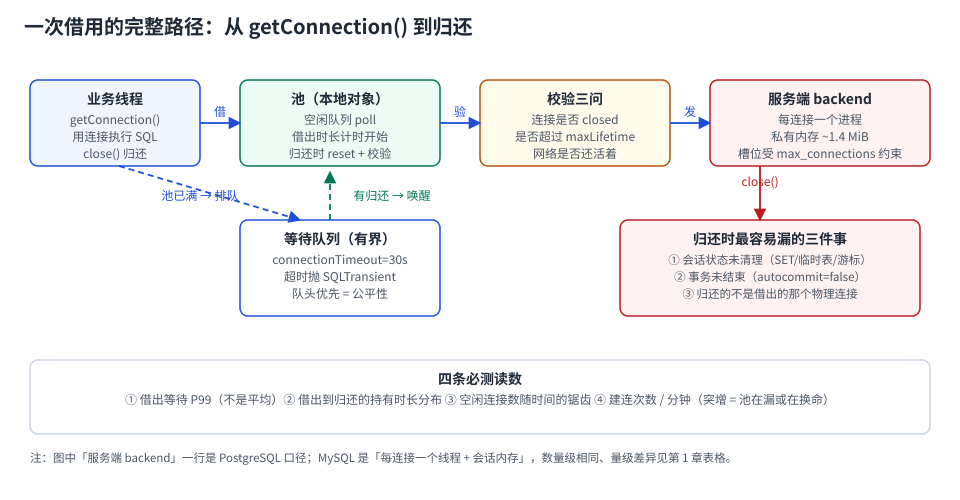

# 池里到底有什么：一次借用的完整路径

调参数之前得先知道池里有几样东西。多数「池有问题」的判断失误，都来自把池当成一个队列——实际上它是**四个结构**加**一条计时线**：

1. **空闲集合**（idle）：可直接借出的物理连接；
2. **活跃集合**（active）：已经借出、还没归还的连接；
3. **等待队列**：池满且无空闲时排队的线程（有界，上限是 `connectionTimeout`）；
4. **连接工厂**：新建物理连接的地方，也是所有「建连风暴」的源头；
5. **计时线**：每条连接从借出到归还的时长，是泄漏检测与长事务定位的唯一依据。



本页判据族 `CPI-A` ~ `CPI-H`，共 8 条。定义表在第 2 节起「本页判据」。

## 一、先算清「连接到底有多贵」

连接贵在四个地方：TCP 握手、认证（SCRAM 要算哈希）、服务端分配后端进程/线程、客户端驱动初始化会话。四件事叠起来，本机 PostgreSQL 18.6 的读数是：

| 场景 | 吞吐 | 平均延迟 | 说明 |
| --- | --- | --- | --- |
| 复用连接（`pgbench -c 8 -T 12`） | **2,556.69 TPS** | **3.129 ms** | 池的常态 |
| 每事务新建连接（`pgbench -C -c 8`） | **566.28 TPS** | **14.127 ms** | 其中建连 **4.201 ms** |
| 单客户端新建连接（`pgbench -C -c 1`） | 165.44 TPS | 6.044 ms | 其中建连 **2.124 ms** |

```shell
# 复现（容器内执行，脚本不入库）
docker exec pglab pgbench -i -s 10 -U postgres bench
docker exec pglab pgbench    -c 8 -j 4 -T 12 -U postgres bench   # 复用
docker exec pglab pgbench -C -c 8 -j 4 -T 12 -U postgres bench   # 每次新建
```

::: tip 三行读数里最该记住的一条
**建连成本随并发上升**：单客户端 2.124 ms，8 并发下变成 4.201 ms——因为建连本身要吃服务端的 fork、认证哈希和客户端线程调度。所以「连接不够就多建几条」在高峰期是**负反馈**：越缺连接，建连越慢。
:::

内存侧的口径要说清。51 条客户端连接时，容器内 postgres 进程 RSS 汇总 **967,324 kB**；1 条连接时 **209,568 kB**；差值 757,756 kB ÷ 50 ≈ **15,155 kB（约 14.8 MiB）/ 连接**。

但这是**上限**：RSS 把 `shared_buffers`（本机 128 MiB）的共享映射重复计入了每个 backend。真正属于这条连接私有的部分小得多——同机 `pg_backend_memory_contexts` 实测 **1,447 kB**（一条空闲连接的内存上下文总和）。

```sql
-- 单条连接私有内存（在目标会话里执行）
select pg_size_pretty(sum(total_bytes)) from pg_backend_memory_contexts;
-- 1447 kB
```

::: warning 别用 14.8 MiB 去算容量
「每连接 14.8 MiB」是 RSS 口径的上限，用它乘 1,000 条连接会得出「要 14 GB」的结论，实际私有部分只有 1.4 MiB 量级（1,000 条 ≈ 1.4 GB），差值全是被重复计入的共享内存。算容量用**私有内存上下文 × 连接数 + 共享缓冲**，不要用 RSS 直接乘。
:::

## 二、借出前校验：0.205 ms 买什么

池里最容易被省掉的一步是「借出前校验」——「连接刚从池里出来，怎么会是死的？」

会死。服务端重启、主备切换、防火墙 idle 超时、LB 掐连接，都会让池里的连接变成**半开连接**：客户端这边 socket 还在、`isClosed()` 返回 `false`，发出去的第一条 SQL 才报 `08S01` / `57P01`。

校验的代价极低，本机一次往返查询（`select 1`，8 并发）：

| 操作 | 延迟 | 相对建连 |
| --- | --- | --- |
| 一次往返校验（`select 1`） | **0.205 ms** | 建连的 **1/10 ~ 1/20** |
| 新建一条连接 | 2.124 ~ 4.201 ms | 1× |

也就是说，**借出前校验的成本是重连的 5%~10%**。HikariCP 的 `validationTimeout` 默认 5,000 ms（最小值 250 ms），它的语义是「这次校验最多等多久」——不是「校验要花 5 秒」。

```properties
# 推荐：不写 connectionTestQuery，JDBC4 驱动用 isValid()；把校验超时压到 1 s
dataSource.setValidationTimeout(1000);
```

::: danger 三个「校验」不是一回事
1. `Connection.isClosed()` **只查客户端状态**，半开连接照样返回 `false`；
2. `isValid(timeout)` 会真的发一次往返（PG 驱动发空查询），能抓到半开；
3. `connectionTestQuery`（`select 1`）是老驱动（非 JDBC4）的兜底，现代驱动不需要。

把 ① 当 ② 用，就是「池里有连接、请求全失败」的经典成因。
:::

## 三、池的并发结构：为什么「刚还回来的连接」常被同一个线程借走

主流实现（HikariCP 的 `ConcurrentBag`、Druid 的 `ThreadLocal` 缓存）都会把**最近归还的连接优先还给同一线程**。好处是缓存友好、少一次跨线程交接；代价是**状态污染的暴露面变大**：如果上一个请求在这条连接上设了 `SET time_zone`，同一线程的下一个请求会立刻继承。

这解释了本仓已经踩过的一个坑（[TeamBoard 连接池串租户](../../../../project/Complete/TeamBoard/PoolTenantLeak/index.md)）：会话级 `SET` 被下一个请求继承，请求二什么都没设，`current_setting` 仍是 `tenant-a`。

```text
线程 T1：借 conn#7 → SET app.tenant='tenant-a' → 归还（未复位）
线程 T1：借 conn#7（ThreadLocal 优先）→ 读到 tenant-a
```

::: tip 这条对设计的含义
**不要依赖「归还即复位」的默认行为**。复位只有两种可靠来源：① 池实现了协议级重置（MySQL `COM_RESET_CONNECTION`、PG `DISCARD ALL`）；② 应用自己在 `finally` 里复位。二者都没有时，「状态泄漏」是**结构性的**，不是偶发。
:::

## 四、预热与最小空闲：冷启动的两个坑

`minimumIdle` 决定池保持多少条空闲连接。HikariCP 的默认值是 **`minimumIdle = maximumPoolSize`**（即固定大小池），官方明确建议**不要单独设 `minimumIdle`**，理由是固定大小池对突发流量最稳。

于是冷启动有两个坑：

1. **启动即建满**：`maximumPoolSize=20` 的池，应用启动瞬间会建 20 条连接。多实例同时发布就是一次**连接风暴**（见 [故障与自愈](../FailureRecovery/index.md)）。
2. **不预热 = 首个请求吃建连延迟**：固定大小池在启动后**异步**补满空闲连接，第一个请求可能正好撞上「正在建连」，延迟从 3 ms 跳到 50 ms 以上。

::: warning 预热要用「真的查询」
用 `select 1` 预热只能证明「连接建立了」，证明不了「表存在、权限够、时区对」。预热脚本应当执行**一条业务里最常见的查询**（如按主键取一行），并断言返回 1 行——这才是「池热了」。
:::

## 五、四步验证：池到底是不是在工作

```shell
# ① 池侧：借出等待是否为 0（HikariCP 的指标名）
#    hikaricp_connections_pending / hikaricp_connections_acquire_seconds_max
curl -s localhost:8080/actuator/metrics/hikaricp.connections.pending | jq '.measurements'

# ② 库侧：客户端连接数应与「实例数 × 池上限」同量级，而不是数倍
docker exec pglab psql -U postgres -d bench -c \
  "select usename, application_name, state, count(*) from pg_stat_activity
   where backend_type='client backend' group by 1,2,3 order by 4 desc;"

# ③ 建连速率：突增说明在换命或在漏
docker exec pglab psql -U postgres -d bench -c \
  "select count(*) from pg_stat_activity where backend_start > now() - interval '1 minute';"

# ④ 一次往返校验的成本基线（用于判断校验是否过重）
docker exec pglab pgbench -n -c 8 -j 4 -T 8 -f /tmp/one.sql -U postgres bench
```

四条读数的判读：

| 读数 | 正常 | 异常含义 |
| --- | --- | --- |
| 借出等待 P99 | ≈ 0 | > 5 ms：池不够或有人在长时间占用 |
| 库侧客户端连接数 | ≈ 实例数 × 池上限 | 远大于：有非池连接（脚本、监控、代理） |
| 每分钟新建连接数 | 平稳的小数字 | 突增：`maxLifetime` 太短、连接被服务端踢、泄漏 |
| 校验延迟 | 0.2~1 ms | 与建连同量级：校验写成了重查询 |

## 六、本页判据

| 编号 | 判据 | 看什么现象 | 不满足时改哪里 |
| --- | --- | --- | --- |
| `CPI-A` | 连接复用率可量化 | 有「TPS 复用 vs 每次新建」的对照读数 | 补一次 `pgbench -C` 对照，否则无法证明池有用 |
| `CPI-B` | 借出前校验开启且有超时 | `validationTimeout ≤ 2 s`，日志里能区分校验失败与业务失败 | 补 `setValidationTimeout`，别用 `isClosed()` 顶替 |
| `CPI-C` | 校验成本 < 建连成本的 20% | 校验 ≤ 1 ms（本机 0.205 ms） | 校验语句改回空查询/`isValid()` |
| `CPI-D` | 内存容量按私有口径算 | 容量表用的是 `pg_backend_memory_contexts` 或驱动侧口径 | 用 RSS 直接乘会高估 10 倍 |
| `CPI-E` | 预热执行真实业务查询 | 预热脚本里有 `select ... where id = ?` 且断言行数 | 换成业务查询；`select 1` 只证明连得上 |
| `CPI-F` | 不依赖「归还即复位」 | 复位有明确来源（协议级或 `finally`） | 补复位；否则状态污染是结构性的 |
| `CPI-G` | 建连速率有监控 | 有「每分钟新建连接数」曲线 | 接池指标或库侧 `backend_start` 统计 |
| `CPI-H` | 借出等待 P99 有读数 | 指标里有 `acquire` 的 P99 / max | 只有平均值等于没测（长尾看不见） |

## 参考资料

- HikariCP README：*Configuration* 中 `validationTimeout`（默认 5,000 ms，最小 250 ms）、`minimumIdle` 建议
- HikariCP wiki：*About Pool Sizing*、*You're [probably] doing it wrong*（Oracle Real-world Performance 的「连接过多反而慢」）
- PostgreSQL 18 Documentation：*Monitoring Database Activity*（`pg_stat_activity`）、*Memory Contexts*（`pg_backend_memory_contexts`）
- MySQL 8.4 Reference Manual：*Connection Interfaces*（`COM_RESET_CONNECTION` 的协议级重置）
- 本仓库：[连接治理](../../Middleware/ConnectionGovernance/index.md)（参数与值班手册）、[TeamBoard 连接池串租户](../../../../project/Complete/TeamBoard/PoolTenantLeak/index.md)（会话状态污染的五种形态）
