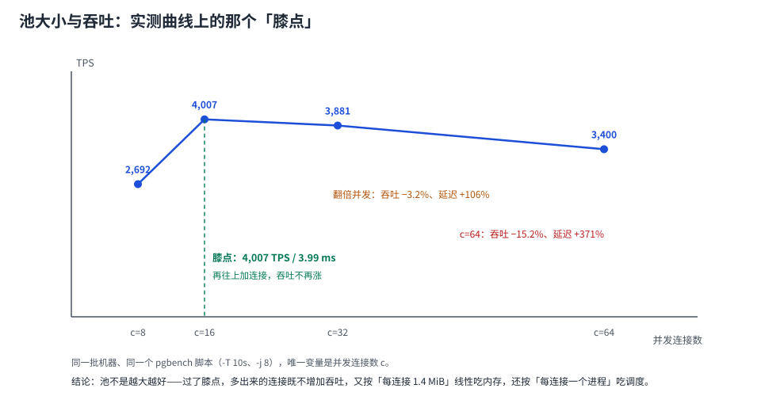

# 池大小怎么算：从公式到实测的膝点

「池开多大」是本专题唯一一个**能被算错十倍**的问题。网上流传 `cores × 2 + 有效主轴数`，也流传「池越大并发越高」。两个说法在本机实测里都不成立：并发从 8 加到 16，吞吐涨 49%；从 16 加到 32，吞吐**掉了 3.2%**，延迟翻了倍。

本页给三样东西：一条能自己跑出来的膝点曲线、一个必须算平的库侧预算、以及「公式什么时候失效」的判据。



本页判据族 `CPS-A` ~ `CPS-H`，共 8 条。定义表在第 1 节起「本页判据」。

## 一、先跑出自己的曲线（30 秒）

```shell
# 建数据（只做一次）
docker exec pglab pgbench -i -s 10 -U postgres bench

# 只改并发，其余不变；每个点跑 10 秒
for c in 8 16 32 64; do
  echo "== c=$c"
  docker exec pglab pgbench -c $c -j 8 -T 10 -U postgres bench | grep -E "^tps|latency average"
done
```

本机 PostgreSQL 18.6 的结果（同一台机器、同一个脚本、唯一变量是并发）：

| 并发 c | 吞吐 TPS | 平均延迟 | 每连接边际吞吐 | 相对膝点 |
| --- | --- | --- | --- | --- |
| 8 | 2,692.10 | 2.972 ms | 336.5 | −32.8% |
| **16** | **4,007.45** | **3.993 ms** | 250.5 | **膝点** |
| 32 | 3,881.10 | 8.245 ms | 121.3 | 吞吐 −3.2%、延迟 **+106%** |
| 64 | 3,399.80 | 18.825 ms | 53.1 | 吞吐 −15.2%、延迟 **+371%** |

::: tip 这张表只用看一列：每连接边际吞吐
336 → 250 → 121 → 53。**每多开一条连接带来的吞吐，是单调递减的**；过了膝点，它变成负数（拿吞吐换延迟）。而每条连接的成本（1.4 MiB 私有内存 + 一个后端进程/线程 + 一份调度）是**线性上升**的。两个方向一夹，「越大越好」不成立。
:::

::: warning 绝对值会漂，比例不会
同一配置重复跑，`tps` 绝对值有 5~10% 波动（共享宿主 CPU）。所以**别把本机的 4,007 当目标值**，要看的是「膝点在 c≈16、再翻倍就掉头」这个形状。你们的膝点取决于核数、磁盘与服务时间，必须在自己的机器上跑一遍。
:::

## 二、Little 定律：把「并发」与「吞吐/延迟」锁在一起

排队论的基本恒等式，也是判断读数是否自洽的唯一工具：

```text
并发数 L = 吞吐 λ × 停留时间 W
```

用上表验证 c=16：`4,007.45 × 0.003993 s = 16.00` —— 正好等于并发数。这不是巧合，是恒等式。

它的三个用法：

1. **判断读数真假**：任何一组「TPS + 平均延迟」都必须满足 L ≈ c。算出来是 8 或 40，说明采样窗口没对齐（比如把建连时间算进了延迟、只统计了部分客户端）。
2. **反推需要的连接数**：已知目标吞吐与单请求停留时间，`L = λ × W` 直接给出**同时在飞的请求数**，这就是池的下限。例：目标 1,000 TPS、单请求 20 ms → L = 20 条连接。
3. **识别「延迟涨了但吞吐没涨」**：`λ` 不变而 `W` 翻倍，必然意味着 `L` 翻倍——多出来的连接全在排队，不是在干活。

::: danger 别把「平均延迟」当停留时间
Little 定律里的 `W` 是**请求从进入系统到离开**的时间（含排队）。用「SQL 执行时间」代入，会系统性低估 `L`，得出的池大小正好差一个排队系数——高峰期就是这么不够的。
:::

## 三、库侧预算：这条算不平，后面全白搭

池大小的上限**不是**由应用决定的，是由 `max_connections` 决定的。本机把 `max_connections` 调到 20（`superuser_reserved_connections` 默认 3）后：

```shell
# 17 条普通连接占满可用槽位后，第 18 条直接被拒
docker exec -e PGPASSWORD=app pglab psql -h 127.0.0.1 -U app -d bench -c "select 1"
# psql: error: ... FATAL:  remaining connection slots are reserved for roles with the SUPERUSER attribute
```

此时**超级用户仍能连进来**（这就是保留槽位的意义：出事了还能登进去看）。这条实测给出两个结论：

- 报错信息说的是「保留给超级用户」，**不是「max_connections 太小」**——照着这句话去调大 `max_connections` 是误诊；
- 「打满后连排查都进不去」只在**用普通账号排查**时成立；值班账号必须是超级用户或单独预留。

预算算式（写进上线检查表）：

```text
实例数 × maxPoolSize                       # 应用池
+ 代理池（若有两层）                        # 见「双层池」
+ 离线任务 / 报表 / 迁移脚本的独立连接       # 不能与在线共用预算
+ 监控、备份、DBA 会话                       # 常被忘记的一档
≤ max_connections × 0.8                     # 留 20% 余量给突发与故障转移
```

**算例**：`max_connections=100`、预留 20% → 可用 80。10 个应用实例、PgBouncer 池 20、离线任务 5 条、监控与运维 5 条：

```text
10 × maxPoolSize + 20 + 5 + 5 ≤ 80   →   maxPoolSize ≤ 5
```

「10 个实例每个 20 条」= 200 条，是预算的 2.5 倍——这种配置在低峰期永远看不出问题，**在发布或故障转移时才会集体撞墙**。

## 四、那 `cores × 2 + spindles` 还要不要用

用，但只当**起点**。它的原始语境是「一条连接对应一个后端进程，活跃连接数超过核数只是把 CPU 时间切片」，所以建议 `2 × cores`（留一倍给 IO 等待）。三条失效条件：

| 失效条件 | 为什么 | 怎么办 |
| --- | --- | --- |
| **请求里有大量等待**（外部 HTTP、锁等待） | 连接被占着但不吃 CPU，`2 × cores` 会严重不够 | 先用 `L = λ × W` 算，再压测校准 |
| **连接被长事务/批处理占用** | 池大小不再等于并发能力，等于「长任务的槽位数」 | 长任务拆独立池（见 [多数据源](../MultiDatasource/index.md)） |
| **库前面有代理** | 应用侧的池上限与库侧的真实连接数脱钩 | 两层的账一起算（见 [双层池](../DoubleLayer/index.md)） |

::: tip 一个可执行的取值顺序
1. 先算 `L = 目标 TPS × 请求停留时间`，得到**下限**；
2. 用 `max_connections × 0.8` 反推**上限**（扣掉代理与离线）；
3. 在这个区间里跑压测，取**吞吐膝点**对应的并发；
4. 若下限 > 上限 → 不是调参问题，是要加代理、加只读副本或改请求路径。
:::

## 五、`minimumIdle` 与「固定大小池」

HikariCP 默认 `minimumIdle = maximumPoolSize`，即固定大小池；官方建议**不要单独设置 `minimumIdle`**。原因是弹性池在流量突增时要做「建连 + 交接」，而建连要 2~4 ms，恰好落在延迟敏感的位置。

固定大小池的代价是**空闲也占着连接**。判断标准很简单：

| 场景 | 建议 |
| --- | --- |
| 常驻在线服务、流量平稳 | 固定大小（不设 `minimumIdle`） |
| 有明显昼夜差、夜间希望释放连接 | `minimumIdle` = 峰值的 20%~30%，并接受突增时的建连延迟 |
| 批处理 / 定时任务 | 独立小池，任务结束即关池，不要与在线共用 |

## 六、验证：三条命令判断「现在这组参数对不对」

```sql
-- ① 库侧真实连接数 vs 预算
select count(*) as client_backends,
       current_setting('max_connections')::int as max_conn,
       round(count(*)::numeric / current_setting('max_connections')::int * 100, 1) as pct
from pg_stat_activity where backend_type = 'client backend';

-- ② 谁在占着连接（应用名要在连接串里设置，否则这一列是空的）
select coalesce(application_name,'(unset)') as app, state, count(*)
from pg_stat_activity where backend_type='client backend'
group by 1,2 order by 3 desc;

-- ③ 有没有超出池上限的「野生连接」
--    判据：某个 app 的连接数 > 它的 maxPoolSize × 实例数 → 有非池来源
select usename, count(*) from pg_stat_activity
where backend_type='client backend' group by 1 order by 2 desc;
```

读数判据：

| 读数 | 正常 | 异常 |
| --- | --- | --- |
| `pct` | < 60% | > 80%：预算已吃完，下一次发布就会撞墙 |
| `application_name` | 每行都能读出是哪个服务 | 大量 `(unset)`：出问题无法归因，先补连接串参数 |
| 某 app 的连接数 | ≈ 实例数 × 池上限 | 超出：有脚本/监控/代理在用同一账号 |

## 七、本页判据

| 编号 | 判据 | 看什么现象 | 不满足时改哪里 |
| --- | --- | --- | --- |
| `CPS-A` | 有本机膝点曲线 | 至少 4 个并发点的 TPS/延迟表 | 按第一节跑一遍；抄别人的数字必错 |
| `CPS-B` | 池大小由 `L = λ × W` 给出下限 | 有「目标 TPS × 停留时间」的算式 | 补算式；凭感觉取值 |
| `CPS-C` | 库侧预算算平 | `实例数 × 池上限 + 代理 + 离线 + 运维 ≤ 0.8 × max` | 超了就降池上限或加代理 |
| `CPS-D` | 报错信息被正确解读 | 53300 时先查预算，不是先调 `max_connections` | 按预算重算 |
| `CPS-E` | 读数满足 `L ≈ c` | `TPS × 延迟 ≈ 并发数` | 采样窗口或口径有问题 |
| `CPS-F` | `minimumIdle` 有明确取舍 | 要么不设（固定池），要么写了理由 | 别抄「设成一半」这类口头经验 |
| `CPS-G` | 长任务用独立池 | 报表/回填不占在线池 | 拆池 + 独立账号 |
| `CPS-H` | `application_name` 已设置 | 库侧能按服务归因 | 连接串补 `ApplicationName` |
## 与「数据库参数与内核调优」专题的分工（第 199 天补充）

本页算的是**池**的账（池大小、膝点、排队），[数据库参数与内核调优](../../ParameterTuning/index.md) 算的是**池背后每个后端连接**的账（固定开销 + 工作内存 × 并行度）。

| 问题 | 本页（池） | 参数专题（后端连接） |
| --- | --- | --- |
| 池该开多大、膝点在哪 | ✅ 给公式与实测 | 不重复 |
| 一个后端连接占多少内存 | 只作输入 | ✅ 给实测 2.65 MB |
| 并行 worker 让内存上界翻几倍 | — | ✅ `× (1 + 并行度)` |

**这一页特有的一个坑**：池大小算式里漏掉并行度。池里 20 条连接，若每条查询走 2 个并行 worker、`work_mem=16 MB`，实际工作内存是 `20 × 16 × 3 = 960 MB`，而不是 `320 MB`。本机实测 `max_parallel_workers_per_gather=4` 时只启动 3 个 worker（`max_worker_processes` 默认 8 先撞墙），聚合查询从 212.6 ms 降到 77.7 ms（**2.74×**）——加速是真的，内存乘数也是真的。

## 参考资料

- HikariCP wiki：*About Pool Sizing*（不提供公式，引用 Oracle Real-world Performance「连接过多差 50 倍」）、*Down the Rabbit Hole*
- HikariCP README：`maximumPoolSize` 默认 10、`minimumIdle` 建议不单独设置
- PostgreSQL wiki：*Number Of Database Connections*（`cores × 2 + spindles` 的原始语境与失效条件）
- PostgreSQL 18 Documentation：*Connections and Authentication*（`max_connections`、`superuser_reserved_connections`）
- 本仓库：[连接治理](../../Middleware/ConnectionGovernance/index.md)（连接数是乘出来的）、[双层池](../DoubleLayer/index.md)（两层上限的账）
