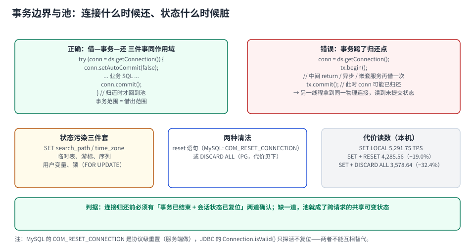

# 事务边界与池：连接什么时候还、状态什么时候脏

连接池里最难查的一类问题，都落在同一句话上：**连接借出的寿命（borrow lifetime）与事务的边界（transaction boundary）不重合**。

两者一旦错位，会产生三种症状，看起来毫不相干，根因是同一个：

1. **状态污染**——下一个请求继承了上一个请求的 `SET`、临时表、RLS 上下文；
2. **连接被吞**——事务没结束，连接不归还，池慢慢被吃空；
3. **长事务拖库**——连接占着锁不放，DDL 排队、`VACUUM` 被挡、从库延迟。



本页判据族 `CPT-A` ~ `CPT-H`，共 8 条。定义表在第 1 节起「本页判据」。

## 一、三个时刻必须对齐

```text
getConnection()  →  事务开始  →  ... SQL ...  →  事务提交/回滚  →  close() 归还
       ↑                                              ↑                ↑
   借出计时开始                                  事务结束点        池的复位点
```

对齐的写法只有一个形状——**借、事务、还在同一个作用域里**：

```java
// 对：借出范围 == 事务范围，异常也走 finally
try (Connection conn = dataSource.getConnection()) {
    conn.setAutoCommit(false);
    try {
        // 业务 SQL
        conn.commit();
    } catch (SQLException e) {
        conn.rollback();
        throw e;
    }
}   // 归还发生在这里
```

```java
// 错：事务跨了归还点
Connection conn = dataSource.getConnection();
txManager.begin();
// ... 中间 return / 异步 / 又调了一个 @Transactional 方法（可能借第二条连接）
txManager.commit();   // 此时 conn 可能已经被归还并借给了别的线程
```

::: danger 错位最典型的三种代码形状
1. **手动 `begin/commit` + 中间 `return`**：`commit()` 写在 `return` 后面，永远不执行；连接带着未提交事务被归还。
2. **`@Transactional` 方法里再调一个 `REQUIRES_NEW` 方法**：同一请求同时持有 **两条** 连接（外层挂起、内层新建）。池的可用数量瞬间减半。
3. **事务里调外部 HTTP**：下游慢 5 秒，连接就被占 5 秒。`connectionTimeout` 是 30 秒，看起来「没超时」，实际池里少了 5 条连接。
:::

## 二、会话状态：池是「共享可变状态」

一条连接被复用，意味着**它上面的会话状态也跟着被复用**。会残留的东西至少七类：

| 残留项 | 怎么产生 | 后果 |
| --- | --- | --- |
| `SET` 会话变量（`time_zone`、`search_path`、`app.tenant`） | 业务代码按需设置 | 下一个请求读到别人的时区/租户 |
| 临时表 | `create temporary table` | 同名冲突、数据串号 |
| 游标（`WITH HOLD`） | 分页/批处理 | 未关闭的游标占内存与锁 |
| 会话级 advisory lock | `pg_advisory_lock` | 别人永远拿不到锁 |
| 预编译语句 | `PREPARE` / 驱动服务端预处理 | 代理模式下报「语句不存在」 |
| 事务隔离级别 | `SET TRANSACTION ISOLATION LEVEL` | 影响下一个事务的可见性 |
| `autocommit` 状态 | 关闭后忘了恢复 | 下一条 SQL 掉进一个看不见的事务里 |

本仓库已有一个完整的实测（[TeamBoard 连接池串租户](../../../../project/Complete/TeamBoard/PoolTenantLeak/index.md)，PostgreSQL 18 沙盒，`pgbench` 4 客户端 / 5 秒）：

| 复位写法 | 只做 `SELECT 1` | 换成真实 `count(*)` 查询 | 相对成本 |
| --- | --- | --- | --- |
| 事务级 `SET LOCAL` | **5,291.75 TPS** | 1,357.37 TPS | 基准（最便宜） |
| `SET` + `RESET` | 4,285.56 TPS | 1,220.52 TPS | **−19.0% / −10.1%** |
| `SET` + `DISCARD ALL` | 3,578.64 TPS | 1,104.84 TPS | **−32.4% / −18.6%** |

::: tip 这张表的结论是「正确的写法恰好最便宜」
`SET LOCAL` 在事务结束时由 PG 自动恢复，**不需要复位语句**，所以它最快；`DISCARD ALL` 最安全但最贵（它会清掉预编译语句与计划缓存，`-M prepared` 下直接报 `prepared statement "P_0" does not exist`）。

所以复位策略的优先级是：**优先用「作用域自带恢复」的写法（`SET LOCAL`、事务级设置），其次才是「事后复位」**。
:::

## 三、长事务占池：池不是被「泄漏」吃掉的，是被「合法占用」吃掉的

一个执行 30 秒的报表查询，会合法占用一条连接 30 秒。10 个并发报表 = 池里少 10 条连接——**没有任何 bug，但池就是不够了**。

本机实测「空闲事务」的杀伤力（PostgreSQL 18.6）：

```sql
-- 会话 A：开事务、改一行、然后什么都不做（模拟忘记提交）
begin;
update pgbench_accounts set abalance = abalance + 1 where aid = 1;
-- 停在这里 12 秒
```

```text
-- 观察到的状态
state = idle in transaction   wait_event_type = Client   xact_age = 3.02 s

-- 会话 B：更新同一行
UPDATE 1
Time: 8866.411 ms          ← 等了 8.87 秒，直到 A 提交
```

两条结论：

1. **它会占连接**：`idle in transaction` 的连接不会被池回收，也不会被服务端回收（PG 的 `idle_in_transaction_session_timeout` 默认 0）；
2. **它还会占锁**：另一个会话的 `UPDATE` 直接等了 8.87 秒。**池里少一条连接只是变慢，锁被占住是会连锁超时的**。

::: warning 三个必须有的超时
`connectionTimeout`（借不到就放弃）、语句超时（`statement_timeout` / JDBC `setQueryTimeout`）、外部调用超时（HTTP client）。三者缺一，池就会被一个慢下游整池拖死——因为「借出」这一步没有上限。
:::

## 四、嵌套借用：一次请求借两条连接

三种常见形态：

| 形态 | 表现 | 池的隐性需求 |
| --- | --- | --- |
| `REQUIRES_NEW` 嵌套事务 | 外层挂起、内层新建 | ×2 |
| 事务中调用另一个数据源（多库） | 两个池各借一条 | 两个池都要够 |
| 异步/并行流（`CompletableFuture` 里查库） | 每条并行分支一条 | ×分支数 |

**实用判据**：池的 `maxPoolSize` 至少要 ≥ `实例并发线程数 × 单请求最大连接占用数`，否则线程池里的线程会集体卡在「借连接」上——线程没死、池没满，但系统吞吐归零。这种「死锁式的饥饿」比 OOM 更难查，因为两边指标都不报警。

## 五、一个正确的模板（可直接抄）

```java
@Transactional(rollbackFor = Exception.class)
public void placeOrder(OrderCmd cmd) {
    // ① 事务外做外部调用（HTTP 拿到价格/风控结果），不要放在这里
    // ② 事务内只做本地库操作，尽量短
    orderRepo.insert(cmd);
    stockRepo.reserve(cmd.skuId(), cmd.qty());
}   // 提交后连接立刻归还

// ③ 需要外部调用的部分放在事务外，用 outbox/补偿保证最终一致
```

配套三条纪律：

1. **事务方法内禁止外部 IO**（HTTP、RPC、发消息、文件）；
2. **禁止在事务里 sleep / 重试**——重试要在事务外，否则每次重试都多占一条连接的时间；
3. **批量操作分批提交**，不要把 10 万行放在一个事务里（既占连接又制造长事务）。

## 六、验证：四条能直接跑的检查

```sql
-- ① 有没有「事务开着但不干活」的连接（最危险的一类）
select pid, usename, application_name, state,
       round(extract(epoch from (now() - xact_start))::numeric, 1) as xact_age_s,
       left(query, 60) as last_query
from pg_stat_activity
where state = 'idle in transaction'
order by xact_age_s desc;

-- ② 有没有长事务（> 5 s），它占着连接也占着锁
select pid, state, now() - xact_start as age, left(query, 60)
from pg_stat_activity
where xact_start is not null and now() - xact_start > interval '5 seconds'
order by age desc;

-- ③ 每条连接的「借出时长」分布（客户端侧指标，比库侧更准）
--    HikariCP: hikaricp_connections_usage_seconds_max
--    Druid:    druid_datasource_pooling_count / 自建计时
```

```shell
# ④ 复现「状态污染」的最小实验：同一连接里设变量，归还后再借
docker exec pglab psql -U postgres -d bench -c "set application_name='probe'; select current_setting('application_name');"
# 期望：看到 probe；若在池里复用，下一个请求也读到 probe → 说明没有复位
```

| 读数 | 正常 | 异常 |
| --- | --- | --- |
| `idle in transaction` | 0 行 | 有 → 事务未结束，立刻定位应用 |
| 长事务（> 5 s） | 报表类可解释 | 在线请求出现 → 事务里有外部 IO |
| 连接借出时长 P99 | ≈ 语句耗时 | 远大于 → 有等待（锁/外部调用） |
| 状态污染实验 | 复位后读不到旧值 | 读到旧值 → 复位缺失 |

## 七、本页判据

| 编号 | 判据 | 看什么现象 | 不满足时改哪里 |
| --- | --- | --- | --- |
| `CPT-A` | 借出范围 == 事务范围 | 代码里 `getConnection` 与 `commit` 同作用域 | 重构为 try-with-resources |
| `CPT-B` | 事务内无外部 IO | 事务方法里没有 HTTP/RPC/MQ | 移到事务外，用 outbox 保一致 |
| `CPT-C` | 复位用「作用域自带」优先 | 优先 `SET LOCAL`，而非事后 `RESET`/`DISCARD ALL` | 改写法（便宜 19%~32%） |
| `CPT-D` | `idle in transaction` 有告警 | 监控里这一项有阈值 | 加告警；PG 侧设 `idle_in_transaction_session_timeout` |
| `CPT-E` | 三种超时都设置 | `connectionTimeout` / 语句超时 / 外部调用超时 | 缺一个就会被慢下游拖死 |
| `CPT-F` | 嵌套借用有配额 | `REQUIRES_NEW`/异步分支的连接需求已计入池大小 | 提高池上限或改同步 |
| `CPT-G` | 批处理分批提交 | 单事务行数有上限 | 按批提交，避免长事务 |
| `CPT-H` | 有状态污染实验记录 | 能复现「设置 → 归还 → 再借」的结果 | 补实验；这是唯一能证明复位有效的动作 |

## 与「数据库访问控制与审计」专题的分工（第 190 天补充）

| 问题 | 看哪里 |
| --- | --- |
| 事务边界、借还时机、会话状态怎么脏 | 本页 |
| 行级策略需要什么上下文、为什么必须事务级 | [行级安全：策略的写法与边界](../../AccessControl/RowLevelSecurity/index.md) |
| 身份切换（`SET ROLE`）残留造成越权 | [越权路径](../../AccessControl/PrivilegeEscalation/index.md) |

**这一页特有的坑：`RESET ROLE` 不会复位 `search_path`。** 本机实测：攻击场景里 `SET search_path = evil, public` 之后，即使 `RESET ROLE`，同会话后续未限定名的 `select ... from audit_log` 仍然命中 `evil.audit_log`。归还连接前要做的是 `DISCARD ALL`（或至少 `RESET ALL` + `RESET ROLE` 两条），只做 `RESET ROLE` 会把上下文带给下一个请求。

## 参考资料

- HikariCP README：`connectionTimeout`（30,000 ms）、`autoCommit`、`transactionIsolation` 的复位语义
- PostgreSQL 18 Documentation：*SET TRANSACTION*、*SET LOCAL*、*DISCARD*、*Advisory Locks*
- MySQL 8.4 Reference Manual：*SET Syntax for Variable Assignment*、*COM_RESET_CONNECTION*
- 本仓库：[TeamBoard 连接池串租户](../../../../project/Complete/TeamBoard/PoolTenantLeak/index.md)（五种形态 + TPS 成本三档）、[TeamBoard 池容量](../../../../project/Complete/TeamBoard/PoolCapacity/index.md)（预算与启动顺序）
