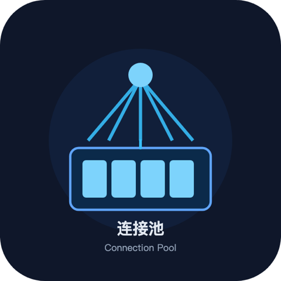
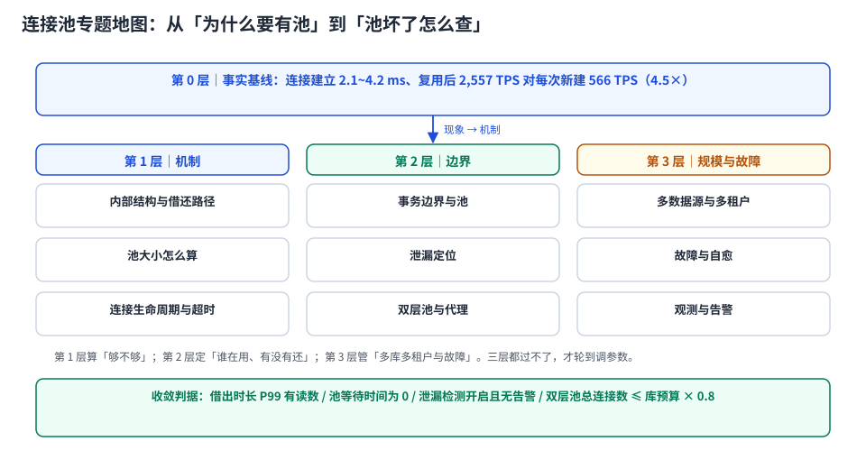

# 连接池与连接生命周期

一个请求要查一次库，是「新建一条连接 → 发 SQL → 关掉」快，还是「从池里借一条已经建好的」快？答案在数字里：本机同一台机器、同一个 `pgbench` 脚本，复用连接 **2,556.69 TPS / 3.129 ms**，每个事务新建连接 **566.28 TPS / 14.127 ms**——**吞吐差 4.5 倍**。

但连接池的麻烦从来不是「为什么要有池」，而是「池给了你一条复用过的连接，它带着上一位使用者留下的状态、可能已经被服务端单方面关掉、可能正被某个忘了 `close()` 的线程占着」。本专题讲的就是**这四件事的机制、读数和处置**。

::: tip 一句话理解
连接池不是「缓存的连接」，而是**「一个有并发语义的资源池」**——它同时是并发容器、状态容器和故障边界。把池当成缓存来调参数（越大越好、永不过期），三样都会出问题。
:::

::: info 本专题与相邻专题的分工
- **连接数怎么算、打满了怎么值班处置** → [连接治理](../Middleware/ConnectionGovernance/index.md)：那页是**值班手册**（六个参数、连接风暴、处置顺序），本专题是**机制与工程化**（借还路径、池的数学、生命周期、泄漏定位、双层池的账）。两页有交叠的地方一律在本页给出判据、在那页给出动作。
- **代理与中间件形态（读写分离、影子库、分库分表路由）** → [数据库中间件](../Middleware/Overview/index.md) 与 [代理模式](../Middleware/ProxyMode/index.md)：本专题只讲「代理作为第二层池时，两层上限怎么一起算」。
- **高并发下的过载与排队** → [高并发总览](../../Backend/HighConcurrency/Overview/index.md)：那里把「排队」放在请求链路的整体视角里，本页只把排队收缩到「借连接」这一个点。
- **连接上的会话状态怎么污染下一个租户** → [TeamBoard 连接池串租户复现](../../../project/Complete/TeamBoard/PoolTenantLeak/index.md)：那页有五种形态的实测（`SET LOCAL` 提交后回到外层值、超级用户绕过 RLS、`DISCARD ALL` 打掉预编译），本页只讲「池的复位契约」。
- **池打满时的容量核算与启动顺序** → [TeamBoard 池容量](../../../project/Complete/TeamBoard/PoolCapacity/index.md)：项目侧的落地形态。
- **表结构变更要拿锁、连接占着锁会拖死 DDL** → [在线 Schema 演进](../SchemaEvolution/LockQueue/index.md)：锁与队列那一面在那页，本页只引用「长事务占连接」这一种形态。
- **主备切换、备份恢复的流程** → [数据库大版本升级与切换](../../Ops/DatabaseUpgrade/index.md)：本页只讲「切完之后连接池怎么认新主」。
:::

## 目录

- [池里到底有什么：一次借用的完整路径](PoolInternals/index.md)
- [池大小怎么算：从公式到实测的膝点](Sizing/index.md)
- [连接生命周期：五个阀门谁先关](Lifetime/index.md)
- [事务边界与池：连接什么时候还、状态什么时候脏](TransactionBoundary/index.md)
- [泄漏定位：从「池满了」倒推到那一行没 close](LeakDetection/index.md)
- [双层池与代理：两层上限怎么一起算](DoubleLayer/index.md)
- [多数据源与多租户：池的维度选错就是乘法](MultiDatasource/index.md)
- [故障与自愈：库重启、主备切换、连接风暴](FailureRecovery/index.md)
- [观测与告警：四个必看指标与三个口径陷阱](Observability/index.md)
- [常见问题与分诊](FAQ/index.md)

## 专题地图

## 判据纪律

沿用全库写法：**每页 8 条，编号形如 `CPI-A`**，逐页前缀唯一，可被 `utils/audit` 下的判据类巡检机械核对。每条判据都要能回答三件事：**看什么现象、判成什么、不满足时改哪里**。

| 页 | 判据族 | 条数 | 这一族管什么 |
| --- | --- | --- | --- |
| 池的内部 | `CPI-A` ~ `CPI-H` | 8 | 借还路径、并发结构、校验成本、预热与公平性 |
| 池大小 | `CPS-A` ~ `CPS-H` | 8 | 算式、膝点、库侧预算、压测反推 |
| 生命周期 | `CPL-A` ~ `CPL-H` | 8 | 五个阀门、半开连接、换命成本、时间常数的相互约束 |
| 事务边界 | `CPT-A` ~ `CPT-H` | 8 | 借还时机、会话状态复位、长事务、嵌套借用 |
| 泄漏定位 | `CPK-A` ~ `CPK-H` | 8 | 检测阈值、堆栈、服务端对账、处置顺序 |
| 双层池 | `CPD-A` ~ `CPD-H` | 8 | 三种模式、预编译、会话状态、两层的账 |
| 多数据源 | `CPM-A` ~ `CPM-H` | 8 | 池的维度、路由、隔离、连接数算式 |
| 故障自愈 | `CPR-A` ~ `CPR-H` | 8 | 失效判定、退避、熔断、演练验收 |
| 观测 | `CPV-A` ~ `CPV-H` | 8 | 指标口径、长尾、告警阈值、与库侧对账 |
| 常见问题 | `CPQ-A` ~ `CPQ-H` | 8 | 症状分诊与上线自查 |

合计 **10 族 80 条**。

## 事实与版本速览（2026-10 核对）

| 项 | 现状 | 对本专题的影响 |
| --- | --- | --- |
| HikariCP | 当前主线 **7.1.0**（2026-09） | 参数默认值以 7.x README 为准，见下表；`keepaliveTime` 自 **6.2.1** 起默认 2 分钟（此前默认关闭）——照抄老文章的「默认 0」会得出错误的「空闲连接不会被探活」 |
| HikariCP 默认值 | `maximumPoolSize=10`、`minimumIdle=maximumPoolSize`、`connectionTimeout=30,000 ms`、`idleTimeout=600,000 ms`、`maxLifetime=1,800,000 ms`、`keepaliveTime=120,000 ms`、`leakDetectionThreshold=0`、`validationTimeout=5,000 ms` | 「默认就是固定大小池」——`minimumIdle` 不建议单独设，见 [池大小](Sizing/index.md) |
| PgBouncer | **1.26.1**（2026-10-14），1.26.0（2026-09-23） | 1.26.0 起**默认追踪 `search_path` 与 `default_transaction_read_only`**，新增 `pool_idle_timeout`、`query_wait_timeout` 可按 user/db 设；**移除 `-R` 在线重启**（改 `so_reuseport` 多进程滚动） |
| PgBouncer 预编译 | `max_prepared_statements` 默认 **200**（0 = 关闭协议级支持） | transaction 模式下「预编译语句」不再是死结，但有上限，见 [双层池](DoubleLayer/index.md) |
| PostgreSQL | 18.x（本机 **18.6** 容器） | `max_connections` 默认 100、`superuser_reserved_connections` 默认 3；每连接一个进程 |
| MySQL | 8.4 LTS（9.x 为 innovation） | 每连接一个线程 + 会话级缓冲；`wait_timeout` 默认 28,800 s |
| 池大小的「公式」 | 广为流传的 `cores × 2 + spindles` 出自 PostgreSQL wiki，**HikariCP README 明确不提供公式**，只引用 Oracle Real-world Performance 的结论「连接不需要那么多，过多有可验证的负面影响」 | 本专题把它当**起点**而不是答案，用实测膝点校准 |

::: warning 关于「实测」的诚实标注
本专题的数字分两类，正文逐处标注：

- **本机可复跑**：PostgreSQL **18.6** 容器（`docker run postgres:18`，`pgbench -i -s 10`，100 万账户行）、`pgbench` 自带脚本、macOS x64 + Docker Desktop。命令都写在页面里，**脚本本身不入库**。用途是**比较不同写法的量级差**，不是你们生产库的绝对值——容器共享宿主机 CPU，`tps` 绝对值会随宿主机负载波动（同一配置重复跑差 5~10% 属正常）。
- **公开口径**：HikariCP / PgBouncer / PostgreSQL 的参数默认值与版本时间线，逐条标来源与日期；凡属推算（连接数预算、容量）一律写「算例」。

两处必须说清的局限：① 内存读数用 **RSS 汇总**（51 条连接 967,324 kB 对 1 条连接 209,568 kB），RSS 会把 `shared_buffers` 的共享映射重复计入每个 backend，因此 **14.8 MiB/连接是上限**，真实私有增量要小得多（`pg_backend_memory_contexts` 实测 1,447 kB）；② MySQL 侧只做参数与语义对照，**没有做 MySQL 的连接成本实测**，凡涉及 MySQL 的数字都标了来源，没有来源的一律不写。
:::

## 三条底线

1. **池的上限之和必须小于库的上限**：`实例数 × maxPoolSize + 代理池 + 离线任务 ≤ max_connections × 0.8`。这条算不平，后面的调参全是徒劳——库侧的槽位是硬上限，池再聪明也变不出来。
2. **借出的连接必须能在「有时限」内还回来**：`connectionTimeout`、语句超时、外部调用超时三者缺一，池就会被一个慢下游整池拖死。
3. **连接的「死」必须由池判定，不能由第一次 SQL 判定**：借出前校验、`maxLifetime`、失效重建三者至少有两项，否则服务端重启后的第一批请求必然报错。

## 与「多租户 SaaS 架构」的分工（第 195 天补充）

| 那边（专题）回答 | 本页回答 |
| --- | --- |
| 池化复用后**租户上下文**的残留：会话级 `set_config` 让下一个请求读到上一租户的 1,000 行 | 池的借还路径、池大小算式、泄漏定位、双层池的账 |
| 每租户独立池（舱壁）的代价与收益 | 池本身的容量与探活 |
| 上下文复位应该用事务级写法（`set_config(..., true)`，开销 1.6 µs） | 连接的生命周期与 `keepalive`、`maxLifetime` |

**本页独有的一个坑**：池的 `borrow` 回调里「补设上下文」只能治「忘了设」，治不了「设成别人的」。而且补设本身会掩盖问题——它让串租户变成「静默正确」，于是没人去修拦截器的排除名单。正确做法是在 `borrow` 里做**校验**（Token 租户 == Header 租户），不一致直接抛异常。

专题详见 [多租户 SaaS 架构](../../Backend/MultiTenantSaaS/index.md) 的 [租户上下文](../../Backend/MultiTenantSaaS/TenantContext/index.md)。

## 参考资料

- HikariCP 官方仓库 README：*Configuration (knobs, baby!)* 默认值表、*About Pool Sizing* wiki、*You're [probably] doing it wrong*
- HikariCP CHANGES：5.1.0、6.2.1（`keepaliveTime` 默认值变更）、7.x 系列
- PgBouncer 官方：*1.26.1 release notes*（2026-10-14）、*1.26.0 release notes*（2026-09-23）、*Features*（三种 pooling 模式的 SQL 能力矩阵）
- PostgreSQL 18 Documentation：*Connections and Authentication*（`max_connections`、`superuser_reserved_connections`）、*Monitoring Database Activity*（`pg_stat_activity`）、*Resource Consumption*（`idle_in_transaction_session_timeout`）
- MySQL 8.4 Reference Manual：*Server System Variables*（`wait_timeout`、`max_connections`）、*Connection Interfaces*（`COM_RESET_CONNECTION`）
- 本仓库相邻专题：[连接治理](../Middleware/ConnectionGovernance/index.md)（值班手册）、[代理模式](../Middleware/ProxyMode/index.md)（中间件形态）、[TeamBoard 连接池串租户](../../../project/Complete/TeamBoard/PoolTenantLeak/index.md)（会话状态污染的实测）
