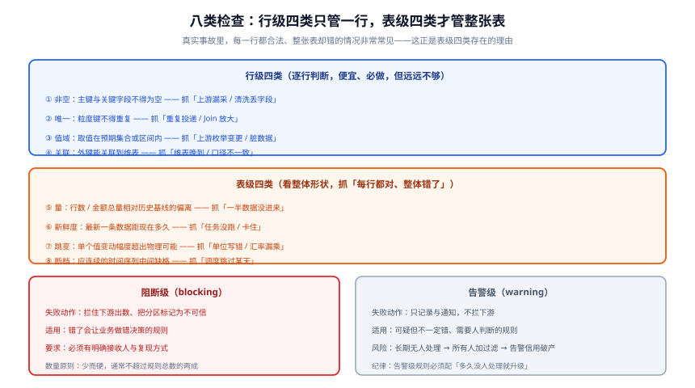

# 数据质量规则与闭环

**数据质量规则**是一条**可以被机器执行的断言**：它读一个数据集，返回「通过」或「失败」。

但**规则本身不是质量**。真正让质量变好的，是失败之后的**闭环**：**谁在多长时间内、做什么、做完之后怎么确认**。本页的重点在后半句——绝大多数团队的规则写得没问题，闭环是空的。



## 一、八类检查：为什么行级四类远远不够

行业里最常被写的检查是「非空 + 唯一」，因为它们最便宜。但真实的重大数据事故里，**绝大多数属于「每一行都合法、整张表却错了」**：

| 事故 | 行级四类能发现吗 | 表级四类能发现吗 |
| --- | --- | --- |
| 上游只同步了一半数据（几千行变几百行） | ❌ 每行都合法 | ✅ 量检查 |
| 调度卡住，昨天分区没产出 | ❌ 无行可查 | ✅ 新鲜度检查 |
| 汇率漏乘 6.9 倍，金额整体偏小 | ❌ 每行都在合法值域内 | ✅ 跳变检查 |
| 某天调度跳过了 10 月 3 日 | ❌ 行都合法 | ✅ 断档检查（对日历） |
| 主键重复（重复投递） | ✅ 唯一 | — |
| 枚举新增了 `REFUNDING` 状态 | ✅ 值域 | — |

::: tip 「八类里该先写哪几类」
**先写表级四类，再补行级四类。** 这与直觉相反，但符合风险分布：行级的问题通常在源头就被数据库约束挡住了一部分（主键、非空、外键），而表级问题**没有任何一层在挡**——数据库约束管不到「今天的数据少了一半」。
:::

## 二、规则五要素：缺一条就退化成空转

一条可交付的规则必须同时写清五件事，缺任何一条都会让它变成没人管的噪声：

| 要素 | 内容 | 缺了会怎样 |
| --- | --- | --- |
| **① 对象** | 检查哪张表 / 哪个分区 / 哪个字段 | 不知道规则在管什么，无法随表变更维护 |
| **② 条件** | 断言的表达式与阈值 | 规则无法执行 |
| **③ 分级** | 阻断级 / 告警级 | 要么全都拦（业务停摆），要么全都不拦（无人理会） |
| **④ 动作** | 失败后系统做什么 | 失败了没人知道 |
| **⑤ 接收人** | 是**一个角色或人**，不是「数据组」 | 失败了没人修 |

```yaml [规则写成配置的样子（五要素齐全）]
# name: 日成交额偏离检查
rules:
  - name: daily_gmv_deviation
    # ① 对象
    dataset: dws_trade_daily
    partition: "{{ bizdate }}"
    columns: [pay_amt]
    # ② 条件
    type: table_metric_deviation
    metric: sum(pay_amt)
    baseline: "avg(same_weekday, last 4 weeks)"
    threshold:
      relative: 0.40      # 相对偏离 40%
      absolute: 200000    # 且绝对差超过 20 万
      mode: both_over      # 两个都超才报（见下节）
    # ③ 分级
    severity: blocking
    # ④ 动作
    on_failure:
      - block_downstream: dws_trade_daily
      - mark_partition: untrusted
      - notify: orders_owner
    # ⑤ 接收人（角色 -> 具体值的映射在组织页维护）
    owner: orders_owner
    runbook: "https://runbook.internal/data/daily_gmv_deviation"
```

## 三、阈值的三条纪律

阈值定不好，规则不是漏报就是误报。三条纪律都是实操里被反复验证过的：

### 纪律一：同时设**绝对差**与**相对差**，且用「双超才报」

纯相对差会在基数很小时疯狂误报（日均 100 元的表波动 50% 毫无意义）；纯绝对差会掩盖大表上的结构性变化（日均 1 亿的表少 100 万，相对只偏 0.1%，但可能正是某条业务线断了）。

```sql [双阈值写法：两个都超才判定失败]
SELECT ABS(today - base)                                   AS abs_diff,
       ABS(today - base) / NULLIF(base, 0)                 AS rel_diff
FROM metric_snapshot
WHERE stat_dt = '${bizdate}'
  AND ABS(today - base) > 200000                           -- 绝对差超了
  AND ABS(today - base) / NULLIF(base, 0) > 0.40;          -- 相对差也超了
-- 期望：0 行。两个条件都满足才算失败。
```

### 纪律二：基线要**按业务节奏分组**，不能拿「过去 7 天平均」硬套

周末、月初、大促的基线完全不同。用「过去 7 天平均」做基线，会导致**每周一误报、每月 1 日误报**——然后所有人学会忽略周一和月初的告警。

```sql [按「星期几 + 是否月初」分组取基线]
SELECT stat_dt,
       sum_amt,
       AVG(sum_amt) OVER (
         PARTITION BY EXTRACT(DOW FROM stat_dt), (EXTRACT(DAY FROM stat_dt) <= 3)
         ORDER BY stat_dt
         ROWS BETWEEN 4 PRECEDING AND 1 PRECEDING      -- 同组前 4 次
       ) AS base
FROM daily_gmv_history
ORDER BY stat_dt DESC
LIMIT 30;
```

### 纪律三：**新规则先以告警级跑两周**，再决定是否转阻断

新规则的误报率在真实数据上才能暴露。直接上阻断级的结果通常是：上线第一天拦住出数，业务投诉，规则当场被降级或删除，且**从此没人再相信任何阻断级规则**。

::: danger 关于 `NULLIF(base, 0)` 的一个静默陷阱
`rel_diff` 的分母为 0 时结果是 `NULL`，而 `NULL > 0.40` 是 `UNKNOWN`——**WHERE 子句会把它过滤掉，规则判定为「通过」**。基数从 0 涨到 100 这种「从无到有」的变化，恰恰是分母为 0 的典型场景，也正是最该报警的场景。

修法是**显式兜底**：`COALESCE(ABS(today - base) / NULLIF(base, 0), CASE WHEN today > 0 THEN 1 ELSE 0 END) > 0.40`。**凡是「刚上线的业务」或「新建分区」，都会踩这个坑。**
:::

## 四、失败之后：闭环的四个时刻

规则触发只是开始。一个可用的闭环必须对四个时刻都给出答案：

| 时刻 | 必须回答 | 常见失败 |
| --- | --- | --- |
| **T+0 触发时** | 通知发给谁、内容里有没有可复现的查询 | 通知发给群而不是人；内容只有「规则失败」四个字 |
| **T+15min 未响应** | 升级给谁 | 没有升级路径，规则静静地挂着 |
| **T+2h 仍未解决** | 谁有权决定「今天这批数废弃」 | 没人有权拍板，下游一直在等 |
| **T+1d 解决后** | 要不要补跑、要不要回填、有没有复盘记录 | 补跑了但没回填历史，或修了规则没改上游 |

```python [通知内容的最小可用形态——够接收人自己复现]
# 反例（几乎等于没通知）：
#   "任务 dws_trade_daily_qc 失败"
#
# 正例：
FAIL_NOTICE = """
规则：daily_gmv_deviation（阻断级）
对象：dws_trade_daily / 分区 2026-10-14 / 字段 pay_amt
现象：今日 1,820,000，基线 3,050,000，相对偏离 -40.3%（阈值 40%），绝对差 1,230,000
复现：
  psql -c "select stat_dt, sum(pay_amt) from dws_trade_daily
           where stat_dt >= current_date - 10 group by 1 order by 1"
影响：下游 dws_trade_report_1d 已阻断，未出数
手册：https://runbook.internal/data/daily_gmv_deviation
接收人：orders_owner（升级对象：data_platform_oncall）
"""
```

::: warning 「通知发给个人」而不是「发到群」
这是本仓反复强调的一条：**发到群等于谁都不负责**。升级链必须是「人 → 值班 → 主管」，每一级都是具体的人或轮值角色。群可以抄送，但**接收人字段必须是单数**，并且与元数据里的表责任人一致（见[元数据与资产目录](../Metadata/index.md)的 `MD-B`）。
:::

## 五、数据 SLI / SLO：把「可信」变成一个可度量的数

服务有 SLI / SLO，数据也应该有。三条指标就够用：

| 指标 | 定义 | 计算方式 | 典型目标 |
| --- | --- | --- | --- |
| **及时性（Timeliness）** | 分区在承诺时间前产出的比例 | `按期产出分区数 / 应产出分区数` | ≥ 99%（按周统计） |
| **完整性（Completeness）** | 通过阻断级检查的分区比例 | `通过数 / 总分区数` | ≥ 99.5% |
| **准确性（Accuracy）** | 未被事后回填修正的分区比例 | `1 - 回填分区数 / 总分区数` | ≥ 99.9% |

::: tip 为什么用「按分区」而不是「按行」
按行统计会让指标被表规模绑架（大表的一个空格子拉低百万行）。**按「分区」统计的粒度与业务的感知粒度一致**——业务说「今天的数据没出来」，指的就是一个分区。同类指标在服务侧的口径叫「请求」，在数据侧对应的就是「分区」。
:::

## 六、工具对照：三种路线怎么选

信息质量工具没有绝对优劣，差别全在「**规则挂在哪一层**」。下表按 2026-10 官方口径核对：

| 工具 | 规则写在哪 | 最适合的边界 | 2026-10 关键状态 |
| --- | --- | --- | --- |
| **dbt 数据测试** | 与模型同仓库的 YAML / SQL | 断言属于 dbt 模型、源、快照的场合 | dbt Core **1.11.12**；Rust 版 2.0.0-alpha 在开发中；YAML 键为 `data_tests:`（`tests:` 兼容） |
| **GX Core（Great Expectations）** | Python，命名 Expectation 库 | 跨数据帧 / 文件 / SQL 的场景，需要丰富的失败行证据 | **1.23.2**（2026-09-28）；2026-05 被收购、**GX Cloud 2026-06-01 宣布停服**，GX Core（Apache-2.0）由新维护方继续 |
| **Soda Core** | YAML（**v4 起以数据契约为默认写法**） | 需要快速 SQL/YAML 检查、CI 友好 CLI 的场合 | **4.25.0**（2026-09-23）；需 Python 3.10+；**v4 是破坏性变更**（SodaCL checks → contract 语法）；退出码 0/2，warn-only 不失败 |
| **Dagster asset checks** | Python 函数挂在资产生上 | 校验就长在编排里、需要 `blocking=True` 阻断下游的场合 | 支持 WARN / ERROR 分级 |
| **Pandera** | Python schema 对象 | 在**数据帧这一层**做契约，跨 Polars / Ibis / PySpark | 0.32.0 起引入 Narwhals 后端，支持惰性校验 |

::: danger 三条选型纪律
1. **一条规则的归属者只能有一个**。同一份契约在 dbt 和 GX 里各写一遍，必然分叉——**分叉之后你会有两个「权威」**。
2. **注意「被收购 / 停服」这类事实**。GX Cloud 停服、`dbt-expectations` 原作者仓库已于 2024-12-18 标记不再维护（活跃开发在 `metaplane/dbt-expectations`，且 Metaplane 已被 Datadog 收购）——**选型不能只看 star 数，要看维护主体是否还在**。
3. **别把「工具能否发现」当成「有没有人处理」**。工具提供的是证据，闭环靠的是人。
:::

## 七、判据清单

| 判据 | 内容 | 怎么验证 |
| --- | --- | --- |
| `DQ-A` | 每条规则**五要素齐全** | 抽查 10 条规则，逐一核对五个字段 |
| `DQ-B` | 至少**一条**规则会真正阻断下游出数 | 造一次失败，观察下游是否被拦 |
| `DQ-C` | 阻断级规则的接收人是**单个角色/人** | 抽查字段，出现群名/团队名即失败 |
| `DQ-D` | 通知内容含**可复现的查询**，且接收人能独立跑通 | 让接收人按通知内容复现一次 |
| `DQ-E` | 存在**升级路径**（超时未响应升级给谁） | 查配置与值班表，核对升级对象存在 |
| `DQ-F` | 基线**按业务节奏分组**（周末/月初不与工作日混算） | 查基线 SQL 的 `PARTITION BY` 分组维度 |
| `DQ-G` | 阈值**双条件**（绝对差与相对差都超才报） | 查规则配置的阈值写法 |
| `DQ-H` | 及时性 / 完整性 / 准确性三项 SLI **有取数且在看在用** | 打开报表，确认三项有近期数据 |
| `DQ-I` | 每条阻断级规则都有 **runbook 且链接可达** | 逐条点开 runbook 链接（「条数相等」不等于「链接可达」） |

::: warning `DQ-I` 为什么单独列一条
「告警规则条数 == `runbook_url` 条数」是一个很容易满足的判据，但**满足它跟链接能不能打开是两件事**。本项目在[交付验收](../Practice/index.md)里实测过一次：12 条规则的 runbook 全部写了 URL，逐条请求后发现有域名根本不存在。**判据的写法必须包含「可达」，不是「存在」。**
:::

## 八、相关页面

- [元数据与资产目录](../Metadata/index.md)：规则**挂在哪个字段上**、责任人从哪来
- [数据血缘与影响分析](../Lineage/index.md)：失败之后用血缘圈定影响面
- [数据标准与主数据](../StandardsMasterData/index.md)：值域检查的「值域」从哪来
- [数仓的数据质量与血缘](/docs/DB/DataWarehouse/Quality/index.md)：一套 SQL 数仓内部的规则实现与调度依赖
- [监控告警](/docs/Ops/Monitoring/Alerting/index.md)：告警规则怎么写、怎么不吵（数据质量告警复用同一套机制）
- [故障应急体系](/docs/Ops/IncidentResponse/index.md)：数据事故的定级与响应流程

## 参考资料

- dbt 数据测试官方文档（`data_tests` 语法与内置四类测试）：<https://docs.getdbt.com/docs/build/data-tests>
- Great Expectations（GX Core）1.x API 与变更日志：<https://docs.greatexpectations.io/docs/changelog>
- Soda Core 发布说明（v4 数据契约写法）：<https://docs.soda.io/soda-core/release-notes.html>
- Dagster 资产检查（`blocking` 与 WARN/ERROR 分级）：<https://docs.dagster.io/guides/dagster/asset-checks>
- Pandera 官方文档（数据帧契约）：<https://pandera.readthedocs.io/>
- SRE Workbook「Service Level Objectives」章（SLI/SLO 方法论来源）：<https://sre.google/workbook/implementing-slos/>
- DAMA-DMBOK（2nd Edition, Revised）「数据质量」知识领域：<https://www.dama.org/cpages/body-of-knowledge>
