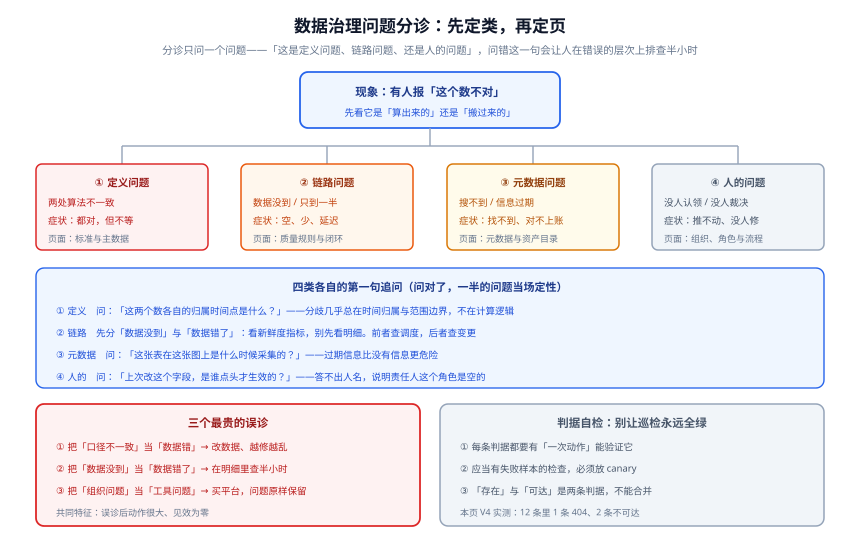

# 常见问题与最佳实践

本页是[数据治理入门](../index.md)的收口页：**遇到现象先从分诊表定位到页面，再动手**；动手之前用自查清单核对；拿不准时先看最佳实践与术语表。

按本专题的写法纪律，这里的每一条答案都**指回一页正文**，不在这里重复展开——避免同一套结论维护两份。

## 一、现象分诊表

**用法**：按「你听到的那句话」找到行，先做「第一问」，再按「落点」翻页。**跳过第一问直接翻页，是排查变慢的主要原因。**

| 你听到的现象 | 第一问 | 典型结论 | 落点 |
| --- | --- | --- | --- |
| 「这两个系统的成交额对不上」 | 两个数各自的**归属时间点**是什么 | 定义问题（不是数据错） | [标准与主数据](../StandardsMasterData/index.md) |
| 「今天的表没出来」 | 是**数据没到**还是**数据错了**（先看新鲜度，不看明细） | 链路问题（调度侧） | [质量规则与闭环](../DataQuality/index.md) |
| 「目录里搜不到表」 | 是搜不到，还是**搜到了但信息是过期的** | 元数据问题，两者处置不同 | [元数据与资产目录](../Metadata/index.md) |
| 「改了个字段，下游好几个报表空了」 | 变更前有没有查过血缘、看的是几级边 | 血缘 A 级覆盖不足 | [血缘与影响分析](../Lineage/index.md) |
| 「规则天天报，没人理」 | 这些规则里**有几条会真的拦住什么** | 全是告警级 = 空转 | [质量规则与闭环](../DataQuality/index.md) |
| 「同一张卡我改了两遍，第二遍没生效」 | 谁有这个字段的**变更否决权** | 组织问题（Owner 是空的） | [组织、角色与流程](../OrgAndProcess/index.md) |
| 「治理推了半年，业务不配合」 | 治理的结果指标**挂在谁身上** | 组织问题（指标挂错了人） | [组织、角色与流程](../OrgAndProcess/index.md) |
| 「客户在三个系统里是三个人」 | 有没有**权威源**，没有权威源就不该上主数据 | 主数据问题（先降级为参考数据） | [标准与主数据](../StandardsMasterData/index.md) |
| 「报表数字突然整体变小约 7 倍」 | 是**跳变**（单位/汇率）还是**量**（同步少了一半） | 两者是不同规则，先看是哪一类 | [质量规则与闭环](../DataQuality/index.md) |
| 「结构化数据管起来了，AI 语料没人管」 | 语料有没有**来源与授权登记** | 非结构化资产未纳入账本 | [元数据与资产目录](../Metadata/index.md) |
| 「告警发的群里没人回」 | 接收人字段是**一个人**还是一个群 | 通知纪律问题 | [质量规则与闭环](../DataQuality/index.md) |
| 「覆盖率上不去，追加人手也没用」 | 是不是在**按字母顺序**补元数据 | 方法问题（应按访问热度排队） | [实战：五个源系统到一个治理体系](../Practice/index.md) |

::: danger 三个最贵的误诊（三条都会让人做完一堆动作、问题原样保留）
1. **把「口径不一致」当成「数据错」**——于是去改数据。改完两边的数还是不等，因为**它们的定义本来就不同**。
2. **把「数据没到」当成「数据错了」**——于是在明细数据里找异常。而真相是上游任务根本没跑完，**表里没有数据这件事和「数据全对」看起来一样**。
3. **把组织问题当成工具问题**——于是买平台、建目录、加规则。三个月后所有东西都在，**但「谁定义、谁负责、谁裁决」依旧没有人**。
:::

## 二、高频十二问

### Q1：小团队（10 人以内）需要数据治理吗？

**需要，但只需要最小的那一步：一份关键 10 张表的清单 + 一个指标的唯一定义。** 判断标准不是团队规模，而是**「有没有第二个团队来要数」**。没有，就继续口头对齐；有了，就必须立规矩——因为跨团队的口头对齐不存在。

### Q2：先建平台还是先定口径？

**先定口径。** 平台的第一个作用是把口径**固化**下来：口径对了，平台让它更牢；口径错了，平台让它错得更快、更难改。参见[实战](../Practice/index.md)里「明确不做的四件事」第 ③ 条。

### Q3：数据质量与数据治理到底是不是一回事？

不是。[概述](../Overview/index.md)的边界二写得很清楚：**数据质量回答「这个数现在对不对」（运行时判据），治理回答「这个数该由谁定义、错了谁处理、改了会影响谁」（制度）**。只有质量没有治理，会退化成「告警发给了不负责的人」与「规则口径本身就是错的」两类噪声。

### Q4：为什么我们的目录上线三个月就没人用了？

几乎总是因为**价值主张错了**：目录的价值不是「有个地方能查」，而是「**不用问人就能查到，且查到的是对的**」。要做到这一点需要三件事同时成立：按业务名词能搜到、每张表的责任人是**真人**、元数据**新鲜度有上界**。缺任何一条，目录都会退化成一份没人维护的文档。

### Q5：血缘为什么不能做到全自动？

因为**执行过程必须可观测**，而三类操作天生不可观测：**动态 SQL**（解析器看到的是字符串拼接）、**框架外执行**（调度器不知道有这个作业）、**人工补数**（没有任何自动记录）。正确的定位是：**自动采集覆盖正规链路，人工登记覆盖长尾，两者合起来才叫血缘**。参见[血缘与影响分析](../Lineage/index.md)第二节。

### Q6：列级血缘值不值得上？

问一句：**「过去半年有多少次变更，表级范围会让你多叫 5 个以上的下游团队来评审？」** 有，就值得上。表级的采集成本约是列级的**十分之一**，而它能回答变更评审里最常问的问题。

### Q7：质量规则该写多少条？

**先写 3 条会真正拦住东西的，再考虑第 4 条。** 阻断级规则应当「少而硬」（通常不超过规则总数的两成）；如果所有规则都是告警级，两周后所有人都会加过滤规则，**告警信用破产**。

### Q8：阈值怎么定才不会天天误报？

三条纪律（[质量规则与闭环](../DataQuality/index.md)第三节）：**同时设绝对差与相对差且双超才报**、**基线按业务节奏分组**（周末与月初不与工作日混算）、**新规则先以告警级跑两周**再决定是否转阻断。

### Q9：主数据平台的权威源定不下来怎么办？

**先把它降级为「参考数据」**（各系统自治 + 映射表），不要硬上平台。**「以谁为准」是一个权力问题，不是技术问题**——一个没有权威源的主数据平台，只是把「三个版本」变成「三个版本 + 一个没用的平台」。

### Q10：用业务键（手机号、邮箱）自动匹配实体可以吗？

可以，但**`confidence < 1.00` 的匹配一律不进生产口径**。自动匹配的错误是双向的：既会把两个人合成一个（合并后金额翻倍），也会把一个人拆成两个（历史被切成两段）。同时必须有一条反向判据：**自动匹配占比超过阈值（如 30%）= 业务键质量不达标，应先治理业务键而不是加大自动匹配**。

### Q11：治理团队该怎么设 KPI？

**不设自己的投入型 KPI，把结果指标挂到业务方身上。** 口径争议的平均闭环天数挂业务域负责人、规则提前发现率挂数据工程负责人、返工工时由需求方与交付方共同承担。理由见[组织、角色与流程](../OrgAndProcess/index.md)第六节：**不背 KPI 的治理团队一定失败**，因为它推动的事不在任何人的 KPI 里。

### Q12：要不要照着 DCMM 2.0 建体系？

**不要照着条款建平台，要用它反向核对空白。** 三份尺子的分工可以记成一句：**DAMA-DMBOK 回答「应该做什么」，DCMM 回答「做到了什么程度」，本专题回答「先做哪一步」**。DCMM 2.0（GB/T 36073-2025）自 2026-07-01 起实施，能力域 8 → 9、能力项 28 → 33、评估指标 441 → 486。

## 三、上线自查二十项

**用法**：上线前逐条打勾。**打不出来的勾就是缺口**——不要写成「部分完成」。分四组，每组对应一个阶段。

### A 组：账本（6 项）

| # | 自查项 | 对应判据 |
| --- | --- | --- |
| A1 | 关键资产清单存在，且**责任人全部是自然人** | `DG-A` `PR-A` |
| A2 | 关键资产的**无人认领清单为空**（或已派工） | `DG-B` `PR-A` |
| A3 | 按**业务名词**能搜到资产（不是按表名） | `MD-A` |
| A4 | 元数据新鲜度**有上界**，且最久的 5 个数据源逐一核对过 | `MD-C` |
| A5 | 临时表被**命名规则 + 生命周期**两道清理挡住 | `MD-G` |
| A6 | 覆盖率的**反向指标**（被访问资产的业务定义占比）同时在报 | `MD-H` |

### B 组：口径与标准（5 项）

| # | 自查项 | 对应判据 |
| --- | --- | --- |
| B1 | 争议最多的指标有**唯一定义页** | `DG-C` |
| B2 | 定义里**「已知差异」栏非空** | `DG-C` `SM-B` |
| B3 | 关键字段的标准**三栏齐全**（业务定义 / 技术定义 / 值域） | `SM-A` |
| B4 | 值域标准含**变更流程**（谁批、提前几天公告） | `SM-C` |
| B5 | 主数据清单**经过四问过滤**，且权威源栏允许填「暂无」 | `SM-D` `SM-E` |

### C 组：链路与规则（5 项）

| # | 自查项 | 对应判据 |
| --- | --- | --- |
| C1 | 至少 **3 条阻断级**规则会真正拦住下游出数 | `DG-D` `PR-D` |
| C2 | 每条阻断级规则的接收人能**独立复现**失败 | `DQ-D` `PR-E` |
| C3 | 每条阻断级规则的 **runbook 链接可达**（不是「存在」） | `DQ-I` `PR-E` |
| C4 | 血缘边**带来源与刷新时间**，且 A 级占比达标 | `LN-B` |
| C5 | 「框架外写数」有**登记入口**，且登记后图上可见 | `LN-C` |

### D 组：流程与度量（4 项）

| # | 自查项 | 对应判据 |
| --- | --- | --- |
| D1 | 分诊第一问能区分**「数据没到」与「数据错了」** | `OP-G` `PR-G` |
| D2 | 质量失败各时刻**有责任人与时限**，升级链是具体的人 | `OP-F` |
| D3 | 口径变更流程含**影响评估**与**旧口径可复算**两项要求 | `OP-E` |
| D4 | 治理度量里**投入指标与结果指标成对出现** | `OP-H` |

::: tip 二十项里如果只能先做三项
选 **A1（责任人）**、**B2（已知差异）**、**C1（会拦住的规则）**。这三项做完，四个问题里已经能答上三个半；其余十七项都是让它们**可持续**的配套。
:::

## 四、十二条最佳实践

| # | 实践 | 反面 |
| --- | --- | --- |
| 1 | **责任人写自然人**，允许一人多岗 | ❌ 写团队名——它不是一个人，所以不会出现在任何一次分诊里 |
| 2 | **先有账本，再谈治理** | ❌ 先建平台再想「谁用、用来看什么」 |
| 3 | **按访问热度排优先级**，不按字母顺序 | ❌ 平摊给所有资产，最常用的表最后补 |
| 4 | **判据必须能被一次动作验证** | ❌ 「覆盖率达标」这种要靠报表解读的判据 |
| 5 | **「存在」与「可达」分开写** | ❌ 「12 条规则都写了 runbook URL」就认为通过 |
| 6 | **应当失败的检查要放 canary** | ❌ 一个从不报错的巡检脚本——等于没有巡检 |
| 7 | **阈值双条件 + 基线分组** | ❌ 拿「过去 7 天平均」硬套周末与月初 |
| 8 | **新规则先跑两周告警级** | ❌ 上线第一天就阻断，被投诉后当场删掉 |
| 9 | **通知发给个人，群只抄送** | ❌ 发到群——等于谁都不负责 |
| 10 | **口径变更必须保留旧口径可复算** | ❌ 直接覆盖旧 SQL，历史永远算不回来 |
| 11 | **血缘分级，C 级不得用于「无影响」判定** | ❌ 把「图上没有下游」当成「可以安全修改」 |
| 12 | **旧版本口径一律保留、不删除** | ❌ 用新版口径覆盖旧版，历史数据与文档同时失真 |

::: warning 第 12 条是本仓的仓库级约定，不只是治理的约定
凡涉及大版本的主题，本仓的处理方式是**按版本目录组织、旧版本保留并标注维护状态、不覆盖旧内容**（范例见 [Spring 5 / Spring 6](/docs/Backend/Java/Frame/Spring/Spring6/index.md)、[Vue 2 / Vue 3](/docs/Frontend/Frame/Vue/Vue3/index.md)）。

治理领域同样如此：**DCMM 2018 版被 2025 版替代，但旧版口径不删除**，只在正文用 `::: info` 标注「该口径适用于哪个版本区间」——原因见[首页的「大版本组织说明」](../index.md)。
:::

## 五、术语表

| 术语 | 英文 | 一句话解释 |
| --- | --- | --- |
| 数据治理 | Data Governance | 把数据的责任、定义与判据固定下来并让它生效 |
| 元数据 | Metadata | 关于数据的数据：在哪、什么意思、何时产生 |
| 资产目录 | Data Catalog | 元数据的落地形态：能按业务名词搜到并知道归谁 |
| 业务元数据 | Business Metadata | 定义、口径、值域、敏感级别——**只能靠人填** |
| 操作元数据 | Operational Metadata | 作业、频率、上次状态、耗时——**故障分诊的第一手信息** |
| 数据血缘 | Data Lineage | 数据的来源与去向；向上溯源用于排错，向下影响用于评审 |
| 列级血缘 | Column-level Lineage | 精确到字段变换的血缘，成本约为表级的 10 倍 |
| 数据标准 | Data Standard | 一个字段的业务定义 / 技术定义 / 值域三件套 |
| 主数据 | Master Data | 多系统共享、生命周期长、需要全局唯一标识的实体 |
| 参考数据 | Reference Data | 各系统自治、靠映射表统一的枚举类数据（如汇率、区划） |
| 数据质量规则 | Data Quality Rule | 一条可被机器执行的断言，返回通过或失败 |
| 阻断级 | Blocking | 失败后**拦住下游出数**并把分区标记为不可信 |
| 数据 SLI / SLO | Service Level Indicator / Objective | 以「分区」为粒度的及时性、完整性、准确性指标 |
| 数据负责人 | Data Owner | 有权定义口径、批准变更与决定「这批数废弃」的角色 |
| 数据管理员 | Data Steward | 受理变更、审核标准合规性、维护目录条目的角色 |
| 数据保管人 | Data Custodian | 执行变更、修链路故障的角色 |
| 数据委员会 | Data Council | 例会制的裁决机构，处理 Owner 之间无法达成一致的事 |
| 已知差异 | Known Differences | 口径定义里最值钱的一栏：把争吵变成已登记的差异 |
| 覆盖率 | Coverage | 已登记资产的占比——**必须配反向指标一起看** |
| 探测表法 | Probe Table | 造一张表再采一次，**唯一能证明采集链路此刻活着**的方法 |
| canary | — | 已知会失败的输入，用于证明判据不是永远全绿 |
| 能力成熟度 | DCMM | 国家标准 GB/T 36073 系列，评估「做到了什么程度」 |

## 六、相关页面

- [专题首页](../index.md)：四条支柱、事实与规格速览、成熟度五档与阅读顺序
- [概述：数据治理的四条边界](../Overview/index.md)：本页分诊表的理论出处
- [元数据与资产目录](../Metadata/index.md)：A 组自查项的完整依据
- [数据血缘与影响分析](../Lineage/index.md)：C4 / C5 与「改一列之前该问的四个问题」
- [数据质量规则与闭环](../DataQuality/index.md)：C1 ~ C3 与告警信用破产
- [数据标准与主数据](../StandardsMasterData/index.md)：B 组自查项与主数据四问
- [组织、角色与流程](../OrgAndProcess/index.md)：D 组自查项与治理团队的定位
- [实战：五个源系统到一个治理体系](../Practice/index.md)：二十项自查清单在场景里的三个月对照

## 参考资料

- DAMA International，*DAMA-DMBOK: Data Management Body of Knowledge*（2nd Edition, Revised）：<https://www.dama.org/cpages/body-of-knowledge>
- 国家标准 GB/T 36073-2025（DCMM 2.0）发布公告：<https://www.stdaily.com/web/gdxw/2026-01/15/content_462215.html>
- DataHub 词汇表（Glossary）与术语模型：<https://docs.datahub.com/docs/glossary/business-glossary>
- OpenLineage 规范（血缘事件与命名）：<https://openlineage.io/docs/spec>
- Great Expectations（GX Core）文档与变更日志：<https://docs.greatexpectations.io/docs/changelog>
- Google SRE Workbook「Implementing SLOs」：<https://sre.google/workbook/implementing-slos/>
