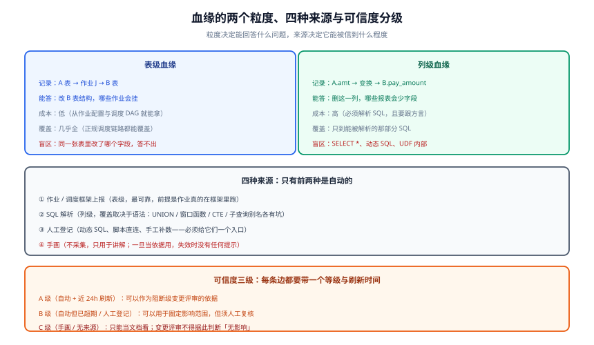

# 数据血缘与影响分析

**数据血缘（Data Lineage）**记录的是「**数据从哪来、经过了什么、到哪去**」。它只有两个方向的用途，而这两个方向**用途完全不同、不能用同一份工作代替**：

- **向上溯源（upstream）**：这个数从哪来 → 用于**排查错误**
- **向下影响（downstream）**：改这个会坏谁 → 用于**变更评审**

本页回答：**表级和列级能回答什么问题**、**为什么血缘天然只有半自动**、**SQL 解析在哪五类语法上会漏**、**怎么给血缘标可信度**，以及**改一列之前该问的四个问题**。



## 一、两个粒度：能力差别比想象中大

| 问题 | 表级血缘能答 | 列级血缘能答 |
| --- | --- | --- |
| 这张表挂了，哪些作业会失败？ | ✅ 直接查下游 | ✅ |
| 我只想改这一个字段的类型，会坏什么？ | ❌ 只能给「涉及这张表的全部下游」，范围大到没法评审 | ✅ |
| 这个指标的口径经过了哪几层加工？ | ✅ 粗粒度链路 | ✅ 精确到字段变换 |
| 把这张表下线，谁的报表会空？ | ✅ | ✅ |
| 某列的数据是哪来的？ | ❌ | ✅（且仅当变换可解析） |

::: tip 先上表级，再考虑列级
表级的采集成本约是列级的**十分之一**，却能回答变更评审中最常问的问题（「改这张表涉及谁」）。**列级的价值出现在「字段级变更」这个场景**——如果团队一年也没几次字段级变更，列级血缘的投入产出比会很难看。

判断该不该上列级，问一句：**「过去半年有多少次变更，表级范围会让你多叫 5 个以上的下游团队来评审？」** 有，就值得上。
:::

## 二、为什么血缘天然只有半自动

任何血缘采集方案都建立在同一个前提上：**执行过程是可观测的**。而现实里有三类操作天生不可观测：

| 形态 | 例子 | 为什么采不到 | 处置 |
| --- | --- | --- | --- |
| **动态 SQL** | `SET @sql = CONCAT('INSERT INTO dwd_', ...)` | 解析器看到的是字符串拼接，拿不到真实表名 | 人工登记边 + 标注「该作业含动态 SQL」 |
| **框架外执行** | 脚本直连写库、Crontab 里跑的 Python | 调度框架不知道有这个作业 | 登记作业 + 标注来源为「框架外」 |
| **人工操作** | 运维终端里手工跑 `INSERT OVERWRITE` | 没有任何自动记录 | 操作登记制度 + 与审计日志对账 |

所以正确的定位是：**自动采集覆盖「正规链路」，人工登记覆盖「长尾」，两者合起来才叫血缘**。任何声称「全自动、零维护」的方案，都是把长尾部分静默丢掉了。

::: danger 「图上没有」不等于「没有影响」
这是血缘被误用最危险的一种方式：团队成员做变更评审，**以「血缘图上没有下游」作为「可以安全修改」的依据**。而图缺边的三种原因（动态 SQL、框架外执行、采集器没覆盖这个数据源）都不会在图上有任何提示。

**唯一可靠的做法是给每条边标可信度等级**，并写明「C 级以下的图不得作为『无影响』的判定依据」。
:::

## 三、SQL 解析在哪五类语法上会漏

列级血缘的核心是 SQL 解析。下面五类语法是各家解析器的常见失手处，**应当在选型时逐条试**：

```sql [五类容易解析失败/解析错的语法——选型时逐条验证]
-- ① SELECT *：列级血缘直接断掉，只能退回表级
INSERT INTO dwd_order SELECT * FROM ods_order WHERE dt = '${bizdate}';

-- ② 动态表名：表级血缘都拿不到
SET @t = CONCAT('dwd_order_', DATE_FORMAT(NOW(), '%Y%m'));
SET @s = CONCAT('INSERT INTO ', @t, ' SELECT ...');

-- ③ 窗口函数 + 多层 CTE：容易把中间字段的传递关系解错
WITH base AS (
  SELECT user_id, SUM(amt) OVER (PARTITION BY user_id ORDER BY dt) AS cum
  FROM dwd_order
), ranked AS (
  SELECT user_id, cum, ROW_NUMBER() OVER (PARTITION BY user_id ORDER BY cum DESC) AS rn
  FROM base
)
INSERT INTO dws_user_metrics SELECT user_id, cum FROM ranked WHERE rn = 1;

-- ④ UNION ALL 里列位对齐：解析器常把两段各自的血缘写进同一列
INSERT INTO dwd_user_all
SELECT id, name FROM app_user
UNION ALL
SELECT id, nick AS name FROM app_user_profile;

-- ⑤ UDF / 存储过程内部：函数体不在当前 SQL 里，边断在调用处
INSERT INTO dwd_clean SELECT id, my_mask(phone) FROM ods_user;
```

**验证方式（不依赖任何产品）**：

```shell [用「造一张影子表」实测解析覆盖率]
# 思路：造一个父表 -> 子表的链路，逐条套用上面的语法，
#      看解析结果里子表的上游是否包含父表。

# 1. 建立最小链路
psql -c "create table gov_p as select 1 as id, 2 as amt;"
psql -c "insert into gov_c select id, amt from gov_p;"

# 2. 触发血缘解析（各平台命令不同）
curl -s -X POST "$CATALOG/api/lineage/parse?job=gov_probe" | jq .

# 3. 查子表的上游
curl -s "$CATALOG/api/lineage/upstream?asset=gov_c" | jq '.edges[].source'
# 期望：包含 gov_p

# 4. 换成 SELECT * 版本再跑一次，观察是否退化为表级或直接为空——记录结果
psql -c "drop table if exists gov_c; drop table if exists gov_p;"
```

::: warning 解析覆盖率必须实测，不能看官方宣传
各家文档都会说「支持 ANSI SQL」。**差别全部发生在方言与上面的五类语法上**。一个可操作的做法是：把生产里**出现频率最高的 50 条加工 SQL** 导出，逐条跑一遍解析，统计能正确识别的比例——这个比例才是有意义的覆盖率。
:::

## 四、给血缘标可信度：A / B / C 三级

不分级的血缘图，最终一定被当成 A 级用。三级规则如下：

| 等级 | 来源 | 时效 | 允许用来做什么 |
| --- | --- | --- | --- |
| **A 级** | 自动采集（调度框架 / SQL 解析） | 24 小时内刷新过 | 可以作为阻断级变更评审的依据；可以据此宣布「影响范围已确认」 |
| **B 级** | 自动采集但已超期，或人工登记 | — | 可以用于**圈定**影响范围，但结论必须经人工复核 |
| **C 级** | 手画 / 无来源 | — | 只能当文档看；**不得据此判定「无影响」** |

### 一条可落地的判据

```sql [定期检查：有多少边的可信度已经掉到 B 级以下]
-- 假设血缘边表结构：lineage_edge(src_asset, dst_asset, level, last_refreshed_at, origin)
SELECT level,
       COUNT(*)                                                   AS edges,
       COUNT(*) FILTER (WHERE last_refreshed_at < NOW() - INTERVAL '7 days') AS stale
FROM lineage_edge
GROUP BY level
ORDER BY level;

-- 判读口径：
--   A 级里 stale > 0 → 说明采集链路有数据源掉线了，优先查数据源而不是查边
--   B/C 级占比 > 30% → 血缘整体不可作为评审依据，先补采集再谈用它
```

::: tip 「边变少了」比「边变多了」更值得报警
自动采集的血缘边总数应当**单调缓增**（新任务不断加入）。如果某天边数明显下降，几乎一定是采集链路出了问题（数据源不可达、凭证过期、解析服务挂了），而不是「有人删了任务」。

**这与监控里「指标消失」是同一类问题**：数据缺失看起来和「一切正常」完全一样。所以要把「血缘边总数」和「最近一次成功解析时间」一起挂到监控上。
:::

## 五、改一列之前该问的四个问题

这一节是本页最实用的部分。任何字段级变更（改名、改类型、改口径、下线）之前，按顺序问：

1. **它的下游有哪些？** → 查列级血缘（B 级以上才可用）。拿不到列级就退回表级，**并把范围按「涉及该表的全部下游」估**。
2. **这些下游里，哪些是「我改完之后不会有人立刻发现坏了」？** → 这类最危险：没有实时看板会立刻报错，错误会静默传播。**必须逐个通知，不能只发公告。**
3. **有没有绕过血缘的消费方？** → 问一句「有没有人直接从这张表导数据到 Excel / 拉进 BI 的自助查询 / 用脚本直连？」这类消费**永远不会出现在血缘图上**。
4. **这次变更要不要走登记流程？** → 涉及对外口径或对外报表的字段，改之前必须在口径登记处留一条记录（谁、何时、为什么、影响范围）。

::: danger 第 3 个问题最容易漏，代价也最大
「有没有人直接导表」这个问题，在有自助取数能力的环境里**答案几乎总是「有」**。而这些人不在任何下游清单里，他们的表坏了也不会报错——**只会在某天业务方拿着一个错数字来问**。

处置不是禁止自助取数，而是**把「被自助取数」这件事变成一种被登记的下游类型**：允许，但要在目录里登记「该表存在自助取数消费方」，改口径时按「无 SLA 消费方」单独通知一轮。
:::

## 六、判据清单

| 判据 | 内容 | 怎么验证 |
| --- | --- | --- |
| `LN-A` | 血缘**两个方向**都能查 | 任取一张表，分别查上游与下游，均有结果 |
| `LN-B` | 每条边带**来源与刷新时间** | 抽查 3 条边，两个字段都不为空 |
| `LN-C` | 存在**框架外操作的登记入口** | 提交一条人工血缘边，确认能落库且被标为「人工登记」 |
| `LN-D` | 血缘边总数有监控，**下降会告警** | 断开一个数据源，确认边数下降触发告警 |
| `LN-E` | SQL 解析覆盖率**实测过**（用生产 SQL 抽样） | 抽样 50 条，统计正确识别的比例并记录在案 |
| `LN-F` | 变更评审模板里含**「绕过血缘的消费方」**问题 | 打开评审模板，核对该问题是否存在 |
| `LN-G` | C 级血缘**不得作为「无影响」的依据**，且这条规则写进了流程 | 查阅评审记录，核对是否出现过「图上没有 → 判定无影响」 |
| `LN-H` | 表结构变更与血缘刷新**能对上账**（改完一段时间内下游边更新） | 改一张表加一列，等一个采集周期，查下游是否出现对应变化 |

## 七、相关页面

- [元数据与资产目录](../Metadata/index.md)：血缘是元数据的一部分，采集方式与页内「四种来源」同源
- [数据质量规则与闭环](../DataQuality/index.md)：质量失败后用血缘**圈定影响面**，是血缘最主要的日常用途
- [数仓的数据质量与血缘](/docs/DB/DataWarehouse/Quality/index.md)：一套数仓内部的家族与调度依赖视角
- [数仓建模的分层设计](/docs/DB/DataWarehouse/Layering/index.md)：依赖方向「不许反向」这条纪律的出处
- [数据同步与 CDC](/docs/DB/CDC/index.md)：同步链路本身也会产生血缘边（源表 → 目标表）

## 参考资料

- OpenLineage 规范（血缘事件的事实标准，含命名与 facet 定义）：<https://openlineage.io/docs/spec>
- OpenLineage Dataset 命名与生命周期：<https://openlineage.io/docs/spec/naming>
- DataHub 列级血缘文档：<https://docs.datahub.com/docs/lineage/lineage-feature-guide>
- Apache Atlas 血缘（`DataSet` / `Process` 模型与 REST 查询）：<https://atlas.apache.org/#/Lineage>
- dbt 的 `manifest.json` 与血缘来源（`ref` / `source` 如何形成 DAG）：<https://docs.getdbt.com/reference/artifacts/manifest-json>
- DAMA-DMBOK（2nd Edition, Revised）「数据集成与互操作」知识领域：<https://www.dama.org/cpages/body-of-knowledge>
