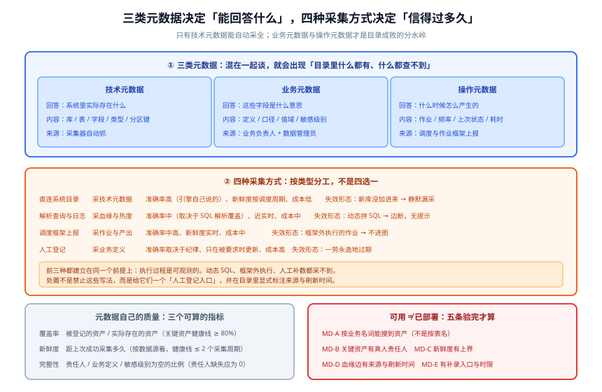

# 元数据与资产目录

**元数据（Metadata）是「关于数据的数据」**：它不记录订单有多少条，只记录「有一张叫 `orders` 的表、它属于交易系统、责任人是李四、`pay_amount` 的含义是应付金额、它昨天 03:12 更新过」。

**资产目录（Data Catalog）**是元数据的落地形态：**一个能按业务名词搜到数据、并告诉你它归谁的入口**。

本页回答四件事：**元数据分哪三类**、**四种采集方式各自信得过到什么程度**、**元数据自己怎么算「质量差」**、**怎么验证一个目录是可用而不是已部署**。



## 一、三类元数据，不是一回事

把三类混在一起谈，会导致「目录里什么都有，但什么都查不到」。

| 类型 | 回答什么 | 典型内容 | 谁来维护 | 变了会影响谁 |
| --- | --- | --- | --- | --- |
| **技术元数据** | 系统里**实际存在**什么 | 库 / 表 / 字段 / 类型 / 约束 / 分区键 / 存储位置 / 行数 | 采集器自动抓 | 变更评审、上下游链路 |
| **业务元数据** | 这些字段**是什么意思** | 业务定义、口径、值域、指标公式、所属业务域、敏感级别 | 业务负责人 + 数据管理员 | 报表口径、指标对账、合规判定 |
| **操作元数据** | 这些数据**是什么时候怎么产生的** | 作业名、调度频率、上次运行状态、耗时、产出分区、负责人 | 调度 / 作业框架上报 | 故障分诊、SLA 判定、成本归因 |

::: danger 三类元数据最常见的错配
**只有技术元数据，却拿它当业务元数据用。** 表现是：目录里能搜到 `t_ord_amt_01`，点进去看到类型是 `numeric(18,2)`，然后没人知道它是含税还是不含税。技术元数据**采集得再全也不会自动产生业务含义**——这一格只能靠人填，而「有人愿意填」是组织问题，不是工具问题。
:::

::: tip 一个判断「该补哪一类」的快捷问法
- 问「**这张表在哪**」答不上来 → 缺技术元数据（采集有问题）
- 问「**这个字段什么意思**」答不上来 → 缺业务元数据（**绝大多数目录的短板**）
- 问「**这张表上次更新是什么时候**」答不上来 → 缺操作元数据（作业框架没上报）

三个问题里，只有第一个能靠装一个采集器解决。**后两个才是目录成败的关键**，也是治理与「装个工具」的分水岭。
:::

## 二、四种采集方式与它们的准确率

元数据从哪来，直接决定它能被信到什么程度。四种方式不是选择题，而是**按类型分工**：

| 方式 | 采集什么 | 准确率 | 新鲜度 | 维护成本 | 失效形态 |
| --- | --- | --- | --- | --- | --- |
| **① 直连系统目录** | 表 / 字段 / 类型 / 约束 | 高（引擎自己说的） | 按调度周期 | 低（加数据源即可） | 新库没加进来 → **静默漏采** |
| **② 解析查询与执行日志** | 血缘、访问热度、慢查询归因 | 中（取决于 SQL 解析覆盖） | 近实时 | 中（要处理方言差异） | 动态拼 SQL → **解析不出边，静默丢血缘** |
| **③ 作业 / 调度框架上报** | 作业与产出的对应关系、运行状态 | 中高（框架有就准） | 实时 | 中（要改作业模板） | 手工跑的作业 → **不进图** |
| **④ 人工登记** | 业务定义、口径、敏感级别、负责人 | 取决于纪律 | 只在被要求时更新 | 高（要有人持续做） | **一劳永逸地过期** |

### 一个必须写进流程的事实：**② 与 ③ 只覆盖「正规链路」**

自动采集有一个共同前提：**执行过程是可观测的**。下面三种写法会让链路断在采集器的视野之外：

```sql [三种「采集不到」的常见写法]
-- ① 动态拼 SQL：解析器看到的是一段字符串拼接，拿不到真实表名
SET @sql = CONCAT('INSERT INTO dwd_', DATE_FORMAT(NOW(), '%Y%m'), '_order SELECT ...');
PREPARE stmt FROM @sql; EXECUTE stmt;

-- ② 外部脚本直连写库：不经过调度框架，作业框架不知道有这个作业
--    （python / java 程序里直接 INSERT，调度器只看到一个 shell 步骤）

-- ③ 人工补数：运维在终端里手工跑一次 INSERT OVERWRITE
--    血缘图上没有这条边，但数据确实被改过
```

**处置不是「禁止这些写法」**（做不到），而是**给它们一个登记入口**：任何在调度框架之外写数的操作，必须在上线前**登记一条人工血缘边**，并在目录里标注「该边为人工登记，刷新时间 X」。

::: warning 别把「采集不到」当成「不存在」
一个只在自动采集结果上做变更影响分析的团队，会在某次改表之后发现：「我按血缘评审了，但有个定时脚本挂了」。**血缘的可信度必须显式分级**（见[数据血缘与影响分析](../Lineage/index.md)），而不是默认「图上没有就是没有影响」。
:::

## 三、元数据自己的质量问题

元数据也需要被度量，否则「有目录」会变成「有一堆过期信息」。三个可计算的指标就够：

```sql [元数据质量三指标（以 PostgreSQL 为元数据存储时可直接跑）]
-- ① 覆盖率：被登记的资产 / 实际存在的资产
--    分母来自直连采集，分子来自「有人补过业务元数据」的资产
SELECT
  COUNT(*) FILTER (WHERE business_desc IS NOT NULL) AS with_business_meta,
  COUNT(*)                                          AS total_assets,
  ROUND(100.0 * COUNT(*) FILTER (WHERE business_desc IS NOT NULL) / COUNT(*), 1)
                                                    AS coverage_pct
FROM catalog_asset;

-- ② 新鲜度：距上次成功采集多久（按数据源看，不看全局均值）
SELECT source_id,
       MAX(collected_at)                       AS last_collected,
       NOW() - MAX(collected_at)               AS staleness
FROM catalog_collection_run
WHERE status = 'success'
GROUP BY source_id
ORDER BY staleness DESC;

-- ③ 完整性：关键字段为空的比例（按字段分组，找出「整列都是空」的那些）
SELECT asset_id, column_name, COUNT(*) AS null_rows
FROM catalog_column_meta
WHERE responsible_person IS NULL      -- 责任人缺失
   OR business_desc IS NULL           -- 业务定义缺失
   OR sensitivity IS NULL             -- 敏感级别缺失
GROUP BY asset_id, column_name
ORDER BY null_rows DESC;
```

**判读口径**：

| 指标 | 健康线（经验值，需按规模调） | 低于这条线意味着 |
| --- | --- | --- |
| 覆盖率（关键资产） | **≥ 80%** | 目录里搜不到大家在用的表 |
| 新鲜度 | **≤ 2 个采集周期** | 表结构改了、目录没跟上——比没有更危险 |
| 责任人缺失 | **0** | 「谁负责」这个问题答不出来，第 1 类失败形态已成型 |

::: danger 「覆盖率」是一个会被口径放大的指标
把一张宽表的 100 个字段拆成 100 条资产，覆盖率立刻翻倍。**必须同时看一条反向指标**：「最近 30 天被访问过的资产中被登记业务定义的比例」。前者防漏，后者防虚，两个一起看才成立。
:::

## 四、怎么验证一个目录是「可用」而不是「已部署」

「部署成功」是运维口径，「可用」是用户口径。用下面五条在**半天内**可以验完：

| 判据 | 内容 | 验证方式 | 失败意味着 |
| --- | --- | --- | --- |
| `MD-A` | 按**业务名词**能搜到资产 | 拿 5 个业务常用词（如「成交额」「履约率」）去搜，不看表名搜 | 用户必须先知道表名才能用，目录退化成一个字典 |
| `MD-B` | 每张关键资产有**真人责任人** | 抽查 20 张表，`responsible_person` 不是团队名词 | 第 1 类失败形态已成型 |
| `MD-C` | 元数据**新鲜度有上界** | 查「距上次成功采集最久的 5 个数据源」，逐一核对是否真有变更 | 过期信息比没有信息更糟 |
| `MD-D` | 血缘边**有来源与刷新时间** | 任取 3 条边，核对它是自动采集还是人工登记 | 拿手画图当变更依据 |
| `MD-E` | 搜不到时有**补录入口与时限** | 提交一条「缺表」请求，看是否有 SLA 与受理人 | 目录的能力边界永远不会扩张 |

### 一条可执行的验证脚本

```shell [验证「新加的数据源是否被采到」（以直连采集为例）]
# 1. 先在源库里造一张表
psql -h $SRC_HOST -U $SRC_USER -d $SRC_DB -c \
  "create table if not exists gov_probe (id int primary key, note text);"

# 2. 手工触发一次采集（各平台命令不同，这里以「按数据源触发」为例）
curl -s -X POST "$CATALOG/api/ingest/$SOURCE_ID?full=false" | jq .

# 3. 等一个采集周期（或按平台方式等待完成），再查目录里有没有这张表
curl -s "$CATALOG/api/search?q=gov_probe" | jq '.total'

# 期望：total >= 1（采到了）
# 若为 0，按顺序排查：数据源配置里有没有这个库 → 采集用户有没有 information_schema 读权限
#                  → 采集任务是否真的执行成功（看 run 状态，不看任务是否被创建）

# 4. 清理探针表
psql -h $SRC_HOST -U $SRC_USER -d $SRC_DB -c "drop table if exists gov_probe;"
```

::: tip 为什么用「造一张探测表」而不是「查已有的表」
已有的表可能在白名单里、可能上次采集就采到了，两种情况下「查到了」都**不能证明采集链路今天还有效**。**探测表法是唯一能证明「从源到目录这条链路此刻活着」的验证方式**，与监控里的「黑盒拨测」同源。
:::

## 五、目录与资产的关系：什么该登记为「资产」

不是所有表都值得登记。**判断标准是「有人会因为不知道它而做错决定吗」**：

| 该登记 | 可以晚点登记 | 不必登记 |
| --- | --- | --- |
| 被两个以上团队消费的表 | 只在单个服务内部用的表 | 临时表（`tmp_` / `_bak_` / 带日期的中间表） |
| 支撑对外报表 / 对外口径的表 | 明细日志表 | 一次性分析留下的表 |
| 关键指标的计算中间层 | 尚未上线的实验表 | 可以随时重算出的结果表 |

::: warning 「临时表」是目录噪声的最大来源
一个不做清理的目录，最终会被 `tmp_xxx_20260101` 这类表淹掉，把搜索排序质量拖垮。处置有两条：**一是采集侧用命名规则过滤**（`^tmp_`、`^_bak_`、含 `_\d{8}$`），**二是给临时表设生命周期**（超过 N 天无人访问即归档并从目录移除）。两条都要有，只做第一条会漏掉命名不规范的。
:::

## 六、判据清单

| 判据 | 内容 | 怎么验证 |
| --- | --- | --- |
| `MD-A` | 按业务名词可搜到资产 | 用 5 个业务词盲搜 |
| `MD-B` | 关键资产有真人责任人 | 抽查 20 张表的责任人字段 |
| `MD-C` | 元数据新鲜度有上界 | 查最久未成功采集的数据源 |
| `MD-D` | 血缘边有来源与刷新时间 | 抽查 3 条边的采集方式 |
| `MD-E` | 有补录入口与响应时限 | 提交一条缺表请求 |
| `MD-F` | 三类元数据**都**有采集路径 | 抽一张表，分别回答「在哪 / 什么意思 / 何时更新」 |
| `MD-G` | 临时表被命名规则与生命周期两道清理挡住 | 搜索 `tmp_`，核对结果条数与最后一次访问时间 |
| `MD-H` | 覆盖率的反向指标（被访问资产的业务定义占比）同时在看 | 两个指标同时取数，任一个单独看即不成立 |

## 七、相关页面

- [数据血缘与影响分析](../Lineage/index.md)：元数据里最难采、也最容易被过度信任的那一部分
- [数据质量规则与闭环](../DataQuality/index.md)：质量规则**挂在元数据的哪个字段上**
- [数据标准与主数据](../StandardsMasterData/index.md)：业务元数据里最需要统一的那一类
- [数仓建模的分层设计](/docs/DB/DataWarehouse/Layering/index.md)：分层是数仓内部结构，本页讲的是它怎么出现在跨系统的账本里
- [数据同步与 CDC](/docs/DB/CDC/index.md)：同步链路本身也要产出元数据（同步了哪些表、延迟多少）

## 参考资料

- DataHub 元数据模型（实体 / 方面模型的权威说明）：<https://docs.datahub.com/docs/metadata-model>
- OpenMetadata 官方文档「元数据采集（Ingestion）」：<https://docs.open-metadata.org/latest/connectors>
- Apache Atlas 类型系统（`DataSet` / `Process` / `qualifiedName` 的定义）：<https://atlas.apache.org/#/TypeSystem>
- OpenLineage 元数据命名规范：<https://openlineage.io/docs/spec/naming>
- DAMA-DMBOK（2nd Edition, Revised）「元数据管理」知识领域：<https://www.dama.org/cpages/body-of-knowledge>
- PostgreSQL 系统目录（`information_schema` 与 `pg_catalog`）：<https://www.postgresql.org/docs/current/information-schema.html>
