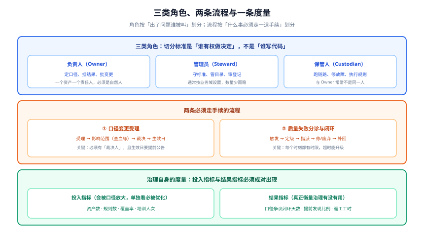

# 组织、角色与流程

**治理的失败，几乎从不出在技术上。** 出在：一个角色被赋予了职责却没有权力、一条流程没有时限、一个指标能被口径放大。本页把这三件事分别说清。



## 一、三类角色：切分标准是「谁有权做决定」

角色划分最常见的错误是**按工作内容分**（谁写 SQL、谁配调度），结果是一个角色既要定口径又要跑链路，权力与责任完全错位。正确的切分标准是**决策权**：

| 活动 | 负责人（Owner） | 管理员（Steward） | 保管人（Custodian） |
| --- | --- | --- | --- |
| 定义业务口径 | **决定** | 参与评审 | 不参与 |
| 批准口径变更 | **决定** | 受理与评估影响 | 执行变更 |
| 批准敏感级别 | **决定** | 拟定建议 | 执行打标 |
| 维护资产目录条目 | 提供输入 | **决定** | 不参与 |
| 审核标准的合规性 | 不参与 | **决定** | 不参与 |
| 编写与维护质量规则 | 批准分级 | 审核规则 | **执行** |
| 修数据链路故障 | 被通知 | 不参与 | **决定** |
| 决定「这批数废弃」 | **决定** | 不参与 | 提议 |

::: danger 两类最常见的角色错配
1. **让 Custodian 当 Owner**：运维同事负责跑链路，于是被顺理成章地赋予「口径」职责。结果是**口径由最不了解业务的人定**——因为口径是业务决策，不是运维决策。
2. **Owner 没有变更否决权**：清单上写着他是责任人，但别人要改字段时不需要他同意。这种「责任」只在出事后成立，事前无效——**它不叫责任，叫背锅**。

判据很简单，问一句：**「上一次有人要改这个字段，是谁点头才生效的？」** 答不出人名，说明 Owner 这个角色是空的。
:::

### 角色数量：少而稳

| 角色 | 建议数量 | 说明 |
| --- | --- | --- |
| Owner | ≈ 关键资产数（通常 20~200 个自然人，可一人多岗） | 必须落到自然人 |
| Steward | 按业务域，通常 **3~8 人** | 少而稳；频繁更换会让标准失去连续性 |
| Custodian | 按平台/团队 | 与值班体系重合即可，不必单独设岗 |

::: tip Owner 可以一人多岗，但不能是团队名
「张三同时是 15 张表的责任人」是健康的；「数据中台组是这 15 张表的责任人」是不成立的——**它不是一个人，所以它不会出现在任何一次分诊里**。这条与[元数据与资产目录](../Metadata/index.md)的 `MD-B` 是同一条判据。
:::

## 二、数据委员会：谁裁决「两个数都对不上」

需要一个**例会制的裁决机构**，处理两类 Owner 之间无法达成一致的事：

1. **跨域的归属争议**：「这个指标应该归交易域还是营销域？」
2. **口径的最终裁决**：「财务说按开票时间、业务说按下单时间，最终用哪个？」

| 要素 | 要求 | 反例 |
| --- | --- | --- |
| 成员 | Owner 代表 + Steward + 平台负责人，**有最终裁决人** | 只有执行层，没有能拍板的人 |
| 频率 | 双周或每月，**固定时间** | 「有需要再开」→ 永远不会开 |
| 输入 | 待裁决清单（**每条带影响范围与截止期**） | 会上临时提，无法决策 |
| 输出 | **决议 + 生效日 + 公告对象**，登记在案 | 会上达成共识，会后无人知道 |

::: warning 「达成共识」不是会议输出
最常见的失败：会上讨论了 40 分钟，「大家觉得还是按下单时间比较好」，然后**没有任何记录**。三个月后同样的问题重新出现，因为**新来的人不知道有这个决议**。

**会议的唯一有效输出是登记记录**：谁在何时、裁决了什么、生效日是哪天、谁需要被通知。没有登记，这场会等于没开。
:::

## 三、流程一：口径变更受理

口径变更（改一个指标怎么算、改一个字段的含义）是**最需要走手续**的事，因为它会**让历史数据与新数据不可比**。

```text
① 受理        提交变更单：改什么、为什么、期望生效日
               受理人：对应域的 Steward
               时限：1 个工作日内确认收到

② 影响评估    查血缘（B 级以上）圈定下游
               列出「不会立刻报错但会静默错」的消费方
               时限：3 个工作日
               输出：影响清单 + 受影响方名单

③ 裁决        Owner 批准；跨域争议升级到数据委员会
               时限：下一次委员会例会（最长 2 周）
               输出：决议 + 生效日

④ 公告与生效  提前 N 个工作日公告（N 按影响面定，通常 5）
               生效日当天切换，并保留「旧口径可复算」的窗口
               同步更新：标准文档 / 目录业务元数据 / 质量规则 / 已知差异

⑤ 归档        登记决议（谁、何时、为何、影响范围）
               时限：生效后 3 个工作日内
```

### 一条容易被跳过的关键要求：**旧口径必须可复算**

口径变更最贵的代价不是改代码，而是**历史不可比**。因此生效时必须回答：**「如果有人要按旧口径重算历史，能不能算出来？」**

| 做法 | 可复算吗 | 建议 |
| --- | --- | --- |
| 直接改 SQL，覆盖旧逻辑 | ❌ 永远算不回来了 | 禁止用于对外口径 |
| 旧逻辑用版本化的视图/分支保留 | ✅ | 推荐 |
| 在指标层同时保留新旧两列 | ✅（有存储代价） | 适合过渡期 |

## 四、流程二：质量失败的分诊与闭环

规则触发之后的每个时刻都要有答案。下表把[数据质量规则与闭环](../DataQuality/index.md)的四个时刻展开成可指派的责任：

| 时刻 | 动作 | 责任人 | 时限 |
| --- | --- | --- | --- |
| T+0 | 分诊：是**数据没到**、**数据错了**、还是**规则本身错了** | 值班 Custodian | 15 分钟 |
| T+15min | 未分诊 → 升级给平台值班主管 | 自动升级 | 15 分钟 |
| T+2h | 未定位 → 通知 Owner，请其决定「今天这批数是否废弃」 | Owner | 2 小时 |
| T+1d | 修复完成；决定是否补跑、是否回填历史 | Custodian | 1 个工作日 |
| T+3d | 更新规则或上游；登记事故记录 | Steward | 3 个工作日 |

::: tip 分诊的第一问决定后面所有动作
**「数据没到」和「数据错了」是完全不同的两类问题**：

- **数据没到**（新鲜度 / 断档失败）→ 查调度与依赖，通常在链路侧，**动作是重新调度**。
- **数据错了**（值域 / 关联 / 跳变失败）→ 查上游变更与解析逻辑，**动作是定位变更点 + 圈定影响面**。

把它们混在一起分诊，会让值班人在错误的层次上排查半小时——**这是数据告警响应时间长的第一大原因**。
:::

## 五、成熟度与标准：两条独立的尺子

### 本专题的落地路线（五档）

见[专题首页的成熟度五档](./../index.md)：**L0 无序 → L1 有账本 → L2 有口径 → L3 有判据 → L4 有度量**。它是**推进顺序**，不是评分表。

### DCMM 2.0 的能力域（评估标准）

国家标准 GB/T 36073-2025（DCMM 2.0）自 **2026-07-01** 起实施，取代 GB/T 36073-2018。关键变化：

| 项 | 2018 版 | 2025 版（DCMM 2.0） |
| --- | --- | --- |
| 能力域 | 8 个 | **9 个**（新增「数据资产」域：权属管理 / 价值评估 / 资产运营） |
| 能力项 | 28 个 | **33 个** |
| 评估指标 | 441 项 | **486 项** |
| 「数据应用」域 | 数据应用 | 更名并扩展为「**数据应用流通**」（数据应用 / 外部数据管理 / 数据开放 / 数据服务） |
| AI 相关 | 无 | L4 量化管理级明确「**引入人工智能等先进技术**」 |

::: danger 照着标准条款建平台是最贵的弯路
DCMM 是**评估尺子**，不是**施工图**。它的 486 项指标用于衡量「组织做到了什么程度」，直接照着指标建平台，会得到大量「为了被评估而存在」的流程与文档。

正确用法是**反向映射**：先按本专题的路线把 L1~L3 做起来，再拿 DCMM 的能力域核对「哪一块完全空白」。两份尺子的关系可以记成一句：**DAMA-DMBOK 回答「应该做什么」，DCMM 回答「做到了什么程度」，本专题回答「先做哪一步」。**
:::

## 六、为什么「不背 KPI 的治理团队」一定失败

治理团队的常见设置是「一个三人小组，负责推动各部门做治理」。这个设置有两个必死点：

1. **它推动的事，别人的 KPI 里没有**。改口径会拖慢业务迭代，填元数据不产生任何业务价值——各部门理性地选择不做。
2. **它自己的 KPI 只能选投入指标**（因为结果指标不由它控制），于是只能报「资产数」「覆盖率」。

### 一条可用的替代方案：把结果指标**挂到业务方的 KPI 上**

| 结果指标 | 挂给谁 | 为什么这样有效 |
| --- | --- | --- |
| 口径争议的平均闭环天数 | 业务域负责人 | 争议是他产生的，也只有他能裁决 |
| 由质量规则提前发现的数据事故占比 | 平台 / 数据工程负责人 | 规则是他维护的，覆盖率是他能提升的 |
| 因数据问题导致的返工工时 | 需求方 + 交付方共同承担 | 两边都有动机把口径提前对齐 |

::: warning 治理团队的定位应该从「推动者」变成「提供者」
一个健康的治理团队提供三样东西：**工具**（目录、规则平台）、**判据**（规则模板、检查清单）、**裁决场所**（委员会与流程）。**它不替业务做决定**——因为一旦替业务做了，业务就再也不为口径负责了。
:::

## 七、判据清单

| 判据 | 内容 | 怎么验证 |
| --- | --- | --- |
| `OP-A` | Owner 全部是**自然人**，且**有变更否决权** | 问「上次改字段谁点头的」，答不出人名即失败 |
| `OP-B` | 每个关键资产能同时指出 Owner 与 Custodian，**两者可以不同但都必须存在** | 抽查 10 个资产 |
| `OP-C` | 数据委员会**有固定例会**且有**最终裁决人** | 查会议日历与成员名单 |
| `OP-D` | 委员会的输出是**登记记录**（含生效日与公告对象） | 任取一条历史决议，能查到完整记录 |
| `OP-E` | 口径变更流程含**影响评估**与**旧口径可复算**两项要求 | 查阅流程文档与最近一次变更的产物 |
| `OP-F` | 质量失败各时刻**都有责任人与时限**，且升级链是具体的人 | 查流程配置与值班表 |
| `OP-G` | 分诊第一问明确区分**「数据没到」与「数据错了」** | 查阅分诊手册 |
| `OP-H` | 治理的度量里**投入指标与结果指标成对出现** | 打开治理报表，核对是否有结果指标 |

## 八、相关页面

- [专题首页：成熟度五档与阅读路径](../index.md)：本页流程的推进顺序
- [概述：四条边界](../Overview/index.md)：本页「边界三：治理是组织问题」的展开
- [元数据与资产目录](../Metadata/index.md)：Owner / Steward 字段在目录里的落地形态
- [数据质量规则与闭环](../DataQuality/index.md)：本页流程二的技术实现
- [故障应急体系](/docs/Ops/IncidentResponse/index.md)：事故定级、值班与演练（数据事故复用同一套机制）
- [项目交付方法论](/docs/Others/ProjectDelivery/index.md)：需求、契约与验收的通用流程

## 参考资料

- 国家标准 GB/T 36073-2025（DCMM 2.0）发布公告：<https://www.stdaily.com/web/gdxw/2026-01/15/content_462215.html>
- 国家标准全文公开系统（检索 GB/T 36073 系列）：<https://openstd.samr.gov.cn/bzgk/gb/>
- DAMA-DMBOK（2nd Edition, Revised）「数据治理」知识领域：<https://www.dama.org/cpages/body-of-knowledge>
- Google SRE Book「Being On-Call」与「Postmortem Culture」（值班与升级链的通用实践）：<https://sre.google/sre-book/being-on-call/>
- DataHub 所有权（Ownership）模型：<https://docs.datahub.com/docs/glossary/ownership>
