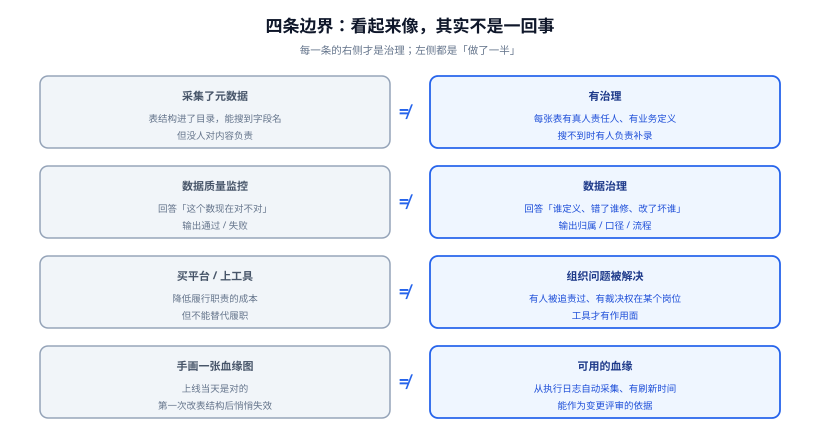

# 概述：数据治理的四条边界

**数据治理（Data Governance）**是一套**把数据的责任、定义与判据固定下来并让它生效**的机制。它要解决的不是「数据存不下」，而是「**同一件事有两个数、两个数都有人信**」。

本页不教任何工具，只做四件事：**划清四条最容易混的边界**、**指出三类典型失败形态**、**说清什么时候不该做治理**、**给出一个只花两周就能落地的最小起步**。



## 一、四条边界

### 边界一：有元数据 ≠ 有治理

装一个数据目录、把表结构刷进搜索框，这叫**有元数据**。它离治理还差三件事：

| 只做了采集 | 才算治理 |
| --- | --- |
| 表名字段名进了目录 | 每张表有**明确的责任人**（不是「数据组」这种集体名词） |
| 目录里能看到字段类型 | 关键字段有**业务定义**，且与另外两个系统的定义对得上 |
| 有人在目录里搜索 | 目录里搜不到东西时，**有人负责补录**，且有补录时限 |

::: danger 第一条边界最容易踩的坑
把「目录部署成功」当成「治理上线」。目录的可用性由**搜索命中率**和**元数据新鲜度**决定，不由容器数决定。一个没人维护的目录，会比没有目录更糟——因为大家会去查，然后查到过期的信息，于是**开始不信任所有文档**。
:::

### 边界二：数据质量 ≠ 数据治理

两者常被当成同义词，其实回答的是不同问题：

- **数据质量**回答「**这个数现在对不对**」——它是**运行时的判据**，输出是「通过 / 失败」。
- **数据治理**回答「**这个数该由谁定义、错了谁处理、改了会影响谁**」——它是**制度的**，输出是「归属 / 口径 / 流程」。

没有治理的质量监控会退化成两类噪声：**告警发给了一个不负责的人**（于是没人修），以及**规则的口径本身就是错的**（于是天天误报直到所有人屏蔽）。

### 边界三：治理是组织问题，不是工具问题

| 看起来像技术问题 | 实际是组织问题 | 判据 |
| --- | --- | --- |
| 「加了字段注释但没人填」 | 填注释**不在任何人的职责里** | 问：谁因为「注释没填」被追责过？答不出就是组织问题 |
| 「两个系统的订单金额对不上」 | 没人有权**裁决**哪个对 | 问：这个裁决权在哪个岗位手里？答不出就是组织问题 |
| 「质量规则没人维护」 | 规则的所有者与表的负责人不是同一个人 | 问：规则失败时，通知发给谁、他有权停哪个下游？ |

工具能做的是**降低履行这些职责的成本**，不是**替代履行**。因此本专题的顺序永远是「先有职责，再配工具」。

### 边界四：血缘不是画出来的

血缘（Lineage）只有**从真实执行中采集**才有价值。手画的图会在第一次表结构变更后失效，而且**失效时没有任何提示**——图上还是那条边，实际链路已经断了。

::: tip 判断一份血缘能不能用
问一句：**「这张图的边是人工录入的还是自动采集的、上次刷新是什么时候？」** 如果答案是「人工录入」或「不确定」，那它只能当文档看，不能当变更评审的依据。
:::

## 二、三类典型的「治理失败」

这三类形态的共同点是：**表面看都在做治理，但投入的钱不产生任何决策价值。**

### 形态一：目录建成了，但没人用

**表现**：平台上线时全员培训，三个月后日活个位数；搜索框里最常被搜的表在目录里不存在。

**根因**：目录的价值主张错了。它的价值不是「有个地方能查」，而是**「不用问人就能查到，且查到的是对的」**。要做到这一点，需要：搜索能按业务名词命中（而不是必须知道表名）、每张表的负责人是**真人**、元数据的新鲜度有上限。

**收口判据**：连续两周统计「通过目录找到表」的次数 ≥ 「在群里问表」的次数。

### 形态二：规则很多，但没有一条会拦住什么

**表现**：规则写了一百多条，全是告警级；每天几十条通知，两周后所有人都加了过滤规则。

**根因**：**没有区分「阻断」与「通知」**。一条规则如果失败之后下游照常出数，那它的读者就只有写规则的人。

**收口判据**：抽查最近 20 次规则失败，**至少有一次**导致了「下游出数被拦」或「资产被标记为不可信」。一次都没有，说明规则全是空转。

### 形态三：有人在治理，但他说不上自己在做什么

**表现**：治理团队每季度交一份「盘点报告」，报告里是资产数量、覆盖率、规则条数。

**根因**：这些是**投入指标**，不是**结果指标**。结果指标应该是：口径争议的**平均闭环天数**、数据事故中**由质量规则提前发现的比例**、**因数据问题导致的返工工时**。

::: danger 治理度量里最危险的一条
「资产覆盖率」这个数**可以只靠改口径变大**——把一张宽表的 100 个字段拆成 100 条资产，覆盖率立刻上升。凡是能被口径放大的指标，都必须配一条**反向指标**同时看（如「被访问过的资产占比」），否则它一定会被优化成好看的数字。
:::

## 三、什么时候不需要数据治理

治理是有成本的：盘点的工时、评审的会议、规则维护的人力。下面五种情况下**先不要做**，或者只做最小集：

1. **公司只有一张核心表**。直接给这张表写一页定义文档，比建目录便宜一百倍。
2. **没有跨团队的消费方**。数据只在同一个小组内部用，口头对齐比制度快。等出现第二个团队来要数时再立规矩。
3. **业务口径本身还在剧烈变化**。产品需求一周一变时固化口径，等于每周改一次制度。**先等口径稳定，再固化**。
4. **没有明确的决策消费者**。治理的产出是「让人敢用这个数做决策」。如果没有人在做这种决策，治理就是在给自己造工作量。
5. **组织还没有「负责人」这个概念**。如果连表的开发负责人都不固定（谁有空谁改），那么「数据负责人」这个角色落下去也是空的。

::: warning 一条容易忽略的前提
上面前四条是「不划算」，第五条是「不可能」。**遇到第五条，先解决组织问题再谈治理**——这是本专题与「买个平台就能上治理」这类说法的最大分歧。
:::

## 四、最小起步三步（两周可落地）

不做平台、不买工具、不写制度文档，只做三件事：

### 第一步：一份「关键 20 张表」的清单

不要盘全量。选**支撑决策最多的 20 张表**（通常是被报表和口径争议反复引用的那批），每张表登记四个字段：

| 字段 | 要求 | 反例 |
| --- | --- | --- |
| 表名 | 物理名 + 所属系统 | — |
| 责任人 | **一个自然人**，不接受团队名 | ❌「数据中台组」 ✅「张三」 |
| 更新频率 | 每日 / 每小时 / 实时 / 不定期 | ❌「经常」 |
| 关键下游 | 用到它的报表 / 服务，**至少列一个** | ❌「很多地方在用」 |

**验收方式**：把清单发给每个责任人，让他确认「这张表归我」。**没人认领的表就是本次治理的第一个产出**——它比任何报告都有价值。

### 第二步：三个指标的唯一定义

选三个会议里吵得最多的指标（通常是「活跃用户」「成交额」「履约率」这类），为每个写一页定义：

```text
指标名：日成交额
业务定义：当日创建且未取消的订单，按订单创建时间归属，金额取订单应付金额之和
口径边界：不含运费、不含退款、跨天支付仍计入创建日
数据来源：orders 表（负责人：李四）
计算方式：见 orders_daily.sql（版本 committed 2026-10-14）
已知差异：与财务口径相差约 2%，原因是财务按「开票时间」归属
```

**验收方式**：拿这页定义去问一个**不参与定义的人**，让他按定义复述计算过程；如果能一次复述对，说明定义可交付。

::: tip 为什么必须写「已知差异」
「已知差异」这一栏是整个定义里最有价值的部分。它把「两个数对不上」从**争吵**变成**已登记的差异**——下次有人问起，直接指到这一行。**没有这一栏，定义写得再漂亮也挡不住下一次争吵。**
:::

### 第三步：一条会被真正拦住的规则

只写**一条**质量规则，但要求它满足三件事：

1. **有明确的动作**——失败之后下游出数被拦住（不是只发通知）。
2. **有明确的接收人**——就是第一步里那张表的责任人。
3. **有一句可执行的复现方式**——收到告警的人能自己跑一遍确认，不依赖写规则的人。

```sql [一条可交付的规则长什么样（以日成交额为例）]
-- 规则：日成交额相对 7 日均值的偏离不超过 40%
-- 失败动作：阻断 dws_trade_daily 出数，并把分区标记为不可信
-- 接收人：orders 表责任人
-- 复现方式：
--   psql -c "select stat_dt, sum(pay_amt) from dws_trade_daily
--            where stat_dt >= current_date - 10 group by 1 order by 1"
SELECT stat_dt, today, base, ABS(today - base) / NULLIF(base, 0) AS dev
FROM (
  SELECT stat_dt,
         SUM(pay_amt) AS today,
         AVG(SUM(pay_amt)) OVER (ORDER BY stat_dt ROWS BETWEEN 7 PRECEDING AND 1 PRECEDING) AS base
  FROM dws_trade_daily
  WHERE stat_dt >= current_date - 10
  GROUP BY stat_dt
) t
WHERE stat_dt = current_date - 1
  AND ABS(today - base) / NULLIF(base, 0) > 0.4;   -- 期望：0 行
```

**验收方式**：手动改一天的历史数据造一个偏离，确认告警发出**且下游确实被拦**。这一条不通过，说明前面两步还只是文档。

## 五、判据清单

以下六条是本页的**可证伪判据**，每条都给出验证方式。它们不依赖任何产品，只依赖人：

| 判据 | 内容 | 怎么验证 |
| --- | --- | --- |
| `DG-A` | 关键资产清单存在，且**每张表的责任人是一个自然人** | 按清单逐个核对责任人字段，出现团队名即失败 |
| `DG-B` | 关键资产清单里**没有无人认领的表** | 让每个责任人回执确认；未回执的即为无人认领 |
| `DG-C` | 争议最多的三个指标各有**唯一定义页**，且含「已知差异」栏 | 让未参与定义的人复述；复述错误或该栏为空即失败 |
| `DG-D` | 至少有一条质量规则**会阻断下游出数**（不是只告警） | 造一次失败，观察下游是否真的被拦 |
| `DG-E` | 每条规则都能被接收人**独立复现** | 让接收人按文档跑一遍，全程不问写规则的人 |
| `DG-F` | 口径争议有**登记处**，且能查到历史决议 | 任取一个历史争议，能在登记处找到「谁在何时裁决为何」 |

::: warning `DG-C` 为什么用「复述」而不是「审批」
让定义作者自己检查定义永远是「通过」的。**只有让一个未参与者复述，才能测出定义是否自足**——这正是「口径写下来」与「口径被写清楚」的区别。
:::

## 六、验证方式

本页的结论可以在一台机器上独立验证「最后一步是否成立」（前两步依赖组织、无法自动化，这正是治理的特点）：

```shell
# 1. 规则真的会失败吗：拿一个偏离值试一次（把 0.4 临时改成 0.001）
psql -c "..."            # 期望：返回若干行，而不是 0 行

# 2. 失败之后下游真的被拦了吗：查下游表是否存在昨天分区
psql -c "select count(*) from dws_trade_daily where stat_dt = current_date - 1"
# 期望：0（被拦）或该分区被标记为不可信

# 3. 接收人收到的通知里，有没有可复现的查询
# 打开告警内容，逐字执行其中的查询，期望能独立复现失败
```

**预期结果**：三步都能跑通，说明「一条规则」这条最小闭环成立；任何一步无法独立完成，说明它还停留在文档层。

## 七、相关页面

- [元数据与资产目录](../Metadata/index.md)：本页第一步的技术化形态——清单怎么变成可搜索的目录
- [数据质量规则与闭环](../DataQuality/index.md)：本页第三步的完整版——八类检查与失败闭环
- [组织、角色与流程](../OrgAndProcess/index.md)：本页「边界三」的展开——职责怎么落到岗位上
- [数仓的数据质量与血缘](/docs/DB/DataWarehouse/Quality/index.md)：数仓内部视角的规则与血缘，与本专题是「仓库内」与「跨系统」的分工

## 与「邮件送达工程」专题的分工（第 179 天补充）

| 问题 | 本页回答 | [邮件送达工程](/docs/Backend/EmailDeliverability/index.md) 回答 |
| --- | --- | --- |
| 数据资产怎么编目 | 元数据、责任主体、分级分类 | 发信相关的五张表（`mail_outbox`、`delivery_event`、`suppression`、`complaint`、`audit_log`）各自主责什么 |
| 保留期怎么定 | 按法规与业务价值分层 | 投递事件与原始信体的保留期为什么必须**分开**定 |
| 质量规则怎么闭环 | 八类检查与失败拦截 | 「进收件箱率」的分母为什么只能是「送达量」，用错分母的规则等于没规则 |
| 跨系统血缘怎么画 | 系统级数据流与信任边界 | 从「用户点邀请」到「投诉回传」这条链上，哪个字段在哪一跳被改写 |

::: danger 本页特有的坑：为了排障方便，把原始信体（含收件人地址）全量落库且不设保留期
这条决定通常在故障之后做出，理由是「上次那个问题查不到原始信，只能靠猜」。它确实解决了排障，但同时制造了三个更难处理的问题：

- **合规面**：原始信体里可能有附件、可能有第三方内容、可能包含收件人之外的人的信息。它一旦入库，就进入了你的数据资产清单，要过分类分级、要能被删除请求命中（`delete from ... where email = ?` 必须真的能删干净，包括备份）。
- **体积面**：一封 1.4 MB 的附件信，base64 后入库约 1.9 MB。日发 10 万封、其中 8% 带附件，一天就是 15 GB，一年 5.5 TB —— 而其中 99.9% 的信永远不会被查第二次。
- **血缘面**：这张表会迅速变成「谁都往里写、谁都不敢删」的黑洞。它不在任何业务主键体系里，血缘图画到它就断了。

可行的折中是**分层留存**：元数据（信封、时间、应答码、Message-ID）留 90 天到 13 个月（够做投诉申诉）；**信体只留头部**（`From`/`To`/`Subject`/`Message-ID`，不含正文与附件）；正文按需开启（排障窗口内 `sample_rate=1%` 采样或按 `Message-ID` 白名单），默认关闭并自动过期。这样排障能力保住了，合规面与体积面都可控。
:::

## 参考资料

- DAMA International，*DAMA-DMBOK: Data Management Body of Knowledge*（2nd Edition, Revised），「数据治理」与「数据管理」两章：<https://www.dama.org/cpages/body-of-knowledge>
- 国家标准 GB/T 36073-2025《数据管理能力成熟度评估模型》（DCMM 2.0）发布公告：<https://www.stdaily.com/web/gdxw/2026-01/15/content_462215.html>
- 国家标准全文公开系统（检索 GB/T 36073）：<https://openstd.samr.gov.cn/bzgk/gb/>
- DataHub 官方文档「Metadata Platform 概念模型」：<https://docs.datahub.com/docs/metadata-model>
- OpenLineage 开放标准（血缘事件的传输格式）：<https://openlineage.io/docs/>
