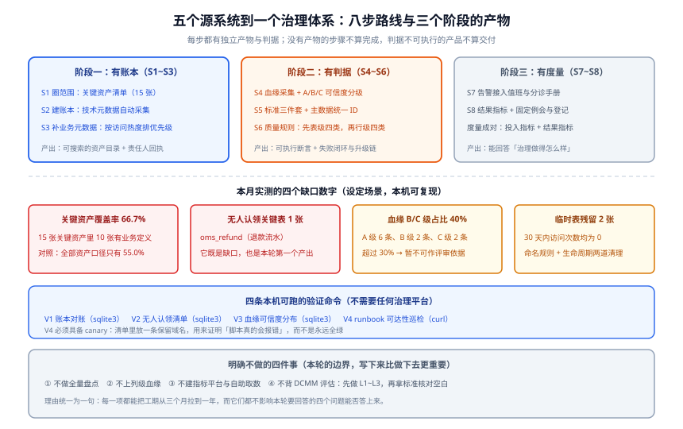

# 实战：五个源系统到一个治理体系

本页把前面六页的结论落到一个**具体的三个月**里：一家 300 人规模的电商公司，把散在 **5 个源系统**里的数据纳入**同一套账本、同一套判据、同一套流程**。

它要回答的不是「买哪个平台」，而是四个很具体的问题：**先做哪一步**、**每步的产物是什么**、**怎么判断这步真的完成了**、**哪些事这一轮明确不做**。



::: tip 为什么这个场景值得从头走一遍
治理的失败几乎都不是「某个技术点没做对」，而是**顺序错了**——先买平台、先写规则、先盘全量，三件事都会让人在第二个月放弃。本页给出的顺序是**被倒推出来的**：每一个「先做」都是为了让它后面那一步**有可能完成**。
:::

## 一、设定场景

### 五个源系统（本轮的治理范围）

| # | 源系统 | 库 / 形态 | 资产数 | 谁最关心它 | 采集方式 |
| --- | --- | --- | --- | --- | --- |
| ① | `oms_mysql` | MySQL 订单库（OLTP） | 5 张表 | 交易域、财务 | 直连系统目录 |
| ② | `user_pg` | PostgreSQL 用户与账户库 | 3 张表 | 增长域、风控 | 直连系统目录 |
| ③ | `crm_saas` | 第三方 CRM（只有 API） | 2 张表视图 | 销售、客服 | 直连 API + **人工补登记** |
| ④ | `dw_hive` | 数据仓（40 个 DWD/DWS 任务） | 7 张表 | 全员看报表 | 调度框架上报 + SQL 解析 |
| ⑤ | `oss_parquet` | 对象存储里的埋点 Parquet | 3 个数据集 | 增长域、算法 | 作业上报（**无表结构引擎**） |

::: warning 五个源里有两个是「不完整源」
③ 只有一个受限的 API（拿不到字段级约束），⑤ 连「表」这个概念都没有（只有文件与分区）。**它们正是「血缘与元数据必须允许人工登记」这条纪律的现实来源**——如果只按 ①②④ 的形态设计采集，③⑤ 会永远缺席，而缺了它们的账本没人会信。
:::

### 本轮要解决的四个问题（不是目标口号）

| 问题 | 现状（第 0 天） | 三个月后的判据 |
| --- | --- | --- |
| 公司有哪些数据、归谁 | 只有一张 Excel，最后更新是 4 个月前 | `PR-A`：关键资产清单存在且责任人全部回执 |
| 这个数该怎么算 | 「成交额」在三个系统里有三种算法 | `PR-C`：三个争议指标各有唯一定义且含已知差异 |
| 这个数现在可信吗 | 靠人肉发现，平均滞后 2 天 | `PR-D` + `PR-E`：有阻断级规则且接收人能独立复现 |
| 改了这个会坏谁 | 靠群里问，经常漏掉脚本消费方 | `PR-F`：变更评审必须查血缘且问「绕过血缘的消费方」 |

::: danger 先记住本页最重要的一个数字关系
**「覆盖率」和「被访问过的资产中被登记业务定义的比例」必须成对看。** 本轮设定场景里，全部资产的业务定义覆盖率是 **55.0%**，而**被访问过的 16 个资产里只有 62.5% 有定义**——也就是说，**越是没人用的东西，越容易被登记成"已完成"**。

只报前一个数，会让团队把力气花在「凑数量」上；两个一起看，力气才会落到「每天都在被查的那 15 张表」上。
:::

## 二、八步落地路线

### 总览

| 步 | 做什么 | 产物 | 完成判据 | 常见走偏 |
| --- | --- | --- | --- | --- |
| **S1** | 圈定范围：选 15 张关键资产 | 一份带责任人的清单 | `PR-A` `PR-B` | 一上来盘全量，两个月还在数表 |
| **S2** | 建账本：接技术元数据采集 | 可搜索的目录 | `PR-A` | 只装平台，不要求责任人回执 |
| **S3** | 补业务元数据（按访问热度排序） | 业务定义 + 值域 + 敏感级别 | `PR-B` | 平摊给所有资产，最常用的表最后补 |
| **S4** | 采集血缘 + 分可信度等级 | 表级血缘 + 人工登记入口 | `PR-F` | 直接上列级，解析覆盖率没测过 |
| **S5** | 标准三件套 + 主数据统一 ID | 三个指标唯一定义页 | `PR-C` | 只写业务定义，不写「已知差异」 |
| **S6** | 质量规则与闭环（先表级四类） | 3 条阻断级 + 若干告警级 | `PR-D` `PR-E` | 全上告警级，一条都不拦 |
| **S7** | 告警接入值班与分诊手册 | 分诊表 + 升级链 | `PR-G` | 「数据没到」与「数据错了」混在一起分诊 |
| **S8** | 度量与固定例会 | 投入指标 + 结果指标 | 见第六节 | 只报资产数与覆盖率 |

### S1 圈定范围：为什么是 15 张而不是 200 张

选法只有一条：**被报表与口径争议反复引用的那批表**。用两个来源交叉：最近 90 天的**报表引用清单** + 最近 90 天的**口径争议记录**。

| 入选理由 | 本次入选 | 说明 |
| --- | --- | --- |
| 出现在 3 份以上对外报表 | `dws_trade_daily`、`ads_gmv_report` | 报表错一次，外面就会发现 |
| 近 90 天被争议过 | `oms_refund`、`u_account` | 争议本身就是「口径没定」的信号 |
| 有跨团队消费方 | `crm_customer`、`dim_sku` | 跨团队 = 必须有权威源 |
| 是链路上的关键节点 | `dwd_order_di`、`dwd_user_di` | 它错了会静默污染下游 |

::: tip 本步的产物不是「15 行清单」，而是「15 个回执」
清单交给责任人，**让他回执「这张表归我」**。未回执的即为**无人认领**——按本页的设定场景，回执结果是 **`oms_refund`（退款流水）无人认领 1 张**。

**这一张表就是 S1 的全部产出中价值最高的一项**：它是退款金额对不上、财务与业务吵架半个月的根因，而在此之前没有任何人知道「它没有主人」。
:::

### S2 建账本：先接最容易的三个源

采集顺序按「**成本 / 收益比**」排，不是按重要性排：

| 顺序 | 源 | 方式 | 一次接入的成本 | 为什么这个顺序 |
| --- | --- | --- | --- | --- |
| 1 | ①② MySQL / PostgreSQL | 直连系统目录 | 半天（配数据源 + 只读账号） | 技术元数据准确率最高，立刻能回答「有哪些表」 |
| 2 | ④ 数据仓 | 调度框架上报 + 解析 | 一周（要改作业模板） | 产出「作业与表」的对应关系，血缘的地基 |
| 3 | ③ CRM | API + 人工补登记 | 一周（API 限额 + 补字段含义） | 只能拿到表名与字段名，业务含义必须人工 |
| 4 | ⑤ 埋点文件 | 作业上报 | 半天 | 它没有表结构，只能登记「数据集 + 分区 + 产出作业」 |

::: danger S2 最容易犯的三个错
1. **给采集账号开写权限**。采集只需要读系统目录的权限（MySQL 的 `information_schema`、PostgreSQL 的 `pg_catalog`）。给写权限会把「采集工具」变成一次事故的放大器。
2. **把「采集任务已创建」当成「采集在跑」**。判据要看 **run 状态**，不看任务是否存在——这一点与[元数据与资产目录](../Metadata/index.md)里的探测表法是同一条纪律。
3. **没有清理规则就开始采**。按本页设定，`tmp_` 前缀的残留表有 **2 张**（`tmp_order_fix_20261001`、`tmp_rate_backfill`，30 天内访问次数均为 **0**）。不清理的目录会在三个月后被这类表淹没，把搜索结果排序彻底拖坏。
:::

### S3 补业务元数据：按访问热度排队，不按表的字母顺序

原则上只需要回答一句话：**「这张表最近 30 天被访问过吗？」** 被访问过的先补。

本页设定场景的实测分布（覆盖率为**业务定义已填写**的比例）：

| 口径 | 分子 / 分母 | 覆盖率 | 读法 |
| --- | --- | --- | --- |
| 全部资产 | 11 / 20 | **55.0%** | 看起来「一半多」，但这是被长尾稀释过的数 |
| 关键资产（`is_key = 1`） | 10 / 15 | **66.7%** | 这才是本轮真正的进度 |
| 被访问过的资产（`accessed_30d = 1`） | 10 / 16 | **62.5%** | **反向指标**：防「只登记没人用的表」 |

::: tip 三行数一起看，结论才是可行动的
- 关键资产覆盖率 **< 80%** → 说明**最该补的那批还没补完**，S3 继续。
- 关键资产覆盖率 ≥ 80% 而**被访问资产覆盖率不涨** → 说明登记工作**在做但没做对地方**，检查是不是按字母顺序在补。
- 反向指标**高于**全部资产覆盖率是健康的（说明登记集中在了有人用的表上）；反之说明在凑数。
:::

### S4 血缘：先表级，给每条边标 A / B / C

本页设定场景是一条**只有表级血缘**的链路（15 张关键资产、10 条边）：

| 等级 | 含义 | 边数 | 已过期数 | 能否作为「无影响」的依据 |
| --- | --- | --- | --- | --- |
| **A** | 自动采集且 7 天内刷新过 | 6 | 0 | ✅ 可以 |
| **B** | 自动采集但已超期，或人工登记 | 2 | 2 | ❌ 只能圈范围，结论需人工复核 |
| **C** | 手工画 / 无来源 | 2 | 1 | ❌ 只能当文档看 |

```sql [血缘可信度分布：这条查询决定了「现在能不能拿血缘做评审」]
-- 口径：stale = 刷新时间为空 或 早于 7 天前（示例基准日 2026-10-09）
SELECT level,
       COUNT(*)                                                             AS edges,
       COUNT(*) FILTER (WHERE last_refreshed_at IS NULL
                           OR last_refreshed_at < '2026-10-09')             AS stale
FROM lineage_edge
GROUP BY level
ORDER BY level;

-- 本页设定场景的实际输出：
--   level  edges  stale
--   A      6      0
--   B      2      2
--   C      2      1
-- 判读：B + C = 4 / 10 = 40% > 30%  → 按血缘页的判据，
--       本轮血缘尚不可作为「改这列没有影响」的依据，先补采集再谈用它。
```

::: danger 本步最容易被跳过的一件事：给「框架外写数」留登记入口
五个源里，`oss_parquet` 的埋点文件是**用脚本直接写进对象存储**的，调度框架完全不知道这个作业存在。**如果只接自动采集，这条链路在血缘图上是断的**——而它恰好是给算法团队供数的那条。

处置：为这类作业提供**人工登记边**的表单，登记后在图里标为 `manual`（本页场景中 C 级的两条边就是这么来的）。
:::

### S5 标准与主数据：先把三个数吵清楚

本轮只做三个指标的唯一定义（选法见[概述](../Overview/index.md)第二步）：**成交额、活跃用户、履约率**；再加上一个主数据实体：**客户**。

| 工作 | 产物 | 必须包含的那一栏 |
| --- | --- | --- |
| 三个指标定义 | 三页定义（业务定义 / 口径边界 / 来源表 / 计算方式） | **已知差异**（如「与财务差约 2%，财务按开票时间归属」） |
| 客户统一 ID | `master_entity` + `master_entity_xref` 两张表 | **唯一性硬约束**（同一 CRM 客户不能挂到两个实体上） |
| 值域变更流程 | 每个关键枚举的变更流程（谁批、提前几天公告） | 「合法新增」与「脏数据」要能分开 |

```sql [主数据标识映射的唯一性硬约束（把纪律写进 DDL，而不是写进文档）]
CREATE TABLE master_entity (
  ent_id     varchar(32) PRIMARY KEY,   -- 全局唯一，如 uuidv7()
  ent_type   varchar(32) NOT NULL,      -- customer / sku / store
  created_at timestamptz NOT NULL DEFAULT now()
);

CREATE TABLE master_entity_xref (
  ent_id     varchar(32) NOT NULL REFERENCES master_entity(ent_id),
  source_sys varchar(64) NOT NULL,      -- crm / oms / dw
  local_id   varchar(128) NOT NULL,
  match_rule varchar(32) NOT NULL,      -- manual / business_key / inherited
  confidence numeric(3,2) NOT NULL,     -- 1.00 = 人工确认过
  PRIMARY KEY (source_sys, local_id)    -- 一个外部标识只能指向一个实体
);
-- 这条主键约束就是「不允许一个客户被算成两个人」这句话的机器化表达。
-- 凡是只能靠流程保证的纪律，都要问一句：能不能写成约束？
```

### S6 质量规则：先把三条阻断级写对

按[数据质量规则与闭环](../DataQuality/index.md)的「先表级、后行级」顺序，本轮只落 **3 条阻断级 + 6 条告警级**：

| 级别 | 规则 | 对象 | 失败动作 | 接收人 |
| --- | --- | --- | --- | --- |
| 阻断 | 日成交额偏离（双阈值） | `dws_trade_daily` | 拦下游、分区标不可信 | `orders_owner` |
| 阻断 | 分区新鲜度（承诺时间前未产出） | `dwd_order_di` | 拦下游 DWS 作业 | `dw_oncall` |
| 阻断 | 客户主键唯一性 | `crm_customer` | 停止同步并置为不可用 | `crm_owner` |
| 告警 | 行数相对基线偏离 ≥ 30% | `dwd_user_di` | 只通知 | `dw_steward` |
| 告警 | 枚举出现未登记新值 | 交易状态字段 | 只通知（**与「值域非法」是两条规则**） | `trade_steward` |
| 告警 | 字段级空值率上升 | 关键 5 个字段 | 只通知 | 各表责任人 |

::: warning 「值域失败」与「出现新枚举」必须是两条规则
把它们合成一条的后果是：**上游合法地加了一个状态值，告警却长成了「脏数据」的样子**，值班人按查脏数据的方式排查半小时，最后发现是新需求。分开之后，前者的处置是**修数据**，后者是**走变更评审**。
:::

### S7 告警接入值班：分诊第一问决定后面全部动作

| 现象 | 判据 | 第一问 | 动作 |
| --- | --- | --- | --- |
| 分区没产出 | 新鲜度 / 断档失败 | **数据没到** | 查依赖与调度，重新调度 |
| 量偏一半 | 表级量检查失败 | 数据可能到了但不全 | 查上游同步与过滤条件 |
| 金额整体偏小 | 跳变检查失败 | **数据错了** | 查单位 / 汇率 / 解析逻辑，圈影响面 |
| 枚举新增 | 新值告警 | 这是变更不是缺陷 | 走值域变更流程 |

**这一步的产物是一页分诊手册**，而不是一张告警配置截图。判据是 `PR-G`：**新人拿着手册能独立完成第一问的分流**。

### S8 度量与例会：投入指标必须配一条结果指标

| 指标 | 类型 | 现状（第 0 天） | 三个月目标 |
| --- | --- | --- | --- |
| 关键资产覆盖率 | 投入 | 不详（Excel 不可信） | ≥ 80%（**同时看被访问资产覆盖率**） |
| 规则条数（阻断 / 告警） | 投入 | 0 | 3 / 6 |
| 口径争议平均闭环天数 | **结果** | ≈ 9 天 | ≤ 3 天 |
| 数据事故中由规则提前发现的比例 | **结果** | ≈ 0 | ≥ 50% |
| 因数据问题导致的返工工时 | **结果** | 未统计 | 开始统计并逐月下降 |

::: danger 不要报「治理完成度」这类百分比
它没有分母定义，只能靠口径变大来变好。**结果指标必须是「时间」或「比例」，且分母来自业务流程**（争议条数、事故条数、返工单数），不来自治理团队自己的清单。
:::

## 三、验收判据 `PR-A` ~ `PR-G`

七条判据覆盖三个阶段，**每条都能用「一次动作」验证，不需要看报表**：

| 判据 | 内容 | 怎么验证（一次动作） |
| --- | --- | --- |
| `PR-A` | 关键资产清单存在，**每张表的责任人是一个自然人**，且**全部完成回执** | 逐条核对责任人字段 + 收集回执；出现团队名或未回执即失败 |
| `PR-B` | 关键资产的业务定义覆盖率 ≥ 80%，且**被访问资产的覆盖率不低于它** | 跑本页 V1 的两条查询，两个数一起看 |
| `PR-C` | 三个争议指标有唯一定义页，且**含非空的「已知差异」栏** | 让**未参与定义的人**按定义复述计算过程，一次复述对才算通过 |
| `PR-D` | 至少 **3 条阻断级规则**会真正拦住下游出数 | 造一次失败（把阈值临时改成 0.001），观察下游分区是否被拦 |
| `PR-E` | 每条阻断级规则的接收人能**独立复现**失败，且 runbook **链接可达** | 让接收人按通知内容跑一遍；再用 V4 巡检一遍全部 runbook |
| `PR-F` | 变更评审必须查血缘，且**必须回答「绕过血缘的消费方」**；C 级边不得用于判定「无影响」 | 打开评审模板核对；任取一份评审记录核查 |
| `PR-G` | 数据告警的**分诊第一问**能区分「数据没到」与「数据错了」，且升级链是具体的人 | 让一个没参与建设的人按分诊手册处理一次模拟告警 |

::: tip `PR-C` 为什么用「复述」而不是「评审通过」
让定义作者自己检查自己的定义，永远是「通过」。**只有让一个未参与者复述，才能测出定义是否自足**——这正是「口径写下来」与「口径被写清楚」的区别，也是[概述](../Overview/index.md)里 `DG-C` 的同一条判据在实战场景下的形态。
:::

## 四、四条本机可跑的验证命令

下面四条**不需要任何治理平台、不需要容器、不需要网络**（V4 需要网络）就能跑通。它们验证的是**判据本身**，而不是产品。

### 前置：造一份最小数据集

```sql [fixture.sql —— 20 个资产 + 10 条血缘边，五源齐全]
CREATE TABLE catalog_asset (
  asset_id TEXT PRIMARY KEY, source_id TEXT, asset_name TEXT, asset_type TEXT,
  is_key INTEGER, responsible_person TEXT, business_desc TEXT,
  sensitivity TEXT, accessed_30d INTEGER
);
INSERT INTO catalog_asset VALUES
 ('a01','oms_mysql','oms_order','table',1,'李四','订单主表','P1',1),
 ('a02','oms_mysql','oms_order_item','table',1,'李四',NULL,'P1',1),
 ('a03','oms_mysql','oms_payment','table',1,'李四','支付流水','P1',1),
 ('a04','oms_mysql','oms_refund','table',1,NULL,NULL,'P2',1),
 ('a05','oms_mysql','tmp_order_fix_20261001','table',0,NULL,NULL,NULL,0),
 ('a06','user_pg','u_account','table',1,'王五','账户表','P0',1),
 ('a07','user_pg','u_profile','table',1,'王五',NULL,'P0',1),
 ('a08','user_pg','u_login_log','table',0,'王五','登录日志','P2',1),
 ('a09','crm_saas','crm_customer','table',1,'赵六','客户主数据视图','P0',1),
 ('a10','crm_saas','crm_opportunity','table',0,'赵六',NULL,'P2',1),
 ('a11','dw_hive','dwd_order_di','table',1,'周七','订单明细清洗层','P1',1),
 ('a12','dw_hive','dws_trade_daily','table',1,'周七','日成交额汇总','P1',1),
 ('a13','dw_hive','ads_gmv_report','table',1,'周七',NULL,'P1',1),
 ('a14','dw_hive','dwd_user_di','table',1,'周七','用户明细清洗层',NULL,1),
 ('a15','dw_hive','tmp_rate_backfill','table',0,NULL,NULL,NULL,0),
 ('a16','oss_parquet','evt_click','file',1,'孙八','埋点点击事件',NULL,1),
 ('a17','oss_parquet','evt_expose','file',1,'孙八',NULL,'P2',1),
 ('a18','oss_parquet','evt_order_trace','file',0,NULL,NULL,NULL,0),
 ('a19','dw_hive','dim_sku','table',1,'周七','商品维表','P1',1),
 ('a20','dw_hive','dim_store','table',1,'周七','门店维表','P1',0);

CREATE TABLE lineage_edge (
  src_asset TEXT, dst_asset TEXT, level TEXT, last_refreshed_at TEXT, origin TEXT
);
INSERT INTO lineage_edge VALUES
 ('a01','a11','A','2026-10-16 02:10','auto'),
 ('a02','a11','A','2026-10-16 02:10','auto'),
 ('a11','a12','A','2026-10-16 02:12','auto'),
 ('a12','a13','A','2026-10-16 02:15','auto'),
 ('a06','a14','A','2026-10-16 02:20','auto'),
 ('a16','a11','B','2026-10-02 03:00','auto'),
 ('a17','a18','C',NULL,'manual'),
 ('a10','a13','B','2026-10-06 03:00','auto'),
 ('a19','a11','A','2026-10-16 02:10','auto'),
 ('a20','a12','C','2026-10-09 11:00','manual');
```

### V1：账本对账（覆盖率与责任人缺口）

```shell [建库并跑 V1]
sqlite3 dg.db < fixture.sql

sqlite3 -header -column dg.db "
select count(*) as key_assets,
       count(*) filter (where business_desc is not null) as with_desc,
       round(100.0 * count(*) filter (where business_desc is not null) / count(*), 1) as pct
from catalog_asset where is_key = 1;"

sqlite3 -header -column dg.db "
select source_id, count(*) as assets,
       count(*) filter (where responsible_person is null) as no_owner,
       count(*) filter (where business_desc is null)      as no_desc
from catalog_asset group by source_id order by no_desc desc, source_id;"
```

**本机实测输出（2026-10-16，sqlite3 3.39.5 / macOS）**：

```text
key_assets  with_desc  pct
----------  ---------  ----
15          10         66.7

source_id    assets  no_owner  no_desc
----------   ------  --------  -------
oms_mysql    5       2         3
oss_parquet  3       1         2
dw_hive      7       1         2
user_pg      3       0         1
crm_saas     2       0         1
```

**判读**：关键资产覆盖率 **66.7% < 80%**，S3 尚未完成。缺口最集中的是 `oms_mysql`（3 张缺定义、2 张缺责任人）——**与它在报表里的引用量成正比，符合「按热度排队」的预期**。

### V2：无人认领清单（这是 S1 的核心产出）

```shell [只查关键资产里没有责任人的那些]
sqlite3 -header -column dg.db "
select asset_id, source_id, asset_name
from catalog_asset
where is_key = 1 and responsible_person is null;"

sqlite3 -header -column dg.db "
select asset_id, asset_name, accessed_30d
from catalog_asset
where asset_name like 'tmp\_%' escape '\';"
```

**本机实测输出**：

```text
asset_id  source_id  asset_name
--------  ---------  ----------
a04       oms_mysql  oms_refund

asset_id  asset_name              accessed_30d
--------  ----------------------  ------------
a05       tmp_order_fix_20261001  0
a15       tmp_rate_backfill       0
```

**判读**：**无人认领的关键表只有 1 张（`oms_refund`）**——比「覆盖率」这种百分比更有行动价值，因为它是**一条可以直接派工的事项**。另外两张 `tmp_` 表 30 天内访问次数为 0，属于「命名规则 + 生命周期」两道清理的对象（对应 `MD-G`）。

### V3：血缘可信度分布

```shell [B/C 级占比决定「现在能不能拿血缘做变更评审」]
sqlite3 -header -column dg.db "
select level,
       count(*) as edges,
       count(*) filter (where last_refreshed_at is null or last_refreshed_at < '2026-10-09') as stale
from lineage_edge group by level order by level;"
```

**本机实测输出**：

```text
level  edges  stale
-----  -----  -----
A      6      0
B      2      2
C      2      1
```

**判读**：`B + C = 4 / 10 = 40% > 30%` → **本轮血缘尚不可作为「改这列没有影响」的依据**。注意 A 级的 `stale = 0` 与 B 级的 `stale = 2` 是关键信号：**A 级全新鲜说明采集链路此刻是活的**，B 级的过期是「采集范围没覆盖到」而不是「采集挂了」——**两者的处置完全不同**。

### V4：runbook 可达性巡检（含 canary）

这一条是本页**最值得抄走**的一个做法。判据必须同时满足两个条件才靠得住：**「存在」不等于「可达」**（`DQ-I`），而且**「全部通过」必须能被证伪**（否则脚本永远全绿）。

为便于复现，这里用一份**公开可访问的 12 条 URL 清单**代替内网 runbook 地址，其中**第 12 条 `runbook.internal` 是保留域名 canary**——它必须失败，用来证明脚本真的会报错：

```shell [逐条请求，并且必须 --follow 跟完重定向]
while read -r u; do
  printf '%-4s %-6s rd=%-2s %s\n' "$(curl -sL -o /dev/null -m 10 -w '%{http_code}' "$u")" \
    "$?" "$(curl -sL -o /dev/null -m 10 -w '%{num_redirects}' "$u")" "$u"
done < urls.txt
```

**本机实测输出（2026-10-16，curl 8.1.2）**：

```text
200   https://docs.datahub.com/docs/glossary/business-glossary
200   https://docs.open-metadata.org/latest/how-to-guides/data-governance/glossary      （1 跳）
200   https://openlineage.io/docs/spec/naming                                          （1 跳）
200   https://docs.getdbt.com/docs/build/data-tests
200   https://docs.greatexpectations.io/docs/changelog                                  （2 跳）
200   https://docs.soda.io/soda-core/release-notes.html                                 （1 跳）
404   https://docs.dagster.io/guides/dagster/asset-checks                              （1 跳后 404）
200   https://pandera.readthedocs.io/                                                   （1 跳）
000   https://sre.google/workbook/implementing-slos/            rc=28 超时
200   https://atlas.apache.org/#/TypeSystem
200   https://openstd.samr.gov.cn/bzgk/gb/                                            （2 跳）
000   https://runbook.internal/data/daily_gmv_deviation         rc=6 DNS 解析失败（canary）
```

**这张输出里有三条独立的结论，每一条都值得写进纪律**：

| 现象 | 真实原因 | 处置 |
| --- | --- | --- |
| 不跟重定向时，有 **8 条不是 200** | 308 / 301 / 307 / 302 都是正常重定向 | 判据必须 `-L` 跟完重定向再判最终码，否则 8 条全是假 FAIL |
| 跟完之后仍有 1 条 **404** | 重定向把请求送到了**一个不存在的页面** | **只有「跟随后判最终码」才能发现**——这是本步最值钱的一条 |
| 两条 `000`，但 **rc 不同**（28 / 6） | 一条是网络超时，一条是域名不存在 | 不能合并成一个「失败」计数；超时重试，DNS 失败直接改配置 |

::: danger canary 是判据的一部分，不是可选项
一个从不报错的巡检脚本，与没有巡检是同一件事。**本页的 canary（保留域名）在两次实测中都稳定返回 `rc=6`**，它是这套判据「还活着」的证明。

同一条纪律适用于其它巡检：凡是「应当有失败样本」的检查，都必须在一个已知会失败的输入上验一次。
:::

**判读口径与收尾**：`PR-E` 的验收动作是**先跑一遍 V4，确认 canary 报错、其余条目的最终码为 2xx**；出现 404 或 `rc=28` 时，**先区分「页面没了」「网络不通」「域名写错」三类**，再决定改链接还是改网络配置。

## 五、明确不做的四件事

把「不做」写下来，是本页与「治理清单式文章」最大的区别——**不写下来，它们会在第三周以「顺便也做了吧」的形式回来**。

| 不做 | 做了会怎样 | 为什么这一轮不需要 |
| --- | --- | --- |
| **① 不做全量盘点** | 三个月还在数表，一个判据都验不了 | 本轮要回答的四个问题，15 张关键资产就能回答；剩下的表按热度滚动纳入 |
| **② 不上列级血缘** | 采集成本约是表级的 10 倍，而字段级变更一年没几次 | 表级能回答「改这张表涉及谁」；等出现「一次字段变更要多叫 5 个以上下游团队」时再上 |
| **③ 不建指标平台与自助取数** | 平台成了新的事实来源，口径争议从 3 个变成 2 套系统 | 先把三个指标的唯一定义写对；**工具会固化口径，口径错了固化得更快** |
| **④ 不背 DCMM 评估** | 产出一批「为了被评估而存在」的流程与文档 | 先把 L1~L3 做起来，再拿 DCMM 的能力域核对「哪一块完全空白」 |

::: warning 第 ① 条最容易被推翻，所以要给出反驳的说法
「先把家底盘清楚」听起来永远正确。它是错的，因为**盘点没有完成态**——只要业务在跑，就有新表产生。可交付的形态是**清单 + 滚动纳入规则**（超过 30 天被访问 3 次以上即进入候选），而不是「盘完」。
:::

## 六、三个月后的度量对照

| 度量 | 第 0 天 | 第 90 天 | 类型 | 备注 |
| --- | --- | --- | --- | --- |
| 关键资产覆盖率 | 不详 | 80% 以上 | 投入 | **必须与「被访问资产覆盖率」成对看**（本轮基线 55.0% / 62.5%） |
| 无人认领的关键资产 | 不详（`oms_refund` 事实上无人认领） | 0 | 投入 | 这项从「无人认领清单」直接读 |
| 阻断级规则数 | 0 | 3 | 投入 | 少而硬，不超过规则总数的两成 |
| 血缘 A 级边占比 | 0 | ≥ 70% | 投入 | 低于 70% 时血缘不得用于变更评审 |
| 口径争议平均闭环天数 | ≈ 9 天 | ≤ 3 天 | **结果** | 分歧点通常是「裁决人不存在」，不是「流程太长」 |
| 由规则提前发现的数据事故占比 | ≈ 0 | ≥ 50% | **结果** | 这是治理唯一能让业务侧感知到的产出 |
| 因数据问题导致的返工工时 | 未统计 | 逐月下降 | **结果** | 从第 1 个月开始统计，否则第 3 个月没有基线 |

::: tip 最后一条建议：把「结果指标」挂到业务方身上
治理团队自己的 KPI 只能选投入指标（结果不由它控制）。**把结果指标挂到争议的双方**——争议的平均闭环天数挂业务域负责人、规则提前发现率挂数据工程负责人、返工工时由需求方与交付方共同承担。

这不是为了追责，而是为了**让「口径没定」这件事在发生之前就有人不愿意**。
:::

## 七、相关页面

- [概述：数据治理的四条边界](../Overview/index.md)：本页每一步背后的边界与「什么时候不需要治理」
- [元数据与资产目录](../Metadata/index.md)：S2 / S3 的技术实现与探测表验证法
- [数据血缘与影响分析](../Lineage/index.md)：S4 的可信度分级与「改一列之前该问的四个问题」
- [数据质量规则与闭环](../DataQuality/index.md)：S6 的规则五要素与闭环四个时刻
- [数据标准与主数据](../StandardsMasterData/index.md)：S5 的三件套与统一 ID 表结构
- [组织、角色与流程](../OrgAndProcess/index.md)：S7 / S8 的责任人、升级链与度量配对
- [数仓建模](/docs/DB/DataWarehouse/index.md)：一套数仓内部的建模与分层，与本页是「仓库内」对「跨系统」
- [项目交付方法论](/docs/Others/ProjectDelivery/index.md)：本页八步路线与通用交付流程的对应关系

## 参考资料

- DAMA International，*DAMA-DMBOK: Data Management Body of Knowledge*（2nd Edition, Revised）：<https://www.dama.org/cpages/body-of-knowledge>
- 国家标准 GB/T 36073-2025（DCMM 2.0）发布公告：<https://www.stdaily.com/web/gdxw/2026-01/15/content_462215.html>
- SQLite 官方文档（本页 V1~V3 的验证环境；窗口函数与 `FILTER` 自 3.30 起可用）：<https://www.sqlite.org/docs.html>
- curl 官方手册（`--write-out` 变量 `%{http_code}` / `%{num_redirects}` / `%{url_effective}`）：<https://curl.se/docs/manpage.html>
- DataHub 词汇表与所有权模型：<https://docs.datahub.com/docs/glossary/business-glossary>
- OpenLineage 命名规范（血缘边与数据集的命名一致性）：<https://openlineage.io/docs/spec/naming>
