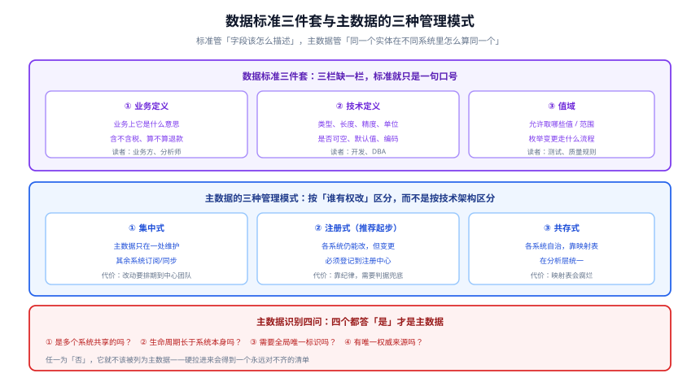

# 数据标准与主数据

**数据标准（Data Standard）**规定「一个字段该被怎样描述」；**主数据（Master Data）**规定「同一个实体在不同系统里怎么算同一个」。

两者常被合并讨论，但它们解决的是不同层的问题：**标准管「描述一致性」，主数据管「实体一致性」**。先有标准，主数据才有落脚点。



## 一、数据标准三件套：缺一栏就只是口号

一个字段的标准必须同时写清三栏。**缺任何一栏，标准都会在落地时失效**：

| 栏目 | 内容 | 缺了会怎样 |
| --- | --- | --- |
| **① 业务定义** | 业务上它是什么意思、边界在哪里 | 每个读的人自己理解，口径分叉 |
| **② 技术定义** | 类型、长度、精度、单位、可空性、编码 | 开发各自选类型，`decimal(18,2)` 与 `numeric(10,4)` 并存 |
| **③ 值域** | 允许取哪些值 / 范围，以及**枚举变更走什么流程** | 值域检查写不出来；新枚举静默出现 |

```yaml [一个合格的数据标准长什么样]
standard:
  code: STD_TRADE_ORDER_AMOUNT        # 标准编号，供引用
  name: 订单应付金额
  # ① 业务定义
  business_definition: >
    订单创建时确定的应付金额合计，含商品金额与运费，不含优惠券抵扣与退款。
    归属日期取订单创建时间（不是支付时间）。
  business_owner: 交易域负责人
  # ② 技术定义
  technical:
    type: decimal(18,2)
    unit: CNY
    nullable: false
    default: 0
    encoding: 数值型，不使用字符串
  # ③ 值域
  domain:
    range: "[0, 10000000]"
    change_process: >
      枚举/范围变更须由交易域负责人批准，
      并在「口径登记处」登记生效日，提前 5 个工作日公告。
  # 已知差异：最容易被跳过、也最有价值的一栏
  known_differences:
    - 与财务口径相差约 2%，原因是财务按「开票时间」归属（见口径登记 #187）
```

::: danger 「已知差异」不是瑕疵，是必需品
很多标准的编写者觉得写「已知差异」是在暴露问题。恰恰相反：**不写差异，差异就会在下一次口径会议上以争执的形式重新出现**。写了差异，争议就变成「已登记的差异」——一句话就能回答，且回答的人不需要是当初定义的人。
:::

### 值域为什么必须带「变更流程」

只写「允许值：`CREATED` / `PAID` / `CANCELLED`」是不够的。真正会出事的是**上游悄悄加了一个 `REFUNDING`**：

- 下游的 `CASE WHEN` 没覆盖新值，落到 `ELSE` 分支，静默归入「其他」
- 值域质量规则开始报警，但没人知道是「合法新增」还是「脏数据」

**处置**：值域标准里写清「新增枚举值要走谁批准、提前多少天公告」，并在质量规则里把**值域失败**与**新增值告警**分成两条——前者是缺陷，后者是待评审的变更。

## 二、主数据的识别：四个问题

「哪些数据是主数据」是实践中最容易吵起来的问题。用下面四问过滤，**四个都答「是」才是主数据**：

| 问题 | 判据 | 反例（答「否」就不该列为主数据） |
| --- | --- | --- |
| ① **多个系统共享吗？** | 两个以上系统都在用同一个实体 | 只在 CRM 里用的「销售线索备注」 |
| ② **生命周期长于系统本身吗？** | 换系统时它还要存在 | 某个系统内的会话 ID |
| ③ **需要全局唯一标识吗？** | 跨系统必须能指向同一个 | 系统内自增的流水号 |
| ④ **有唯一权威来源吗？** | 能指出「以谁为准」 | 三个系统各有一份且都自称权威的「门店信息」 |

::: tip 第 ④ 问是最难的，也是唯一不可绕过的
前三问通常在半小时内能达成一致；第 ④ 问会暴露组织问题——**「以谁为准」是一个权力问题，不是技术问题**。

实操建议：如果第 ④ 问答不出来，**先把它降级为「参考数据」（各系统自治 + 映射表）**，不要硬上主数据平台。一个没有权威源的主数据平台，只是把「三个版本」变成了「三个版本 + 一个没用的平台」。
:::

### 常见的主数据候选

| 实体 | 通常是不是主数据 | 权威源通常在哪 | 常见坑 |
| --- | --- | --- | --- |
| 客户 / 会员 | 是 | CRM 或会员系统 | 电商与线下各有 ID，靠手机号关联（而手机号会变） |
| 商品 / SKU | 是 | PIM 或商品中心 | 一个 SKU 在多渠道有不同编码 |
| 组织 / 门店 | 是 | HR 系统或组织中心 | 组织重组后历史数据归属错乱 |
| 供应商 | 是 | SRM | 供应商合并与改名导致的重复 |
| 员工 | 是 | HR | 离职再入职产生两个 ID |
| 汇率 | 不是（是参考数据） | 财务 | 各家取数时间点不同导致对账差异 |
| 地区行政区划 | 不是（是参考数据） | 国家标准 | 区划调整后历史数据不应回溯改写 |

## 三、主数据的三种管理模式

按「谁有权改」区分，而不是按技术架构区分：

| 模式 | 谁有权改 | 优点 | 代价 | 适用 |
| --- | --- | --- | --- | --- |
| **① 集中式** | 只有中心团队 | 一致性最强 | 改动要排期；中心团队成为瓶颈 | 实体变更极少、一致性要求极高（如财务科目） |
| **② 注册式** | 各系统可改，但**必须登记** | 不阻塞业务；有全局视图 | 依赖纪律，需要判据兜底 | **推荐作为起步模式** |
| **③ 共存式** | 各系统自治 | 改动成本最低 | 靠映射表在分析层统一，**映射表会腐烂** | 历史包袱重、短期无法收敛 |

::: warning 注册式落地的唯一硬条件
注册式成立的唯一前提是：**「没登记就改」这件事会被发现**。所以必须有一条**对账判据**：

```sql [每天对账：有没有未经登记的主数据变更]
-- 思路：把主数据源表的「变更事件」与注册中心的登记记录做差集
SELECT e.entity_id, e.changed_at, e.change_type
FROM master_entity_change_event e                 -- 来自源系统的变更流
LEFT JOIN registry_change_record r
       ON r.entity_id = e.entity_id
      AND r.changed_at BETWEEN e.changed_at - INTERVAL '1 day'
                           AND e.changed_at + INTERVAL '1 day'
WHERE r.record_id IS NULL
  AND e.changed_at >= NOW() - INTERVAL '1 day';
-- 期望：0 行。有行 = 存在未经登记的主数据变更。
```

**这条对账不存在，注册式就只是「各改各的 + 一个没人看的登记表」。**
:::

## 四、同一实体多 ID：统一标识的三条路线

「同一个客户在 CRM 是 `C001`、在订单库是 `10086`、在数据仓是 `cust_20240101_001`」——这是主数据要解决的核心问题。三条路线：

| 路线 | 做法 | 优点 | 代价 |
| --- | --- | --- | --- |
| **① 统一 ID（推荐）** | 生成全局 ID，各系统记录它 | 干净、稳定 | 需要改各系统的表结构；存量数据要回填 |
| **② 映射表** | 保留各自 ID，维护 `(系统, 本地ID) → 全局ID` | 不动业务系统 | 映射表需要持续维护，新增系统必须同步 |
| **③ 业务键去重** | 用手机号 / 邮箱 / 税号等做匹配 | 无需改动 | 业务键会变、会重复、会缺失，**匹配错误率最高** |

```sql [统一 ID 的最小表结构（可直接落地）]
-- 全局实体表：一个实体一行
CREATE TABLE master_entity (
  ent_id        varchar(32) PRIMARY KEY,        -- 全局唯一，如 uuidv7()
  ent_type      varchar(32) NOT NULL,           -- customer / sku / store ...
  created_at    timestamptz NOT NULL DEFAULT now()
);

-- 标识映射表：一个实体可以有多条外部标识
CREATE TABLE master_entity_xref (
  ent_id        varchar(32) NOT NULL REFERENCES master_entity(ent_id),
  source_sys    varchar(64) NOT NULL,           -- crm / oms / dw
  local_id      varchar(128) NOT NULL,
  match_rule    varchar(32) NOT NULL,           -- manual / business_key / inherited
  confidence    numeric(3,2) NOT NULL,          -- 1.00 = 人工确认
  created_at    timestamptz NOT NULL DEFAULT now(),
  PRIMARY KEY (source_sys, local_id)
);
CREATE INDEX ON master_entity_xref (ent_id);

-- 硬约束：同一个外部标识只能挂到一个实体上（防止一对多）
-- 这条约束本身就是「不允许一个 CRM 客户被算成两个人」的机器化表达
```

::: danger 用业务键自动匹配是最容易埋雷的路线
手机号会换人、邮箱会共用、税号会有大小写与空格差异。**自动匹配的错误是双向的**：既会把两个人合成一个（合并后订单金额翻倍），也会把一个人拆成两个（同一个人的历史被切成两段）。

处置：**`confidence < 1.00` 的匹配一律不进生产口径**，只在分析层作为候选；**人工确认过才置 1.00**。并且要有一条反向判据：**「自动匹配产生的映射占比」超过某个阈值（如 30%）就说明业务键质量不达标，应先治理业务键而不是加大自动匹配**。
:::

## 五、判据清单

| 判据 | 内容 | 怎么验证 |
| --- | --- | --- |
| `SM-A` | 关键字段的标准**三栏齐全**（业务定义 / 技术定义 / 值域） | 抽查 10 个关键字段，缺栏即失败 |
| `SM-B` | 标准里有**「已知差异」**栏，且非空 | 抽查关键指标对应的字段 |
| `SM-C` | 值域标准含**变更流程**（谁批、提前几天） | 查阅标准文档 |
| `SM-D` | 主数据清单经过**四问过滤**，无「四问不全」的实体 | 对每个主数据实体逐问核对 |
| `SM-E` | 每个主数据实体有**明确的权威源**（含「暂无」这个合法答案） | 查阅清单的权威源栏 |
| `SM-F` | 若采用注册式，存在**未登记变更的对账判据**且每天跑 | 手工改一条主数据不登记，确认次日对账报出 |
| `SM-G` | 映射表有**唯一性硬约束**（同一外部标识不挂两个实体） | 查表结构或约束定义 |
| `SM-H` | 自动匹配的映射**占比有上界告警**，且低置信度不进生产口径 | 查 `confidence` 分布与口径 SQL |

## 六、相关页面

- [元数据与资产目录](../Metadata/index.md)：标准是业务元数据的核心内容，「值域」正是质量规则的输入
- [数据质量规则与闭环](../DataQuality/index.md)：值域检查的值域、跳变检查的合理区间都来自标准
- [数据建模](/docs/DB/DataModeling/index.md)：标准是**字段级契约**，建模是**表级结构**
- [数据建模的工具选型](/docs/DB/DataModeling/ModelingTools/index.md)：模型工具里如何承载标准与数据字典
- [数据仓库的分层设计](/docs/DB/DataWarehouse/Layering/index.md)：主数据通常落在数仓的哪一层
- [数据同步与 CDC](/docs/DB/CDC/index.md)：主数据如何同步到各消费系统

## 与「采购到付款（P2P）与三单匹配工程」的分工（第 224 天补充）

| 这件事 | 本页负责 | [采购到付款专题](../../Backend/ProcureToPay/index.md) 负责 |
| --- | --- | --- |
| 主数据建模 | 实体、编码规则、黄金记录、存活规则 | 谁在链上**改**它（供应商准入、料号、价格） |
| 去重与合并 | 匹配算法、合并策略、血缘 | 合并后单据上的外键怎么迁移 |
| 生命周期 | 新增/变更/停用/归档 | 停用后「还能不能下单」的判据 |
| 质量度量 | 完整率、唯一率、一致率 | 采购链上的具体口径（信用代码、税率分类） |

一句话：**本页定义「什么是一份正确的主数据」，P2P 定义「用错主数据会付出什么代价」**。

::: danger 本页特有的一个坑（与 P2P 相关）
**主数据合并会让历史单据指向一个「已合并」的 ID**。供应商 A 与 A' 合并成一条黄金记录后，历史 `purchase_order.supplier_id` 仍指向被合并的那一个；如果合并脚本顺手删了旧记录，历史订单会变成孤儿（外键悬空），而对账时「同一供应商」的汇总会漏掉一半。正确做法：**合并只做「映射 + 停用」，不物理删除**，并保留 `merged_into` 字段与反向查询视图。
:::

## 参考资料

- DAMA-DMBOK（2nd Edition, Revised）「参考数据与主数据」知识领域：<https://www.dama.org/cpages/body-of-knowledge>
- 国家标准 GB/T 36073-2025（DCMM 2.0）「数据标准」能力域：<https://openstd.samr.gov.cn/bzgk/gb/>
- DataHub 词汇表（Glossary）与术语（Term）模型：<https://docs.datahub.com/docs/glossary/business-glossary>
- OpenMetadata 术语表与指标定义：<https://docs.open-metadata.org/latest/how-to-guides/data-governance/glossary>
- PostgreSQL 唯一约束与 `NOT NULL`（把标准写进 DDL 的机制）：<https://www.postgresql.org/docs/current/ddl-constraints.html>
