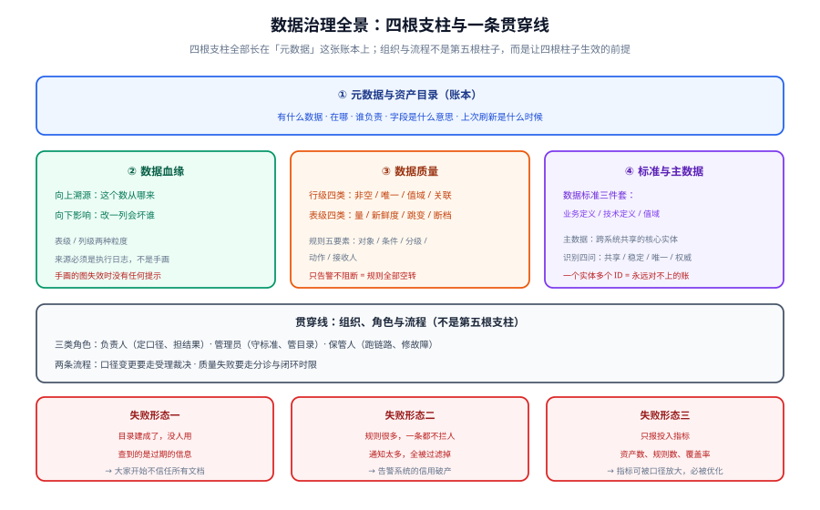

# 数据治理入门

**数据治理**解决的问题只有一句话：**让「这个数字是多少」在会议室里不需要争论第二次**。

它要回答的不是「买哪个工具」，而是四个更硬的问题：**谁定义口径、算出来的数凭什么可信、改了一列会影响到谁、出了问题谁负责**。这四个问题答不上来，所有的平台建设都只是在给一个没有裁判的球场修看台。

::: tip 一句话理解
数据治理不是技术项目，而是**把「数据这件事」的责任、定义和判据写下来并让它们生效**。工具只是让这些约定**可以被执行、被检查、被追溯**。
:::

## 与相邻专题的分工

本专题讲**跨越系统的资产与口径管理**——谁定义、谁负责、错了怎么发现、改了什么会坏；**数仓内部怎么建模加工**、**库表怎么设计**、**数据怎么搬运**由库内既有专题承担。下表写死边界，避免重复阅读：

| 相邻专题 | 它讲什么 | 本专题讲什么 | 判据（什么时候该看哪边） |
| --- | --- | --- | --- |
| [数仓建模](/docs/DB/DataWarehouse/index.md) | 分层、维度建模、缓慢变化维、粒度与聚合 | 跨系统的**资产目录与口径归属**：分层是数仓内部的结构，治理是「这张表算不算资产、归谁」 | 「DWD 该放什么」→ 数仓专题；「这张表谁负责、口径谁定」→ 本专题 |
| [数仓的数据质量与血缘](/docs/DB/DataWarehouse/Quality/index.md) | 一套 SQL 数仓里，规则怎么写成可调度的检查 | **规则从哪来、挂在谁身上、失败了找谁**；血缘的采集方式与可信度分级 | 「规则 SQL 怎么写」→ 数仓专题；「这条规则该谁定、告警发给我对吗」→ 本专题 |
| [数据建模](/docs/DB/DataModeling/index.md) | 范式、ER 图、反范式、设计规范（OLTP 业务库） | **数据标准与主数据**：字段该叫什么、值域从哪来、同一实体在三个系统里怎么统一 | 「表怎么设计不写错」→ 建模专题；「同一个客户在 CRM 和订单库 ID 不一致」→ 本专题 |
| [数据同步与 CDC](/docs/DB/CDC/index.md) | 变更怎么捕获、怎么投递、怎么保证不丢 | 同步链路的**元数据与血缘怎么被登记**，以及「谁有权批准一次表结构变更」 | 「怎么同步」→ CDC 专题；「同步过程本身算不算资产」→ 本专题 |
| [数据仓库与 BI 的元数据](/docs/DB/DataWarehouse/Layering/index.md) | 每层的职责与依赖方向 | **元数据的三种类型、四种采集方式**，以及元数据自己也会过期这件事 | 「这层放什么」→ 数仓专题；「目录里为什么搜不到这张表」→ 本专题 |
| [SQL 优化](/docs/DB/Relational/SQLOptimization/index.md) | 索引、执行计划、慢查询定位 | 治理**不优化查询**，只回答「这次查询消耗算谁的」 | 「这条 SQL 为什么慢」→ 优化专题；「这块存储成本算哪个部门的」→ 本专题 |
| [向量数据库深入](/docs/DB/VectorDatabase/index.md) | 索引、量化、过滤、融合的机制 | 「非结构化数据算不算资产」以及**AI 语料的来源与授权登记** | 「Embedding 怎么建索引」→ 向量专题；「这批语料有没有授权凭证」→ 本专题 |
| [企业知识库落地](/docs/AI/EnterpriseKB/index.md) | 权限隔离、入库、问答评估（某一套知识库内部） | 把**同一套治理方法**用在「结构化数据资产」上；两页的权限模型与生命周期是同源问题 | 「知识库怎么建」→ 知识库专题；「公司有哪些数据资产、归谁」→ 本专题 |
| [大数据生态](/docs/DB/BigData/index.md) | Hadoop / Hive / Spark / Flink 的组件与选型 | **湖与仓之间的口径一致性**归谁管，以及「一份数据存在多处」时谁是权威 | 「集群怎么搭」→ 大数据专题；「两个系统同一个指标对不上」→ 本专题 |
| [审计与检测](/docs/Ops/SecurityHardening/AuditDetection/index.md) | 平台侧的审计日志怎么建 | 数据侧该产出**哪几类事件**（访问、改口径、删资产），以及留痕保留多久 | 「日志往哪写」→ 安全专题；「这次改口径谁批的」→ 本专题 |
| [监控告警](/docs/Ops/Monitoring/index.md) | 指标采集、规则怎么写、怎么不吵 | 数据质量告警**挂在哪个对象上**，以及「数据没到」和「数据错了」是两类告警 | 「服务挂了怎么叫人」→ 监控专题；「今天的表没跑出来」→ 本专题 |
| [项目交付方法论](/docs/Others/ProjectDelivery/index.md) | 需求、架构、契约、验收的通用流程 | 治理在**一个 30 天项目里**该做到哪一步就够 | 「项目怎么交付」→ 交付专题；「这个项目要上治理吗」→ 本专题的实战页 |
| [数据库总览](/docs/DB/Overview/index.md) | 数据库分类与技术全景 | 治理是**横切**的：任何一种库都需要归属、口径与生命周期 | 「该用哪种库」→ 总览；「这个库里的数据谁负责」→ 本专题 |

## 专题地图

四根支柱里最容易被当成「可以晚点做」的是**元数据**：它看不见产出，也不修任何 bug。但另外三根全都长在它上面——没有元数据就说不清血缘的起点和终点，没有元数据就不知道质量规则该挂在哪张表的哪个字段上，没有元数据更是无法回答「公司到底有哪些数据」。**先有账本，才谈得上治理。**

## 章节导航

1. [概述：数据治理的四条边界](./Overview/index.md)：四条必须先划清的边界（有元数据 ≠ 有治理 / 数据质量 ≠ 数据治理 / 治理是组织问题不是工具问题 / 血缘不是画出来的）、三类「治理失败」的典型形态，以及**什么时候根本不需要治理**与最小起步三步
2. [元数据与资产目录](./Metadata/index.md)：技术 / 业务 / 操作三类元数据的分工、四种采集方式的准确率与维护成本、元数据自己也会有质量问题的三个度量，以及一次**可执行的目录可用性验证**
3. [数据血缘与影响分析](./Lineage/index.md)：表级与列级血缘的能力边界、**为什么血缘天然只有半自动**、SQL 解析在五类语法上会漏、血缘可信度分级与「改一列之前该问的四个问题」
4. [数据质量规则与闭环](./DataQuality/index.md)：八类检查（行级四类 + 表级四类）、规则五要素、**阻断级与告警级怎么分**、失败之后谁在多长时间内做什么，以及数据 SLI / SLO 的写法
5. [数据标准与主数据](./StandardsMasterData/index.md)：数据标准三件套（业务定义 / 技术定义 / 值域）、主数据识别的四问、主数据管理的三种模式，以及**同一实体在多个系统里怎么统一标识**
6. [组织、角色与流程](./OrgAndProcess/index.md)：三类角色（负责人 / 管理员 / 保管人）的职责切分、口径变更的受理流程、成熟度模型与**治理自身的度量指标**，以及一个不背 KPI 的治理团队为什么一定失败
7. [实战：五个源系统到一个治理体系](./Practice/index.md)：设定场景、八步落地路线、`PR-A~PR-G` 判据表、四条本机可跑的验证命令，以及**明确不做的四件事**
8. [常见问题与最佳实践](./FAQ/index.md)：现象分诊表、高频十二问、上线自查二十项、十二条最佳实践与术语表

## 事实与规格速览（2026-10 口径）

本专题涉及**在演进中的产品与标准**，下表按官方发布页、ASF 理事会纪要、国家标准公告核对：

| 对象 | 当前版本 / 状态 | 关键口径 |
| --- | --- | --- |
| Apache Atlas | **2.5.0**（2026-04-30） | ASF 理事会 2026-06 纪要标注「Ongoing, with moderate activity」；2.6.0 仅见 RC 标记、未确认正式发布。**不做数据质量、不做访问控制**（分类标签交给 Ranger 执行） |
| DataHub | **v1.7.0.1**（2026-09-03） | 1.0 于 2025-01 发布；**v1.7.0 起消息中间件可选**（`pgQueue` 取代 Kafka），快速起不再必须 7 个容器 |
| OpenMetadata | **2.0.1-release**（2026-09-02） | 同仓库最新 tag 是 `1.13.5-release`（2026-09-03，1.13 维护线）——**按 tag 列表从上往下读会读错当前版本**；2.0 新增可选 RDF/Fuseki 存储（默认关闭） |
| Amundsen | **2026-09-10 正式归档** | LF AI & Data 技术与治理委员会投票归档；选型时不要再把它列为「活跃三强」 |
| Great Expectations（GX Core） | **1.23.2**（2026-09-28） | 2026-05 被收购（收购方未公开具名）、**GX Cloud 于 2026-06-01 宣布停服**，GX Core（Apache-2.0）由新维护方继续 |
| dbt Core | **1.11.12**（2026-07 口径） | Rust 版 `2.0.0-alpha` 在开发中（dbt Fusion 的基础）；YAML 键已改为 `data_tests:`（`tests:` 仍兼容）；`dbt test --resource-type test` 只跑数据测试 |
| Soda Core | **4.25.0**（2026-09-23） | **v4 把数据契约作为默认写法**（从 SodaCL checks 转向 contract 语法，破坏性变更）；需 Python 3.10+；CLI 退出码 0 = 通过 / 2 = 失败，warn-only 不失败 |
| Pandera | 0.32.0 起 Narwhals 后端 | 跨 Polars / Ibis / PySpark SQL 的惰性校验，适合在**数据帧这一层**做契约 |
| DCMM 国家标准 | **GB/T 36073-2025（DCMM 2.0）**，2026-07-01 实施 | 取代 GB/T 36073-2018；能力域 **8 → 9**（新增「数据资产」）、能力项 28 → 33、评估指标 441 → 486；五级成熟度不变 |
| DAMA-DMBOK | **2.0（2nd Edition, Revised）** | 11 个知识领域；与 DCMM 的关系是「**该做什么**」对「**做到了什么程度**」 |

::: warning 说明
上表只登记**与本专题判据有关**的版本与状态事实，不追求穷举。任何一条版本判断在用于生产前，都应以官方发布页或标准公告复核一次——**版本事实会过期，判据不会**。
:::

## 大版本组织说明

按仓库约定「涉及大版本时按版本目录组织、旧版本保留并标注状态，不覆盖旧内容」，本专题的处理方式是**不建版本目录**，理由有三条：

1. **主题不是某一个产品**。本专题讲的是「跨系统的资产与口径怎么被管住」这一层方法，Apache Atlas、DataHub、OpenMetadata、GX Core、dbt 都是它的实例。为其中任何一个产品建版本目录，都会让另外几个失去位置。
2. **标准的新旧版本不是并行维护的第二条内容线**。DCMM 确实存在 GB/T 36073-2018 与 2025 两个版本，但旧版是**被替代**而不是**被并存支持**（不像 Spring 5 与 Spring 6 需要两条工程做法长期同在）；把 2018 版单独立一套目录，只会让读者读到一份没人再评估的尺子。差异一律在正文用 `::: info` 标注「该口径适用于哪个版本区间」。
3. **拆目录会产生大量重复**。元数据、血缘、质量、标准四根支柱在标准的新旧版本里是同一套东西，拆开等于把同一套内容写两遍，与「不做重复章节」的约定直接冲突。

因此：**旧版本口径一律保留、不删除**。需要按版本目录组织的主题，是那些**工程做法必须分开写**的破坏性变化（`javax` → `jakarta` 这类），本仓库内已有范例可参照：[Spring 5 / Spring 6](/docs/Backend/Java/Frame/Spring/Spring6/index.md)、[Vue 2 / Vue 3](/docs/Frontend/Frame/Vue/Vue3/index.md)、Spring Boot [v2](/docs/Backend/Java/Frame/SpringBoot/v2/index.md) / [v3](/docs/Backend/Java/Frame/SpringBoot/v3/index.md) / [v4](/docs/Backend/Java/Frame/SpringBoot/v4/index.md)。

## 成熟度五档

治理最容易犯的错是「一步到位照着 DCMM 五级建体系」。下表用它能回答的问题来划分档次，够用就停：

| 档位 | 已经具备 | 能回答的问题 | 典型代价 |
| --- | --- | --- | --- |
| **L0 无序** | 数据散在各系统，谁用谁查 | 「这个数是多少」 | 会议里吵架，没有成本 |
| **L1 有账本** | 一份资产清单（表 / 字段 / 负责人） | 「公司有哪些数据、谁负责」 | 一次性盘点 + 常态化登记 |
| **L2 有口径** | 关键指标有唯一定义与责任人对齐 | 「这个数该怎么算」 | 指标评审会与口径文档 |
| **L3 有判据** | 质量规则可执行、血缘可追、变更要走流程 | 「这个数现在可信吗、改了什么会坏」 | 规则维护 + 平台建设 |
| **L4 有度量** | 治理本身有指标（覆盖率 / 及时率 / 修复时长） | 「治理做得怎么样、该往哪加人」 | 治理成为独立职能 |

::: info 关于「等级」的两个陷阱
① **档位不是越高越好**：一个 20 人团队停在 L2 是健康的，硬上 L3 会得到一堆没人维护的规则。② **DCMM 的「级」与本表的「档」不是一回事**——DCMM 是组织级评估标准（含 486 项指标），本表是**本专题的落地路线图**，两者只在「有账本 → 有口径 → 有判据 → 有度量」这条推进方向上同源。
:::

## 建议阅读顺序

- **第一次接触**：概述 → 元数据与资产目录 → 数据质量规则与闭环 → 实战（先把「账本」和「判据」建立起来）。
- **正在建平台**：概述 → 元数据与资产目录 → 数据血缘与影响分析 → 组织、角色与流程（先想清楚谁用，再选工具）。
- **指标对不上**：常见问题与最佳实践 → 数据标准与主数据 → 数据质量规则与闭环（分诊表会直接指到「口径」还是「规则」）。
- **要接标准 / 过评估**：组织、角色与流程 → 事实与规格速览 → 实战（把 DCMM 的能力域映射回本专题的章节，而不是照着条款建平台）。
- **只有一个小团队**：概述最后一节「什么时候不需要数据治理」→ 实战的第二步（只做清单与关键指标口径）。

## 与「AI 安全与合规」专题的分工（第 146 天补充）

本专题治理的是**数据资产**：它长什么样（元数据、血缘、口径）、谁负责、什么时候销毁。而 [AI 安全与合规](../../AI/AISecurityCompliance/index.md) 处理的是**这批资产进入 AI 链路之后的那一段**：哪些字段可以出去、出去之后还能不能追回来。一句话，本专题回答「**数据资产长什么样、谁负责**」，那边回答「**这份数据在 AI 这条路上能走多远**」。

| 边界问题 | 归本专题 | 归 [AI 安全与合规](../../AI/AISecurityCompliance/index.md) |
| --- | --- | --- |
| 治理对象 | 全量数据资产：目录、血缘、标准、主数据、质量规则 | 只关心**进入模型上下文与出站请求**的那一小撮字段 |
| 分类分级 | 定标准、定等级、定责任人（治理层的「账本」） | [数据最小化](../../AI/AISecurityCompliance/DataMinimization/index.md)把等级落成**字段白名单 + 五种降级档位 + 出域复查**三道闸 |
| 生命周期 | 保留与销毁策略（在数据层执行：分区、TTL、删除传播） | [审计链](../../AI/AISecurityCompliance/Audit/index.md)的**留存期三来源取最大**（法规 / 合同 / 内控）——它给的是期限的**下限**，本专题把它落成具体策略 |
| 审计 | 血缘与变更审计：**这份数据从哪来、改过什么** | 访问与决定审计：**谁在什么时候把它交给了模型，闸门做了什么处置** |
| 质量规则 | 完整性、唯一性、及时性、一致性这类**资产质量**判据 | 不评质量：那边只判**布尔闸门**（拆掉任一道必须看得出差异） |
| 合规 | 本专题覆盖的是**数据**类标准（如 DCMM 的能力域） | [合规清单](../../AI/AISecurityCompliance/Compliance/index.md)覆盖的是**AI 专属**法规与标准，含生效日期与证据包 |

::: warning 一处容易漏的接口：分级结果必须以机器可读的形式交出去
本专题的分级如果只落在文档与流程里（「这张表是 L3，责任人是谁谁」），那么 AI 侧那道字段白名单**没有任何数据源可以读**——结果就是它只能靠人工配置，而人工配置一定会过期。

所以两份东西必须对接上：**本专题给出「哪个字段属于哪一级」，那边的数据闸门给出「每一级对应哪一种降级档位」**。这也是本专题与 AI 侧之间唯一需要提前约定的接口。
:::

## 参考资料

- DAMA International，*DAMA-DMBOK: Data Management Body of Knowledge*（2nd Edition, Revised）：<https://www.dama.org/cpages/body-of-knowledge>
- 国家标准全文公开系统（GB/T 36073 系列）：<https://openstd.samr.gov.cn/bzgk/gb/>
- DCMM 2.0（GB/T 36073-2025）发布公告：<https://www.stdaily.com/web/gdxw/2026-01/15/content_462215.html>
- Apache Atlas 官方下载页（版本与发布日期权威出处）：<https://atlas.apache.org/#/Downloads>
- ASF 理事会纪要（Atlas 项目季度报告）：<https://www.apache.org/foundation/board/minutes/>
- DataHub 官方文档与发布说明：<https://docs.datahub.com/docs/releases>
- OpenMetadata 官方发布页：<https://github.com/open-metadata/OpenMetadata/releases>
- Great Expectations（GX Core）文档与变更日志：<https://docs.greatexpectations.io/docs/changelog>
- dbt 数据测试官方文档：<https://docs.getdbt.com/docs/build/data-tests>
- Soda Core 官方文档与发布说明：<https://docs.soda.io/soda-core/release-notes.html>
- OpenLineage（血缘事件的开放标准）：<https://openlineage.io/>
- Amundsen 归档公告（LF AI & Data）：<https://lfaidata.foundation/projects/amundsen/>
