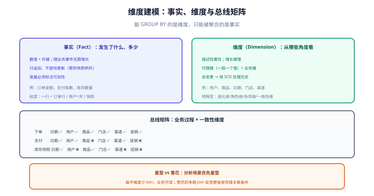

# 维度建模

维度建模（Dimensional Modeling）的核心思想只有一句：**把可分析的世界拆成「发生了什么」（事实）与「从哪些角度看」（维度）**。它牺牲了一部分范式上的纯净，换来业务人员能看懂、查询能跑得快。



## 事实与维度怎么分

| | 事实（Fact） | 维度（Dimension） |
| --- | --- | --- |
| 回答 | 发生了什么、多少 | 谁、什么、何时、何地、如何 |
| 形态 | 数值 + 外键 | 描述性文本/属性 |
| 增长 | **随业务事件无限增长** | 增长缓慢（几万~几百万行） |
| 变更 | 只追加，不 UPDATE | 会变更（需 SCD 处理） |
| 示例 | 订单金额、支付笔数、库存数量 | 用户、商品、门店、日期、渠道 |

### 一条判定规则

问自己：**「这个词能出现在 `GROUP BY` 里，还是只能出现在 `SUM/COUNT` 里？」**

- 能 `GROUP BY`（用户、商品、日期）→ 维度
- 只能被聚合（金额、数量、次数）→ 事实
- 既想 `GROUP BY` 又想聚合（如「订单号」）→ 它通常是**退化维**（放在事实表里的单列维度）

## 建模四步法

Kimball 的四步法是一个可以直接照做的顺序，**顺序不能颠倒**：

1. **选择业务过程**：不是选「部门」，而是选「事件」——下单、支付、发货、退款。
2. **声明粒度**：一行事实代表什么？**这是最重要的一步**（见 [粒度与聚合](../Grain/index.md)）。
3. **确定维度**：围绕这个粒度，业务会从哪些角度切？写进总线矩阵。
4. **确定度量**：这些角度下要算哪些数？并标注**可加 / 半可加 / 不可加**。

::: danger 最常见的顺序错误
先想「我要哪些指标」再定粒度。这样建出来的事实表会**一个指标一列**、粒度混乱：
「支付金额」在最细粒度上可加，但「支付率」是派生指标（支付笔数 / 下单笔数），
把它直接存进明细表，既无法下钻也无法回溯。**指标应该由粒度上的度量推导，而不是反之。**
:::

## 总线矩阵：一致性维度的落地工具

总线矩阵（Bus Matrix）是一张「业务过程 × 维度」的表格，每一行是一个业务过程，每一列是一个**一致性维度**，打勾表示该过程需要这个维度。

| 业务过程 | 日期 | 用户 | 商品 | 门店 | 渠道 | 促销 |
| --- | --- | --- | --- | --- | --- | --- |
| 下单 | ✅ | ✅ | ✅ | ✅ | ✅ | ✅ |
| 支付 | ✅ | ✅ | ❌ | ✅ | ✅ | ❌ |
| 发货 | ✅ | ✅ | ✅ | ✅ | ❌ | ❌ |
| 退款 | ✅ | ✅ | ✅ | ✅ | ❌ | ❌ |
| 库存快照 | ✅ | ❌ | ✅ | ✅ | ❌ | ❌ |

**它的价值在于「一致性维度」**：矩阵里同一列（如「日期」）在所有过程中**必须是同一张维度表、同一套属性**。这样「按渠道看下单与支付」才能对得上——否则下单用渠道 A 口径、支付用渠道 B 口径，两个数永远打架。

```sql [一致性维度：唯一的一份日期维度]
CREATE TABLE dim_date (
  date_sk     INT PRIMARY KEY,     -- 如 20261010
  date_day    DATE,
  year        INT,
  quarter     INT,
  month       INT,
  week        INT,
  is_weekend  TINYINT,
  is_holiday  TINYINT
);
```

::: tip 一致性维度是「治理」而非「技术」
技术上新加一列很容易，难的是**所有业务过程同时改**。所以维度属性的变更要走统一的评审——
这也是为什么总线矩阵应当作为**跨团队文档**维护，而不是某个人的 SQL 文件。
:::

## 星型模型与雪花模型

| | 星型（Star） | 雪花（Snowflake） |
| --- | --- | --- |
| 结构 | 事实表直接连**扁平**的维度表 | 维度表再规范化，拆出子维度 |
| 查询 Join 层数 | 1 层 | 2~n 层 |
| 冗余 | 有（维度属性冗余在多个事实表） | 低 |
| 可理解性 | 高（业务人员能直接看懂） | 低 |
| 维度维护 | 改一次要刷所有引用 | 改子维表即可 |
| 适用 | **分析场景的主流选择** | 维度层级极深、存储成本敏感 |

```sql [星型：一张商品维度装下所有属性]
CREATE TABLE dim_sku (
  sku_sk      BIGINT PRIMARY KEY,     -- 代理键
  sku_id      VARCHAR(64),            -- 业务键
  sku_name    VARCHAR(200),
  category_l1 VARCHAR(64),            -- 类目一级（扁平化）
  category_l2 VARCHAR(64),
  category_l3 VARCHAR(64),
  brand_name  VARCHAR(64),
  start_dt    DATE,                   -- SCD2 版本
  end_dt      DATE,
  is_current  TINYINT
);
```

**为什么主流选星型**：分析查询的瓶颈在扫描与 Join，扁平维度把「类目三层」压在一行里，省掉两次 Join；而维度表的冗余（类目名重复）在列存与压缩下代价很小。

::: warning 雪花不是「更规范所以更好」
数仓的规范性判据不是「冗余多少」，而是「**查询是否可预期、口径是否唯一**」。
雪花模型在多跳 Join 下容易写错关联条件（少一个 `is_current = 1` 就重复计数），反而增加出错概率。
:::

## 与业务库建模的边界

| 场景 | 用什么模型 | 为什么 |
| --- | --- | --- |
| 订单、支付等**在线交易表** | 规范化（3NF） | 保证写入正确性、避免更新异常（见 [数据建模](../../DataModeling/index.md)） |
| 面向分析的**事实明细** | 维度建模（星型） | 查询可预测、业务可理解 |
| 需要长期原样留痕的**集成层** | Data Vault | 抗源系统变化、可重放（见 [概述](../Overview/index.md)） |

**同一个业务过程可以有两种形态并存**：业务库里是 3NF 的 `order` 表，数仓里是星型的 `dwd_trade_order_detail`——它们服务的目标不同，不是重复建设。

## 易错点与最佳实践

::: danger 高频坑
1. **粒度没定清楚就建表**：一行到底是订单还是订单行？混着放会让所有金额都不可加。
2. **维度属性直接塞进事实表**：把 `province_name` 放进事实表，省份改名时历史数据无法统一。
3. **没有一致性维度**：每个主题各建一套「日期」「用户」，跨主题分析时对不上。
4. **雪花拆得太细**：为了「规范」把维度拆成五层，查询要 Join 六次，收益为负。
5. **事实表更新历史行**：违背不可变性，补数后与历史快照对不上。
:::

::: tip 最佳实践
1. **先画总线矩阵再建表**：矩阵是模型的地图，缺了它就会出现「各建各的维度」。
2. **粒度声明写进表注释与元数据**：`COMMENT '一行 = 一个订单行'`，让后来者不用猜。
3. **一致性维度用同一份代理键**：`dim_user.user_sk` 在订单、支付、退款事实表里必须指向同一张维表。
4. **给每张事实表配一条「粒度断言」SQL**（见下方验证方式），纳入日常巡检。
:::

## 验证方式

```sql [1. 粒度断言：事实表必须唯一到声明的粒度]
SELECT COUNT(*) AS total, COUNT(DISTINCT order_id) AS uniq_order
FROM dwd_trade_order_detail WHERE order_dt = '2026-10-10';
-- 若声明「一行 = 一个订单行」，则应按 (order_id, sku_id) 唯一：
SELECT COUNT(*) AS total, COUNT(DISTINCT CONCAT(order_id, '-', sku_id)) AS uniq_line
FROM dwd_trade_order_detail WHERE order_dt = '2026-10-10';
-- 预期：total = uniq_line
```

```sql [2. 一致性维度检查：同一维度在各事实表中的键域必须一致]
SELECT
  (SELECT COUNT(DISTINCT user_sk) FROM dwd_trade_order_detail WHERE order_dt='2026-10-10') AS order_users,
  (SELECT COUNT(DISTINCT user_sk) FROM dwd_trade_pay_detail  WHERE pay_dt ='2026-10-10') AS pay_users;
-- 两者可以不等（未支付订单的用户只在下单侧），但两边用的必须是同一套 user_sk 口径：
-- 抽样一条 sku_sk/user_sk，去 dim_user / dim_sku 必须能查到，查不到即为不一致。
```

```text [3. 总线矩阵覆盖率]
对每个业务过程，检查其事实表是否具备矩阵中打勾的全部维度外键；
缺任何一个 → 该过程无法按该维度分析，矩阵与模型已经脱节。
```

## 参考资料

- [Kimball：Dimensional Modeling Techniques](https://www.kimballgroup.com/data-warehouse-business-intelligence-resources/kimball-techniques/dimensional-modeling-techniques/)
- [Kimball：The Bus Matrix](https://www.kimballgroup.com/data-warehouse-business-intelligence-resources/kimball-techniques/kimball-architecture-concepts/)
- 本库相邻专题：[事实表与维度表设计](../FactAndDimension/index.md)、[缓慢变化维与拉链表](../SCD/index.md)、[数据建模](../../DataModeling/index.md)
