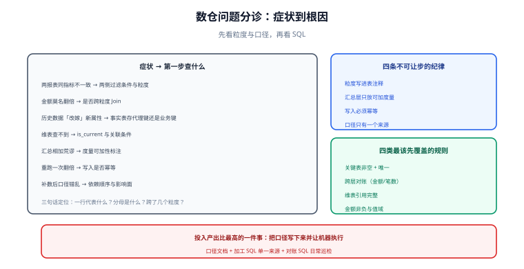

# 常见问题与最佳实践

数仓的问题大多不在语法，而在**语义**：口径不一致、粒度说不清、历史对不上。这一页先给一张按症状分诊的表，再逐条回答高频问题。

## 先分诊

| 症状 | 第一步查什么 | 常见根因 | 去哪一页 |
| --- | --- | --- | --- |
| 两个报表同一指标数不一致 | 两侧的过滤条件与粒度 | 口径各自定义、粒度不同 | [概述](../Overview/index.md) |
| 金额莫名翻倍 | 是否跨粒度 Join | 汇总表与明细表混用 | [粒度与聚合](../Grain/index.md) |
| 历史数据「改嫁」到新属性 | 事实表存的是代理键还是业务键 | 代理键复用（SCD2 做错） | [缓慢变化维](../SCD/index.md) |
| 同一商品在维表里查不到 | `is_current` 与关联条件 | 漏 `is_current = 1` 或维表晚到 | [事实表与维度表设计](../FactAndDimension/index.md) |
| 汇总层相加得到荒谬结果 | 度量可加性标注 | 比率/去重数被当成可加 | [事实表与维度表设计](../FactAndDimension/index.md) |
| 重跑一次数据翻倍 | 写入是否幂等 | 直接追加而非覆盖分区 | [数据质量、血缘与调度](../Quality/index.md) |
| 补数后口径错乱 | 依赖顺序与影响面 | 血缘缺失、只补了一张表 | [数据质量、血缘与调度](../Quality/index.md) |

::: danger 一条纪律
**先看粒度与口径，再看 SQL。** 数仓 80% 的「数不对」都能用三句话定位：
① 这张表一行代表什么？② 这个指标的分母是什么？③ 这条查询跨了几个粒度？
跳过这三问直接读 SQL，通常会在几百行代码里迷路。
:::

## 高频十二问

### 1. 数仓和数据库有什么区别？

数据库（OLTP）负责「把眼前这笔业务记准」，数仓负责「让过去所有业务都能被重新解释」。前者规范化写入、后者反规范化分析，目标不同（见 [概述](../Overview/index.md)）。

### 2. 一定要分层吗？不分层行不行？

小规模（几张表、一个业务源）可以简化，但**只要出现两个以上消费方，就必须分层**：分层的作用不是好看，而是把「口径」收敛到少数几处，并让血缘可维护。中间层可以少（如只留 ODS/DWD/ADS），但依赖方向不能乱。

### 3. 维度建模和范式建模到底选哪个？

分析场景优先维度建模（可理解、查询快）；多源整合且监管要求高时，集成层用范式或 Data Vault，再向外派生维度模型。**两者不是互斥，常见组合是「集成层范式 + 集市层维度」**。

### 4. 事实表要不要存代理键？

**要**。事实表存代理键，与维表按等值关联；只存业务键会退化成范围关联（`>= start_dt AND < end_dt`），既慢又易错（见 [缓慢变化维](../SCD/index.md)）。

### 5. 订单级优惠怎么落到订单行？

按金额比例分摊（`item_amount / SUM(item_amount) OVER (PARTITION BY order_id)`），并校验「分摊后之和 = 订单级优惠」。分位差按最大余额行修正（见 [粒度与聚合](../Grain/index.md)）。

### 6. 为什么不能直接把比率存进汇总表？

比率不可加：三个月的支付率相加没有意义。正确做法是存**分子与分母**，由上层现算。同理，去重类指标（买家数、活跃用户数）也不能跨天相加。

### 7. 拉链表会不会越来越大？

会（一个实体改 N 次就有 N 行）。缓解手段：只对**需要追溯的属性**做 SCD2，其余用 SCD1 覆盖；并对 `(业务键, start_dt, end_dt)` 建索引，优先走代理键等值关联。

### 8. 什么时候该建预聚合表？

满足「高频查询 + 扫描量远大于结果集 + 维度组合稳定」三条中的两条以上才值得；反之直查明细更划算（见 [粒度与聚合](../Grain/index.md)）。

### 9. T+1 批处理够用吗？什么时候上实时？

先问业务：**看到昨天的数够不够？** 绝大多数经营分析与财务口径都是 T+1。实时（流式）只用于监控、风控、实时推荐等**分钟级决策**场景，且必须单独建设、单独定义口径。

### 10. 数据质量规则要写多少条？

不要追求全覆盖，先覆盖**最贵的四类**：关键表的非空与唯一、跨层对账、维表引用完整、金额非负。这四类能拦住绝大多数严重事故（见 [数据质量、血缘与调度](../Quality/index.md)）。

### 11. 口径变了，历史数据要不要重刷？

要。口径变更必须**同步回刷历史**，否则新老口径混在一起，趋势图会出现假的断层。回刷走「影响分析 → 按拓扑序补数 → 对账」三步，并在补数窗口冻结下游展示。

### 12. 数仓团队最该做的一件事是什么？

**把口径写下来并让机器执行。** 建表容易、写 SQL 容易，难的是让所有人对「GMV 是什么」有同一个答案——口径文档 + 加工 SQL 单一来源 + 对账 SQL 日常巡检，是投入产出比最高的组合。

## 上线自查清单

| # | 检查项 | 通过判据 |
| --- | --- | --- |
| 1 | 每张表的粒度有明确声明 | 表注释含「一行 = ...」 |
| 2 | 命名符合层级与粒度规范 | 正则校验 0 违规 |
| 3 | 依赖方向无环 | 拓扑排序可完成 |
| 4 | 事实表键完整 | 孤儿外键 0 行 |
| 5 | 维表当前版本唯一 | 每业务键最多 1 个 `is_current = 1` |
| 6 | 度量可加性已标注 | 汇总层只含可加度量 |
| 7 | 跨层对账通过 | DWD/DWS/ADS 金额一致 |
| 8 | 任务幂等 | 同 `bizdate` 重跑结果不变 |
| 9 | 质量规则接入调度 | E 级规则失败即阻断发布 |
| 10 | 血缘可递归查询 | 向上一路能追到 ODS |

## 最佳实践十二条

1. **粒度先定，且写进注释**——它是最不可逆的决策。
2. **事实表只存代理键**，与维表等值关联。
3. **汇总层只放可加度量**，比率与去重数交给上层。
4. **口径只有一个来源**，加工 SQL 与文档同源。
5. **分层依赖只能向上**，反向引用会让血缘成环。
6. **写入必须幂等**（覆盖分区或按主键合并）。
7. **分区键用业务日期**，不用装载日期。
8. **历史变化用 SCD2 表达**，不就地改历史事实。
9. **关键链路配对账 SQL**，每次产出都验一遍。
10. **质量规则要跑起来**，绑定负责人与阻断级别。
11. **补数按拓扑序**，并冻结下游展示。
12. **宽表不是银弹**：字段越多、变更越贵，只在维度稳定时用宽表。

## 参考资料

- [Kimball：Dimensional Modeling Techniques](https://www.kimballgroup.com/data-warehouse-business-intelligence-resources/kimball-techniques/dimensional-modeling-techniques/)
- [dbt：Best practices](https://docs.getdbt.com/best-practices)
- [Apache Airflow：DAG 与依赖](https://airflow.apache.org/docs/apache-airflow/stable/core-concepts/dags.html)
- 本库相邻专题：[数据建模](../../DataModeling/index.md)、[ClickHouse](../../ClickHouse/index.md)、[数据同步与 CDC](../../CDC/index.md)
