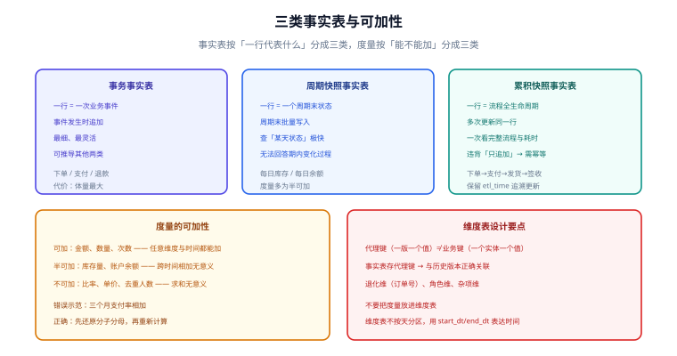

# 事实表与维度表设计

维度建模的骨架由两类表撑起来：**事实表存「多少」，维度表存「从哪看」**。这一页把两者的设计要点讲透——尤其是事实表的三种类型与度量的可加性，这两处是最容易埋下「数算错了却查不出来」的地方。



## 事实表的三种类型

| 类型 | 一行代表 | 何时写入 | 典型场景 | 优点 | 代价 |
| --- | --- | --- | --- | --- | --- |
| **事务事实表**（Transaction） | 一次业务事件 | 事件发生时追加 | 下单、支付、退款、点击 | 最细、最灵活，可推导其他两类 | 体量最大 |
| **周期快照事实表**（Periodic Snapshot） | 一个周期末的状态 | 周期末批量写入 | 每日库存、每日账户余额 | 查询「某天状态」极快 | 无法回答周期内的变化过程 |
| **累积快照事实表**（Accumulating Snapshot） | 一个流程的全生命周期 | **多次更新同一行** | 订单履约（下单→支付→发货→签收） | 一次查询看完整流程与各阶段耗时 | 需要更新历史行，违背「只追加」 |

```sql [事务事实表：只追加，粒度 = 订单行]
CREATE TABLE dwd_trade_order_detail (
  order_id     BIGINT,
  order_line   INT,              -- 订单行号，与 order_id 一起构成粒度
  user_sk      BIGINT,
  sku_sk       BIGINT,
  channel_sk   BIGINT,
  order_amount DECIMAL(18,2),    -- 可加
  discount_amt DECIMAL(18,2),    -- 可加
  pay_amount   DECIMAL(18,2),    -- 可加
  order_dt     VARCHAR(10),
  etl_time     DATETIME
) PARTITIONED BY (order_dt);
```

```sql [周期快照事实表：一行 = 商品 × 天，存量语义]
CREATE TABLE dws_item_stock_1d (
  stat_dt      VARCHAR(10),
  sku_sk       BIGINT,
  warehouse_sk BIGINT,
  stock_qty    BIGINT,           -- 半可加：按天可加、跨天不可加
  locked_qty   BIGINT,
  etl_time     DATETIME
) PARTITIONED BY (stat_dt);
```

```sql [累积快照事实表：一行 = 订单，随流程推进更新]
CREATE TABLE dwd_trade_order_fulfillment (
  order_id     BIGINT PRIMARY KEY,
  user_sk      BIGINT,
  create_time  DATETIME,   -- 下单
  pay_time     DATETIME,   -- 支付
  ship_time    DATETIME,   -- 发货
  receive_time DATETIME,   -- 签收
  order_amount DECIMAL(18,2),
  -- 派生：各阶段耗时（天/小时），用来自动化监控履约时效
  pay_hours    DECIMAL(10,2),
  ship_hours   DECIMAL(10,2),
  etl_time     DATETIME
) PARTITIONED BY (order_dt);
```

::: warning 累积快照是「有意的例外」
它需要 `UPDATE` 历史行（订单支付后回填 `pay_time`），这违背了事实表「只追加」的一般纪律。
因此必须额外做两件事：① 用**幂等写入**（按 `order_id` 覆盖）避免重复投递造成错乱；② 保留 `etl_time`，否则无法判断某行是什么时候被更新的。
:::

## 度量的可加性

这是数仓最容易出错的一类语义问题，必须在建模时就标注清楚：

| 类型 | 定义 | 例子 | 跨维度相加 | 跨时间相加 |
| --- | --- | --- | --- | --- |
| **可加**（Additive） | 任意维度求和都有意义 | 金额、数量、次数 | ✅ | ✅ |
| **半可加**（Semi-additive） | 部分维度可加 | 库存量、账户余额 | ✅ | ❌（日余额相加无意义） |
| **不可加**（Non-additive） | 求和无意义 | 比率、单价、去重人数 | ❌ | ❌ |

```sql [错误示范：把不可加度量当可加度量算]
-- ❌ 三个月的「支付率」相加 → 得到一个毫无意义的数
SELECT SUM(pay_rate) FROM dws_trade_channel_1m WHERE month IN ('2026-08','2026-09','2026-10');

-- ✅ 比率必须「先还原分子分母，再重新计算」
SELECT SUM(pay_order_cnt) * 1.0 / SUM(order_cnt) AS pay_rate
FROM dws_trade_channel_1m WHERE month IN ('2026-08','2026-09','2026-10');

-- ❌ 三个月的「去重买家数」相加 → 会把复购用户算两次
SELECT SUM(buyer_cnt) FROM dws_trade_user_1d WHERE stat_dt BETWEEN '2026-08-01' AND '2026-10-31';

-- ✅ 去重计数要么从明细重算，要么用可合并的近似结构
SELECT COUNT(DISTINCT user_sk) FROM dwd_trade_order_detail
WHERE order_dt BETWEEN '2026-08-01' AND '2026-10-31';
```

::: tip 落地做法
在汇总层只放**可加度量**（金额、件数）；比率与去重计数放到 ADS，或提供「分子/分母」两列由上层计算。
如果确实需要在 DWS 存去重结果，用**可合并的近似结构**（如 Bitmap、HLL），并在表注释里写清「不可直接相加」。
:::

## 维度表设计要点

### 代理键（Surrogate Key）

维度表的主键应当是**与业务无关的自增/哈希键**，而不是业务主键：

| 键 | 用途 | 为什么不能混用 |
| --- | --- | --- |
| 业务键（`sku_id`） | 对应源系统的标识 | 源系统可能改键、可能多源冲突 |
| 代理键（`sku_sk`） | 事实表外键，标识**某个版本**的维度行 | 与 SCD2 配合，才能让历史事实指向「当时那一版」属性 |

```sql [代理键 + SCD2 版本列]
CREATE TABLE dim_sku (
  sku_sk     BIGINT PRIMARY KEY,   -- 代理键：一个版本一个值
  sku_id     VARCHAR(64),          -- 业务键：一个商品一个值（版本间相同）
  sku_name   VARCHAR(200),
  category_l1 VARCHAR(64),
  start_dt   DATE,
  end_dt     DATE,
  is_current TINYINT
);
```

### 几种特殊维度

| 类型 | 说明 | 例子 |
| --- | --- | --- |
| **退化维**（Degenerate） | 放在事实表里的单列，没有独立维表 | `order_id`、`trade_no` |
| **角色维**（Role-playing） | 同一次事实里多次引用同一维表，用视图区分角色 | 订单里「下单人」「支付人」「收货人」都用 `dim_user` 的不同视图 |
| **杂项维**（Junk） | 把一堆小标志位合成一个维度，避免事实表列爆炸 | `is_gift`、`is_first_order`、`is_refund` 合成 `junk_order_flag` |
| **一致性维**（Conformed） | 跨多个事实表共用的同一套维度 | `dim_date`、`dim_user` |
| **缓慢变化维**（SCD） | 会随时间变化的维度 | 见 [缓慢变化维与拉链表](../SCD/index.md) |

```sql [杂项维：把多个小标志位合成一张小表]
CREATE TABLE dim_order_junk (
  junk_sk      BIGINT PRIMARY KEY,
  is_first_order TINYINT,
  is_gift        TINYINT,
  is_presale     TINYINT,
  is_refund      TINYINT
);
-- 事实表只需存一个 junk_sk，而不是四个标志位列
```

::: danger 维度表设计的三个坑
1. **不要用业务键做代理键**：源系统主键变更时，历史事实的外键会批量失效。
2. **不要把度量放进维度表**：维度表是「描述」，放进金额会让「维度快照」变成「第二个事实表」，两处口径必然打架。
3. **不要给维度表加分区**：维度用 `start_dt/end_dt` 表达时间，按天分区会让同一实体的多个版本散落在不同分区，查询必须扫全部分区。
:::

## 事实表 vs 维度表的自检

| 检查项 | 事实表 | 维度表 |
| --- | --- | --- |
| 行数增长 | 随业务事件增长 | 缓慢（除非 SCD 频繁变更） |
| 是否更新 | 只追加（累积快照除外） | 会新增版本行 |
| 主键 | 复合键（维度外键 + 退化维） | 单一代理键 |
| 列的特征 | 数值为主 + 外键 | 文本属性为主 |
| 典型操作 | `SUM` / `COUNT` | `GROUP BY` / `JOIN` |

## 验证方式

```sql [1. 事实表粒度唯一性]
SELECT COUNT(*) AS total,
       COUNT(DISTINCT CONCAT(order_id, '-', order_line)) AS uniq_rows
FROM dwd_trade_order_detail WHERE order_dt = '2026-10-10';
-- 预期：total = uniq_rows
```

```sql [2. 外键完整性：事实表的维度键必须都能在维表找到]
SELECT COUNT(*) AS orphan_rows
FROM dwd_trade_order_detail f
LEFT JOIN dim_sku s ON f.sku_sk = s.sku_sk
WHERE s.sku_sk IS NULL AND f.order_dt = '2026-10-10';
-- 预期：0
```

```sql [3. 半可加度量不得跨时间求和（用判据替代人工检查）]
-- 抽查：同一 sku 连续两天库存相加是否符合业务预期？若不符合，说明它必须标为半可加
SELECT sku_sk, stat_dt, stock_qty FROM dws_item_stock_1d
WHERE sku_sk = 1001 ORDER BY stat_dt DESC LIMIT 5;
```

## 参考资料

- [Kimball：Fact Table Types](https://www.kimballgroup.com/data-warehouse-business-intelligence-resources/kimball-techniques/dimensional-modeling-techniques/fact-table/)
- [Kimball：Dimension Table Techniques](https://www.kimballgroup.com/data-warehouse-business-intelligence-resources/kimball-techniques/dimensional-modeling-techniques/dimension/)
- 本库相邻专题：[维度建模](../DimensionalModeling/index.md)、[缓慢变化维与拉链表](../SCD/index.md)、[粒度与聚合设计](../Grain/index.md)
