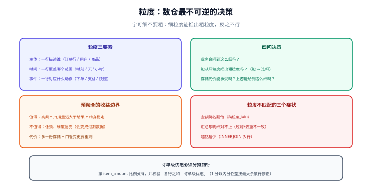

# 粒度与聚合设计

粒度（Grain）是数仓里**最重要、也最不可逆**的一个决策：它回答「事实表的一行到底代表什么」。粒度定错了，后面所有的指标、所有的 Join、所有的汇总都会带着这个错误跑下去——而改粒度等于重建整条链路。



## 粒度由三件事共同确定

一个完整的粒度声明必须回答三个问题：

| 要素 | 问题 | 例 |
| --- | --- | --- |
| **主体** | 一行描述谁？ | 订单行 / 用户 / 商品 / 门店 |
| **时间** | 一行覆盖哪个时间范围？ | 下单时刻 / 一天 / 一小时 |
| **事件** | 一行对应一次什么动作？ | 下单 / 支付 / 库存快照 |

```text
完整声明：dwd_trade_order_detail 一行 = 一笔订单中的一个商品行，时间 = 下单时刻，事件 = 下单
模糊声明：dwd_trade_order 一行 = 订单相关数据（到底含不含订单行？金额能不能加？）
```

::: tip 把粒度写进表注释
`COMMENT '一行 = 一个订单行（order_id + order_line）'`。这句话看起来像废话，但它是三个月后接手的人唯一能确定「这个 SUM 对不对」的依据。
:::

## 粒度选择：四问决策

1. **业务会不会问到这么细？** 会问「哪个商品卖得好」，就必须保留商品行粒度，不能只存到订单粒度。
2. **能不能从细粒度推出粗粒度？** 能。所以**宁可细，不要粗**——粗粒度无法反推细节。
3. **细粒度的存储代价能承受吗？** 这是唯一的反向约束（见下文成本）。
4. **上游能提供这么细的数据吗？** 源头只有日汇总，就不要假装建模到小时。

| 需求 | 建议粒度 | 说明 |
| --- | --- | --- |
| 商品销量分析 | 订单行（订单 × 商品） | 只到订单粒度就丢了商品明细 |
| 用户行为漏斗 | 事件级（一次行为一行） | 漏斗必须按事件序列算 |
| 每日库存监控 | 商品 × 仓库 × 天 | 快照语义，不是事件 |
| 财务对账 | 支付流水级（一笔支付一行） | 金额必须能逐笔追溯 |

## 粒度与可加性的连锁反应

粒度决定了哪些度量可加：

| 粒度 | 度量 | 可加性 |
| --- | --- | --- |
| 订单行 | `pay_amount` | 可加（行到订单到天都能加） |
| 订单行 | `order_discount` | **半可加**：订单级优惠分摊到行才可加，否则按行求和会重复 |
| 订单 | `order_amount` | 可加 |
| 用户 × 天 | `buyer_cnt` | 不可加（跨天去重） |

**订单级优惠是经典陷阱**：一笔订单减 20 元，若订单有 3 个商品行，直接在每个行上记 20 元优惠，三行加起来就是 60 元。正确做法是**按金额比例分摊到行**，并在表里同时保留「分摊后优惠」与「订单级原始优惠」两列。

```sql [按金额比例分摊订单级优惠]
SELECT
  order_id, sku_id,
  order_amount,
  ROUND(order_discount * order_amount
        / SUM(order_amount) OVER (PARTITION BY order_id), 2) AS line_discount
FROM dwd_trade_order_detail;
-- 校验：同一订单的 line_discount 之和必须等于订单级 order_discount（分位差需按最大余额行修正）
```

## 预聚合：什么时候值得

预聚合（把明细提前算成汇总）是数仓性能的主要来源，但**它有明确的收益边界**：

| 维度 | 明细直算 | 预聚合 |
| --- | --- | --- |
| 查询延迟 | 与数据量成正比 | 稳定且低 |
| 存储 | 1 份明细 | 明细 + N 份汇总 |
| 灵活性 | 任意维度都能切 | **只能切预聚合里有的维度** |
| 口径变更 | 改 SQL 即可 | 需要重刷所有汇总 |

**决策判据**：一条查询满足下面三条中的两条以上，就值得为它建汇总表。

1. 被**高频**查询（每天几十次以上，或仪表盘固定刷新）；
2. 扫描的数据量**远大于**结果集（如扫 1 亿行出 100 行）；
3. 涉及的维度组合**稳定**（不会天天加新维度）。

反之，**低频 + 维度易变**的查询应该直查明细层——多建一张汇总表，往往就是多一份会过期、会不一致的数据。

```sql [DWS 汇总：只放可加度量，维度取最常用的组合]
CREATE TABLE dws_trade_user_1d (
  user_sk     BIGINT,
  stat_dt     VARCHAR(10),
  order_cnt   BIGINT,            -- 可加
  order_amt   DECIMAL(18,2),     -- 可加
  pay_cnt     BIGINT,            -- 可加
  pay_amt     DECIMAL(18,2),     -- 可加
  etl_time    DATETIME
) PARTITIONED BY (stat_dt);
-- 注意：这里没有「支付率」「客单价」「去重买家数」——它们是派生或不可加度量，
-- 应当由上层用这些分子分母现算，而不是预先算好存进来。
```

## 上卷、下钻与粒度不匹配

```sql [上卷：日到月，直接 SUM（因为度量可加）]
SELECT SUBSTR(stat_dt, 1, 7) AS month,
       SUM(order_amt) AS order_amt,
       SUM(pay_amt)   AS pay_amt
FROM dws_trade_user_1d
GROUP BY SUBSTR(stat_dt, 1, 7);
```

```sql [错误示范：两表粒度不同却直接 JOIN]
-- 错误：日汇总表 JOIN 月汇总表，一行日会被月行放大，金额虚高
SELECT * FROM dws_trade_user_1d d JOIN dws_trade_user_1m m ON d.user_sk = m.user_sk;

-- 正确：要么统一到同一粒度，要么先各自聚合再关联
SELECT d.stat_dt, d.order_amt, m.order_amt AS month_amt
FROM dws_trade_user_1d d
JOIN (SELECT user_sk, order_amt FROM dws_trade_user_1m WHERE stat_month = '2026-10') m
  ON d.user_sk = m.user_sk
WHERE d.stat_dt = '2026-10-10';
```

::: danger 粒度不匹配的三个典型症状
1. **金额莫名翻倍**：两表粒度不同直接 Join，或汇总表与明细表混用。
2. **统计口径对不上**：DWS 与 DWD 汇总值不等，通常是某侧多加了过滤条件或漏了去重。
3. **越钻越少**：下钻到明细后发现总数变少，说明汇总时用了 `INNER JOIN` 把无维度匹配的行丢掉了（应视业务用 `LEFT JOIN` 或补默认维度行）。
:::

## 成本：细粒度不是免费的

```text
存储 ≈ 行数 × 每行字节数 × 压缩比⁻¹ × 保留天数

例：明细表一行 200 字节、日增 5000 万行、保留 3 年（1095 天）
    原始 ≈ 200 × 5e7 × 1095 ≈ 1.1e13 字节 ≈ 10 TB
    列存 + 压缩（按 5:1）≈ 2 TB
```

三条降低成本的常规手段（按优先级）：

1. **缩列**：明细表只保留分析需要的列，宽字段（JSON、长文本）拆到扩展表；
2. **降保留**：ODS 短保留（可重放），DWD 长保留（不可再生）；
3. **分区裁剪**：所有查询必须带分区条件，否则全表扫描会把成本放大几十倍。

## 验证方式

```sql [1. 粒度唯一性断言]
SELECT COUNT(*) AS total, COUNT(DISTINCT CONCAT(user_sk, '-', stat_dt)) AS uniq_rows
FROM dws_trade_user_1d WHERE stat_dt = '2026-10-10';
-- 预期：total = uniq_rows
```

```sql [2. 汇总层与明细层对账（口径一致性）]
SELECT
  (SELECT SUM(pay_amount) FROM dwd_trade_order_detail WHERE order_dt = '2026-10-10') AS dwd_amt,
  (SELECT SUM(pay_amt)    FROM dws_trade_user_1d       WHERE stat_dt  = '2026-10-10') AS dws_amt;
-- 预期：两个数完全相等（不等即为口径或过滤条件不一致）
```

```sql [3. 分摊类度量的守恒检查]
SELECT order_id,
       SUM(line_discount) AS sum_line,
       MAX(order_discount) AS order_level
FROM dwd_trade_order_detail
WHERE order_dt = '2026-10-10'
GROUP BY order_id
HAVING ABS(SUM(line_discount) - MAX(order_discount)) > 0.01;
-- 预期：0 行（允许 1 分以内的分位差，需有明确的余额行规则）
```

## 参考资料

- [Kimball：Declaring the Grain](https://www.kimballgroup.com/data-warehouse-business-intelligence-resources/kimball-techniques/dimensional-modeling-techniques/)
- [dbt：Materializations（明细与聚合的工程化取舍）](https://docs.getdbt.com/docs/build/materializations)
- 本库相邻专题：[事实表与维度表设计](../FactAndDimension/index.md)、[数仓分层设计](../Layering/index.md)、[SQL 优化](../../Relational/SQLOptimization/index.md)
