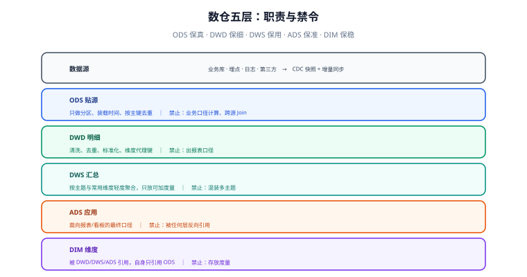

# 分层设计

分层不是「多建几张表」，而是**用层级约束把复杂度关在笼子里**：每一层只解决一类问题，出了问题能快速定位，口径只在少数几处定义。本页给出五层的职责、禁令、命名与分区规范。



## 五层职责与禁令

| 层 | 全称 | 职责 | 典型加工 | **禁止** |
| --- | --- | --- | --- | --- |
| **ODS** | Operational Data Store，贴源层 | 与源系统结构一致地落地，保留原始细节 | 建分区、加 `etl_time`、去重（按主键保留最新） | 业务口径计算、跨源 Join、改字段含义 |
| **DWD** | Data Warehouse Detail，明细层 | 一份干净的、事务粒度的事实明细 | 清洗、类型统一、维度代理键、金额单位统一 | 出报表口径、做跨主题混合汇总 |
| **DWS** | Data Warehouse Summary，汇总层 | 按主题与常用维度做轻度聚合 | 按 `用户×天`、`商品×天` 汇总可加度量 | 混装多个主题、放不可加度量 |
| **ADS** | Application Data Store，应用层 | 面向具体报表/看板/接口的最终结果 | 口径加工、维表关联、指标拼装 | **被其他层反向引用** |
| **DIM** | Dimension，维度层 | 跨层共用的维度属性与历史版本 | 代理键、SCD 版本、层级属性 | 存放度量指标 |

::: tip 一句话记法
**ODS 保真、DWD 保细、DWS 保用、ADS 保准、DIM 保稳。**
:::

## 依赖方向：只能向上，不能向下

```text
源系统 → ODS → DWD → DWS → ADS
                  ↖     ↖
                   DIM（被 DWD/DWS/ADS 引用，自己只引用 ODS）
```

**规则**：低层不得引用高层。DWD 不能读 DWS，DWS 不能读 ADS。

违反这条规则会带来两个直接后果：

1. **血缘成环**：补数时无法确定重算顺序（先算谁？）；
2. **口径污染**：高层的临时口径反向流入明细层，明细层不再「细而干净」。

**落地检查**：把每张表的直接上游写进元数据（或用 SQL 解析自动抽取），然后跑一次拓扑排序——**存在环就是有反向引用**。

## 命名规范

```text
{层}_{主题域}_{粒度/内容}[_{周期}]

ods_order                    贴源：源库表 order
dwd_trade_order_detail       明细：交易域订单行明细
dws_trade_user_1d            汇总：交易域 用户×天
ads_trade_overview_1d        应用：交易域大盘 天
dim_user                     维度：用户（含历史版本）
```

| 要素 | 规范 | 反例 |
| --- | --- | --- |
| 层级前缀 | 固定小写 `ods_` / `dwd_` / `dws_` / `ads_` / `dim_` | `DWDOrder`、`order_detail_dwd` |
| 主题域 | 稳定英文单词（`trade` / `user` / `item`） | `dingdan`、`tmp1` |
| 粒度后缀 | `_detail`（明细）/ `_1d`（天）/ `_1h`（小时）/ `_1m`（月） | 不写粒度（无法判断能不能直接相加） |
| 临时表 | `tmp_` 前缀 + 负责人 + 日期，**必须有清理策略** | `test`、`a1` |

**粒度后缀不是装饰**：看到 `_1d` 就知道这表一行是一天，不能与 `_detail` 表直接 Join 后再求和（会重复计数）。

## 分区与生命周期

| 层 | 常用分区 | 保留策略 |
| --- | --- | --- |
| ODS | 按天（`dt`），大表可加小时 | 短期（如 30~90 天）——它是可重放的，不需要永久 |
| DWD | 按天，必要时按业务日期 | 长期（1~3 年），它是**唯一可回溯的明细** |
| DWS | 按天 | 长期（汇总体量小） |
| ADS | 按天 | 按业务要求（如 3 年） |
| DIM | 不分区，用 `start_dt`/`end_dt` 表达时间 | 永久保留历史版本 |

::: warning 分区键要选「业务日期」而不是「装载日期」
写错分区键最典型的后果：**补数时把昨天的数据写进了今天的分区**，报表口径整体错位且很难发现。
正确做法是让分区键来自**数据的业务时间**（下单时间、支付时间），装载时间只作为表内的审计字段 `etl_time`。
:::

## 一个完整例子：订单域四层

```sql [ODS：贴源，只加分区与装载时间]
CREATE TABLE ods_order (
  order_id      BIGINT,
  user_id       BIGINT,
  status        VARCHAR(32),
  pay_amount    DECIMAL(18,2),
  create_time   DATETIME,
  update_time   DATETIME,
  dt            VARCHAR(10),      -- 业务日期分区
  etl_time      DATETIME          -- 装载时间（审计用）
) PARTITIONED BY (dt);
```

```sql [DWD：明细 + 代理键 + 清洗]
CREATE TABLE dwd_trade_order_detail (
  order_id      BIGINT,
  user_sk       BIGINT,           -- 指向 dim_user 的代理键
  sku_sk        BIGINT,
  status        VARCHAR(32),
  pay_amount    DECIMAL(18,2),    -- 统一为「元」，两位小数
  order_dt      VARCHAR(10),      -- 业务日期（下单日）
  etl_time      DATETIME
) PARTITIONED BY (order_dt);
```

```sql [DWS：用户×天 轻度汇总，只放可加度量]
CREATE TABLE dws_trade_user_1d (
  user_sk        BIGINT,
  stat_dt        VARCHAR(10),
  order_cnt      BIGINT,          -- 可加
  pay_amount     DECIMAL(18,2),   -- 可加
  etl_time       DATETIME
) PARTITIONED BY (stat_dt);
```

```sql [ADS：面向大盘的最终口径]
CREATE TABLE ads_trade_overview_1d (
  stat_dt        VARCHAR(10),
  gmv            DECIMAL(18,2),   -- 口径：已支付订单金额（不含退款）
  paid_order_cnt BIGINT,
  buyer_cnt      BIGINT,          -- 不可加：跨天去重人数
  etl_time       DATETIME
) PARTITIONED BY (stat_dt);
```

注意 `buyer_cnt` 被放在 ADS 而不是 DWS：**它是「去重计数」，跨天不能直接相加**——把不可加度量放在汇总层，等于给下游埋了一个「加出来是错的」的坑。

## 易错点与最佳实践

::: danger 高频坑
1. **ODS 里写业务逻辑**：源表结构一变就得改 ODS 加工，贴源层失去「可重放」的价值。
2. **DWD 不做去重**：CDC 日志或重复投递会让同一订单出现多行，下游全部翻倍。
3. **汇总层放不可加度量**：如「日活用户数」，跨天相加毫无意义（见 [粒度与聚合](../Grain/index.md)）。
4. **ADS 被反向引用**：某天 DWS 直接读 ADS，血缘成环，补数顺序无从确定。
5. **临时表没有生命周期**：`tmp_` 表堆积，磁盘被吃满，且没人敢删。
:::

::: tip 落地建议
1. **每层建一张「表清单」元数据**（表名 / 层 / 主题 / 粒度 / 上游 / 负责人 / 生命周期），用脚本校验命名与依赖方向。
2. **禁止跨层引用要机器检查**：人工评审会漏，用 SQL 解析或元数据依赖图自动判定。
3. **口径只写在 DWS/ADS 的加工里**，并配一条对账 SQL（与 DWD 汇总值比对）作为日常巡检。
:::

## 验证方式

```sql [1. 每层是否都有数据（分层没有空跑）]
SELECT layer, cnt FROM (
  SELECT 'ODS' AS layer, COUNT(*) AS cnt FROM ods_order
  UNION ALL SELECT 'DWD', COUNT(*) FROM dwd_trade_order_detail
  UNION ALL SELECT 'DWS', COUNT(*) FROM dws_trade_user_1d
  UNION ALL SELECT 'ADS', COUNT(*) FROM ads_trade_overview_1d
) t;
```

```text [2. 依赖方向是否合法（无环）]
把每张表的直接上游导出成边列表，跑拓扑排序：
  若无法排出完整顺序 → 存在环 → 有反向引用，必须改。
```

```sql [3. 命名是否合规（层级前缀 + 粒度后缀）]
SELECT table_name FROM information_schema.tables
WHERE table_schema = 'dw'
  AND table_name NOT REGEXP '^(ods|dwd|dws|ads|dim|tmp)_[a-z0-9_]+$';
-- 预期：0 行
```

预期：判据 1 四层行数符合粒度关系（ODS ≥ DWD；DWS 行数 = 用户数 × 天数）；判据 2 能排出完整顺序；判据 3 返回 0 行。

## 与数据治理专题的分工

分层是**数仓内部的结构**（哪一层放什么、依赖方向不许反向）；[数据治理入门](../../DataGovernance/index.md) 关心的是**这些层里产出的东西算不算资产、归谁、口径谁定**。两处容易被当成同一件事：

1. **「每层的职责」不等于「每张表的归属」**。ODS 放原始数据、DWD 放清洗后的明细——这是分层；而「`dwd_order_di` 这张表归谁、它出错时谁被叫起来」是治理。分层写得再清楚，**也不会自动产生一个责任人**。
2. **层与层之间的元数据不是同一种**。[元数据与资产目录](../../DataGovernance/Metadata/index.md) 把元数据分成技术 / 业务 / 操作三类：分层属于技术元数据的组织结构，而「这一层的口径边界」属于业务元数据，**只能靠人写下来**。

判断方法只有一句：**问「这一层放什么」→ 看本页；问「这张表谁负责、口径谁定」→ 看治理页。**

## 参考资料

- [dbt：How we structure our dbt projects](https://docs.getdbt.com/best-practices/how-we-structure/1-guide-overview)
- [Kimball：Data Warehouse Layering](https://www.kimballgroup.com/)
- 本库相邻专题：[数据同步与 CDC](../../CDC/index.md)、[ClickHouse](../../ClickHouse/index.md)、[数据建模](../../DataModeling/index.md)
