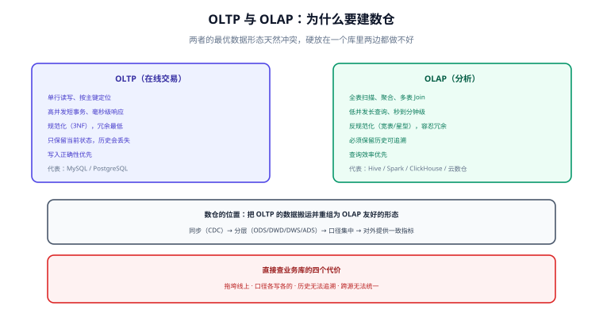

# 概述：数仓全景与四种建模方法论

数仓不是「另一个数据库」，而是一条**从业务库到分析结果的加工流水线**。它存在的理由只有一个：**在线交易库（OLTP）与分析查询（OLAP）对数据的要求天然冲突**，硬要在同一个库上同时满足两者，最终两边都做不好。



## OLTP 与 OLAP：冲突在哪

| 维度 | OLTP（在线交易） | OLAP（分析） |
| --- | --- | --- |
| 典型操作 | 单行读写、按主键定位 | 全表扫描、聚合、多表 Join |
| 单次数据量 | 几行到几百行 | 百万到百亿行 |
| 并发特征 | 高并发、短事务 | 低并发、长查询 |
| 延迟要求 | 毫秒级 | 秒到分钟级可接受 |
| 数据模型 | **规范化**（3NF，避免冗余） | **反规范化**（宽表/星型，减少 Join） |
| 写入模式 | 持续小批量写入 | 周期性批量/流式追加 |
| 历史数据 | 通常只保留当前状态 | **必须保留历史可追溯** |
| 变更处理 | 直接 UPDATE | 追加新版本（不可变） |

**核心冲突**：OLTP 为了保证写入正确性与一致性，把冗余降到最低（规范化）；OLAP 为了查询快，需要把冗余提高（预关联、预聚合）。同一份数据不可能同时处于两种最优形态。

## 为什么不直接查业务库

| 直接查业务库的后果 | 说明 |
| --- | --- |
| **拖垮线上** | 一条全表聚合查询就能把连接池占满，影响下单 |
| **口径不一致** | 每个部门各写一份 SQL，同一个「成交额」算出三个数 |
| **历史丢失** | 业务库只存当前状态，改过的地址、下架的商品无从追溯 |
| **跨源困难** | 订单在 MySQL、支付在另一个库、日志在文件里，无法统一分析 |

数仓通过「**分层 + 建模 + 口径集中**」解决这四件事：数据先被搬运（见 [数据同步与 CDC](../../CDC/index.md)），再按统一模型组织，最后以一致的指标口径对外服务。

## 四条建模方法论与选型

| 方法论 | 一句话 | 优点 | 代价 | 什么时候选 |
| --- | --- | --- | --- | --- |
| **范式建模**（Inmon） | 先建企业级 3NF 集成层，再派生集市 | 冗余低、一致性强、适合多源整合 | 查询要大量 Join，业务方难理解 | 强合规、多源集成、数据治理成熟的组织 |
| **维度建模**（Kimball） | 直接面向分析建「事实 + 维度」 | 可理解、查询快、实施周期短 | 一致性维度需要跨域治理 | **多数分析场景的首选**（本专题主线） |
| **Data Vault** | 拆成 Hub/Link/Satellite，全量留痕 | 强审计、抗源系统变化、易并行加载 | 模型复杂、查询要二次组装 | 多源、变化频繁、监管要求高的集成层 |
| **宽表 / OneData** | 按主题建大宽表，指标口径集中管理 | 上手快、查询简单 | 冗余大、口径变更影响面广 | 大数据平台、指标驱动的互联网场景 |

::: tip 选型判据（三问）
1. **有没有多个源系统要长期整合？** 有 → 在集成层考虑范式或 Data Vault；只有一个业务库 → 直接维度建模。
2. **审计/回溯要求有多强？** 需要「任何时点的原样还原」→ Data Vault 的 Satellite 天然满足；只要「业务可解释的历史」→ SCD2 足够。
3. **谁在用？** 业务人员自助分析 → 维度建模（可理解性优先）；只有数据团队写 SQL → 宽表也能接受。
:::

## 分层总览

分层是数仓的骨架，常见五层（详细规范见 [分层设计](../Layering/index.md)）：

```text
数据源（业务库 / 埋点 / 日志 / 第三方）
   ↓  同步（CDC 快照+增量）
ODS  贴源层：与源表结构一致，不做业务加工
   ↓  清洗、去重、规范、维度补全
DWD  明细层：一份「干净的、带维度外键的」明细事实
   ↓  按主题/维度轻度聚合
DWS  汇总层：常用粒度的汇总（宽表）
   ↓  面向报表口径加工
ADS  应用层：直接对接报表/看板/接口的结果表
     DIM 维度层：跨层共用的维度表（含 SCD 历史）
```

| 层 | 只允许做 | 禁止做 |
| --- | --- | --- |
| ODS | 贴源落地、加分区与装载时间 | 业务清洗、指标计算 |
| DWD | 清洗、去重、标准化、维度代理键 | 直接出报表口径 |
| DWS | 按主题的轻度汇总 | 跨主题大杂烩 |
| ADS | 面向应用的最终口径 | 被其他层反向引用 |
| DIM | 维度属性与历史版本管理 | 放度量指标 |

**允许向上引用、禁止反向引用**：DWD 不能读 DWS 的表。这条纪律一旦破了，血缘就会成环，补数时无法确定重算顺序。

## 一次加工长什么样

以「订单事实」为例，同一笔订单在四层里的形态：

| 层 | 表 | 粒度 | 内容 |
| --- | --- | --- | --- |
| ODS | `ods_order` | 一行 = 源库一行 | 原样字段 + `dt` 分区 + `etl_time` |
| DWD | `dwd_trade_order_detail` | 一行 = 订单行 | 清洗后的金额、`user_sk` / `sku_sk` 代理键 |
| DWS | `dws_trade_user_1d` | 一行 = 用户 × 天 | 下单次数、下单金额（可加度量） |
| ADS | `ads_trade_overview_1d` | 一行 = 天 | 大盘口径：GMV、支付率、客单价 |

这四层的**粒度逐层变粗、口径逐层收敛**。任何一层出问题，都能沿血缘向上定位；反之，任何口径疑问，都能向下追到明细。

## 易错点与最佳实践

::: danger 高频坑
1. **把数仓当「大号的业务库」**：直接 `SELECT` 业务库出报表，既拖垮线上又没有历史，等于没建仓。
2. **分层只做形式**：ODS 里就写好了指标逻辑，DWD 只是把 ODS 改名——分层失去意义，口径仍然散落。
3. **允许反向引用**：ADS 被 DWS 引用、DWS 被 DWD 引用，血缘成环后**补数顺序无法确定**。
4. **不区分「明细事实」与「汇总结果」**：把汇总表当明细用，后续无法回答更细的问题。
5. **只建表不建口径**：表建得再规范，若「GMV 含不含退款」没有统一定义，报表之间照样打架。
:::

::: tip 最佳实践
1. **口径集中**：每个指标只有一处定义（通常在 DWS/ADS 的加工 SQL 或语义层里），其他地方一律引用。
2. **先定粒度再建表**：粒度的选择是不可逆决策，改粒度等于重建（见 [粒度与聚合](../Grain/index.md)）。
3. **命名体现层级与粒度**：`dwd_trade_order_detail` / `dws_trade_user_1d` 这类命名让表名自解释。
4. **保留原始事实的不可变性**：DWD 只追加、不就地改，历史变化用 SCD 或版本字段表达。
:::

## 验证方式

数仓是否「真的建起来了」，用三条可执行的判据验证：

```sql [判据 1：分层是否真的存在（同一条业务数据在四层都能查到）]
SELECT 'ODS' AS layer, COUNT(*) AS cnt FROM ods_order WHERE dt = '2026-10-10'
UNION ALL SELECT 'DWD', COUNT(*) FROM dwd_trade_order_detail WHERE dt = '2026-10-10'
UNION ALL SELECT 'DWS', COUNT(*) FROM dws_trade_user_1d WHERE dt = '2026-10-10'
UNION ALL SELECT 'ADS', COUNT(*) FROM ads_trade_overview_1d WHERE dt = '2026-10-10';
```

```sql [判据 2：对账一致（汇总层与明细层口径必须能对上）]
-- 两个数必须相等：否则说明某一层漏了过滤条件或重复计算
SELECT
  (SELECT SUM(pay_amount) FROM dwd_trade_order_detail WHERE dt = '2026-10-10') AS dwd_sum,
  (SELECT SUM(pay_amount) FROM dws_trade_user_1d  WHERE dt = '2026-10-10') AS dws_sum;
```

```sql [判据 3：历史是否保留（同一订单的状态变化留下多条记录）]
SELECT order_id, status, start_dt, end_dt
FROM dim_order_status   -- 拉链表
WHERE order_id = 1001
ORDER BY start_dt;
```

预期：判据 1 四层都有数据且量级逐层收敛（ODS ≥ DWD ≥ DWS 的行数关系按粒度判断，不是绝对大小）；判据 2 两个数**完全相等**；判据 3 同一订单能看到多条状态记录，且 `end_dt` 连续。

## 参考资料

- [Kimball：Dimensional Modeling Techniques](https://www.kimballgroup.com/data-warehouse-business-intelligence-resources/kimball-techniques/dimensional-modeling-techniques/)
- [dbt：How we structure our dbt projects（分层实践）](https://docs.getdbt.com/best-practices/how-we-structure/1-guide-overview)
- [Data Vault 2.0](https://datavaultalliance.com/)
- 本库相邻专题：[数据建模](../../DataModeling/index.md)（OLTP）、[数据同步与 CDC](../../CDC/index.md)、[ClickHouse](../../ClickHouse/index.md)
