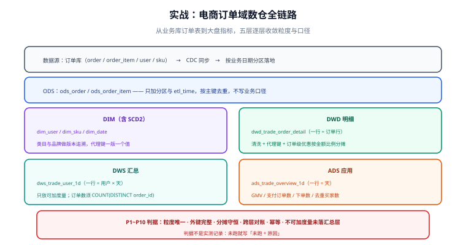

# 实战：电商订单域数仓

本实战把前面各页的判据串成一条完整链路：**从业务库的订单表出发，经 ODS → DWD → DWS → ADS，产出一张可直接对接大盘的日汇总表**，并沿途落实分层纪律、SCD2 维度、可加性与对账。



## 需求与口径先行

| 指标 | 口径定义（**唯一来源**） | 所在层 |
| --- | --- | --- |
| GMV | 已支付订单金额合计，单位元，不含退款 | ADS |
| 支付订单数 | 已支付订单笔数（按订单去重） | ADS |
| 支付率 | 支付订单数 / 下单订单数 | ADS（派生，不落库） |
| 下单用户数 | 当日下单去重用户数 | DWS/ADS |
| 客单价 | GMV / 支付订单数 | ADS（派生） |

::: danger 口径必须先写死再动手
「GMV 含不含退款」「按订单还是按订单行」「跨天退款算哪天」——这三个问题如果不先定，
后面每张表的 SQL 都会各自解释一遍，最后一定对不上。**口径写进文档，加工 SQL 只引用不重定义。**
:::

## 第 1 层：ODS 贴源

```sql [ods_order：与源表结构一致，只加分区与装载时间]
CREATE TABLE ods_order (
  order_id     BIGINT,
  user_id      BIGINT,
  status       VARCHAR(32),      -- created / paid / shipped / received / closed
  order_amount DECIMAL(18,2),    -- 订单应付
  pay_amount   DECIMAL(18,2),    -- 实付
  create_time  DATETIME,
  pay_time     DATETIME,
  update_time  DATETIME,
  etl_time     DATETIME
) PARTITIONED BY (dt)             -- 业务日期（下单日）
COMMENT '贴源：一行 = 源库一条订单记录';
```

```sql [ods_order_item：订单行（商品明细）]
CREATE TABLE ods_order_item (
  order_id     BIGINT,
  order_line   INT,
  sku_id       VARCHAR(64),
  quantity     INT,
  item_amount  DECIMAL(18,2),
  discount_amt DECIMAL(18,2),    -- 行级优惠
  etl_time     DATETIME
) PARTITIONED BY (dt)
COMMENT '贴源：一行 = 一个订单行';
```

**本层只做三件事**：按业务日期分区、加 `etl_time`、按主键去重（保留最新）。不写任何业务口径。

## 第 2 层：DIM 维度（含 SCD2）

```sql [dim_sku：商品维度，类目与品牌用 SCD2 追溯]
CREATE TABLE dim_sku (
  sku_sk      BIGINT      COMMENT '代理键（一版一个值）',
  sku_id      VARCHAR(64) COMMENT '业务键',
  sku_name    VARCHAR(200),
  category_l1 VARCHAR(64),
  category_l2 VARCHAR(64),
  brand_name  VARCHAR(64),
  start_dt    DATE,
  end_dt      DATE        COMMENT '开区间；当前版本为 9999-12-31',
  is_current  TINYINT
) COMMENT '维度：一行 = 一个商品的一个属性版本';
```

SCD2 的四步（新增 / 关闭旧版本 / 插入新版本 / 删除）完整写法见 [缓慢变化维与拉链表](../SCD/index.md)，本实战直接沿用其顺序。

## 第 3 层：DWD 明细

```sql [dwd_trade_order_detail：一行 = 订单行]
CREATE TABLE dwd_trade_order_detail (
  order_id     BIGINT,
  order_line   INT,
  user_sk      BIGINT,
  sku_sk       BIGINT,
  order_status VARCHAR(32),
  quantity     INT,
  item_amount  DECIMAL(18,2),
  line_discount DECIMAL(18,2)  COMMENT '行级优惠（含订单级分摊）',
  pay_amount   DECIMAL(18,2),
  order_dt     VARCHAR(10),
  pay_dt       VARCHAR(10)     COMMENT '未支付为 NULL',
  etl_time     DATETIME
) PARTITIONED BY (order_dt)
COMMENT '明细：一行 = 一个订单行（order_id + order_line）';
```

```sql [加工：清洗 + 代理键 + 订单级优惠分摊]
INSERT OVERWRITE TABLE dwd_trade_order_detail PARTITION (order_dt = '${bizdate}')
SELECT
  i.order_id,
  i.order_line,
  u.user_sk,
  s.sku_sk,
  o.status,
  i.quantity,
  i.item_amount,
  -- 行级优惠 + 订单级优惠按金额比例分摊（分摊后行优惠之和 = 订单总优惠）
  ROUND(i.discount_amt + COALESCE(o.order_discount, 0) * i.item_amount
        / SUM(i.item_amount) OVER (PARTITION BY i.order_id), 2) AS line_discount,
  o.pay_amount,
  o.order_dt,
  CASE WHEN o.status IN ('paid', 'shipped', 'received') THEN o.pay_dt END AS pay_dt,
  CURRENT_TIMESTAMP AS etl_time
FROM ods_order_item i
JOIN ods_order o
  ON i.order_id = o.order_id AND i.dt = '${bizdate}'
LEFT JOIN dim_user u ON o.user_id = u.user_id AND u.is_current = 1
LEFT JOIN dim_sku  s ON i.sku_id  = s.sku_id  AND s.is_current = 1;
```

::: warning 三个必须检查的点
1. **`SUM(...) OVER (...)` 的分母为零**：`item_amount` 全为 0 的订单会除零 → 需 `NULLIF` 兜底；
2. **维表关联必须带 `is_current = 1`**：否则一个商品关联出多个版本，行数直接翻倍；
3. **`pay_dt` 与 `order_dt` 不同**：跨天支付的订单要明确「按下单日归集、支付日另存一列」，避免两套口径。
:::

## 第 4 层：DWS 汇总（只放可加度量）

```sql [dws_trade_user_1d：一行 = 用户 × 天]
CREATE TABLE dws_trade_user_1d (
  user_sk    BIGINT,
  stat_dt    VARCHAR(10),
  order_cnt  BIGINT,             -- 可加
  order_amt  DECIMAL(18,2),      -- 可加
  pay_cnt    BIGINT,             -- 可加
  pay_amt    DECIMAL(18,2),      -- 可加
  etl_time   DATETIME
) PARTITIONED BY (stat_dt)
COMMENT '汇总：一行 = 用户 × 天；全部为可加度量';
```

```sql [加工：从明细上卷，注意订单数要按订单去重]
INSERT OVERWRITE TABLE dws_trade_user_1d PARTITION (stat_dt = '${bizdate}')
SELECT
  user_sk,
  order_dt AS stat_dt,
  COUNT(DISTINCT order_id)                       AS order_cnt,   -- 去重：一个订单多行只算一次
  SUM(item_amount)                               AS order_amt,
  COUNT(DISTINCT IF(pay_dt IS NOT NULL, order_id, NULL)) AS pay_cnt,
  SUM(IF(pay_dt IS NOT NULL, pay_amount, 0))     AS pay_amt,
  CURRENT_TIMESTAMP
FROM dwd_trade_order_detail
WHERE order_dt = '${bizdate}'
GROUP BY user_sk, order_dt;
```

**为什么 `order_cnt` 要 `COUNT(DISTINCT order_id)`**：明细是订单行粒度，一个订单有 3 行就会算 3 次。这条错误会让「订单数」虚高，且与 DWD 的金额口径不一致，是最常见的口径事故之一。

## 第 5 层：ADS 应用

```sql [ads_trade_overview_1d：一行 = 天（大盘口径）]
CREATE TABLE ads_trade_overview_1d (
  stat_dt        VARCHAR(10),
  gmv            DECIMAL(18,2)  COMMENT '已支付订单金额，不含退款',
  paid_order_cnt BIGINT         COMMENT '支付订单数（按订单去重）',
  order_cnt      BIGINT         COMMENT '下单订单数',
  buyer_cnt      BIGINT         COMMENT '下单去重用户数（不可加）',
  etl_time       DATETIME
) PARTITIONED BY (stat_dt)
COMMENT '应用：一行 = 天；口径见数仓口径文档 v1';
```

```sql [加工：由 DWS 汇总到天 + 由 DWD 补去重人数]
INSERT OVERWRITE TABLE ads_trade_overview_1d PARTITION (stat_dt = '${bizdate}')
SELECT
  '${bizdate}' AS stat_dt,
  SUM(pay_amt) AS gmv,
  SUM(pay_cnt) AS paid_order_cnt,
  SUM(order_cnt) AS order_cnt,
  (SELECT COUNT(DISTINCT user_sk) FROM dwd_trade_order_detail WHERE order_dt = '${bizdate}') AS buyer_cnt,
  CURRENT_TIMESTAMP
FROM dws_trade_user_1d
WHERE stat_dt = '${bizdate}';
```

注意 `buyer_cnt` **不能**写成 `SUM(1)`：它是去重计数，必须回明细层算，或使用可合并的近似结构。把不可加度量放在汇总层相加，是数仓最经典的错误。

## 验收判据

| # | 判据 | 怎么验 | 期望 |
| --- | --- | --- | --- |
| P1 | 分层齐全 | 四层各有当日数据 | 都有且量级合理 |
| P2 | 事实表粒度唯一 | 按 `(order_id, order_line)` 去重计数 | 行数相等 |
| P3 | 外键完整 | `sku_sk` / `user_sk` 关联维表 | 孤儿 0 行 |
| P4 | 维表当前版本唯一 | `is_current = 1` 按业务键分组 | 无重复 |
| P5 | 分摊守恒 | 行优惠之和 = 订单优惠 | 差 ≤ 0.01 |
| P6 | DWD 与 DWS 对账 | 两侧金额汇总 | 完全相等 |
| P7 | DWS 与 ADS 对账 | 两级 `pay_amt` 汇总 | 完全相等 |
| P8 | 幂等 | 同 `bizdate` 重跑两次 | 行数与校验和不变 |
| P9 | 不可加度量未落汇总层 | 检查 DWS 列清单 | 无比率/去重列 |
| P10 | 血缘无环 | 对依赖边做拓扑排序 | 可排出完整顺序 |

::: warning 判据不是实测记录
上表是**判据**。没有真实执行过的项，在项目文档与交付说明里要写「未跑 + 原因」，
**不要把期望值抄进实测列**——这是本库一贯的诚实纪律。
:::

## 本方案明确不做的四件事

1. **不做实时（流式）数仓**：本期只做 T+1 批处理；实时链路是另一套技术栈，混在一起会让口径更难统一。
2. **不做 Data Vault 集成层**：只有一个业务源，维度建模足够；多源时再引入。
3. **不做全历史重刷**：首次只回补近 90 天，更早历史按需补（补数纪律见 [数据质量、血缘与调度](../Quality/index.md)）。
4. **不把指标口径写进表名**：口径写在文档与加工 SQL 里，表名只表达层级与粒度。

## 参考资料

- [Kimball：Retail Sales 案例（本实战的经典原型）](https://www.kimballgroup.com/data-warehouse-business-intelligence-resources/kimball-techniques/)
- [dbt：How we structure our dbt projects](https://docs.getdbt.com/best-practices/how-we-structure/1-guide-overview)
- 本库相邻专题：[维度建模](../DimensionalModeling/index.md)、[缓慢变化维与拉链表](../SCD/index.md)、[粒度与聚合设计](../Grain/index.md)、[电商系统设计 · 领域建模](../../../Backend/Ecommerce/DomainModeling/index.md)
