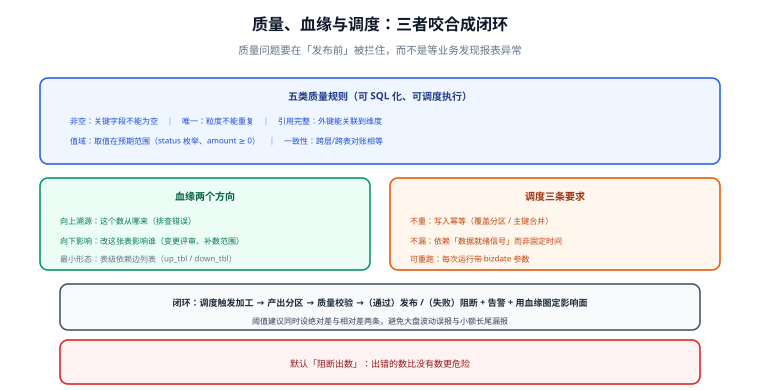

# 数据质量、血缘与调度

数仓的产出是「数」，而数的信任成本极高：**一次口径错、一次漏数，就可能让业务停掉整块分析**。本页讲三件互相咬合的事：质量规则怎么定、血缘怎么支撑影响分析、调度依赖怎么保证不重不漏。



## 数据质量五类规则

质量规则要能被 SQL 表达、被调度执行、被量化。通用的五类：

| 类型 | 检查什么 | 例子 | 失败意味着 |
| --- | --- | --- | --- |
| **非空** | 关键字段不能为空 | `user_sk IS NOT NULL` | 上游漏采或清洗丢字段 |
| **唯一** | 粒度不能重复 | `(order_id, order_line)` 唯一 | 重复投递或 Join 放大 |
| **引用完整** | 外键能关联到维度 | `sku_sk` 在 `dim_sku` 中存在 | 维表晚到或口径不一致 |
| **值域** | 取值在预期范围内 | `status IN (...)`、`amount >= 0` | 上游枚举变更或脏数据 |
| **一致性** | 跨层/跨表对得上 | DWS 汇总 = DWD 汇总 | 过滤条件不一致或漏数 |

```sql [把规则写成表：每条规则一行，可被调度统一执行]
CREATE TABLE dw_quality_rule (
  rule_id     VARCHAR(64) PRIMARY KEY,
  rule_type   VARCHAR(32),      -- not_null / unique / ref / range / consistency
  target_tbl  VARCHAR(200),
  expr        TEXT,             -- 违规行数 > 0 即失败
  owner       VARCHAR(64),
  level       VARCHAR(8)        -- E=阻断出数 / W=告警
);
```

```sql [三类规则的实现示例]
-- 唯一：重复即失败
SELECT COUNT(*) FROM (
  SELECT order_id, order_line FROM dwd_trade_order_detail
  WHERE order_dt = '${bizdate}'
  GROUP BY order_id, order_line HAVING COUNT(*) > 1
) t;                                  -- 期望 0

-- 引用完整：孤儿外键即失败
SELECT COUNT(*) FROM dwd_trade_order_detail f
LEFT JOIN dim_sku s ON f.sku_sk = s.sku_sk
WHERE f.order_dt = '${bizdate}' AND s.sku_sk IS NULL;   -- 期望 0

-- 一致性：两个口径必须相等
SELECT ABS(
  (SELECT SUM(pay_amount) FROM dwd_trade_order_detail WHERE order_dt = '${bizdate}') -
  (SELECT SUM(pay_amt)    FROM dws_trade_user_1d       WHERE stat_dt  = '${bizdate}')
);                                    -- 期望 0
```

::: tip 阈值要留绝对差与相对差两条
纯相对差会在大盘波动时误报，纯绝对差会掩盖小额长尾。建议写成
`ABS(diff) > 100` **或** `ABS(diff) / NULLIF(base,0) > 0.001` 双条件——二者都超才报，避免噪音。
:::

## 血缘：从「数不对」到「改了谁」

血缘（Lineage）有两个方向，用途完全不同：

| 方向 | 提问 | 用途 |
| --- | --- | --- |
| **向上追溯**（溯源） | 这个数从哪来？ | 排查数据错误、解释口径 |
| **向下影响**（影响分析） | 改这张表会影响谁？ | 变更评审、补数范围确定 |

血缘的最小可用形态是**表级依赖边列表**：

```sql [一张表存依赖边，可由 SQL 解析或调度日志自动生成]
CREATE TABLE dw_lineage_edge (
  up_tbl    VARCHAR(200),   -- 上游
  down_tbl  VARCHAR(200),   -- 下游
  job_id    VARCHAR(128),
  update_time DATETIME
);
-- 向上追溯：递归查 up_tbl；向下影响：递归查 down_tbl
```

::: danger 没有血缘的三个直接后果
1. **补数范围靠猜**：改了 DWD 一张表，不知道要连带重算哪些 DWS/ADS，结果报表新旧口径混在一起。
2. **排查时间翻倍**：报表数字不对，只能一层层手工 `SELECT` 验证。
3. **反向引用长期存活**：依赖成环（DWD 读 DWS）时，拓扑排序失败，补数顺序无法确定——这只能靠血缘发现。
:::

## 调度依赖：不重、不漏、可重跑

调度的核心要求只有三条，但每条都容易被违反：

| 要求 | 做法 | 违反后果 |
| --- | --- | --- |
| **不重** | 任务幂等：写分区前先删当日分区，或按主键 `MERGE` | 重跑一次数据翻倍 |
| **不漏** | 依赖上游**数据就绪**信号（而非固定时间） | 上游延迟时下游算了空数据 |
| **可重跑** | 每次运行带 `bizdate` 参数，与运行时刻解耦 | 补历史数据时写进今天的分区 |

```text
错误依赖：02:00 跑 DWD（假定上游 01:30 一定完成）
正确依赖：上游产出「分区就绪」标记后再跑，且下游任务显式声明依赖该标记
```

**补数（重跑历史）的三个纪律**：
1. 补数必须**按依赖顺序**（拓扑序）执行，不能只补出错的那一张；
2. 补数前后各跑一次对账 SQL，确认口径回到基线；
3. 补数期间**冻结下游报表缓存**，避免把中间态数据展示给业务。

## 质量、血缘、调度如何咬合

```text
调度触发加工 → 加工产出分区 → 质量规则校验
                                   ├─ 通过 → 发布（下游可见）
                                   └─ 失败 → 阻断发布 + 告警 + 用血缘圈定影响面
```

这条闭环的价值在于：**质量问题在「发布前」被拦住**，而不是等业务发现报表异常。配合血缘，还能立刻回答「这次故障影响了哪些报表、要不要手工修正」。

## 易错点与最佳实践

::: danger 高频坑
1. **质量规则只建不跑**：规则表建得很漂亮，但没有接进调度，等于没有。
2. **把 E 级放宽成 W 级**：一贯「先出数再说」，最后没人相信任何数。
3. **依赖按时间而非就绪信号**：上游一变慢就大面积空跑。
4. **补数不冻结下游**：业务在补数窗口看到半成品数据，产生二次误判。
5. **血缘靠手工维护**：手工表三个月内必然过期——应从 SQL 解析或调度日志自动生成。
:::

::: tip 最佳实践
1. 每条质量规则都**绑定负责人**（`owner`），失败时精确通知而不是群里广播。
2. 关键指标配**双人复核**的对账 SQL（业务口径 vs 财务口径），差异超阈值即告警。
3. 把「阻断出数」当成默认值：宁可晚出，不可出错——**出错的数比没有数更危险**。
4. 每次口径变更都走「影响分析 → 改加工 → 补历史 → 对账」四步，不要只改不补。
:::

## 验证方式

```sql [1. 质量规则是否真的在跑：查看最近一次执行记录]
SELECT rule_id, target_tbl, last_run_time, last_result, fail_rows
FROM dw_quality_run_log
WHERE last_run_time >= CURRENT_DATE - 1
ORDER BY last_run_time DESC;
-- 预期：所有 E 级规则的 last_result = 'PASS'
```

```sql [2. 血缘是否可递归遍历（向上溯源与向下影响各跑一次）]
-- 向上：dws_trade_user_1d 的全部上游
WITH RECURSIVE up AS (
  SELECT up_tbl FROM dw_lineage_edge WHERE down_tbl = 'dws_trade_user_1d'
  UNION SELECT e.up_tbl FROM dw_lineage_edge e JOIN up ON e.down_tbl = up.up_tbl
) SELECT * FROM up;
-- 预期：能追到 ods_ 层；若中途断链，说明血缘不完整
```

```sql [3. 幂等性验证：同一 bizdate 重跑两次，行数与校验和必须一致]
SELECT '${bizdate}' AS bizdate, COUNT(*) AS cnt, SUM(pay_amount) AS amt
FROM dwd_trade_order_detail WHERE order_dt = '${bizdate}';
-- 跑一次记录，重跑后再记录：cnt 与 amt 必须完全相同
```

## 与数据治理专题的分工

本页讲的是**一套数仓内部**「规则怎么写成可调度的检查」；[数据治理入门](../../DataGovernance/index.md) 讲的是**跨系统**的「规则从哪来、挂在谁身上、失败了找谁」。两者最容易混的一处边界：

| 问题 | 看哪边 |
| --- | --- |
| 这条规则 SQL 怎么写、挂在哪一层、跑完怎么回填 | 本页 |
| 这条规则该由谁定阈值、失败后通知谁、谁有权决定「这批数废弃」 | [数据质量规则与闭环](../../DataGovernance/DataQuality/index.md) |
| 血缘怎么写进调度依赖（作业 A 依赖作业 B） | 本页 |
| 血缘边**是怎么采到的、可信度几级**、能不能作为「改这列没有影响」的依据 | [数据血缘与影响分析](../../DataGovernance/Lineage/index.md) |

一句话记法：**本页管「仓库里怎么检查」，治理页管「谁为这个检查负责」。** 两页的规则可以互相借用（都是断言），但**责任归属不能互相搬运**——数仓内部的一条规则失败了，仓库负责人能改；跨系统的一条规则失败了，只有**资产负责人**有权决定下游出不出数。

## 参考资料

- [dbt：Tests（质量规则的工程化实现）](https://docs.getdbt.com/docs/build/tests)
- [Great Expectations 官方文档](https://docs.greatexpectations.io/)
- [Apache Airflow：DAG 与依赖管理](https://airflow.apache.org/docs/apache-airflow/stable/core-concepts/dags.html)
- 本库相邻专题：[数仓分层设计](../Layering/index.md)、[数据同步与 CDC](../../CDC/index.md)、[监控告警专题](../../../Ops/Monitoring/index.md)
