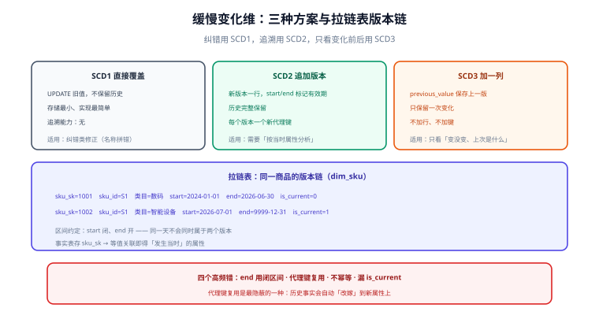

# 缓慢变化维与拉链表

维度属性会变：用户换了城市、商品换了类目、门店换了店长。**问题不在于「会不会变」，而在于「变了之后，历史事实按哪一版属性解释」**。缓慢变化维（Slowly Changing Dimension，SCD）就是回答这个问题的三种标准方案，而拉链表是 SCD2 最常见的一种落地形态。



## 三种方案

| 方案 | 做法 | 历史是否保留 | 存储 | 典型场景 |
| --- | --- | --- | --- | --- |
| **SCD1** | 直接 `UPDATE` 覆盖旧值 | ❌ 不保留 | 最小 | 纠错类修正：手机号录错、名称拼错 |
| **SCD2** | 追加新版本行，用 `start_dt/end_dt` 标记有效期 | ✅ 完整保留 | 每个版本一行 | **绝大多数需要「按当时属性分析」的维度** |
| **SCD3** | 加一列 `previous_value` 保存上一个值 | 仅保留**上一版** | 加列 | 只关心「变没变、上次是什么」（如客户等级迁移） |

::: tip 一句话选型
**纠错用 SCD1，追溯用 SCD2，只看「变化前后」用 SCD3。** 三者可以组合：同一个维度表里，名称类字段用 SCD1（拼错要全局修正），归属类字段用 SCD2（要能追溯历史）。
:::

## SCD2：语义与两列时间

SCD2 的语义是「**一个业务实体有多行，每行代表一个属性版本**」，靠两列时间界定有效期：

| 列 | 含义 | 约定 |
| --- | --- | --- |
| `start_dt` | 该版本生效日期 | 闭区间起点 |
| `end_dt` | 该版本失效日期 | **开区间终点**；当前版本统一用 `9999-12-31` |

```sql [SCD2 维度表结构]
CREATE TABLE dim_sku (
  sku_sk      BIGINT      COMMENT '代理键：一个版本一个值',
  sku_id      VARCHAR(64) COMMENT '业务键：一个商品一个值',
  sku_name    VARCHAR(200),
  category_l1 VARCHAR(64),
  brand_name  VARCHAR(64),
  start_dt    DATE        COMMENT '生效日期（闭）',
  end_dt      DATE        COMMENT '失效日期（开），当前版本为 9999-12-31',
  is_current  TINYINT     COMMENT '1=当前版本；便于查询免写日期条件'
);
```

### 数据变化时的四步处理

每次装载时，把「今天的源快照」与「当前版本」比对，差异分三类分别处理：

```sql [① 新增：源里有、维度里没有 → 插入新行]
INSERT INTO dim_sku (sku_sk, sku_id, sku_name, category_l1, brand_name, start_dt, end_dt, is_current)
SELECT
  /* 代理键：用业务键 + 版本序号生成，避免与源系统主键耦合 */
  ROW_NUMBER() OVER (ORDER BY s.sku_id) + (SELECT COALESCE(MAX(sku_sk), 0) FROM dim_sku) AS sku_sk,
  s.sku_id, s.sku_name, s.category_l1, s.brand_name,
  '${bizdate}' AS start_dt, DATE '9999-12-31' AS end_dt, 1 AS is_current
FROM stg_sku_today s
LEFT JOIN dim_sku d ON s.sku_id = d.sku_id AND d.is_current = 1
WHERE d.sku_id IS NULL;
```

```sql [② 关闭旧版本：属性变了 → 把当前行的 end_dt 改为今天、is_current 置 0]
UPDATE dim_sku d
SET d.end_dt = '${bizdate}', d.is_current = 0
WHERE d.is_current = 1
  AND EXISTS (
    SELECT 1 FROM stg_sku_today s
    WHERE s.sku_id = d.sku_id
      AND (s.sku_name   <> d.sku_name
        OR s.category_l1 <> d.category_l1
        OR s.brand_name  <> d.brand_name)
  );
```

```sql [③ 插入新版本：为「属性变了」的实体插入一条新的当前行]
INSERT INTO dim_sku (sku_sk, sku_id, sku_name, category_l1, brand_name, start_dt, end_dt, is_current)
SELECT
  ROW_NUMBER() OVER (ORDER BY s.sku_id) + (SELECT MAX(sku_sk) FROM dim_sku) AS sku_sk,
  s.sku_id, s.sku_name, s.category_l1, s.brand_name,
  '${bizdate}' AS start_dt, DATE '9999-12-31' AS end_dt, 1 AS is_current
FROM stg_sku_today s
JOIN dim_sku d ON s.sku_id = d.sku_id AND d.is_current = 0 AND d.end_dt = '${bizdate}';
```

```sql [④ 删除：源里没有了 → 关闭当前行（不物理删除，保留历史）]
UPDATE dim_sku d
SET d.end_dt = '${bizdate}', d.is_current = 0
WHERE d.is_current = 1
  AND NOT EXISTS (SELECT 1 FROM stg_sku_today s WHERE s.sku_id = d.sku_id);
```

::: danger SCD2 最容易出的四个错
1. **`end_dt` 用闭区间**：同一实体的两行会出现「同一天既属于旧版本又属于新版本」，区间统计直接翻倍。约定成**开区间**（`end_dt` 当天已不属于旧版本）。
2. **代理键复用**：属性变了但沿用旧 `sku_sk`，历史事实会自动「改嫁」到新属性上——**追溯能力彻底失效**，这是最隐蔽的一种错。
3. **不重跑幂等**：同一天的任务重跑两次，会插入两条相同版本。装载必须幂等（先删当日新增、再重放，或按 `(业务键, start_dt)` 唯一）。
4. **忘了 `is_current`**：只靠 `end_dt = 9999-12-31` 判定当前版本，写起来冗长且容易漏；保留冗余列更稳。
:::

## 拉链表：SCD2 的一种典型落地

「拉链表」是业界对**按 `start_dt/end_dt` 记录版本链的维度表**的叫法（形如拉链，一个实体的多条记录首尾相接）。它的价值在于回答两类问题：

```sql [问题一：截至某历史时点，这个商品属于哪个类目？]
-- 关键：用「时点落在区间内」而不是精确等值匹配
SELECT sku_id, category_l1, start_dt, end_dt
FROM dim_sku
WHERE sku_id = 'S1001'
  AND '2026-06-30' >= start_dt
  AND '2026-06-30' <  end_dt;      -- 开区间，避免边界重叠
```

```sql [问题二：历史事实与「发生当时」的维度属性关联]
-- 事实表存的是「当时的代理键」时，直接 Join 即可（最推荐）
SELECT d.sku_id, f.order_amount
FROM dwd_trade_order_detail f
JOIN dim_sku d ON f.sku_sk = d.sku_sk
WHERE f.order_dt = '2026-10-10';

-- 若事实表只存了业务键，则必须按时间区间关联（性能与正确性都更差）
SELECT d.sku_id, f.order_amount
FROM dwd_trade_order_detail f
JOIN dim_sku d
  ON f.sku_id = d.sku_id
 AND f.order_dt >= d.start_dt
 AND f.order_dt <  d.end_dt;
```

**这就是为什么事实表要存代理键**：存了代理键，关联是「一个等值条件」；只存业务键，关联变成「范围条件」，既慢又容易在多版本歧义时出错。

::: warning 拉链表的性能代价
拉链表会随变更次数膨胀（一个商品改 20 次类目就有 20 行）。生产上两种缓解手段：
① **只对需要追溯的属性做 SCD2**，其余属性用 SCD1 覆盖（例如「商品名称拼错」不需要历史）；
② 给 `(sku_id, start_dt, end_dt)` 建索引，并避免在大表上做范围关联（优先走上一条的代理键等值关联）。
:::

## 从业务库拉链：增量与快照的差别

| 数据来源 | 能拿到什么 | 拉链难度 |
| --- | --- | --- |
| 每日全量快照 | 只有「今天的状态」 | 简单：与当前版本比较即可（本页示例） |
| CDC 增量日志 | 每次变更的前后值 | 中：同一天多次变更需按时间合并成一条版本 |
| 源表无 `update_time` | 无法判断是否变更 | 难：只能全字段比较，且无法区分「改回原值」 |

```sql [CDC 场景：同一天多次变更要合并为一条版本]
SELECT sku_id,
       LAST_VALUE(category_l1) OVER (PARTITION BY sku_id ORDER BY change_time) AS category_l1,
       MIN(change_time) AS first_change,
       MAX(change_time) AS last_change
FROM ods_sku_cdc
WHERE dt = '${bizdate}'
GROUP BY sku_id;
-- 同一天内多次变更：只保留当日最终值作为新版本，避免一天产生多行
```

## 验证方式

```sql [1. 版本链完整性：同一业务键的区间必须首尾相接、不重叠、不空洞]
SELECT sku_id, start_dt, end_dt
FROM dim_sku WHERE sku_id = 'S1001' ORDER BY start_dt;
-- 判据：上一行的 end_dt 必须等于下一行的 start_dt（开区间约定下）
```

```sql [2. 当前版本唯一性：每个业务键最多一个 is_current = 1]
SELECT sku_id, COUNT(*) AS current_cnt
FROM dim_sku WHERE is_current = 1
GROUP BY sku_id HAVING COUNT(*) > 1;
-- 预期：0 行
```

```sql [3. 区间重叠检测（开区间约定下不应出现重叠）]
SELECT a.sku_id
FROM dim_sku a JOIN dim_sku b
  ON a.sku_id = b.sku_id AND a.sku_sk < b.sku_sk
 AND a.start_dt < b.end_dt AND b.start_dt < a.end_dt
GROUP BY a.sku_id;
-- 预期：0 行
```

```sql [4. 幂等性：同一天重跑两次，行数不应增加]
-- 第一次跑完记录 COUNT(*)，重跑后再记录，两次必须相等
SELECT COUNT(*) FROM dim_sku WHERE start_dt = '${bizdate}';
```

## 参考资料

- [Kimball：Slowly Changing Dimensions](https://www.kimballgroup.com/data-warehouse-business-intelligence-resources/kimball-techniques/dimensional-modeling-techniques/dimension/)
- [dbt：Snapshots（SCD2 的工程化实现）](https://docs.getdbt.com/docs/build/snapshots)
- 本库相邻专题：[事实表与维度表设计](../FactAndDimension/index.md)、[维度建模](../DimensionalModeling/index.md)、[数据同步与 CDC](../../CDC/index.md)
