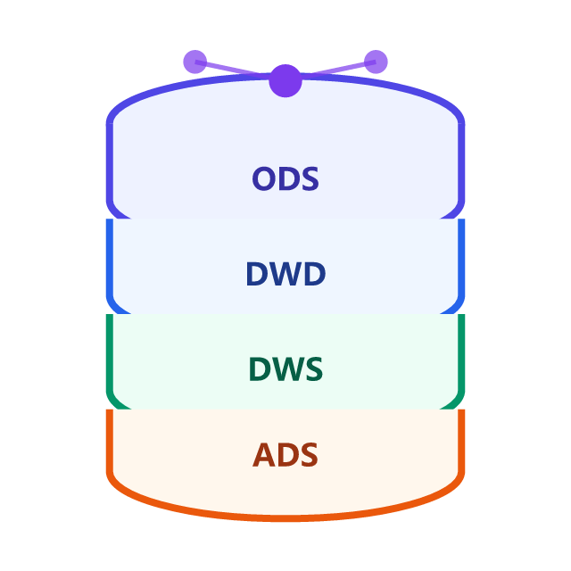

# 数仓建模

**数仓（Data Warehouse，数据仓库）建模**要回答的是与业务库建模完全不同的一组问题：数据**从哪几层流过**、**按什么粒度沉淀**、**维度与事实怎么组织**、**历史变化怎么保留**。业务库建模的目标是「让一笔交易写得正确」，数仓建模的目标是「让过去三年的事实可以被任意维度、任意粒度地重新切分与追问」。

一句话定位：**本专题讲「同一批业务数据，怎么组织成能支撑分析与报表的仓库」**——分层（ODS/DWD/DWS/ADS）、维度建模（事实表与维度表、星型与雪花）、缓慢变化维（SCD 与拉链表）、粒度与聚合，以及数据质量与血缘。

## 目录

- [概述：数仓全景与四种建模方法论](Overview/index.md) —— OLTP 与 OLAP 的根本差异、范式建模/维度建模/Data Vault/宽表四条路线、分层总览与选型判据
- [分层设计](Layering/index.md) —— ODS / DWD / DWS / ADS / DIM 五层职责、每层「允许做什么、禁止做什么」、命名与目录规范
- [维度建模](DimensionalModeling/index.md) —— 事实与维度的划分、总线矩阵与一致性维度、星型与雪花模型取舍
- [事实表与维度表设计](FactAndDimension/index.md) —— 三类事实表（事务/周期快照/累积快照）、度量可加性、代理键与退化维
- [缓慢变化维与拉链表](SCD/index.md) —— SCD1/2/3 的实现与取舍、拉链表的建表与查询、失效与回溯
- [粒度与聚合设计](Grain/index.md) —— 粒度是数仓最重要的决策、预聚合的收益边界、DWS/ADS 的聚合设计
- [数据质量、血缘与调度](Quality/index.md) —— 五类质量规则、血缘与影响分析、调度依赖与补数
- [实战：电商订单域数仓](Practice/index.md) —— 从 ODS 到 ADS 的完整建模（DDL + 加工 SQL + 判据清单）
- [常见问题与最佳实践](FAQ/index.md) —— 高频疑问、口径不一致的治理、上线自查清单

## 一句话理解

::: tip 一句话理解
业务库建模是「**把眼前这笔业务记准**」，数仓建模是「**让过去所有业务都能被重新解释**」——前者怕写错，后者怕口径不一致。
:::

## 与相邻专题的分工

这几处边界**写死在页面上**，互不替代：

| 相邻专题 | 它讲什么 | 本专题讲什么 |
| --- | --- | --- |
| [数据建模](../DataModeling/index.md) | **OLTP 业务库**建模：范式与函数依赖、ER 图、反范式权衡、物理 DDL | 同一批数据**进入分析场景后**的组织方式：分层、维度建模、SCD、粒度与聚合；两者的判据完全不同（前者看「写不写得对」，后者看「查得对不对」） |
| [ClickHouse](../ClickHouse/index.md) | **列式存储引擎**的用法：MergeTree、分区与索引、物化视图、副本分片 | 引擎之上**建模怎么做**：即使换成别的引擎（Hive/Spark/云数仓），本专题的分层与维度建模判据依然成立 |
| [数据同步与 CDC](../CDC/index.md) | **数据怎么搬**：快照与增量、日志解析、幂等与顺序 | 数据搬来之后**怎么组织**：落到哪一层、以什么粒度、如何保留历史 |
| [分库分表](../Relational/Sharding/index.md) | **在线库的水平拆分**：分片键、分布式 ID、迁移 | 数仓侧不做分片：它靠**分区 + 列存 + 预聚合**解决规模问题，是另一套手段 |
| [时序数据库](../TimeSeries/index.md) | 「时间 + 标签 + 数值」这类**指标型**数据的存储与查询 | 数仓处理的是**业务事实**（订单、支付、履约），维度更丰富、口径更复杂；指标型场景用 TSDB 更合适 |
| [电商系统设计 · 领域建模](../../Backend/Ecommerce/DomainModeling/index.md) | 交易系统的**领域模型**（SPU/SKU、订单状态机、库存） | 把同一批交易数据**重组成分析模型**：事实表怎么切、维度怎么一致性化 |
| [大数据生态](../BigData/index.md) | 承载模型的**组件**：HDFS/Hive/Spark/Flink、湖表与调度 | 本专题回答「表该怎么设计」（分层、维度、SCD、粒度），那边回答「这些表跑在哪、用什么引擎算、版本怎么升级」；判据是「问题是模型不对，还是链路跑不动」 |

## 方法论状态速览（2026-10 核对）

数仓建模的「版本」不来自软件，而来自**建模方法论与引擎生态**。当前主流实践：

| 方法论 | 提出/主导 | 适用 | 本专题中的位置 |
| --- | --- | --- | --- |
| 范式建模（Inmon） | Bill Inmon，1990s | 企业级集成、强调单一事实来源 | [概述](Overview/index.md) 中作为对照路线 |
| 维度建模（Kimball） | Ralph Kimball，1996 起 | 面向分析、可理解性优先 | **本专题主线**：[维度建模](DimensionalModeling/index.md) |
| Data Vault 2.0 | Dan Linstedt，2013 | 多源、强审计、变化频繁的集成层 | [概述](Overview/index.md) 中给出与维度建模的取舍判据 |
| 宽表 / OneData 体系 | 阿里等互联网实践（2010s 起） | 大数据平台上的分层与指标治理 | [分层设计](Layering/index.md) 与 [粒度与聚合](Grain/index.md) |

::: info 版本说明
本专题不绑定具体引擎与云产品；示例 DDL 以通用 SQL 方言书写（MySQL/Hive/Spark SQL 均可对照），涉及引擎特有的写法会在页内标注。引擎能力见 [ClickHouse](../ClickHouse/index.md) 与 [大数据生态](../../Ops/CloudNative/index.md) 等相关专题。
:::

## 建议的阅读顺序

- **第一次接触数仓**：[概述](Overview/index.md) → [分层设计](Layering/index.md)，先把「数据在哪几层、每层干什么」建立起来。
- **要动手建表**：[维度建模](DimensionalModeling/index.md) → [事实表与维度表设计](FactAndDimension/index.md)，重点看粒度选择与代理键。
- **要保留历史变化**：[缓慢变化维与拉链表](SCD/index.md)，SCD2 与拉链表是数仓面试与实战的双高频点。
- **查询太慢 / 报表太重**：[粒度与聚合设计](Grain/index.md)，先看预聚合的收益边界再决定加不加汇总层。
- **数据不可信 / 排障难**：[数据质量、血缘与调度](Quality/index.md)。
- **照着做一遍**：[实战：电商订单域数仓](Practice/index.md)，含完整 DDL 与判据清单。

## 参考资料

- [Kimball Group：Dimensional Modeling Techniques](https://www.kimballgroup.com/data-warehouse-business-intelligence-resources/kimball-techniques/dimensional-modeling-techniques/)
- [The Data Warehouse Toolkit（第 3 版）](https://www.kimballgroup.com/data-warehouse-business-intelligence-resources/books/)
- [Data Vault 2.0 官方站点](https://datavaultalliance.com/)
- [dbt 官方文档：Modeling（分层与物化策略的工程化落地）](https://docs.getdbt.com/docs/build/models)
- [Apache Hive 官方文档](https://hive.apache.org/) ｜ [Apache Spark SQL](https://spark.apache.org/docs/latest/sql-programming-guide.html)
- [ClickHouse 官方文档：物化视图](https://clickhouse.com/docs/en/guides/developer/cascading-materialized-views)
