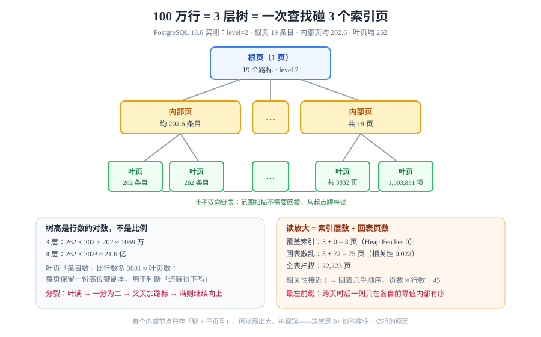

# B+ 树：三层树怎么撑住一亿行

一亿行的表，按主键查一行只需要 **3 次页访问**。这个数字不是靠「索引很快」这句空话支撑的，而是由三条可验证的算式决定：**一页放多少条目、树有多少层、查找沿哪条路径下沉**。本页把这三条拆开，并且给出本机实测的三个数字——树高 3、根页 19 个条目、叶页平均 262 个条目。



## 判据族声明

本页判据族 `BPT-A` ~ `BPT-H`，共 8 条。定义表在第八节。

## 一、结构：为什么所有数据都在叶子上

B+ 树与二叉树最大的区别只有一句话：**内部节点只存路标，不存数据；所有数据都在叶子层，且叶子之间用双向链表串起来。**

```text
                 [ 根页 · 内部节点 ]          19 个路标
                /        |         \
      [内部页]        [内部页]  ...  [内部页]  19 页，平均 202.6 个条目/页
      /   |   \       /   |   \
 [叶][叶][叶] ... [叶][叶][叶] ...          3832 页，平均 262 个条目/页
  ↕    ↕    ↕                                 叶子间双向链表（支持范围扫描）
```

这个设计带来三个直接后果：

| 后果 | 原因 | 你能观察到的现象 |
| --- | --- | --- |
| **等值查找的 I/O 恒定** | 每次下沉只多一层，与总行数无关 | 一亿行与一百万行的等值查询，`Buffers` 都是 3～4 |
| **范围扫描不需要回根** | 叶子有链表，找到起点后顺序读即可 | `between` / `order by` 的 `Buffers` 与范围大小成正比，与表大小无关 |
| **内部节点能放很多路标** | 每个路标只有「键 + 子页号」，不含行数据 | 一页能放数百个路标 ⇒ 扇出（fan-out）很大 ⇒ 树很矮 |

## 二、树高：一条可以自己算的公式

```text
树高 ≈ 1 + log_fanout(total_rows / leaf_capacity)
```

按本机实测参数代入：行数 1,000,000，叶页容量 262，内部扇出 202：

```text
叶子页数      = 1,000,000 ÷ 262                    ≈ 3832
内一层页数    = 3832 ÷ 202                          ≈ 19
根页          = 1（19 个路标指向 19 个内层页）
树高          = 3 层
```

### 本机实测（PostgreSQL 18.6）

```sql
-- 树高与根页号
select * from bt_metap('idx_events_tenant_created');

-- 逐层页数与条目
select btpo_level, count(*) as pages, sum(live_items) as items,
       round(avg(live_items)::numeric, 1) as avg_items
from bt_multi_page_stats('idx_events_tenant_created', 1, 3852)
group by btpo_level order by btpo_level desc;
```

```text
 magic  | version | root | level | fastroot | fastlevel
--------+---------+------+-------+----------+-----------
 340322 |       4 |  209 |     2 |      209 |         2

 btpo_level | pages |  items   | avg_items
------------+-------+----------+-----------
          2 |     1 |       19 |      19.0     ← 根页
          1 |    19 |     3850 |     202.6     ← 内部层
          0 |  3832 |  1003831 |     262.0     ← 叶层
```

四个读数各有含义：

| 读数 | 值 | 读法 |
| --- | --- | --- |
| `level` | **2** | 层号从 0 起，所以是 **3 层**（根 + 1 层内部 + 叶） |
| 根页 `live_items` | **19** | 19 个路标指向 19 个内部页——扇出远没用满 |
| 内部页 `avg_items` | **202.6** | 一页约放 200 个路标，这就是「扇出」 |
| 叶页 `avg_items` | **262** | 一页约放 262 个索引条目 |
| 叶层 `items` 合计 | **1,003,831** | 比 100 万行多 **3,831**，恰好约等于叶页数 |

最后一行值得单独说：**多出来的 3,831 ≈ 叶页数 3,832**。原因是 PostgreSQL 的 B+ 树在每一页里都保留一份**高位键（high key）副本**，用于快速判断「这一页还装得下吗」。所以「条目数 = 行数 + 页数」，这不是 bug，是结构的一部分。

::: tip 为什么树高几乎不涨
叶页容量 262、扇出 202，则**每多一层，容量乘 202**：

- 3 层 ≈ 262 × 202 × 202 ≈ **1069 万**行
- 4 层 ≈ 262 × 202³ ≈ **21.6 亿**行

现实中「一亿行还是 3～4 层」，原因就在这里：**树高是行数的对数，不是比例。**
:::

## 三、一次查找走了哪几页

```text
① 读根页（页 209）→ 二分找 19 个路标里那个 ≤ 目标键的最大者
② 读它指向的内部页 → 再二分 200 多个路标
③ 读叶页 → 页内二分或顺序找，拿到行指针 (页号, 行号)
④ 拿行指针去堆里取元组（这一步叫「回表」）
```

前 3 步是**索引页**，第 4 步是**堆页**。所以「走索引」的读放大其实是：

```text
读放大 = 索引层数（3） + 命中的堆页数
```

第 4 项才是变数。本机实测一个典型例子：

```sql
explain (analyze, buffers, costs off)
select * from events
where tenant_id = 7 and created_at >= '2026-01-05' and created_at < '2026-01-05 01:00';
```

```text
 Bitmap Heap Scan on events (actual rows=72)
   Heap Blocks: exact=72
   Buffers: shared hit=33 read=42
   ->  Bitmap Index Scan on idx_events_tenant_created (actual rows=72)
         Buffers: shared hit=3
```

**72 行 → 72 个堆页**，一个不多一个不少。原因在统计信息里：

```sql
select attname, n_distinct, round(correlation::numeric, 3) as corr
from pg_stats where tablename = 'events';
```

```text
 attname    | n_distinct |  corr
------------+------------+-------
 created_at |         -1 | 1.000
 tenant_id  |         50 | 0.022
```

`tenant_id` 的**物理相关性只有 0.022**（接近 0 = 同一租户的行随机散布在整张表）。于是「取 72 行」几乎等于「取 72 个不同的页」——**读放大从 3 变成了 75**。

::: danger 索引命中了不等于快了
「索引命中 72 行」听起来很省，实际却读了 75 个页。如果表更大、相关性更差，最坏情况会退化成「每行一个随机 I/O」，比全表顺序扫描还慢——**这就是优化器有时故意不用索引的原因**（它算的代价里含这一项）。
:::

## 四、页分裂、填充因子与碎片

插入时如果目标叶页满了，就要**分裂**：

```text
分裂前：[ 100 个条目 ]（满）
分裂后：[ 50 ] →  [ 50 ]  + 向父页插入一个路标
父页也满了 → 父页再分裂 …… 一路向上，直到根；根分裂则树高 +1
```

| 概念 | 说明 | 后果 |
| --- | --- | --- |
| **填充因子**（fillfactor） | 建索引时预留的空闲比例，默认 90 | 留得多 ⇒ 分裂少、树稍高；留得少 ⇒ 树矮、写时更易分裂 |
| **顺序插入** | 键单调递增（自增 id、`uuidv7()`） | 只在最右页分裂，页几乎填满，**最理想** |
| **随机插入** | 键随机（`uuidv4()`、随机哈希） | 分裂散布全树，页平均利用率降到 ~50%～70% |
| **删除** | 只标记行指针为死，不立即合并 | 页变稀，树变「胖」，读放大上升 |

### 为什么 `uuidv7()` 比 `uuidv4()` 好

| 主键类型 | 插入位置 | 页利用率 | 索引体积 |
| --- | --- | --- | --- |
| 自增整数 | 永远最右 | ≈ 90% | 最小 |
| **`uuidv7()`** | 按时间近似有序，集中在右侧 | 较高 | 接近自增 |
| `uuidv4()` | 全树随机 | 50%～70% | 明显更大 |

PostgreSQL 18 内置 `uuidv7()`（时间戳在前 48 位），这就是它被官方定位为「UUID 主键的新默认」的原因：**同样的唯一性，换回接近自增的写入局部性。**

::: info 版本边界
`uuidv7()` 是 **PG 18 新增**。PG 13～17 只有 `gen_random_uuid()`（即 v4），要在旧版用 v7 需要扩展或应用侧生成。
:::

## 五、复合索引：为什么「最左前缀」是硬约束

`(tenant_id, created_at)` 的索引，在页内的排序规则是：**先按 `tenant_id` 排，同一 `tenant_id` 内再按 `created_at` 排**。

```text
叶页内容（示意）：
(1, 2026-01-01) (1, 2026-01-02) (1, 2026-01-03) ... (2, 2026-01-01) (2, 2026-01-02) ...
└──────────── tenant_id=1 的连续区间 ────────────┘└──── tenant_id=2 ────┘
```

| 查询条件 | 能否用索引定位 | 原因 |
| --- | --- | --- |
| `tenant_id = 7` | ✅ 定位到一个连续区间 | 首列有序 |
| `tenant_id = 7 and created_at > X` | ✅ 区间内再二分 | 两列都有序 |
| `created_at > X`（无首列） | ❌ 全表扫 | `created_at` **只在每个 `tenant_id` 内部有序**，全局无序 |

**关键理解**：整个索引文件里 `created_at` 是**分段有序**的（每个 `tenant_id` 一段），不是全局有序。既然全局无序，就没法二分——这才是「最左前缀」的真正原因，不是「优化器不聪明」。

### PG 18 的 skip scan：给「首列低基数」开了一个口子

如果首列**取值很少**（例如 `tenant_id` 只有 50 个不同值），PG 18 可以这样做：**枚举首列的每个不同值，在每个值内部做一次范围查找**。

```sql
-- PG 17：created_at 无首列条件 → 顺序扫描
-- PG 18：首列基数低时 → Index Skip Scan，枚举 50 个 tenant_id 各扫一段
explain select * from events where created_at > '2026-01-10';
```

| 条件 | skip scan 是否有效 |
| --- | --- |
| 首列不同值少（几十～几百） | ✅ 相当于把一次大范围拆成几十次小范围，仍比全扫便宜 |
| 首列不同值极多（百万级） | ❌ 枚举成本超过全扫，优化器会放弃 |

::: warning skip scan 不是「最左前缀失效了」
它只是「首列基数低时的一种替代路径」。**首列基数高时，最左前缀仍然是硬约束。** 看到 `Index Skip Scan` 不要以为可以随便省索引列——先看首列 `n_distinct`。
:::

## 六、覆盖索引与「回表」的代价

如果查询要的列**全在索引里**，就完全不用回表：

```sql
-- 索引 (tenant_id, created_at) 里没有别的列，但 count(*) 不需要列
explain (analyze, buffers, costs off) select count(*) from events where tenant_id = 7;
```

```text
 Aggregate (actual rows=1)
   Buffers: shared hit=81
   ->  Index Only Scan using idx_events_tenant_created on events (actual rows=20000)
         Heap Fetches: 0
```

`Index Only Scan` + `Heap Fetches: 0` 是「零回表」的标志。**81 个页搞定了 2 万行**——这就是覆盖索引的全部价值。

::: danger `Heap Fetches` 不为 0 时，Index Only Scan 会退化
索引里没有「这行对我可见吗」的信息，要靠**可见性映射（visibility map）**判断。如果表刚大批量更新过、`vacuum` 还没跑，可见性映射是空的，于是每一行都要回表确认——`Heap Fetches` 会接近命中行数，性能优势消失。

判断方法：`Heap Fetches ÷ actual rows > 10%` 就该考虑先 `vacuum` 再评估。
:::

## 七、四种「索引在，但用不上」的写法

| 写法 | 为什么失效 | 改成 |
| --- | --- | --- |
| `where lower(name) = 'abc'` | 索引建在 `name` 上，不是 `lower(name)` 上 | 建**表达式索引** `(lower(name))` |
| `where created_at::date = '2026-01-05'` | 列被函数包裹，索引键与表达式不匹配 | 改写成范围：`>= '2026-01-05' and < '2026-01-06'` |
| `where tenant_id = '7'`（列是 int） | 隐式类型转换，可能把列转成 text | 参数类型与列类型一致 |
| `where name like '%abc'` | 前缀不确定，无法二分 | 改 `like 'abc%'`，或上 `pg_trgm` 的 GIN 索引 |

这四条的共同点：**索引键是一组「排好序的值」，任何让「列值」与「索引键」对不上的写法，都会让二分失效。**

## 八、判据表

| 编号 | 约定 | 定错了会怎样 | 怎么验证没被破坏 |
| --- | --- | --- | --- |
| `BPT-A` | 必须知道主要索引的树高与扇出 | 无法判断「一次查询该碰几个页」，优化失去基准 | `bt_metap()` 的 `level` + `bt_multi_page_stats()` 的分层页数 |
| `BPT-B` | 复合索引的列序必须按「等值列 → 范围列」排 | 范围列在前会让后面的等值列无法定位 | 索引定义里范围列总在最后 |
| `BPT-C` | 首列基数极高时，不得指望 skip scan | 误以为可以省列，实际仍全扫 | 查 `pg_stats.n_distinct`，与 `EXPLAIN` 是否出现 `Index Skip Scan` 对照 |
| `BPT-D` | 高写入表的主键应用有序键（自增或 `uuidv7()`） | 随机主键导致页利用率腰斩、索引膨胀 | `pg_relation_size(索引)` 与行数比值，有序键应明显更小 |
| `BPT-E` | 依赖覆盖索引前必须确认 `Heap Fetches` 接近 0 | 以为零回表，实际每行都回表 | `EXPLAIN (ANALYZE)` 里 `Heap Fetches ÷ actual rows < 10%` |
| `BPT-F` | 索引列上不得包裹函数或隐式类型转换 | 索引静默失效，退化为全扫 | `EXPLAIN` 里出现 `Filter` 而不是 `Index Cond` |
| `BPT-G` | 必须能解释「72 行为什么读了 72 个页」 | 把随机 I/O 当成索引的固有成本，放弃优化 | `pg_stats.correlation` 接近 0 即可解释；按 `tenant_id` 聚簇或分区可改善 |
| `BPT-H` | 删除后必须有大页碎片处置策略 | 页变稀、树变胖，读放大持续上升 | 对比 `relpages` 与实际行数，页利用率低于 60% 时评估重建 |

## 如何验证

```sql
-- ① 树高与分层结构（需要 pageinspect 扩展）
create extension if not exists pageinspect;
select * from bt_metap('idx_events_tenant_created');
select btpo_level, count(*) pages, round(avg(live_items)::numeric,1) avg_items
from bt_multi_page_stats('idx_events_tenant_created', 1, 3852) group by 1 order by 1 desc;

-- ② 零回表的证据
explain (analyze, buffers, costs off) select count(*) from events where tenant_id = 7;

-- ③ 随机 I/O 的根因：物理相关性
select attname, round(correlation::numeric,3) from pg_stats where tablename = 'events';
```

**预期输出**：① `level=2`（三层）、根页 19 个条目、内部页平均约 200、叶页平均约 260；② `Index Only Scan` 且 `Heap Fetches: 0`、`Buffers` 约 80；③ `tenant_id` 的 `correlation` 接近 0，这解释了「72 行读 72 个页」。

三个读数连起来读，就是本页的核心结论：**树高管「索引层读几个页」，相关性管「回表读几个页」，两者相加才是这次查询的真实成本。**

## 与分区分表与冷热分离专题的分工

本页讲的是**一棵** B+ 树的页、树高与分裂。分区表在物理上是**多棵小树**：每个分区一张表、一套索引，各自的根页独立。

- 多棵小树的代价（空间 +58%）与收益（树高降一级、`DETACH` 毫秒级）：[总览](/docs/DB/PartitionArchival/Overview/index.md)
- 分区键与索引列序的关系（分区键应进索引首列）：[分区策略](/docs/DB/PartitionArchival/PartitionStrategy/index.md)
- 为什么 `uuidv7()` 的写入局部性比 `uuid4()` 好：[分区维护](/docs/DB/PartitionArchival/PartitionOps/index.md) 的 DDL 示例

一个可算的对照：1 亿行、每行 200 字节时单表约 250 万页，三层树可容纳（根页约 1000 条目 × 中间层 1000 × 叶层 250）；按月分 12 个分区后每个分区约 20 万页，树高仍是三层但叶层页数减少，**缓存命中率提升才是真实收益**，而不是「树变矮了」。

本页特有的一个坑：分区表的索引是「父表一条定义 + 每个分区一份物理索引」，`pg_relation_size(父表索引)` 返回 0（与父表本身一样）。统计索引体积必须累加分区。

## 参考资料

- [PostgreSQL 18 · B-Tree Indexes](https://www.postgresql.org/docs/18/btree.html)——官方对 B+ 树实现（含去重 posting list）的说明
- [PostgreSQL 18 · pgstattuple / pageinspect](https://www.postgresql.org/docs/18/pageinspect.html)——`bt_metap`、`bt_page_stats`、`bt_multi_page_stats` 的字段定义
- [PG 18 Release Notes · skip scan](https://www.postgresql.org/docs/18/release-18.html)——多列 B-tree skip scan 的官方描述
- [Use The Index, Luke · Anatomy of an Index](https://use-the-index-luke.com/sql/anatomy)——面向开发者的 B 树解剖与最左前缀解释
- [MySQL 8.4 · InnoDB Index Types](https://dev.mysql.com/doc/refman/8.4/en/innodb-index-types.html)——聚簇索引与二级索引的区别（本页讲的是通用结构，那边讲的是 InnoDB 的具体形态）
