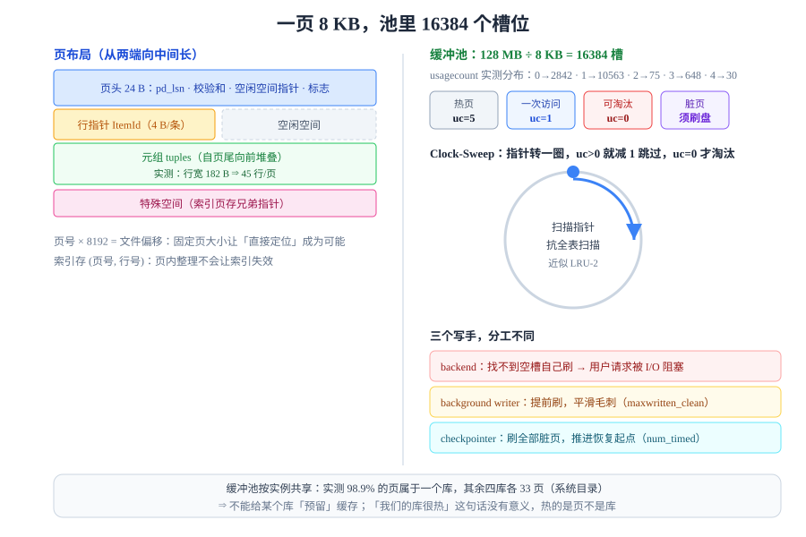

# 页与缓冲池：内存里的那一份数据

存储引擎的所有读写都以**页**为单位。你写的 `where id = 42`，在引擎眼里是「把第 137 号页从磁盘搬到内存的第 N 个槽位，然后在这一页里找第 42 号元组」。所以「数据库慢」的第一个问题永远是：**这一页在不在内存里？**



## 判据族声明

本页判据族 `BFP-A` ~ `BFP-H`，共 8 条。定义表在第八节。

## 一、页长什么样

PostgreSQL 的一页固定 **8192 字节**，InnoDB 固定 **16384 字节**。固定大小是刻意的设计：**只有固定大小才能用「页号 × 页大小」直接算出文件偏移**，不需要任何索引就能定位。

PostgreSQL 的页从两端向中间长：

```text
+----------------------+------------------------------------------+-----------+
| PageHeaderData (24B) | 行指针数组 (ItemIdData, 每项 4B) →→→     |           |
+----------------------+------------------------------------------+           |
|  ←←←  空闲空间 (free space)  →→→                                    特   |
+------------------------------------------------------------------+  殊   |
|  ←←←  元组 (tuple / item) 从尾部往前堆                              |  空   |
+------------------------------------------------------------------+  间   |
```

| 部分 | 内容 | 为什么重要 |
| --- | --- | --- |
| **页头**（24 B） | `pd_lsn`（本页最后一次修改的 WAL 位置）、`pd_checksum`、空闲空间起止、标志位 | `pd_lsn` 是崩溃恢复判断「这页要不要重放」的依据 |
| **行指针**（4 B/条） | `(偏移, 长度, 标志)`，**按顺序编号**，不随元组移动而变 | 索引里存的就是「页号 + 行号」，所以**元组可以在页内移动，行号不会变** |
| **空闲空间** | 上面两者之间的空隙 | 空隙碎片化以后，即使总量够也可能放不下一行（见第八节的坑） |
| **元组** | 实际的列数据，从页尾向前生长 | 变长列超过阈值会挪到 TOAST 表 |
| **特殊空间** | 索引页专用（B+ 树用它存兄弟页指针） | 堆页上为空 |

::: tip 行指针是「稳定引用」
因为索引存的是 `(页号, 行号)` 而不是字节偏移，**页内整理（compact）不会让索引失效**。这条设计让「页内碎片整理」变成纯内部优化，不需要重建索引。
:::

### 一页能放多少行

实测（PG 18.6，每行约 180 字节）：

```sql
select relname, relpages, reltuples,
       round(reltuples / nullif(relpages, 0), 1) as rows_per_page
from pg_class where relname = 'events';
```

```text
 relname | relpages | reltuples | rows_per_page
---------+----------+-----------+---------------
 events  |   22223  |   1e+06   |          45.0
```

**45 行/页**，反推每行 `8192 ÷ 45 ≈ 182` 字节（已含 24 字节页头与 4 字节行指针的摊销）。这个数字决定了两件事：

- **表体积**：1 亿行 × 182 字节 ÷ 0.9（页填充率）≈ **20 GB**；
- **全表扫描的 I/O 量**：20 GB 就是 20 GB，跟「只 select 一列」没关系——**行存引擎读一页就把整页的行都读进来了**。

## 二、缓冲池：一块固定大小的页缓存

缓冲池就是**一片固定大小的共享内存**，被切成 `shared_buffers ÷ 页大小` 个槽位。

```sql
show shared_buffers;                       -- 128MB
select count(*) as slots, pg_size_pretty(count(*)::bigint * 8192) as size
from pg_buffercache;                       -- 16384 槽 / 128 MB
```

| 概念 | 说明 |
| --- | --- |
| 槽位（buffer） | 一个槽放一页；同一页在池内**最多一份** |
| 页表（hash table） | `(文件, 页号) → 槽位`，命中判断 O(1) |
| 脏位（dirty） | 该页被改过、与磁盘不一致，必须刷盘 |
| 引用计数（pin） | 有会话正在用，**不可被淘汰** |
| 使用计数（usagecount） | 0～5，Clock-Sweep 用它决定「值不值得留」 |

### 缓冲池是「实例级」的，不按库、不按表分配

这一点经常被误解。实测这台实例上 5 个数据库共用 16384 个槽：

```sql
select reldatabase, count(*) as pages, round(100.0*count(*)/sum(count(*)) over (), 1) as pct
from pg_buffercache group by reldatabase order by pages desc;
```

```text
 reldatabase | pages |  pct
-------------+-------+-------
       17431 | 16204 |  98.9
       16384 |    33 |   0.2
           5 |    33 |   0.2
       17292 |    33 |   0.2
           1 |    33 |   0.2
```

**98.9% 的页都属于一个库**（本页实验所在的 `dbi_lab`），其余四个库各 33 页——那是系统目录页，谁连上来都要读。

::: danger 三条由此推出的结论
1. **不能给某个库「预留」缓冲池**。A 库的大查询会把 B 库的页挤出去，这是设计如此，不是 bug。
2. **多个库共用一个实例时，「我们的库很热」这句话没有意义**——热的是被访问的页，不是被命名的库。
3. **`shared_buffers` 调大不是线性收益**：PostgreSQL 还依赖操作系统的 page cache 做第二层缓存，池太大反而可能让「双缓冲」重复占用内存（同一页在 PG 池里一份、在 OS cache 里一份）。
:::

## 三、淘汰：Clock-Sweep 而不是 LRU

教科书讲缓冲池都用 LRU，但真实的数据库几乎不用严格 LRU——因为**每次访问都调整链表在并发下要加锁，成本比命中本身还高**。

PostgreSQL 用的是 **Clock-Sweep**（时钟扫除）：

1. 每个页有一个 `usagecount`（0～5）；
2. 需要一个空槽时，指针顺时针走，遇到的页 `usagecount > 0` 就**减 1 并跳过**，遇到 `= 0` 就淘汰它；
3. 一个页每被访问一次，`usagecount` 加 1（上限 5）。

实测这台实例的 `usagecount` 分布：

```sql
select usagecount, count(*) as pages from pg_buffercache group by usagecount order by usagecount;
```

```text
 usagecount | pages
------------+-------
          0 |  2842
          1 | 10563
          2 |    75
          3 |   648
          4 |    30
          5 |  2226
```

这张表能读出三件事：

- **峰值在 1（10563 页）**：一次性访问的页占多数（顺序扫描留下的），它们「只值 1 次机会」；
- **5 那里有 2226 页**：被反复访问的热页（系统目录、索引根与中间层），它们被反复加点，几乎不会被扫出去；
- **2 和 4 很少**：说明加减是「整块」发生的，很少有页长期停在中档。

::: tip Clock-Sweep 的工程含义
它近似 LRU-2，但**抗扫描**：一次全表扫描只会给每页加 1，扫完一轮指针转一圈就把它们清零淘汰了，不会像严格 LRU 那样把整个热数据集冲掉。这就是「OLTP 库上偶尔跑一个大报表，不该让缓存全凉」的实现方式。
:::

### 淘汰的四个前置条件

一个槽位能被淘汰，必须同时满足：

| 条件 | 不满足时 |
| --- | --- |
| `usagecount = 0` | 指针继续转，本轮跳过 |
| 引用计数 `= 0`（没人 pin） | 有人正在读，绝不可动 |
| 不是脏页，或已被刷盘 | 脏页必须先落盘（或交给后台写） |
| 不是被「钉住」的对象 | 系统目录、正在 VACUUM 的页等有特殊保护 |

## 四、脏页与刷盘：谁在写、什么时候写

改页只改内存，脏页需要有人送回磁盘。PostgreSQL 有三个写手，分工不同：

| 写手 | 触发 | 写什么 | 影响 |
| --- | --- | --- | --- |
| **backend（前台进程）** | 找不到空槽且没有干净页可淘汰 | 自己刷脏页 | **用户请求被 I/O 阻塞**，延迟尖刺的来源 |
| **background writer** | 周期性扫描 | 提前刷掉一部分脏页 | 平滑尖刺，`buffers_clean` 计数 |
| **checkpointer** | 定时（`checkpoint_timeout`）或 WAL 量达到 `max_wal_size` | 刷全部脏页并写检查点 | 决定崩溃恢复要重放多少 WAL |

实测这台实例（运行约一天）：

```sql
select num_timed, num_requested, buffers_written, write_time from pg_stat_checkpointer;
select buffers_clean, maxwritten_clean, buffers_alloc from pg_stat_bgwriter;
```

```text
 num_timed | num_requested | buffers_written | write_time
-----------+---------------+-----------------+------------
       168 |             2 |           15189 |     227617

 buffers_clean | maxwritten_clean | buffers_alloc
---------------+------------------+---------------
          5391 |               47 |         38715
```

读法：

- **`num_timed=168`、`num_requested=2`**：绝大多数检查点是定时触发的，只有 2 次是被 WAL 量逼出来的——说明 `max_wal_size` 够用；
- **`maxwritten_clean=47`**：background writer 有 47 次「一轮写到上限就停」，说明它跑得不够快，脏页在堆积；
- **`buffers_alloc=38715` > 槽位数 16384**：说明槽位被复用了两轮多，淘汰是真的在发生。

::: danger `num_requested` 持续增长 = 检查点太稀
如果 `num_requested` 一直在涨，说明 WAL 生成速度超过了 `max_wal_size` 允许的窗口，检查点被**提前强制触发**。后果是：刷盘更频繁、每次刷更多、`fsync` 更密集，**整体吞吐下降**。

正确做法是调大 `max_wal_size` 或缩短 `checkpoint_timeout`，而不是调小——**让检查点按节奏发生，而不是被追着发生**。
:::

## 五、命中率：一个必须小心使用的指标

```sql
select sum(blks_hit) as hits, sum(blks_read) as reads,
       round(100.0 * sum(blks_hit) / nullif(sum(blks_hit) + sum(blks_read), 0), 2) as hit_pct
from pg_stat_database;
```

命中率的定义是 **`hit ÷ (hit + read)`**，注意它是**按访问次数**算的，不是按页数、更不是按数据量。这带来两个陷阱：

| 陷阱 | 现象 | 正确做法 |
| --- | --- | --- |
| **小表刷高命中率** | 一张每秒被读十万次的小字典表，把全局命中率抬到 99.9% | 分表看：`pg_stat_user_tables` 的 `heap_blks_hit / heap_blks_read` |
| **顺序扫描绕过命中率** | 大表全扫时，`read` 涨了但被别的查询的 `hit` 稀释 | 看单条 `EXPLAIN (ANALYZE, BUFFERS)` 的 `hit` / `read` 比例 |

一次实测对比，同一个库、同一时刻：

```sql
-- ① 走索引：81 个页全部命中
explain (analyze, buffers, costs off) select count(*) from events where tenant_id = 7;
-- Buffers: shared hit=81

-- ② 无索引条件：全表扫，一半读盘
explain (analyze, buffers, costs off) select count(*) from events where kind = 'evt-3';
-- Buffers: shared hit=10877 read=11346
```

| 查询 | hit | read | 总页数 | 说明 |
| --- | --- | --- | --- | --- |
| 按租户计数 | 81 | 0 | 81 | 索引 + 覆盖扫描，池里全有 |
| 按类型计数 | 10877 | 11346 | 22223 | 全表 22223 页，**约一半已在池里** |

第 ② 行是关键：**表有 22223 页、池只有 16384 槽**，所以「一半命中一半读盘」是必然结果——这不是「缓存没生效」，而是**工作集大于缓冲池**。

## 六、预读与异步 I/O（PG 18 的变化）

顺序扫描时，引擎不希望「读一页、等一次」，而是**一次发出多个读请求**。PostgreSQL 18 之前靠操作系统的预读；18 起有了自己的 **AIO 子系统**：

| `io_method` | 行为 | 适用 |
| --- | --- | --- |
| `sync` | 同步读，等同 17 及以前 | 兜底 / 对照基线 |
| `worker` | 后台 io worker 进程池并发发起读 | 默认，跨平台可用（含 macOS） |
| `io_uring` | Linux 5.1+ 内核异步 I/O，开销最低 | Linux 生产环境 |

```sql
show io_method;
select count(*) from pg_aios;   -- PG 18 新增：飞行中的异步 I/O 请求
```

::: info 版本边界
`pg_aios` 是 **PG 18 新增**视图。PG 17 及以前没有这个视图、也没有 `io_method` 参数——把这段脚本拿到 PG 16 上会直接报 `unrecognized configuration parameter`。
:::

## 七、五个高频坑

| 坑 | 现象 | 根因 | 正确写法 |
| --- | --- | --- | --- |
| 页内碎片 | 表不大但 `relpages` 很大，扫描慢 | 大量 `delete` / `update` 留下空洞，空闲空间**不连续** | `vacuum` 只标记可复用，要真正回收需 `vacuum full` 或重建表 |
| 行太宽 | 一页只放得下几行 | 大字段（`text`、`jsonb`）没有走 TOAST | 检查 `pg_column_size`，超 2 KB 的大字段考虑拆表或外部存储 |
| 池太小 | `read` 占比高、延迟有毛刺 | `shared_buffers` 小于热数据集 | 先算热数据集大小，再定 `shared_buffers`（通常物理内存 25%） |
| 双缓冲浪费 | 内存吃满但命中率不涨 | PG 池 + OS page cache 各存一份 | 用 `pg_prewarm` 预热，或评估是否需要 `direct io` |
| 把 `blks_hit` 当唯一指标 | 命中率 99.9% 却仍然慢 | 命中率高只说明「多数访问打到池里」，不说明「每次访问的页数少」 | 结合 `Buffers` 与 `actual time` 一起看 |

## 八、判据表

| 编号 | 约定 | 定错了会怎样 | 怎么验证没被破坏 |
| --- | --- | --- | --- |
| `BFP-A` | 必须记录实例的页大小与每页行数 | 容量与 I/O 估算整体偏移一倍以上 | `show block_size` + `relpages/reltuples` 两行都写进容量文档 |
| `BFP-B` | 缓冲池按实例共享，不得按库估算「我们的缓存」 | 多库实例上做出错误的扩容决策 | `pg_buffercache` 按 `reldatabase` 分组，占比写进文档 |
| `BFP-C` | 命中率必须分表看，不得只看 `pg_stat_database` 汇总 | 小表刷高全局命中率，掩盖大表未缓存 | `pg_stat_user_tables` 的 hit/read 逐表列出 |
| `BFP-D` | 判断「缓存够不够」必须比较**热数据集大小**与 `shared_buffers` | 用命中率代替容量判断，永远判不准 | 热数据集 ≈ 高频表 `pg_total_relation_size` 之和，与池大小并列 |
| `BFP-E` | `num_requested`（强制检查点）持续增长必须处置 | 检查点被追着跑，吞吐整体下降 | `pg_stat_checkpointer.num_requested` 在稳定负载下应基本不涨 |
| `BFP-F` | `maxwritten_clean` 增长说明后台写不够快，必须调 | 脏页堆积，前台被 I/O 阻塞出毛刺 | `pg_stat_bgwriter.maxwritten_clean` 增量与写入量一起看 |
| `BFP-G` | 大字段必须确认是否走 TOAST，不得让单页只放几行 | 表体积与扫描量成倍放大 | `pg_column_size(大字段)` 抽样，最大值应远小于 8 KB |
| `BFP-H` | PG 18 的 `io_method` 与 `pg_aios` 不得用在旧版本脚本里 | 脚本在 PG 16/17 上直接报错 | 脚本按 `server_version_num` 分支，或只在 18+ 使用 |

## 如何验证

```sql
-- ① 页与槽位：确认「一页 8KB、池有多少页」
show block_size;
show shared_buffers;
select count(*) as slots from pg_buffercache;

-- ② 淘汰真的在发生：槽位复用次数
select buffers_alloc from pg_stat_bgwriter;   -- 应大于槽位数

-- ③ 命中与读盘的分界：同一条查询连跑两次，第二次 hit 应上升、read 应为 0
explain (analyze, buffers, costs off) select count(*) from events where kind = 'evt-3';
explain (analyze, buffers, costs off) select count(*) from events where kind = 'evt-3';
```

**预期输出**：① `8192` / `128MB` / `16384`；② `buffers_alloc` 明显大于 16384；③ 第一次 `hit=10877 read=11346`（工作集大于池），第二次 `read` 应显著下降甚至为 `0`（第二次访问的页已在池里）。

如果第二次仍然大量 `read`，说明这张表**根本放不进池**——此时问题不在缓存策略，而在「你不该全表扫它」，去看[B+ 树](../BPlusTree/index.md)那一页怎么把它变成索引访问。

## 参考资料

- [PostgreSQL 18 · Database Page Layout](https://www.postgresql.org/docs/18/storage-page-layout.html)——页头字段与行指针的字节级定义
- [PostgreSQL 18 · Buffer Manager](https://www.postgresql.org/docs/18/buffer-manager.html)——缓冲池内部结构与 `usagecount` 语义
- [PostgreSQL 18 · Routine Vacuuming](https://www.postgresql.org/docs/18/routine-vacuuming.html)——死元组、FSM、可见性映射
- [pg_buffercache 扩展文档](https://www.postgresql.org/docs/18/pgbuffercache.html)——池内每个槽位的可观测字段
- [MySQL 8.4 · InnoDB Buffer Pool](https://dev.mysql.com/doc/refman/8.4/en/innodb-buffer-pool.html)——LRU 变体与 `innodb_buffer_pool_instances`
