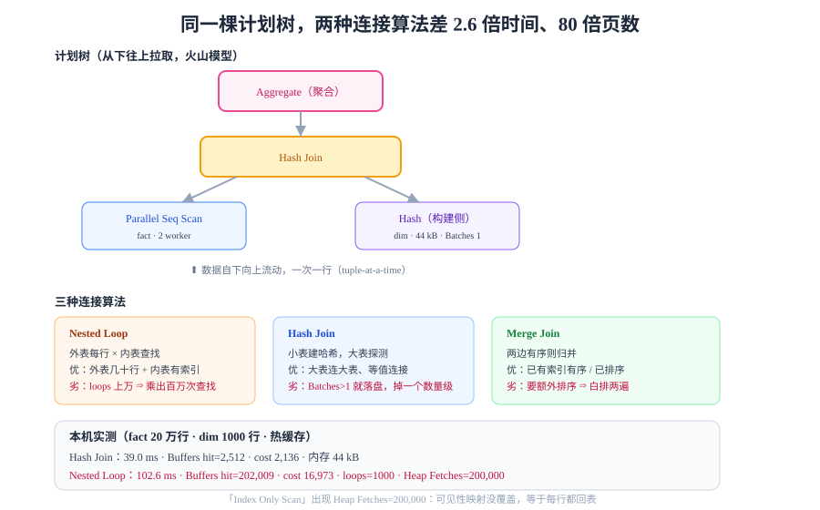

# 执行器：算子是流水线还是批处理

优化器交出一棵**计划树**，执行器负责把它跑出来。同一棵树，不同的执行模型性能可以差 10 倍以上——因为执行模型决定的不是「算什么」，而是「**数据以什么粒度在算子之间流动**」。



## 判据族声明

本页判据族 `EXE-A` ~ `EXE-H`，共 8 条。定义表在第八节。

## 一、三种执行模型

| 模型 | 数据流动粒度 | 代表 | 优点 | 缺点 |
| --- | --- | --- | --- | --- |
| **火山模型**（Volcano / 拉取式） | 一次一行（tuple-at-a-time） | PostgreSQL、MySQL | 实现简单、内存占用小、易中断 | 每个算子每行一次虚函数调用，CPU 开销大 |
| **向量化**（Vectorized / 批处理） | 一次一批（1024～8192 行） | ClickHouse、DuckDB、Spark | 虚函数调用摊薄，可向量化 SIMD，缓存友好 | 部分算子难批处理，内存占用高 |
| **编译执行**（Compiled / 代码生成） | 整棵计划编译成机器码 | HyPer、NoisePage | 消除算子边界，最优 | 编译开销大，短查询不划算 |

PostgreSQL 至今仍是火山模型（PG 18 未改），所以「一个查询里算子越多、行数越大，CPU 越容易成为瓶颈」。这也是它在 OLAP 场景打不过列存引擎的结构性原因——**不是算法不够好，是模型的行粒度太细**。

::: tip 一句话判断
`EXPLAIN (ANALYZE)` 里如果 `actual time` 集中在 `Seq Scan` 与 `Hash`/`Aggregate` 上、而 `Buffers` 不大，那基本是 **CPU 而非 I/O** 受限。此时加内存没用，减少行数（早过滤、加索引、改 SQL）才有用。
:::

## 二、算子分类：计划树上的七种节点

| 类别 | 算子 | 干什么 | 关键读数 |
| --- | --- | --- | --- |
| **扫描** | `Seq Scan` | 顺序读全表所有页 | `Buffers` ≈ `relpages` |
| | `Index Scan` | 走索引定位 + 逐行回表 | `Heap Fetches`、随机 I/O |
| | `Index Only Scan` | 只读索引，不回表 | `Heap Fetches` 应为 0 |
| | `Bitmap Index Scan` + `Bitmap Heap Scan` | 先攒行号位图，再**按页顺序**回表 | `Heap Blocks: exact/lossy` |
| **连接** | `Nested Loop` | 外表每行 × 内表查找 | 内外表行数的乘积 |
| | `Hash Join` | 小表建哈希表，大表探测 | `Buckets` / `Batches` / `Memory Usage` |
| | `Merge Join` | 两边都按连接键有序，归并 | 需要排序或索引有序 |
| **聚合** | `Aggregate` / `HashAggregate` / `GroupAggregate` | 分组与求和 | `Batches`（是否落盘） |
| **排序** | `Sort` / `Incremental Sort` | 排序 | `Sort Method: quicksort / external merge` |
| **并行** | `Gather` / `Gather Merge` | 汇总并行 worker 的结果 | `Workers Planned/Launched` |
| **其他** | `Limit` / `Materialize` / `CTE Scan` / `Subquery Scan` | 截断、缓存、物化 | 是否有 `loops` 放大 |

## 三、扫描：位图扫描为什么常常比索引扫描快

直觉上「走索引」一定比「位图」快，实测常常相反。原因是**回表的顺序**：

| 方式 | 回表顺序 | 72 行时 | 2 万行时 |
| --- | --- | --- | --- |
| `Index Scan` | 按索引顺序，**页号随机跳** | 快 | 慢（随机 I/O 爆炸） |
| `Bitmap Heap Scan` | 先把行号按**页号排序**，再顺序回表 | 略慢（多一步建位图） | **明显更快** |

本机实测（同一张表、同一个条件）：

```sql
explain (analyze, buffers, costs off)
select * from events where tenant_id = 7 and created_at >= '2026-01-05' and created_at < '2026-01-05 01:00';
```

```text
 Bitmap Heap Scan on events (actual rows=72)   Heap Blocks: exact=72
   Buffers: shared hit=33 read=42
   ->  Bitmap Index Scan on idx_events_tenant_created (actual rows=72)
         Buffers: shared hit=3
```

`exact=72` 表示**没有 lossy 页**（位图精度足够）。如果内存不够、位图退化为 `lossy`，那么每个 lossy 页都要**重新检查全部行**——这会静默变慢：

::: danger `lossy` 是最容易被忽略的性能杀手
`Heap Blocks: exact=72 lossy=1300` 的含义是：1300 个页只能记住「这页可能有匹配行」，回表后必须**逐行重新过滤**。表现是「索引明明命中了少量行，却扫了大量堆页」。

调大 `work_mem` 可让位图保持精确。判断方法：`EXPLAIN (ANALYZE, BUFFERS)` 里出现 `lossy` 就去调 `work_mem`。
:::

## 四、连接：三种算法的代价结构完全不同

### 本机实测：同一条 SQL，两种连接算法差 2.6 倍

表：`fact` 20 万行、`dim` 1000 行，`fact.dim_k` 有索引。

```sql
explain (analyze, costs on) select count(*) from fact f join dim d on d.k = f.dim_k;
```

**Hash Join（优化器的选择）**：

```text
 Aggregate (actual time=39.0 ms)
   Buffers: shared hit=2512
   ->  Hash Join  Hash Cond: (f.dim_k = d.k)
         ->  Parallel Seq Scan on fact f  (rows=100000 loops=2)   Buffers: hit=2496
         ->  Hash  (rows=1000)  Buckets: 1024  Batches: 1  Memory Usage: 44kB
               ->  Seq Scan on dim d  (rows=1000)                  Buffers: hit=16
 Execution Time: 39.043 ms
```

**Nested Loop（强制禁用 hash/merge 后）**：

```text
 Aggregate (actual time=102.6 ms)
   Buffers: shared hit=202009 read=165
   ->  Nested Loop (actual rows=200000)
         ->  Seq Scan on dim d (rows=1000)
         ->  Index Only Scan using fact_dim_k_idx on fact f (rows=200, loops=1000)
               Heap Fetches: 200000     Index Searches: 1000
 Execution Time: 102.607 ms
```

| 指标 | Hash Join | Nested Loop | 倍数 |
| --- | --- | --- | --- |
| 执行时间 | **39.0 ms** | 102.6 ms | 2.6× |
| 缓冲页访问 | **2,512** | 202,009 | **80×** |
| 估算 cost | 2,136 | 16,973 | 7.9× |
| 内存 | 44 kB（哈希表，`Batches: 1` 未落盘） | 0 | — |

这张表能读出三件事：

1. **`loops=1000`**：Nested Loop 把内表扫了 1000 次。内表再快，乘以 1000 也慢；
2. **`Heap Fetches: 200000`**：号称 `Index Only Scan`，实际每行都回表了——因为可见性映射没覆盖到（大批量刚写入），退化成「索引扫 + 全回表」；
3. **`Buffers` 差 80 倍而时间只差 2.6 倍**：因为 202009 个页几乎全在缓冲池里（`hit`），如果是冷缓存，差距会放大到几十倍。

### 三种连接的适用条件

| 算法 | 复杂度 | 何时最优 | 何时灾难 |
| --- | --- | --- | --- |
| **Nested Loop** | `外表行数 × 内表查找成本` | 外表很小（几十行）、内表有索引 | 外表几万行 → 乘出百万次查找 |
| **Hash Join** | `外表 + 内表`（各扫一遍） | 大表连大表、等值连接、内存够 | 哈希表超 `work_mem` → `Batches > 1` 落盘 |
| **Merge Join** | `排序 + 归并` | 两边**已有序**（索引有序或已排序） | 需要额外排序 → 白排两遍 |

::: danger `Batches > 1` 就是 Hash Join 落盘了
`Hash` 节点上的 `Batches: 4` 意味着哈希表被分成 4 批，**分批写临时文件再分批读回**。性能会掉一个数量级。

处置：调大 `work_mem`（注意是**每算子**配额，不是每查询），或先把小表过滤得更小（把 `where` 下推到子查询）。
:::

## 五、聚合与排序：两个最容易落盘的算子

| 算子 | 内存内 | 落盘形态 | 触发条件 |
| --- | --- | --- | --- |
| `HashAggregate` | 哈希表存分组 | `Batches > 1`，分批溢出 | 分组数 × 每组状态 > `work_mem` |
| `GroupAggregate` | 无需额外内存 | 要求输入已按分组键有序 | 需要先 `Sort`（除非有索引） |
| `Sort` | `quicksort` | `external merge Disk: NkB` | 排序数据量 > `work_mem` |

`EXPLAIN (ANALYZE)` 里看到这两行就要警惕：

```text
Sort Method: external merge  Disk: 45632kB
HashAggregate  Batches: 8  Memory Usage: 4097kB
```

**它们不会报错，只会静默变慢**——这是「查询昨天还快，今天突然慢」的常见原因之一（数据量跨过了 `work_mem` 阈值）。

## 六、并行执行：`Gather` 到底加不加速

```sql
explain (analyze, costs off) select count(*) from events where kind = 'evt-3';
```

```text
 Finalize Aggregate (actual time=50.9 ms)
   ->  Gather (Workers Planned: 2  Workers Launched: 2)
         ->  Partial Aggregate  (loops=3)
               ->  Parallel Seq Scan on events (rows=47619 loops=3)
                     Rows Removed by Filter: 285714
                     Buffers: shared hit=10877 read=11346
```

| 读数 | 含义 | 判读 |
| --- | --- | --- |
| `Workers Planned: 2` | 计划用 2 个并行 worker | 由 `max_parallel_workers_per_gather` 决定 |
| `Workers Launched: 2` | 实际起了 2 个 | **若小于 Planned，说明 worker 不够**（并发查询多） |
| `loops=3` | 该节点被 3 个进程各跑一次（2 worker + 1 leader） | 累计耗时要按 `loops` 摊 |
| `Rows Removed by Filter: 285714` | 每个 loop 过滤掉 28.5 万行 | 过滤率 85.7% → **应该加索引而不是加并行** |

::: warning 并行不是免费的
- 每个 worker 都是一个进程，**共享同一个 `shared_buffers` 与同一块磁盘**；
- 并行只对**大范围扫描**有效；对小查询，启动 worker 的开销比省下的时间还多；
- `Workers Launched < Planned` 说明并行度被资源限制住了，此时看 `max_worker_processes` 与当前并发数。
:::

## 七、五个高频坑

| 坑 | 现象 | 根因 | 正确做法 |
| --- | --- | --- | --- |
| 把 `cost` 当耗时 | 优化了 cost 却没变快 | `cost` 是估算值，单位是「页访问当量」 | 只看 `actual time` 与 `Buffers` |
| 忽略 `loops` | 单次看起来很快，总时间很长 | `actual time` 是**每次循环**的平均值 | 总时间 ≈ `actual time × loops` |
| 位图退化为 `lossy` | 命中行少但扫了很多堆页 | `work_mem` 不够 | 调大 `work_mem`，看 `Heap Blocks: lossy` 消失 |
| 并行度上不去 | `Launched < Planned` | worker 进程池被占满 | 看 `max_worker_processes`，或降低并发查询数 |
| 排序/聚合落盘 | 数据量涨了以后突然变慢 | 跨过 `work_mem` 阈值 | 调 `work_mem`，或减少排序/分组的数据量 |

## 八、判据表

| 编号 | 约定 | 定错了会怎样 | 怎么验证没被破坏 |
| --- | --- | --- | --- |
| `EXE-A` | 性能结论必须引用 `actual time`，不得引用 `cost` | 优化方向完全跑偏 | 分析记录里 `cost` 只作参考，结论由 `actual time` 支撑 |
| `EXE-B` | 读算子耗时必须乘以 `loops` | 把 1000 次循环的平均值当总耗时，低估几十倍 | `actual time × loops` 与上层节点耗时对得上 |
| `EXE-C` | `Heap Blocks` 出现 `lossy` 必须处置 | 索引命中少量行却全表式回表 | `EXPLAIN (ANALYZE, BUFFERS)` 中 `lossy` 为 0 或不存在 |
| `EXE-D` | `Hash Join` 的 `Batches` 必须为 1 | 哈希表落盘，性能掉一个数量级 | `Batches: 1`；否则调 `work_mem` 或缩小构建侧 |
| `EXE-E` | `Sort` / `HashAggregate` 不得出现落盘 | 静默变慢，且随数据增长持续恶化 | `Sort Method` 不含 `external merge`；`Batches` 为 1 |
| `EXE-F` | `Workers Launched` 应等于 `Planned` | 并行名存实亡，大查询慢 | 两值相等；不等时查 `max_worker_processes` 与并发 |
| `EXE-G` | Nested Loop 的内表被扫次数必须可接受 | `loops` 上万时，内表再快也慢 | `loops` 与外表行数一致，且绝对值在百级以内 |
| `EXE-H` | 「加并行」之前必须先排除「该加索引」 | 用并行掩盖缺索引，资源消耗翻倍 | 过滤率（`Rows Removed ÷ 扫描行数`）高于 90% 时先加索引 |

## 如何验证

```sql
-- ① 同一 SQL 的两种连接算法对照（本页核心结论）
explain (analyze, costs on) select count(*) from fact f join dim d on d.k = f.dim_k;

set enable_hashjoin = off; set enable_mergejoin = off;
explain (analyze, costs on) select count(*) from fact f join dim d on d.k = f.dim_k;
reset all;

-- ② 位图是否 lossy
explain (analyze, buffers, costs off)
select * from events where tenant_id = 7 and created_at >= '2026-01-05' and created_at < '2026-01-05 01:00';

-- ③ 并行是否真的起来
explain (analyze, costs off) select count(*) from events where kind = 'evt-3';
```

**预期输出**：① Hash Join 约 **39 ms / 2,512 页**，Nested Loop 约 **103 ms / 202,009 页**（2.6 倍时间、80 倍页数）；② `Heap Blocks: exact=72`，**无 `lossy`**；③ `Workers Planned: 2` 且 `Workers Launched: 2`、`loops=3`。

如果 ① 的 Nested Loop 时间没有明显更慢，说明你的数据量太小或全在缓存里——**放大到十万行以上再测**，差距才会显现。

## 参考资料

- [PostgreSQL 18 · Using EXPLAIN](https://www.postgresql.org/docs/18/using-explain.html)——各算子的官方说明与读数含义
- [PostgreSQL 18 · Parallel Query](https://www.postgresql.org/docs/18/parallel-query.html)——并行计划与 worker 配置
- [Volcano—An Extensible and Parallel Query Evaluation System](https://dl.acm.org/doi/10.1109/69.273032)——Graefe，1994，火山模型原始论文
- [MonetDB/X100: Hyper-Pipelining Query Execution](https://www.cidrdb.org/cidr2005/papers/P19.pdf)——向量化执行模型的经典论证
- [MySQL 8.4 · EXPLAIN Output Format](https://dev.mysql.com/doc/refman/8.4/en/explain-output.html)——对照阅读：MySQL 的算子命名与本页不同但结构同源
