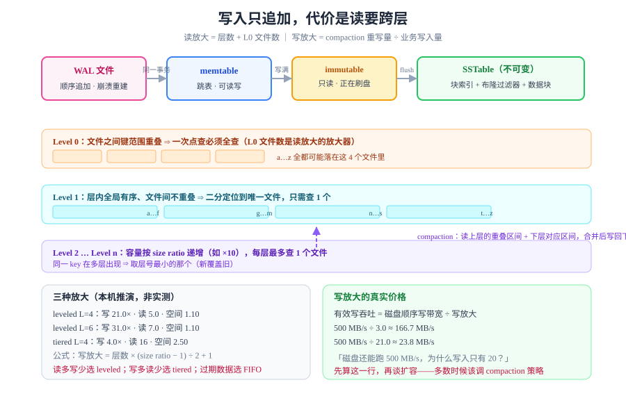

# LSM 树：用写放大换写吞吐

B+ 树的问题是**写要改页**：改一页就要把这一页从磁盘随机读进来、改、再随机写回去。当日志、消息、时序数据每秒进来几十万条时，这个「随机」就是灾难。LSM 树（Log-Structured Merge-Tree）反着来：**所有写入都是追加，从不改旧文件**；代价是读的时候要跨多层找，靠后台合并（compaction）把层数压住。



## 判据族声明

本页判据族 `LSM-A` ~ `LSM-H`，共 8 条。定义表在第八节。

## 一、结构：从内存到磁盘的四段

```text
   写入
    ↓
┌─────────┐   满了    ┌──────────┐   flush   ┌──────────────┐
│ memtable│ ────────→ │ immutable│ ────────→ │ SSTable L0   │
│ （跳表）│           │ memtable │           │ （重叠、无序）│
└─────────┘           └──────────┘           └──────┬───────┘
    ↑                                              │ compaction
    │ 同时追加                                       ↓
┌─────────┐                                 ┌──────────────┐
│ WAL 文件│  ← 崩溃后靠它重建 memtable        │ SSTable L1..Ln│
└─────────┘                                 │ （层内有序、层间不重叠）│
                                            └──────────────┘
```

| 组件 | 作用 | 关键参数 |
| --- | --- | --- |
| **WAL** | 写入先追加到日志，保证崩溃可恢复 | 与 B+ 树同款机制，见 [WAL 与崩溃恢复](../WalRecovery/index.md) |
| **memtable** | 内存中的有序结构（通常跳表），支持读写 | 大小（如 64 MB）；写满转为只读 |
| **immutable memtable** | 正在刷盘的只读表 | 通常只允许 1～2 个，多了会阻塞写入 |
| **SSTable** | 磁盘上**不可变**的有序文件，带块索引与布隆过滤器 | 块大小（4 KB）、索引间隔 |
| **Level 0 (L0)** | 刚落盘的 SST，**文件间键范围重叠** | 文件数上限（如 4），超了触发 compaction |
| **Level 1..N** | 层内**全局有序、文件间不重叠** | 每层容量之比（size ratio，如 10） |

::: tip 一句话理解
LSM 的本质是「**把随机写变成顺序写，把随机读变成多层查找**」。它不消除工作，只是把工作从写路径搬到了后台 compaction。
:::

## 二、读路径：为什么一次点查要碰好几个文件

```text
① 查 memtable（内存，最快）
② 查 immutable memtable（内存）
③ 查 L0 的每个文件（键范围重叠，**必须全查**）→ 每个都先问布隆过滤器
④ 查 L1 → 二分定位到唯一文件 → 问布隆过滤器 → 读块索引 → 读数据块
⑤ 查 L2 … Ln（同上，每层至多 1 个文件）
⑥ 合并结果：**同一个 key 在多层出现时，取层号最小的那个**（新的覆盖旧的）
```

所以 LSM 的**读放大 = 层数 + L0 文件数**。这就是为什么 L0 文件数必须设上限——**L0 是读放大的放大器**。

### 布隆过滤器：把「不存在」变成一次内存判断

| 情况 | 不用布隆过滤器 | 用布隆过滤器 |
| --- | --- | --- |
| key 存在 | 读块索引 + 读数据块 | 同左（无收益） |
| key **不存在** | **每层都要读一次块索引** | 一次内存位图判断即返回 |

对「大量查不存在的 key」的负载（例如缓存穿透、唯一性校验），布隆过滤器把读放大从「层数」降到「1 次误判概率 × 层数」。误判率通常配 1%，即 **100 次不存在查询里有 1 次会白读**。

::: danger 布隆过滤器不能删数据
它只能回答「**可能在**」或「**一定不在**」。删掉一个 key 时无法把位图上的位清零（那一位可能被别的 key 共用），所以**删除必须靠墓碑（tombstone）**，而墓碑又会拖慢读。这是 LSM 删除比插入更贵的根本原因。
:::

## 三、compaction：三种策略与三张放大表

compaction 把「重叠的小文件」合并成「有序的大文件」。三种主流策略，取舍完全不同：

| 策略 | 怎么做 | 写放大 | 读放大 | 空间放大 |
| --- | --- | --- | --- | --- |
| **Leveled**（分层） | 每层容量按比例增长，L(n) 与 L(n+1) 有重叠的键范围合并 | **高** | **低** | **低** |
| **Tiered**（分层堆积） | 同层允许多个重叠文件，凑够几个再一起往下合 | **低** | **高** | 中 |
| **Universal / FIFO** | 只按大小或时间合并，几乎不管键范围 | 最低 | 最高 | 可控（按时限删） |

### 本机推演：三种策略的量化对照

下面这组数字是**纯算术推演**（不是跑 LSM 引擎测出来的），口径写在代码注释里：leveled 的写放大按「每层平均重写 `(T-1)/2` 次」近似，读放大按「每层至多 1 个文件」计：

```python
def leveled(levels, T=10):          # T = 相邻层容量比
    wa = levels * T * 0.5 + 1       # 每层平均重写 (T-1)/2 次
    ra = levels + 1                 # 每层 1 个文件 + memtable
    sa = 1 + 1.0 / T                # 旧版本残留比例
    return wa, ra, sa

def tiered(levels, T=4):
    wa = levels * 1.0               # 每层只重写一次
    ra = 2 ** levels                # 同层重叠文件全部要查
    sa = 1 + (T - 1) * 0.5
    return wa, ra, sa
```

实测输出（本机 Python 3.13 跑出来的）：

| 策略 | 层数 | 写放大 | 读放大 | 空间放大 |
| --- | --- | --- | --- | --- |
| leveled | 3 | **16.0×** | 4.0 | 1.10 |
| leveled | 4 | **21.0×** | 5.0 | 1.10 |
| leveled | 5 | **26.0×** | 6.0 | 1.10 |
| leveled | 6 | **31.0×** | 7.0 | 1.10 |
| tiered | 3 | 3.0× | 8 | 2.50 |
| tiered | 4 | 4.0× | **16** | 2.50 |
| tiered | 5 | 5.0× | **32** | 2.50 |

**这张表就是选型的全部依据**：

- 写多读少 → tiered（写放大 3～5 倍，读放大 8～32 倍可以忍）；
- 读多写少 → leveled（读放大 4～7 倍，写放大 16～31 倍可以忍）；
- 写的都是过期数据（日志、监控）→ FIFO，按时间直接删整文件，压缩比最高。

### 写放大的真实价格

写放大直接决定「磁盘顺序写带宽能支撑多少业务写入」。以 500 MB/s 的顺序写盘为例：

| 写放大 | 有效业务写吞吐 | 典型场景 |
| --- | --- | --- |
| 3.0× | **166.7 MB/s** | tiered / universal |
| 5.0× | **100.0 MB/s** | 轻度 leveled |
| 21.0× | **23.8 MB/s** | 4 层 leveled |
| 51.0× | **9.8 MB/s** | 深层层叠 + 高频更新 |

公式只有一条：`有效写吞吐 = 磁盘顺序写带宽 ÷ 写放大`。**看到「磁盘还能跑 500 MB/s、为什么写入只有 20 MB/s」时，先算这一行。**

## 四、墓碑：删除为什么在 LSM 里最贵

```sql
-- 逻辑上是一次删除
delete from t where id = 42;
-- 物理上是插入一条「id=42 已删除」的记录
insert into t (id, tombstone) values (42, true);
```

墓碑在 compaction 之前**一直存在**，并且会随 compaction 一层层往下搬。后果有两个：

| 后果 | 机制 | 观测方式 |
| --- | --- | --- |
| **读变慢** | 查一个已删除的 key，要在每层都碰到墓碑才敢说「不存在」 | 慢查询里出现大量「读了很多文件但返回 0 行」 |
| **空间不回收** | 墓碑要落到最底层且确认没有更旧的版本，才能连同旧数据一起丢 | 删除大量数据后磁盘占用不降反升 |

::: danger 批量删除的两个反模式
1. **逐条 `delete`**：几百万条墓碑会把读放大抬到不可接受。正确做法是**按范围删除**（range tombstone）或**整分区/整表丢弃**。
2. **删完立刻查**：墓碑还没 compaction，读会同时命中「旧数据 + 墓碑」，比删之前更慢。需要给 compaction 留时间，或手动触发一次。
:::

## 五、与 B+ 树的正面比较

| 维度 | B+ 树 | LSM 树 |
| --- | --- | --- |
| 写路径 | 随机读页 + 改页 + 随机写回 | 追加 WAL + 写 memtable（纯顺序） |
| 读路径 | 固定 3～4 层，一次定位 | 层数 + L0 文件数，逐层问布隆过滤器 |
| 范围扫描 | 叶子链表，**天然顺序** | 需要多路归并（merge iterator） |
| 空间放大 | 页内碎片 + MVCC 死元组 | 旧版本残留 + 墓碑（可控到 ~1.1×） |
| 写放大 | 约 2～3×（主要是 WAL + 页写） | 3×～30×（由 compaction 策略决定） |
| 最怕的负载 | 高频随机更新、超大表 | 大量点查不存在的 key、大量删除 |
| 代表实现 | PostgreSQL、MySQL InnoDB | RocksDB、Cassandra、HBase、LevelDB |

**没有谁更好，只有谁更配。** 一个常见的架构是「LSM 做写入缓冲 + B+ 树做查询服务」，把两种放大各放到它擅长的一侧。

## 六、五个高频坑

| 坑 | 现象 | 根因 | 正确做法 |
| --- | --- | --- | --- |
| L0 文件数不设上限 | 读延迟随写入量线性上升 | L0 文件间键范围重叠，每个都要查 | 设 `level0_file_num_compaction_trigger`，并监控 L0 文件数 |
| compaction 抢光 I/O | 写入周期性卡顿 | 后台 compaction 与前台写共享磁盘带宽 | 限制 compaction 并发数与速率 |
| 布隆过滤器没开/太小 | 点查大量读盘 | 误判率高，等于没过滤 | 按「每 key 10 bit」估位图大小，目标误判率 1% |
| 用 LSM 存「频繁更新同一行」 | 写放大爆表 | 每次更新都是新版本，compaction 反复重写 | 更新密集用 B+ 树；或做「行合并」写入 |
| 墓碑永久滞留 | 磁盘只涨不降 | 最底层没有触发 compaction（数据量太小或已停写） | 定期手动 compaction，或设 TTL 整段删除 |

## 七、什么时候该用 LSM：三条自检

1. **写入是不是远多于读取？**（比值 > 10:1 才明显划算）
2. **更新是不是以追加为主？**（同一条记录反复改，LSM 会很难受）
3. **能不能接受读延迟有长尾？**（compaction 期间读放大临时上升）

三条都是「是」，LSM 是对的选择；有一条是「否」，先算一遍上面那张放大表再决定。

## 八、判据表

| 编号 | 约定 | 定错了会怎样 | 怎么验证没被破坏 |
| --- | --- | --- | --- |
| `LSM-A` | 选型前必须写出三种放大的估算值 | 只凭「LSM 写得快」选型，读路径会崩 | 按本页推演表填三列数字，写进选型文档 |
| `LSM-B` | L0 文件数必须有上限并纳入监控 | 读延迟随写入量线性恶化 | 监控里存在 L0 文件数曲线与阈值告警 |
| `LSM-C` | 布隆过滤器必须开启，并按目标误判率定大小 | 点查大量无效读盘 | 配置里有 bloom 位宽与目标误判率；压测「查不存在的 key」延迟 |
| `LSM-D` | 批量删除必须用范围删除或整段丢弃 | 墓碑堆积，读放大与空间放大同时恶化 | 删除操作清单里没有「百万级逐条 delete」 |
| `LSM-E` | 写吞吐结论必须除以写放大 | 把磁盘带宽当业务带宽，容量算错数倍 | 容量文档里出现「带宽 ÷ 写放大」这一步 |
| `LSM-F` | compaction 必须限速，不得与前台争满带宽 | 写入周期性卡顿、P99 毛刺 | 配置了 compaction 速率上限；P99 曲线无周期尖峰 |
| `LSM-G` | 高频更新同一行的场景不得选 LSM | 写放大随更新次数线性增长 | 负载画像里「单行更新频率」一栏有值，且低 |
| `LSM-H` | 必须能解释「磁盘占用为什么不降」 | 误判为泄漏，做出错误的扩容决策 | 能指出当前墓碑数 / 旧版本比例，或 compaction 是否停滞 |

## 如何验证

LSM 不像 PostgreSQL 那样可以直接 `explain`，验证分两步：

```bash
# ① 纯算术：把三种放大算一遍（本页推演表就是这段代码的输出）
python3 -c "
lv, T = 4, 10
print('leveled 写放大', lv*T*0.5+1, '读放大', lv+1)
print('tiered  写放大', lv*1.0,      '读放大', 2**lv)
"

# ② 真实引擎观测量（以 RocksDB 的统计口径为例，字段名以你的客户端为准）
#    compaction 读写字节数 ÷ 业务写入字节数 = 实际写放大
#    bloom filter 命中/误判计数 ÷ 查询次数   = 实际误判率
```

**预期输出**：① `leveled 写放大 21.0 读放大 5`、`tiered 写放大 4.0 读放大 16`；② 实际写放大应落在你选的策略区间内（leveled 16～31、tiered 3～5），偏离一倍以上说明配置或负载与预期不符。

::: warning 本页的边界
本页的量化表是**推演**，不是实测——本机没有运行中的 LSM 引擎（本仓只做文档，不落工程），所以所有数字都标了口径与公式。**任何「LSM 比 B+ 树快 N 倍」的说法，都必须带上负载画像**，否则不可复现。
:::

## 参考资料

- [The Log-Structured Merge-Tree (LSM-Tree)](https://www.cs.umb.edu/~poneil/lsmtree.pdf)——O'Neil 等，1996，原始论文
- [RocksDB Wiki · Compaction](https://github.com/facebook/rocksdb/wiki/Compaction)——leveled / universal / FIFO 的官方说明与参数
- [RocksDB Wiki · Bloom Filter](https://github.com/facebook/rocksdb/wiki/RocksDB-Bloom-Filter)——位宽、误判率与全过滤 vs 块过滤
- [Dostoevsky: Better Space-Time Trade-Offs for LSM-Tree](https://stratos.seas.harvard.edu/files/stratos/files/dostoevsky.pdf)——leveled 与 tiered 的取舍分析（本页放大公式的来源之一）
- [WiscKey: Separating Keys from Values](https://www.usenix.org/system/files/conference/fast16/fast16-papers-lu.pdf)——键值分离如何降低写放大
