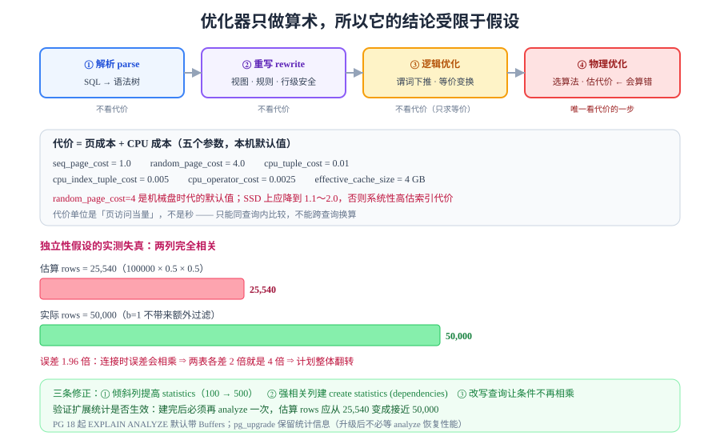

# 优化器：代价模型为什么会算错

优化器的全部工作可以浓缩成一句话：**在候选计划里挑一个「估算代价」最小的**。它不运行查询，只做算术——所以它给出的结论，**永远受限于它手上的统计信息与几条简化假设**。这一页讲清楚它怎么算、在哪一步失真、以及失真之后你看到的现象。



## 判据族声明

本页判据族 `OPT-A` ~ `OPT-H`，共 8 条。定义表在第八节。

## 一、四个步骤：逻辑 → 物理

```text
SQL
 ↓ ① 解析（parse）      → 语法树
 ↓ ② 重写（rewrite）    → 展开视图、规则、行级安全
 ↓ ③ 逻辑优化           → 谓词下推、连接重排、子查询展开（等价变换，不看代价）
 ↓ ④ 物理优化           → 为每个操作选算法（Seq/Index、Hash/NestLoop/Merge）+ 估代价
计划树
```

| 步骤 | 是否看代价 | 你能干预的地方 |
| --- | --- | --- |
| 解析 / 重写 | 否 | 视图、规则、`security_barrier` |
| 逻辑优化 | 否 | 改写 SQL（把 `or` 拆成 `union all`、把子查询改 `join`） |
| 物理优化 | **是** | 索引、统计信息、`enable_*` 开关、`pg_hint_plan`（扩展） |

关键认识：**逻辑优化是「等价变换」，物理优化是「选一个」**。前者不会出错（只可能错失机会），后者会算错——本页讨论的全部是后者。

## 二、代价模型：五个成本参数

PostgreSQL 的代价是一个**无量纲加权和**：

```text
总代价 ≈ 页成本 + CPU 成本
       = 顺序页数 × seq_page_cost
       + 随机页数 × random_page_cost
       + 处理行数 × cpu_tuple_cost
       + 索引条目数 × cpu_index_tuple_cost
       + 表达式求值次数 × cpu_operator_cost
```

本机默认值（`pg_settings` 实测）：

| 参数 | 默认值 | 含义 |
| --- | --- | --- |
| `seq_page_cost` | **1.0** | 顺序读一页的成本基准 |
| `random_page_cost` | **4.0** | 随机读一页 = 4 次顺序读 |
| `cpu_tuple_cost` | **0.01** | 处理一行的 CPU 成本 = 1% 个顺序页 |
| `cpu_index_tuple_cost` | **0.005** | 处理一个索引条目的成本 |
| `cpu_operator_cost` | **0.0025** | 求值一次表达式的成本 |
| `effective_cache_size` | **4 GB**（524288 页） | 告诉优化器「OS 缓存里大概有多少」 |

::: danger `random_page_cost=4` 在 SSD 上是过时的
这个默认值来自机械盘时代（随机寻道约 4 倍顺序读）。在 **SSD / 云盘**上，随机读与顺序读的差距通常只有 1.5～2 倍。

后果：优化器**系统性高估**索引扫描的代价，于是过度选择全表扫描。SSD 上常见的调整是把 `random_page_cost` 降到 **1.1～2.0**，并同步把 `effective_cache_size` 设成「物理内存的 50%～75%」（不是 `shared_buffers`）。
:::

### 代价是怎么算出来的：一个可验算的例子

实测：`fact` 表 20 万行、约 2,000 页，`dim` 表 1000 行、约 18 页。

| 计划 | 估算 cost | 拆解 |
| --- | --- | --- |
| Hash Join | **2,136** | 两表各扫一遍（~2,018 页）+ 20 万行 CPU + 哈希构建 |
| Nested Loop | **16,973** | 1000 次索引查找，每次约 17 |

**估算差 7.9 倍，实测时间差 2.6 倍**。注意这两个倍数不一样：**cost 是「页访问当量」，时间是真实秒数**，两者只能同向参考，不能直接换算。这正是「优化了 cost 却没变快」的原因。

## 三、选择率：优化器最脆弱的一环

计划选择的核心输入是**选择率**（selectivity）——「这个条件能过滤掉多少行」。它决定了「该扫多少行」，而扫多少行决定了「该用哪种访问方式」。

```text
估算行数 = 表总行数 × 各条件选择率之积
```

### 本机实测：独立性假设造成的 1.96 倍误差

构造一张两列**完全相关**的表（`a` 与 `b` 恒等）：

```sql
create table corr as select (g % 2) as a, (g % 2) as b, g as id from generate_series(1,100000) g;
analyze corr;
explain (analyze, costs on, timing off) select count(*) from corr where a = 1 and b = 1;
```

```text
 Aggregate (cost=2139.85..2139.86 rows=1)
   ->  Seq Scan on corr (cost=0.00..2076.00 rows=25540) (actual rows=50000.00)
         Filter: ((a = 1) AND (b = 1))
         Rows Removed by Filter: 50000
```

| 项 | 值 | 说明 |
| --- | --- | --- |
| 估算行数 | **25,540** | `100000 × 0.5 × 0.5` |
| 实际行数 | **50,000** | 因为 `a` 与 `b` 完全相关，第二个条件**不带来任何额外过滤** |
| 误差 | **1.96×** | 估算少了一半 |

根因是**独立性假设**：优化器假设「`a=1` 与 `b=1` 是两个独立事件」，所以把选择率相乘。**现实中的列经常相关**（城市与邮编、品牌与价格、租户与业务线），这条假设会系统性低估。

::: warning 误差会被放大
单表上 2 倍误差通常无害（都走全表扫）。但**连接时误差会相乘**：两个各差 2 倍的表连接，估算差 4 倍，足以让优化器从 Hash Join 翻到 Nested Loop——这就是「昨天还好的查询，今天突然慢了 10 倍」的典型机制。
:::

### 三条修正手段

| 手段 | 怎么做 | 适用 |
| --- | --- | --- |
| **提高统计精度** | `alter table t alter column c set statistics 500`（默认 100） | 列值分布倾斜、`n_distinct` 估不准 |
| **扩展统计（多列）** | `create statistics s (dependencies) on a, b from corr;` | 列间有函数依赖或强相关 |
| **改写查询** | 用 `case` / 子查询让条件不再相乘 | 逻辑上确实相关，但不想改统计 |

验证扩展统计是否生效：

```sql
create statistics corr_dep (dependencies) on a, b from corr;
analyze corr;
explain (analyze, costs on, timing off) select count(*) from corr where a = 1 and b = 1;
-- 估算行数应从 25540 变成接近 50000
```

## 四、统计信息：三个字段决定命运

```sql
select attname, n_distinct, correlation, null_frac from pg_stats where tablename = 'events';
```

```text
 attname    | n_distinct | correlation | null_frac
------------+------------+-------------+-----------
 id         |         -1 |       1.000 |         0
 tenant_id  |         50 |       0.022 |         0
 created_at |         -1 |       1.000 |         0
 kind       |          7 |       0.145 |         0
 payload    |          1 |       1.000 |         0
```

| 字段 | 含义 | 影响什么 |
| --- | --- | --- |
| `n_distinct` | 不同值个数；**负数表示「占总行数的比例」**（`-1` = 唯一） | 等值条件的选择率 = `1 / n_distinct` |
| `correlation` | 物理顺序与逻辑顺序的相关性，`1` 完全一致、`0` 完全随机 | **决定「索引扫描要不要打折」**；接近 1 时优化器认为索引扫描很便宜 |
| `null_frac` | NULL 占比 | `is null` 的选择率、以及 `not null` 的修正 |

`tenant_id` 的 `correlation = 0.022` 是[上一页](../BPlusTree/index.md)那个「72 行读 72 个页」的根因：**优化器知道它是随机分布的**，所以在估算索引扫描代价时会按「每行一个随机页」计——这也是它有时**主动选择全表扫描**的原因，不是它蠢。

::: tip 统计信息什么时候会骗人
- **大批量写入后没 `analyze`**：`reltuples` 还停在旧值，估算整体偏移；
- **数据倾斜但 `statistics=100` 采样不足**：MCV 列表抓不到高频值；
- **表达式列没建表达式索引**：`where lower(name)=...` 的选择率只能按默认 0.5% 猜。
:::

## 五、计划为什么会「突然变了」

计划是**每次执行时重新选的**（普通查询不做计划缓存），所以计划变化只有一个原因：**输入变了**。四个常见输入变化：

| 变化 | 机制 | 现象 |
| --- | --- | --- |
| 数据量跨过阈值 | 表从 1000 页涨到 10000 页，全表扫描的相对成本下降 | 某个时刻起全表扫描取代索引扫描 |
| 统计信息更新 | `autoanalyze` 跑了，`n_distinct` 从 10 改成 5000 | 同一 SQL 换了计划 |
| 参数值不同 | 同一个预编译语句，绑定值从「命中 1 行」变成「命中 10 万行」 | **同一语句两种计划**（generic vs custom plan） |
| 成本参数调整 | `random_page_cost` 改了 | 全库范围的计划翻转 |

### 预编译语句的两种计划

| 计划类型 | 何时用 | 风险 |
| --- | --- | --- |
| **custom plan** | 每次按实际参数值重新估代价（默认前 5 次） | 计划开销略高，但更准 |
| **generic plan** | 用「平均选择率」生成一份固定计划 | 参数倾斜时严重失真（例如 `tenant_id` 有一个超大租户） |

```sql
-- 观察某条预编译语句的计划切换
select name, generic_plans, custom_plans from pg_prepared_statements;
```

::: danger 「昨天好的查询今天慢了」的排查顺序
1. `pg_stat_statements` 看 `plan` 是否变化、`mean_time` 拐点在哪；
2. `analyze` 是否刚跑过（`pg_stat_user_tables.last_analyze`）；
3. 表行数是否跨了数量级（`reltuples` 与历史对比）；
4. 绑定参数是否落在极端值上（`pg_prepared_statements.generic_plans > 0`）；
5. 最后才怀疑成本参数被改过。

**顺序不能反**——先查成本参数，十次有九次白忙。
:::

## 六、PG 18 的两个新变化

| 变化 | 影响 |
| --- | --- |
| **B-tree skip scan** | 首列低基数时，没有首列条件也能用多列索引；减少了「为每种过滤组合建一个索引」的需求 |
| **`EXPLAIN ANALYZE` 默认带 Buffers** | 不必再手写 `EXPLAIN (ANALYZE, BUFFERS)`；`BUFFERS` 从「加分项」变成「默认项」 |
| **`pg_upgrade` 保留统计信息** | 大版本升级后不必等 `analyze` 跑完才恢复性能（升级后「性能要几小时才回来」的老问题被缓解） |

::: info 版本边界
前两条是 **PG 18 新增**。`EXPLAIN ANALYZE` 在 PG 17 及以前**不带** `Buffers`，必须显式写 `EXPLAIN (ANALYZE, BUFFERS)`——旧脚本拿到 18 上不会报错，只是输出多了一行，别误以为是配置问题。
:::

## 七、五个高频坑

| 坑 | 现象 | 根因 | 正确做法 |
| --- | --- | --- | --- |
| 用 `cost` 对比两个不同查询 | 「这个 cost 更小所以更快」 | `cost` 只在同一查询内可比 | 只比 `actual time` 与 `Buffers` |
| 关掉 `enable_*` 当优化手段 | 生产上强制走某条路径 | 绕过了优化器而不是修正输入 | 修统计信息 / 改 SQL；`enable_*` 只在诊断时临时用 |
| 忽略 `correlation` | 索引扫描选了但很慢 | 相关性接近 0，每行一个随机页 | 建索引后看 `correlation`；差就考虑聚簇或分区 |
| 统计目标太小 | 倾斜列估算错十倍 | `statistics=100` 采样不足 | 对关键列 `set statistics 500` |
| 认为「计划应该稳定」 | 同一 SQL 计划变来变去 | 计划每次重选，输入在变 | 监控 `pg_stat_statements` 的计划变化，而不是假设它不变 |

## 八、判据表

| 编号 | 约定 | 定错了会怎样 | 怎么验证没被破坏 |
| --- | --- | --- | --- |
| `OPT-A` | 关键查询必须有 `pg_stat_user_tables.last_analyze` 的时效记录 | 统计过期，估算整体偏移 | 最近 24 小时内 `last_analyze` 或 `last_autoanalyze` 非空 |
| `OPT-B` | 估算与实际行数偏差超过 3 倍必须处置 | 计划可能整体翻转 | `EXPLAIN (ANALYZE)` 里 `rows=` 估算与 `actual rows=` 逐节点对比 |
| `OPT-C` | 强相关列必须建扩展统计或改写查询 | 独立性假设导致系统性低估 | `pg_statistic_ext` 里存在对应条目，或 SQL 已改写 |
| `OPT-D` | `random_page_cost` 必须按存储介质设定，不得沿用默认 4 | SSD 上过度选择全表扫描 | 配置里有基于介质的取值与理由 |
| `OPT-E` | `effective_cache_size` 必须按「OS 缓存可用量」设，不是 `shared_buffers` | 优化器低估缓存，倾向全扫 | 两值不相等，且 `effective_cache_size` 明显更大 |
| `OPT-F` | 倾斜列必须提高 `statistics` 目标 | 高频值的选择率估不准 | `pg_attribute.attstattarget > 100` 的关键列清单存在 |
| `OPT-G` | 不得用 `enable_*` 作为长期优化手段 | 绕过了优化器，换个参数就崩 | 生产配置里没有 `enable_*` 的永久改动 |
| `OPT-H` | 计划变化必须能定位到「哪个输入变了」 | 无法解释的抖动会反复发生 | 每次计划变化的排查记录里写明触发因素 |

## 如何验证

```sql
-- ① 独立性假设的失真（本页核心实测）
create table corr as select (g % 2) a, (g % 2) b, g id from generate_series(1,100000) g;
analyze corr;
explain (analyze, costs on, timing off) select count(*) from corr where a = 1 and b = 1;
-- rows=25540 vs actual rows=50000

-- ② 扩展统计修正它
create statistics corr_dep (dependencies) on a, b from corr;
analyze corr;
explain (analyze, costs on, timing off) select count(*) from corr where a = 1 and b = 1;
-- 估算应接近 50000

-- ③ 统计信息现状
select attname, n_distinct, correlation from pg_stats where tablename = 'events';
select last_analyze, last_autoanalyze from pg_stat_user_tables where relname = 'events';
```

**预期输出**：① 估算 **25,540**、实际 **50,000**（1.96 倍误差）；② 建扩展统计后估算接近 **50,000**；③ `tenant_id` 的 `correlation ≈ 0.02`，`last_autoanalyze` 为最近时间。

如果 ② 的估算没有变化，检查 `analyze` 是否在新统计对象建立**之后**执行——统计对象需要一次 `analyze` 才会计算。

## 参考资料

- [PostgreSQL 18 · Planner/Optimizer](https://www.postgresql.org/docs/18/planner-optimizer.html)——优化器的官方总览
- [PostgreSQL 18 · Statistics Used by the Planner](https://www.postgresql.org/docs/18/planner-statistics.html)——`n_distinct`、`correlation`、MCV 的定义
- [PostgreSQL 18 · Extended Statistics](https://www.postgresql.org/docs/18/sql-createstatistics.html)——多列依赖与 ndistinct 统计
- [How Good Are Query Optimizers, Really?](https://www.vldb.org/pvldb/vol9/p204-leis.pdf)——Leis 等，2015，关于基数估算误差的实证研究
- [PostgreSQL 18 Release Notes](https://www.postgresql.org/docs/18/release-18.html)——skip scan、默认 `Buffers`、`pg_upgrade` 保留统计
