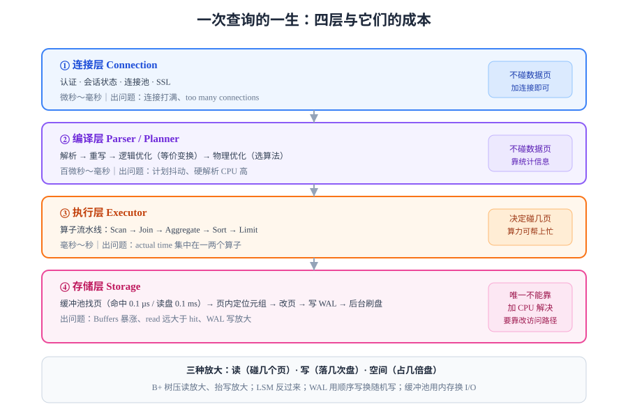

# 概述：一次查询的一生与三种放大

把一次 `select` 拆成四层来看，你会得到一张能解释 90% 性能问题的地图：**连接层 → 编译层（解析 / 重写 / 计划）→ 执行层（算子流水线）→ 存储层（页 / 缓冲池 / 索引 / 日志）**。前两层的工作量以微秒计，后两层以毫秒计；而真正决定「快还是慢」的，是存储层里**每个算子要碰几个页**。



## 判据族声明

本页判据族 `DBI-A` ~ `DBI-H`，共 8 条。定义表在第七节。

## 一、四层分工：谁在花钱

| 层 | 干什么 | 典型耗时 | 出问题的表现 |
| --- | --- | --- | --- |
| **连接层** | 认证、会话状态、SSL、连接池 | 微秒～毫秒 | 连接数打满、`too many connections` |
| **编译层** | 解析 SQL → 语法树 → 重写 → 生成执行计划 | 百微秒～毫秒 | 计划抖动、硬解析 CPU 高 |
| **执行层** | 按计划跑算子：扫描、连接、聚合、排序 | 毫秒～秒 | `actual time` 集中在一两个算子 |
| **存储层** | 把页读进缓冲池、改页、写 WAL、刷盘 | 微秒（命中）～毫秒（磁盘） | `Buffers` 暴涨、`read` 远大于 `hit` |

关键认识：**前三层都能靠加 CPU 解决，只有第四层不行。** 因为存储层的瓶颈是「页搬动的次数」，而页搬动次数由**访问路径与数据布局**决定，不由算力决定。

::: tip 一句话判断
一条查询慢，先看 `Buffers`（碰了多少页），再看 `actual time`（花了多久）。**页数多、时间短**说明是 CPU 密集（加核有用）；**页数少、时间长**说明是 I/O 或锁等待（加核没用）。
:::

## 二、三种放大：存储层的通用货币

任何一种存储引擎，都在同时优化三个指标，而它们**不可能同时最优**：

| 放大类型 | 定义 | 公式 | 谁把它抬高 |
| --- | --- | --- | --- |
| **读放大**（read amplification） | 读一行实际碰了几个页 / 几个文件 | `读放大 = 实际读取页数 ÷ 逻辑需要页数` | B+ 树的分裂碎片、LSM 的层数 |
| **写放大**（write amplification） | 落盘字节数 ÷ 用户写入字节数 | `写放大 = 落盘字节 ÷ 逻辑字节` | WAL（一份数据写两处）、LSM 的 compaction、InnoDB 的 doublewrite |
| **空间放大**（space amplification） | 占用磁盘 ÷ 逻辑数据大小 | `空间放大 = 磁盘占用 ÷ 数据字节` | 死元组、墓碑、多版本（MVCC） |

三条曲线是**联动**的：B+ 树把读放大压到 3 层，代价是随机写和页分裂（写放大、空间放大上升）；LSM 把写变成纯顺序追加（写放大低、写吞吐高），代价是读要跨多层（读放大上升）。**没有免费的午餐，只有「你的负载更像哪一种」。**

### 本机实测：B+ 树的三种放大

在 PostgreSQL 18.6、`shared_buffers=128MB`、100 万行、每行约 180 字节的表上实测：

```sql
-- 表 174 MB / 22223 页；索引 30 MB / 3853 页；表 + 索引 + TOAST 合计 225 MB
select pg_size_pretty(pg_relation_size('events')) as heap,
       pg_size_pretty(pg_relation_size('idx_events_tenant_created')) as idx,
       pg_size_pretty(pg_total_relation_size('events')) as total;
```

| 指标 | 读数 | 怎么算出来的 |
| --- | --- | --- |
| 每页放多少行 | **45 行/页** | 22223 页 ÷ 1,000,000 行 ⇒ 每行 8192 ÷ 45 ≈ 182 字节 |
| 索引占表体积 | **17%** | 30 MB ÷ 174 MB |
| 树高 | **3 层** | `bt_metap()` 的 `level = 2`（层号从 0 起） |
| 一次等值查询的读放大 | **3 页**（根 + 中间 + 叶） | 树高决定，与表大小无关 |

**这三行数字就是 B+ 树存在的全部理由**：一亿行时树高通常还是 3～4 层，读放大几乎不随数据量增长。

### 本机实测：WAL 的写放大

同样在 PG 18.6 上，插入 10 万行（每行 100 字节负载）：

```sql
select pg_current_wal_lsn() as lsn_before \gset
insert into wal_lab (v) select repeat('y', 100) from generate_series(1, 100000);
select pg_current_wal_lsn() as lsn_after \gset
select pg_size_pretty(pg_wal_lsn_diff(:'lsn_after', :'lsn_before')) as wal;
```

**实测读数**：WAL 增长 **23 MB**，折合 **238 字节/行**，而用户数据只有约 100 字节/行——**写放大约 2.3 倍**。

这不是浪费，而是「提交即持久」的价格：**每一行数据至少写两处**（WAL 一处顺序写、数据页一处随机写），用一次顺序写把随机写推迟到后台。

## 三、一次 `insert` 的完整路径

```text
① 解析 → ② 生成计划 → ③ 找空闲页（FSM）→ ④ 在缓冲池里改页（脏页）
                                                    ↓
                        ⑤ 写 WAL 记录（顺序追加，fsync 后才算提交）
                                                    ↓
                        ⑥ 后台把脏页刷回磁盘（checkpoint，可以晚、可以合并）
```

第 ⑤ 步是**提交点**：`commit` 返回时，WAL 已经落盘，而数据页可能还在内存里。这个顺序（**write-ahead**）就是「日志先行」的全部含义——先写日志、后写数据，任何时刻崩溃都能靠日志补齐。

::: danger 顺序不能反
如果把「改页」放在「写 WAL」之前，掉电后磁盘上的页可能是**改了一半**的状态，而日志里没有这次改动的记录——这份数据既回不去也补不上，只能判为损坏。

正确顺序只有一种：**WAL 先落盘（`fsync`），页后落盘（可延迟）**。PostgreSQL 的 `full_page_writes`、InnoDB 的 `doublewrite buffer` 都是在为「页写了一半」这个物理现实兜底。
:::

## 四、一次 `select` 的完整路径

```text
① 计划给出访问路径（Seq Scan / Index Scan / Bitmap Heap Scan）
② 存储层按路径取页：先在缓冲池找，找不到从磁盘读一个 8KB 页
③ 页内按行指针（line pointer）定位元组，做可见性判断（MVCC）
④ 元组返回执行层，算子继续算：过滤、连接、聚合、排序
```

第 ③ 步的「可见性判断」常被忽略：**索引里命中的行，不一定是你能看见的行**。PostgreSQL 的 `Heap Fetches` 就是在数这件事——索引里找到 100 条，可能要去堆里看 100 次才知道哪几条对你可见。

## 五、什么时候该换引擎：三条判据

| 判据 | B+ 树（行存 OLTP） | LSM（写优化） | 列存（OLAP） |
| --- | --- | --- | --- |
| 读写比 | 读多写少，或读写均衡 | **写远多于读**（日志、时序、消息） | 几乎只读、批量导入 |
| 单次访问粒度 | 按主键 / 少量行 | 按 key 点查、按前缀扫 | 大范围扫描 + 聚合 |
| 更新模式 | 频繁原地更新 | **追加为主**，少更新 | 基本不改，整批重写 |

三条都偏左就选 B+ 树（PostgreSQL、MySQL）；偏中间选 LSM（RocksDB、Cassandra、HBase）；偏右选列存（ClickHouse、Doris）。**混着选不是错，但要清楚自己在为哪种放大付钱。**

::: warning 别用「哪个快」来选引擎
「XX 比 YY 快 3 倍」这种结论几乎都来自**某一类负载**。换个负载结论就反了。真正可迁移的判断只有一句：**你的负载把哪一种放大推到了极限，就选那个把它压下去的结构。**
:::

## 六、本页四个必须记住的数字

这四个数字后面每一页都会反复用到，先记住：

| 数字 | 含义 | 为什么重要 |
| --- | --- | --- |
| **8 KB** | PG 一页的大小（InnoDB 16 KB） | 所有 I/O 的最小单位；「读一行」实际是「读 8 KB」 |
| **3 层** | 百万行表的 B+ 树高度 | 一次等值查询 = 3 次页访问，与表大小几乎无关 |
| **2.3×** | 本机实测的 WAL 写放大 | 写吞吐上限 ≈ 磁盘顺序写带宽 ÷ 2.3 |
| **45 行/页** | 本机 180 字节行宽下的密度 | 行越宽，一页放得越少，同样的行数要更多页 |

## 七、判据表

| 编号 | 约定 | 定错了会怎样 | 怎么验证没被破坏 |
| --- | --- | --- | --- |
| `DBI-A` | 判断慢查询时必须同时给出「页数」与「耗时」两个读数，缺一不可 | 只看耗时会把 CPU 问题误判成 I/O 问题，反之亦然 | 每条慢查询记录里 `Buffers` 与 `actual time` 两列都非空 |
| `DBI-B` | 任何「优化」结论必须写明它降低了哪种放大（读 / 写 / 空间） | 说不清就是在赌，换个负载就会反噬 | 优化记录里每项都标注「降低 X 放大，代价是 Y」 |
| `DBI-C` | 必须知道自己的页大小与每页大致行数 | 行宽估算错会导致容量规划差一倍以上 | `show block_size` 与实际 `relpages/reltuples` 都记录在案 |
| `DBI-D` | 写路径必须满足「WAL 先于数据页落盘」 | 掉电后出现无法判定的半写页 | 崩溃测试：`kill -9` 后重启能自动恢复且数据不丢 |
| `DBI-E` | 必须能给出当前表与索引的体积占比 | 索引比表还大时，写放大已经失控 | `pg_relation_size` 分别取表与索引，比例写进容量文档 |
| `DBI-F` | 选型结论必须绑定负载画像（读写比、访问粒度、更新模式） | 「XX 更快」这类结论换个负载就反了 | 选型文档里有三行负载画像与对应的三项判据 |
| `DBI-G` | 不得把 WAL 当「可清理的日志」对待 | 删 WAL = 删数据，且备份链断裂 | 备份脚本里没有任何针对 `pg_wal` 的 `rm` |
| `DBI-H` | 每一条性能结论都必须能在本机用一条命令复现 | 无法复现的结论无法被证伪，也无法被继承 | 结论旁附命令与预期读数，他人照跑能得到同量级结果 |

## 如何验证

以下三条命令在任意 PostgreSQL 18 上都能跑，且能验证本页三个核心结论：

```sql
-- ① 页大小与每页行数：证明「一次读一行」其实是「读一页」
show block_size;
select relname, relpages, reltuples,
       round(reltuples / nullif(relpages, 0), 1) as rows_per_page
from pg_class where relname = 'events';

-- ② 三种放大里的「读放大」：一次等值查询碰了几个页
explain (analyze, buffers, costs off)
select count(*) from events where tenant_id = 7;

-- ③ 写放大：一批写入产生了多少 WAL
select pg_current_wal_lsn();
```

**预期输出**：① `8192`，`rows_per_page` 约 **45**（行宽 180 字节时）；② `Buffers: shared hit≈81`——约 80 个页，远小于表的 22223 页，说明走的是索引而不是全表；③ 记下 LSN，做一批插入后再取一次，差值除以行数应在 **200～250 字节/行**量级。

如果 ② 的 `Buffers` 接近表的 `relpages`，说明计划走了全表扫描——先去看[优化器](../Optimizer/index.md)那一页，而不是先去加内存。

## 参考资料

- [Architecture of a Database System](https://db.cs.berkeley.edu/papers/fntdb07-architecture.pdf)——四层划分与「一次查询的一生」的经典描述
- [PostgreSQL 18 · Database Page Layout](https://www.postgresql.org/docs/18/storage-page-layout.html)——页头、行指针、元组的字节级布局
- [PostgreSQL 18 · Write-Ahead Logging](https://www.postgresql.org/docs/18/wal-intro.html)——WAL 的官方入门与 `fsync` 语义
- [MySQL 8.4 · InnoDB Architecture](https://dev.mysql.com/doc/refman/8.4/en/innodb-architecture.html)——缓冲池、doublewrite、change buffer 的整体图
- [The Log-Structured Merge-Tree](https://www.cs.umb.edu/~poneil/lsmtree.pdf)——三种放大的原始论述
